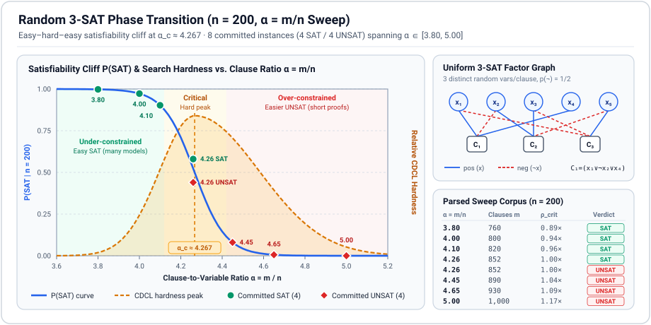

# Critical & Off-Threshold Phase-Transition Random 3-SAT (`random-3sat-phase-transition`)

*Figure: Empirical $P(\mathrm{SAT})$ cliff and CDCL hardness peak around $\alpha_c \approx 4.267$ with all 8 committed $n=200$ sweep instances ($\alpha \in [3.80, 5.00]$, 4 SAT / 4 UNSAT) overlaid alongside a uniform 3-SAT factor graph. Regenerated via [`src/gen_diagram.py`](src/gen_diagram.py).*

## Provenance & Credit

- **Author:** Luke Hutchison ([`lukehutch`](https://github.com/lukehutch))
- **License:** MIT License ([`../LICENSE`](../LICENSE))
- **Recommended by:** [`@jasonslenderman`](https://twitter.com/jasonslenderman) and [`@tingan87`](https://twitter.com/tingan87) (Twitter/X)

## Problem Description

Uniform random 3-SAT formulas ($n = 200$ variables; clauses of 3 distinct uniformly random variables with independent uniform polarities) sampled across the classic **easy–hard–easy satisfiability phase transition** around the critical clause-to-variable ratio $\alpha_c = m / n \approx 4.26$:

- **Under-constrained (SAT side, below threshold):** $\alpha \in \{3.80, 4.00, 4.10\}$ ($m \in \{760, 800, 820\}$, 3 SAT instances)
- **Critical phase transition:** $\alpha = 4.26$ ($m = 852$, 1 SAT + 1 UNSAT instance — also included in the Unified 50-Benchmark Gauntlet)
- **Over-constrained (UNSAT side, above threshold):** $\alpha \in \{4.45, 4.65, 5.00\}$ ($m \in \{890, 930, 1{,}000\}$, 3 UNSAT instances)

These 8 instances (**4 SAT / 4 UNSAT**) provide a pure unstructured baseline with zero gate, parity, cardinality, or symmetry structure on both flanks and at the peak of the phase transition.

- **Origin:** **Original** generator (MIT [`../LICENSE`](../LICENSE)), sampling the canonical uniform random 3-SAT phase-transition ensemble (Mitchell, Selman, & Levesque, AAAI 1992; Crawford & Auton, [AIJ 1996](https://doi.org/10.1016/0004-3702(95)00046-1)).
- **Why they are important:** They trace raw solver search and local-search behavior across the under-constrained SAT shoulder, the critical threshold peak, and the over-constrained UNSAT slope where structural preprocessing yields no simplification.

### Related Critical Phase-Transition Random 3-SAT Benchmarks in This Repo

Following [`@jasonslenderman`](https://twitter.com/jasonslenderman)'s recommendation to evaluate sampled SATLIB random UNSAT/SAT 3-SAT instances around the critical threshold (such as `uuf250-1065`), companion critical-threshold random 3-SAT corpora are also committed directly in this repository (in all four formats: `.cnf.xz`, `.aig.xz`, `.xcnf.xz`, and `.anf.xz`):

- **SATLIB Uniform Random 3-SAT ([`../satlib-rnd3sat/`](../satlib-rnd3sat/README.md), [UBC SATLIB RND3SAT](https://www.cs.ubc.ca/~hoos/SATLIB/Benchmarks/SAT/RND3SAT/descr.html)):**
  - **`uuf250-1065` / `uf250-1065`** ($n = 250, m = 1{,}065, \alpha = 4.26, \rho_{\mathrm{crit}} = 1.00\times$): [`uuf250-01.cnf.xz`](../satlib-rnd3sat/cnf-orig/uuf250-01.cnf.xz) (UNSAT) & [`uf250-01.cnf.xz`](../satlib-rnd3sat/cnf-orig/uf250-01.cnf.xz) (SAT), plus full 100-instance UBC archives ([`uuf250-1065.tar.gz`](https://www.cs.ubc.ca/~hoos/SATLIB/Benchmarks/SAT/RND3SAT/uuf250-1065.tar.gz), [`uf250-1065.tar.gz`](https://www.cs.ubc.ca/~hoos/SATLIB/Benchmarks/SAT/RND3SAT/uf250-1065.tar.gz)).
  - **`uuf200-860` / `uf200-860` & `uuf225-960`** ($n = 200\text{--}225, \alpha \approx 4.27\text{--}4.30$): [`uuf200-01.cnf.xz`](../satlib-rnd3sat/cnf-orig/uuf200-01.cnf.xz) (UNSAT) & [`uf200-01.cnf.xz`](../satlib-rnd3sat/cnf-orig/uf200-01.cnf.xz) (SAT), plus [`uuf225-960.tar.gz`](https://www.cs.ubc.ca/~hoos/SATLIB/Benchmarks/SAT/RND3SAT/uuf225-960.tar.gz) and [`uuf200-860.tar.gz`](https://www.cs.ubc.ca/~hoos/SATLIB/Benchmarks/SAT/RND3SAT/uuf200-860.tar.gz).
  - **`uuf150-645`, `uuf100-430`, `uuf50-218`** (and SAT `uf*` counterparts): committed in [`../satlib-rnd3sat/`](../satlib-rnd3sat/README.md), with all 19 official SATLIB RND3SAT archive URLs listed in [`../satlib-archive-uris/satlib_all_97_archives.uri`](../satlib-archive-uris/satlib_all_97_archives.uri).
- **SATLIB Large Random 3-SAT ([`../satlib-dimacs-lran/`](../satlib-dimacs-lran/README.md)):** `f600`, `f1000`, `f2000` ($n \in \{600, 1{,}000, 2{,}000\}, \alpha = 4.25, \rho_{\mathrm{crit}} = 1.00\times$).
- **SAT Shortcut Challenge Tier 3 ([`../sat-shortcut-challenge-tier3/`](../sat-shortcut-challenge-tier3/README.md)):** 25 uniform random 3-SAT instances scaling across $n \in \{300, 350, 400, 450, 500\}$ at $\alpha = 4.26$ ($\rho_{\mathrm{crit}} = 1.00\times$).

## Corpus & Data Sizes

### Directory Layout & Regeneration

- `cnf-orig/` — Original native **DIMACS CNF** formulas (8 `.cnf.xz` files, `35.2 KB`, 4 SAT / 4 UNSAT).
- `aig-converted/` — Exact logically equivalent **Binary AIGER 1.9 `.aig.xz`** conversions (`42.5 KB`, all 8/8 verified with [Berkeley ABC](https://github.com/berkeley-abc/abc)).
- `xcnf-converted/` — Exact **[CryptoMiniSat](https://github.com/msoos/cryptominisat) `.xcnf.xz`** conversions (`35.7 KB`).
- `anf-converted/` — Lossless degree-3 **DIMACS-ANF `.anf.xz`** conversions (`63.4 KB`, generated via [`../src/to_anf.py`](../src/to_anf.py)).
- **[`expected.tsv`](expected.tsv)** — Ground-truth verdict manifest for all 8 instances (**4 SAT / 4 UNSAT**).
- `src/gen_rand3sat.py` — Standalone zero-dependency Python 3 generator (`python3 src/gen_rand3sat.py`), alongside `src/cnf2aig.py` and `src/cnf2xcnf.py`.

### Problem Parameters & Data Sizes

| Instance | Regime | Vars $n$ | Clauses $m$ | Ratio $m/n$ | Seed | Ans | `.cnf.xz` | AIG ANDs | `.aig.xz` | `.anf.xz` |
|---|---|---:|---:|---:|---:|:---:|---:|---:|---:|---:|
| `rand3sat_n200_r380_sat` | Under-constrained | 200 | 760 | 3.80 | `203800` | SAT | 3.9 KB | 2,274 | 4.8 KB | 7.0 KB |
| `rand3sat_n200_r400_sat` | Under-constrained | 200 | 800 | 4.00 | `204000` | SAT | 4.1 KB | 2,393 | 5.0 KB | 7.3 KB |
| `rand3sat_n200_r410_sat` | Near-threshold SAT | 200 | 820 | 4.10 | `204100` | SAT | 4.2 KB | 2,452 | 5.1 KB | 7.6 KB |
| `rand3sat_n200_sat` | Critical threshold | 200 | 852 | 4.26 | `200000` | SAT | 4.3 KB | 2,549 | 5.3 KB | 7.8 KB |
| `rand3sat_n200_unsat` | Critical threshold | 200 | 852 | 4.26 | `200005` | UNSAT | 4.3 KB | 2,549 | 5.2 KB | 7.8 KB |
| `rand3sat_n200_r445_unsat` | Near-threshold UNSAT | 200 | 890 | 4.45 | `204450` | UNSAT | 4.5 KB | 2,661 | 5.5 KB | 8.2 KB |
| `rand3sat_n200_r465_unsat` | Over-constrained | 200 | 930 | 4.65 | `204650` | UNSAT | 4.7 KB | 2,785 | 5.3 KB | 8.5 KB |
| `rand3sat_n200_r500_unsat` | Over-constrained | 200 | 1,000 | 5.00 | `205000` | UNSAT | 5.1 KB | 2,990 | 6.2 KB | 9.1 KB |

## Benchmark Results

- **Timeout:** $T_{\max} = 60\;\text{s}$ per instance.
- **Same machine?** **Yes** — all six solver configurations were run sequentially on the exact same **AMD Ryzen 9 5950X** Linux workstation (1 core per run, default single-thread flags with `-t 1` for CryptoMiniSat 5.18.0 and `--max-cores 1` for Frobenius, exact median of 3 runs; 0 verdict disagreements; all 4/4 SAT assignments independently verified clause-by-clause).

| Instance ($m/n$) | Ans | Frobenius 1C | [CaDiCaL](https://github.com/arminbiere/cadical) 3.1.0 | [CryptoMiniSat](https://github.com/msoos/cryptominisat) 5.18.0 (CNF) | [CryptoMiniSat](https://github.com/msoos/cryptominisat) 5.18.0 (XCNF) | [dense-solver](https://github.com/libdense/dense-solver) 0.0.4 | [Kissat](https://github.com/arminbiere/kissat) 4.0.4 |
|---|:---:|---:|---:|---:|---:|---:|---:|
| `rand3sat_n200_r380_sat` (3.80) | SAT | **0.76 ms** | 4.01 ms | 30.82 ms | 28.57 ms | 10.66 ms | 22.15 ms |
| `rand3sat_n200_r400_sat` (4.00) | SAT | **0.73 ms** | 21.35 ms | 30.81 ms | 32.51 ms | 4.67 ms | 25.32 ms |
| `rand3sat_n200_r410_sat` (4.10) | SAT | **1.18 ms** | 245.96 ms | 114.58 ms | 111.14 ms | 7.47 ms | 137.37 ms |
| `rand3sat_n200_sat` (4.26) | SAT | **0.74 ms** | 55.98 ms | 36.20 ms | 37.56 ms | 28.04 ms | 37.57 ms |
| `rand3sat_n200_unsat` (4.26) | UNSAT | **96.89 ms** | 334.04 ms | 508.83 ms | 515.00 ms | 200.24 ms | 341.01 ms |
| `rand3sat_n200_r445_unsat` (4.45) | UNSAT | **82.37 ms** | 241.13 ms | 228.32 ms | 241.28 ms | 114.02 ms | 278.28 ms |
| `rand3sat_n200_r465_unsat` (4.65) | UNSAT | **53.82 ms** | 218.58 ms | 227.29 ms | 222.57 ms | 99.04 ms | 203.30 ms |
| `rand3sat_n200_r500_unsat` (5.00) | UNSAT | **11.82 ms** | 45.88 ms | 81.35 ms | 81.24 ms | 18.71 ms | 67.91 ms |
| **TOTAL (8 instances, 8/8 solved)** | **4 / 4** | **248.31 ms** *(fastest)* | 1,166.94 ms *(4.70x slower)* | 1,258.22 ms *(5.07x slower)* | 1,269.88 ms *(5.11x slower)* | 482.86 ms *(1.94x slower)* | 1,112.90 ms *(4.48x slower)* |

*(Across a broader 10-seed $n = 200, m = 852$ cohort [7 SAT / 3 UNSAT], Frobenius achieved median `115.68 ms` / mean `274.43 ms` vs. [Kissat](https://github.com/arminbiere/kissat) `98.41 / 305.15 ms`, [CaDiCaL](https://github.com/arminbiere/cadical) `318.43 / 402.75 ms`, and [CryptoMiniSat](https://github.com/msoos/cryptominisat) 5.18.0 `303.07 / 534.09 ms`; across 10 seeds at $n = 250, m = 1{,}065$ [3 SAT / 7 UNSAT], Frobenius achieved `8.01 s` median / `7.80 s` mean vs. [Kissat](https://github.com/arminbiere/kissat) `4.50 / 4.46 s`, [CaDiCaL](https://github.com/arminbiere/cadical) `6.69 / 6.50 s`, [CryptoMiniSat](https://github.com/msoos/cryptominisat) 5.18.0 `7.88 / 10.58 s`.)*

<!-- BEGIN_STRUCTURAL_ANALYSIS -->
## Phase-Transition & Structural Analysis

*Auto-generated by [`../src/analyze_benchmarks.py`](../src/analyze_benchmarks.py). Position relative to the critical phase transition is measured by $\rho_{\mathrm{crit}} = \frac{1}{n}\sum_k m_k / \alpha_c(k)$ (exact $\alpha/\alpha_c(k)$ for pure $k$-SAT; effective critical threshold $\alpha_c^{\mathrm{eff}} = \alpha/\rho_{\mathrm{crit}}$; `Under` $<0.90\times$, `Near-crit` $0.90\text{--}1.10\times$, `Over` $>1.10\times$), alongside Gent–Walsh annealed constrainedness $\kappa = -\frac{1}{n}\sum_i \log_2(1-2^{-k_i})$ (AAAI 1996), clause-length profile ($\bar{k}$, `%Bin`, `%Horn`), variable-degree CV ($\sigma_d/\bar{d}$, uniformity vs. hub skew), and extracted native XOR parity clauses.*

| Instance | Active $n$ | Clauses $m$ | $\alpha=m/n$ | $\alpha_c^{\mathrm{eff}}$ | $\rho_{\mathrm{crit}}$ (Regime) | $\kappa$ | $\bar{k}$ ($k_{\max}$) | Bin% | Horn% | Pos% | Deg CV | XORs |
|---|---:|---:|---:|---:|---:|---:|---:|---:|---:|---:|---:|---:|
| `rand3sat_n200_r380_sat` | 200 | 760 | 3.80 | 4.27 | **0.89x** (Under) | 0.73 | 3.00 (3) | 0% | 50% | 49% | 0.29 | 0 |
| `rand3sat_n200_r400_sat` | 200 | 800 | 4.00 | 4.27 | **0.94x** (Near-crit) | 0.77 | 3.00 (3) | 0% | 53% | 48% | 0.28 | 0 |
| `rand3sat_n200_r410_sat` | 200 | 820 | 4.10 | 4.27 | **0.96x** (Near-crit) | 0.79 | 3.00 (3) | 0% | 50% | 50% | 0.27 | 0 |
| `rand3sat_n200_r445_unsat` | 200 | 890 | 4.45 | 4.27 | **1.04x** (Near-crit) | 0.86 | 3.00 (3) | 0% | 50% | 50% | 0.27 | 0 |
| `rand3sat_n200_r465_unsat` | 200 | 930 | 4.65 | 4.27 | **1.09x** (Near-crit) | 0.90 | 3.00 (3) | 0% | 51% | 50% | 0.25 | 0 |
| `rand3sat_n200_r500_unsat` | 200 | 1,000 | 5.00 | 4.27 | **1.17x** (Over) | 0.96 | 3.00 (3) | 0% | 51% | 50% | 0.28 | 0 |
| `rand3sat_n200_sat` | 200 | 852 | 4.26 | 4.27 | **1.00x** (Near-crit) | 0.82 | 3.00 (3) | 0% | 52% | 49% | 0.28 | 0 |
| `rand3sat_n200_unsat` | 200 | 852 | 4.26 | 4.27 | **1.00x** (Near-crit) | 0.82 | 3.00 (3) | 0% | 52% | 49% | 0.29 | 0 |

**Collection Phase-Transition Summary (8 instances, 4 formats: 8 CNF / 8 AIG / 8 XCNF / 8 ANF):** median $\rho_{\mathrm{crit}} = 1.00\times$ (range `0.89x–1.17x`), median $\kappa = 0.82$, regime split **1 Under / 6 Near-critical / 1 Over**, total extracted native XOR parity clauses = **0**, total ANF equations = **6,904**.
<!-- END_STRUCTURAL_ANALYSIS -->

## References

- D. Mitchell, B. Selman, and H. Levesque, *Hard and Easy Distributions of SAT Problems*, AAAI 1992.
- J. M. Crawford and L. D. Auton, *Experimental Results on the Crossover Point in Random 3-SAT*, Artificial Intelligence 81(1–2):31–57, 1996.
