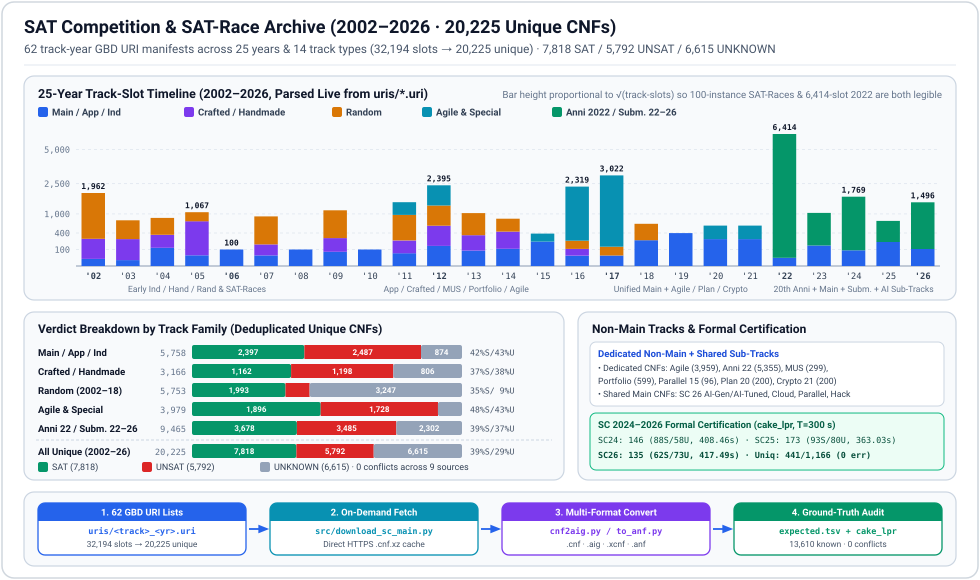

# International SAT Competition & SAT-Race Archive URIs (2002–2026) (`sat-competition-2002-2026-uris`)

*Figure: 25-year SAT Competition & SAT-Race archive timeline (2002–2026, 62 track-year URI manifests, 32,194 track-slots $\to$ 20,225 unique CNFs), deduplicated SAT/UNSAT/UNKNOWN distribution by track family, non-main & SC 2024–2026 `cake_lpr` certification summary, and 4-stage reproducible pipeline. Regenerated live via [`src/gen_diagram.py`](src/gen_diagram.py).*

## Provenance & Credit

- **Curators & Maintainers:** International SAT Competition Organizers ([`satcompetition.github.io`](https://satcompetition.github.io/)) and Global Benchmark Database (GBD, Markus Iser & Carsten Sinz, [`benchmark-database.de`](https://benchmark-database.de/))
- **Upstream Repositories:** [`Udopia/gbd`](https://github.com/Udopia/gbd) & official International SAT Competition / SAT-Race archives (2002–2026)
- **License:** **CC-BY-4.0** — see [`LICENSE`](LICENSE).

## Problem Description

Complete official benchmark URI manifests, ground-truth verdict registry, and reproducible download/conversion/evaluation harness covering **all 25 consecutive years (2002–2026)** and **all 62 official DIMACS CNF tracks** of the **[International SAT Competitions](https://satcompetition.github.io/)** (2002–2005, 2007, 2009, 2011, 2013–2014, 2016–2018, 2020–2026), **SAT-Races** (2006, 2008, 2010, 2015, 2019), and **SAT Challenge 2012**, indexed via the **[Global Benchmark Database (GBD)](https://benchmark-database.de/)** ([`Udopia/gbd`](https://github.com/Udopia/gbd); upstream benchmark license: **CC-BY-4.0**, see [`LICENSE`](LICENSE)).

Across all 62 track-year manifests in [`uris/`](uris/), this archive spans **32,194 track-year URI slots** that deduplicate to **20,225 unique GBD `.cnf.xz` instances** (`7,818 SAT / 5,792 UNSAT / 6,615 UNKNOWN` in [`expected.tsv`](expected.tsv), i.e. **13,610 known verdicts** with **0 SAT/UNSAT disagreements** across GBD `meta.db`, official SC 2023/2024/2026 competition CSVs, and formally certified runs). Because the full upstream archive exceeds Git repository limits by orders of magnitude, this collection stores immutable HTTPS GBD URI lists (`https://benchmark-database.de/file/<gbd_hash>`) alongside on-demand fetchers and exact converters into `.aig` (`src/cnf2aig.py`) and `.anf` ([`../src/to_anf.py`](../src/to_anf.py)).

### Non-Main Tracks & Shared-Benchmark Sub-Tracks (Including SC 2026 AI Sub-Tracks)

Every official SAT Competition and SAT-Race DIMACS CNF track with a dedicated benchmark set in GBD is included directly in [`uris/`](uris/):

- **Dedicated Non-Main CNF Tracks (37 manifests):** `random_2002`–`random_2018` (13 years, 5,753 CNFs), `crafted_2005`–`crafted_2016` (8 years, 2,857 slots), `handmade_2002`–`handmade_2004` (3 years, 1,122 slots), `agile_2016`–`agile_2017` (3,959 slots, short-timeout CDCL agility), `anni_2022` (5,355 CNFs, 20th Anniversary historical union), `submissions_2022`–`submissions_2026` (4,110 CNFs, complete yearly benchmark submission pools including unselected formulas), `portfolio_2012` (599 CNFs, SAT Challenge 2012), `mus_2011` (299 UNSAT CNFs, Minimum Unsatisfiable Subsets), `planning_2020` (200 CNFs, classical & HTN automated planning), `crypto_2021` (200 CNFs, cryptographic encodings), and `parallel_2015` (96 CNFs, SAT-Race 2015 Parallel track).
- **SC 2026 AI-Generated & AI-Tuned Sub-Tracks (`[main-ai]`, `[exp-ai]`):** As documented on the official [SAT Competition 2026 Tracks page](https://satcompetition.github.io/2026/tracks.html) and confirmed in `sc2026_scores.csv` and the SC 2026 slides, the AI-Generated and AI-Tuned awards are **solver-eligibility subcategories within the Main, Experimental, Parallel, and Cloud tracks** — they evaluate on the **exact same 400 Main Track instances** in [`uris/main_2026.uri`](uris/main_2026.uri) (not a separate benchmark URI list). SAT Competition 2025 likewise consisted solely of the Main Track (with No-Limits sub-evaluation) and Parallel Track on [`uris/main_2025.uri`](uris/main_2025.uri).
- **Parallel, Cloud, Hack, Experimental & No-Limits Tracks (2016–2026):** From 2016 onward (outside `parallel_2015`), the Parallel, Cloud, Hack (Glucose/CaDiCaL), Experimental, and No-Limits tracks all evaluate on the corresponding year's Main Track benchmark manifest (`uris/main_<year>.uri`, with No-Limits scored on the new-submission subset).
- **Incremental Library Tracks (2015–2021):** The Incremental tracks distribute interactive C/C++ IPASIR application drivers and assumption-sequence suites as `.tar.xz` archives (e.g., [SC 2020 Downloads](https://satcompetition.github.io/2020/downloads.html), [SC 2021 Downloads](https://satcompetition.github.io/2021/downloads.html)) rather than static single-query DIMACS `.cnf` instances, so they are outside static CNF GBD manifests.
- **Historical Main Track Lineage (2002–2026):** The core sequential benchmark track spans all 25 consecutive years via `industrial_2002`–`industrial_2007` (5 years), `application_2009`–`application_2016` (6 years), and `main_2006`–`main_2026` (14 years) = **25 manifests, 7,644 slots, 5,758 unique CNFs**. The recent **4-year SC 2023–2026 Main Track slice** (`main_2023.uri`–`main_2026.uri`) contains **1,600 year-slots $\to$ 1,548 unique CNFs** (**674 SAT / 755 UNSAT / 119 UNKNOWN**, 92.3% known ground truth).

## Corpus & Data Sizes

### Directory Layout & Usage

- [`uris/`](uris/) — **62 immutable GBD HTTPS URI manifests** (`<track>_<year>.uri`) spanning 2002–2026 across 14 track categories (`main`, `application`, `industrial`, `crafted`, `handmade`, `random`, `agile`, `anni`, `submissions`, `portfolio`, `mus`, `planning`, `crypto`, `parallel`).
- [`expected.tsv`](expected.tsv) — Strict 2-column sorted ground-truth manifest for all **20,225 unique CNFs** (`<hash>.cnf\t<SAT|UNSAT|UNKNOWN>`: **7,818 SAT / 5,792 UNSAT / 6,615 UNKNOWN**), compiled from GBD `meta.db` (`https://benchmark-database.de/getdatabase/meta_db`), official SC 2023/2024/2026 competition logs, and our formally verified SC 2024–2026 `cake_lpr` runs (**0 conflicts across all 9 merged sources**).
- [`src/download_sc_main.py`](src/download_sc_main.py) — Parallel GBD `.cnf.xz` fetcher into `~/.cache/sc-main-cnfs` (defaults to SC 2023–2026 Main Track `1,548` unique CNFs; pass `--tracks <list>` for any subset or `--all` for all `20,225` unique CNFs).
- [`src/run_sc_main.py`](src/run_sc_main.py) — Parallel 1-core-per-instance evaluator with independent Python model verification and `expected.tsv` cross-checking.
- [`src/analyze_sc_main.py`](src/analyze_sc_main.py) — Head-to-head PAR-2 comparator against official SC 2023 (`results_main_detailed.csv`), SC 2024 (`detailed_main.csv`), and SC 2026 (`sc2026_scores.csv`) published logs.
- [`src/cnf2aig.py`](src/cnf2aig.py) — Exact Binary AIGER 1.9 converter (`python3 src/cnf2aig.py <in.cnf.xz> <out.aig>`).
- [`src/sc23_24_manifest.json`](src/sc23_24_manifest.json) — Exact 32-character GBD hashes and provenance metadata for the 14 curated SC 2023–2024 flat-CNF Gauntlet instances (14/14 covered by `uris/main_2023.uri`–`uris/main_2026.uri`).
- [`src/gen_diagram.py`](src/gen_diagram.py) — Live SVG generator for [`diagram.svg`](diagram.svg).

### Complete Track-Category & 62-Manifest Catalog (2002–2026)

#### Summary by Track Category

| Track Category | Manifests | Years Covered | URI Slots | Unique CNFs | SAT | UNSAT | UNKNOWN | Description |
|---|---:|---|---:|---:|---:|---:|---:|---|
| `main` | 14 | 2006–2026 | 4,540 | 4,090 | 1,740 | 1,799 | 551 | Main Track (SAT-Race 06/08/10/15/19; SC 17–26; shared by Parallel/Cloud/AI) |
| `application` | 6 | 2009–2016 | 2,086 | 1,372 | 515 | 685 | 172 | Application Track (2009–2016 sequential industrial successor) |
| `industrial` | 5 | 2002–2007 | 1,018 | 961 | 391 | 355 | 215 | Industrial Track (2002–2007 sequential industrial predecessor) |
| `crafted` | 8 | 2005–2016 | 2,857 | 2,166 | 842 | 821 | 503 | Crafted / Combinatorial Track |
| `handmade` | 3 | 2002–2004 | 1,122 | 1,048 | 330 | 404 | 314 | Handmade Track (predecessor to Crafted) |
| `random` | 13 | 2002–2018 | 5,753 | 5,753 | 1,993 | 513 | 3,247 | Random $k$-SAT Track |
| `agile` | 2 | 2016–2017 | 3,959 | 2,597 | 1,331 | 1,190 | 76 | Agile Track (rapid-solving SMT/verification stream) |
| `anni` | 1 | 2022 | 5,355 | 5,355 | 2,186 | 2,531 | 638 | 20th-Anniversary Track (2002–2021 historical union) |
| `submissions` | 5 | 2022–2026 | 4,110 | 4,110 | 1,492 | 954 | 1,664 | Complete yearly benchmark submission pools (selected + unselected) |
| `portfolio` | 1 | 2012 | 599 | 599 | 304 | 158 | 137 | SAT Challenge 2012 Portfolio Track |
| `mus` | 1 | 2011 | 299 | 299 | 0 | 299 | 0 | SC 2011 Minimum Unsatisfiable Subsets (MUS) Track (100% UNSAT) |
| `planning` | 1 | 2020 | 200 | 200 | 49 | 41 | 110 | SC 2020 Automated Planning Track (classical & HTN) |
| `crypto` | 1 | 2021 | 200 | 200 | 169 | 13 | 18 | SC 2021 Cryptography Track |
| `parallel` | 1 | 2015 | 96 | 96 | 49 | 33 | 14 | SAT-Race 2015 Dedicated Parallel Track |
| **Total (Deduplicated)** | **62** | **2002–2026** | **32,194** | **20,225** | **7,818** | **5,792** | **6,615** | **11,969 cross-track/cross-year overlap slots deduplicated** |

#### All 62 Track-Year URI Manifests (`uris/*.uri`)

| Year | Event | Manifest File | Track | URIs | SAT | UNSAT | UNKNOWN |
|---:|---|---|---|---:|---:|---:|---:|
| 2002 | SAT 2002 | [`uris/handmade_2002.uri`](uris/handmade_2002.uri) | Handmade | 541 | 191 | 187 | 163 |
| 2002 | SAT 2002 | [`uris/industrial_2002.uri`](uris/industrial_2002.uri) | Industrial | 189 | 64 | 118 | 7 |
| 2002 | SAT 2002 | [`uris/random_2002.uri`](uris/random_2002.uri) | Random | 1,232 | 378 | 159 | 695 |
| 2003 | SAT 2003 | [`uris/handmade_2003.uri`](uris/handmade_2003.uri) | Handmade | 353 | 63 | 198 | 92 |
| 2003 | SAT 2003 | [`uris/industrial_2003.uri`](uris/industrial_2003.uri) | Industrial | 100 | 23 | 38 | 39 |
| 2003 | SAT 2003 | [`uris/random_2003.uri`](uris/random_2003.uri) | Random | 317 | 134 | 8 | 175 |
| 2004 | SAT 2004 | [`uris/handmade_2004.uri`](uris/handmade_2004.uri) | Handmade | 228 | 88 | 39 | 101 |
| 2004 | SAT 2004 | [`uris/industrial_2004.uri`](uris/industrial_2004.uri) | Industrial | 323 | 65 | 109 | 149 |
| 2004 | SAT 2004 | [`uris/random_2004.uri`](uris/random_2004.uri) | Random | 300 | 9 | 0 | 291 |
| 2005 | SAT 2005 | [`uris/crafted_2005.uri`](uris/crafted_2005.uri) | Crafted | 675 | 221 | 225 | 229 |
| 2005 | SAT 2005 | [`uris/industrial_2005.uri`](uris/industrial_2005.uri) | Industrial | 212 | 187 | 14 | 11 |
| 2005 | SAT 2005 | [`uris/random_2005.uri`](uris/random_2005.uri) | Random | 180 | 0 | 0 | 180 |
| 2006 | SAT-Race 2006 | [`uris/main_2006.uri`](uris/main_2006.uri) | Main | 100 | 42 | 56 | 2 |
| 2007 | SAT 2007 | [`uris/crafted_2007.uri`](uris/crafted_2007.uri) | Crafted | 201 | 39 | 107 | 55 |
| 2007 | SAT 2007 | [`uris/industrial_2007.uri`](uris/industrial_2007.uri) | Industrial | 194 | 79 | 100 | 15 |
| 2007 | SAT 2007 | [`uris/random_2007.uri`](uris/random_2007.uri) | Random | 511 | 121 | 118 | 272 |
| 2008 | SAT-Race 2008 | [`uris/main_2008.uri`](uris/main_2008.uri) | Main | 100 | 46 | 53 | 1 |
| 2009 | SAT 2009 | [`uris/application_2009.uri`](uris/application_2009.uri) | Application | 292 | 94 | 156 | 42 |
| 2009 | SAT 2009 | [`uris/crafted_2009.uri`](uris/crafted_2009.uri) | Crafted | 281 | 136 | 88 | 57 |
| 2009 | SAT 2009 | [`uris/random_2009.uri`](uris/random_2009.uri) | Random | 570 | 190 | 19 | 361 |
| 2010 | SAT-Race 2010 | [`uris/main_2010.uri`](uris/main_2010.uri) | Main | 100 | 24 | 68 | 8 |
| 2011 | SAT 2011 | [`uris/application_2011.uri`](uris/application_2011.uri) | Application | 300 | 117 | 152 | 31 |
| 2011 | SAT 2011 | [`uris/crafted_2011.uri`](uris/crafted_2011.uri) | Crafted | 300 | 144 | 84 | 72 |
| 2011 | SAT 2011 | [`uris/mus_2011.uri`](uris/mus_2011.uri) | MUS | 299 | 0 | 299 | 0 |
| 2011 | SAT 2011 | [`uris/random_2011.uri`](uris/random_2011.uri) | Random | 600 | 200 | 60 | 340 |
| 2012 | SAT Challenge 2012 | [`uris/application_2012.uri`](uris/application_2012.uri) | Application | 596 | 263 | 293 | 40 |
| 2012 | SAT Challenge 2012 | [`uris/crafted_2012.uri`](uris/crafted_2012.uri) | Crafted | 600 | 357 | 171 | 72 |
| 2012 | SAT Challenge 2012 | [`uris/portfolio_2012.uri`](uris/portfolio_2012.uri) | Portfolio | 599 | 304 | 158 | 137 |
| 2012 | SAT Challenge 2012 | [`uris/random_2012.uri`](uris/random_2012.uri) | Random | 600 | 96 | 0 | 504 |
| 2013 | SAT 2013 | [`uris/application_2013.uri`](uris/application_2013.uri) | Application | 300 | 150 | 142 | 8 |
| 2013 | SAT 2013 | [`uris/crafted_2013.uri`](uris/crafted_2013.uri) | Crafted | 300 | 150 | 137 | 13 |
| 2013 | SAT 2013 | [`uris/random_2013.uri`](uris/random_2013.uri) | Random | 430 | 280 | 149 | 1 |
| 2014 | SAT 2014 | [`uris/application_2014.uri`](uris/application_2014.uri) | Application | 299 | 129 | 149 | 21 |
| 2014 | SAT 2014 | [`uris/crafted_2014.uri`](uris/crafted_2014.uri) | Crafted | 300 | 122 | 126 | 52 |
| 2014 | SAT 2014 | [`uris/random_2014.uri`](uris/random_2014.uri) | Random | 225 | 0 | 0 | 225 |
| 2015 | SAT-Race 2015 | [`uris/main_2015.uri`](uris/main_2015.uri) | Main | 291 | 154 | 117 | 20 |
| 2015 | SAT-Race 2015 | [`uris/parallel_2015.uri`](uris/parallel_2015.uri) | Parallel | 96 | 49 | 33 | 14 |
| 2016 | SAT 2016 | [`uris/agile_2016.uri`](uris/agile_2016.uri) | Agile | 1,580 | 899 | 676 | 5 |
| 2016 | SAT 2016 | [`uris/application_2016.uri`](uris/application_2016.uri) | Application | 299 | 93 | 136 | 70 |
| 2016 | SAT 2016 | [`uris/crafted_2016.uri`](uris/crafted_2016.uri) | Crafted | 200 | 50 | 118 | 32 |
| 2016 | SAT 2016 | [`uris/random_2016.uri`](uris/random_2016.uri) | Random | 240 | 129 | 0 | 111 |
| 2017 | SAT 2017 | [`uris/agile_2017.uri`](uris/agile_2017.uri) | Agile | 2,379 | 1,206 | 1,097 | 76 |
| 2017 | SAT 2017 | [`uris/main_2017.uri`](uris/main_2017.uri) | Main | 350 | 134 | 140 | 76 |
| 2017 | SAT 2017 | [`uris/random_2017.uri`](uris/random_2017.uri) | Random | 293 | 205 | 0 | 88 |
| 2018 | SAT 2018 | [`uris/main_2018.uri`](uris/main_2018.uri) | Main | 400 | 195 | 135 | 70 |
| 2018 | SAT 2018 | [`uris/random_2018.uri`](uris/random_2018.uri) | Random | 255 | 251 | 0 | 4 |
| 2019 | SAT-Race 2019 | [`uris/main_2019.uri`](uris/main_2019.uri) | Main | 399 | 169 | 128 | 102 |
| 2020 | SAT 2020 | [`uris/main_2020.uri`](uris/main_2020.uri) | Main | 400 | 191 | 145 | 64 |
| 2020 | SAT 2020 | [`uris/planning_2020.uri`](uris/planning_2020.uri) | Planning | 200 | 49 | 41 | 110 |
| 2021 | SAT 2021 | [`uris/crypto_2021.uri`](uris/crypto_2021.uri) | Crypto | 200 | 169 | 13 | 18 |
| 2021 | SAT 2021 | [`uris/main_2021.uri`](uris/main_2021.uri) | Main | 400 | 158 | 187 | 55 |
| 2022 | SAT 2022 | [`uris/anni_2022.uri`](uris/anni_2022.uri) | Anniversary | 5,355 | 2,186 | 2,531 | 638 |
| 2022 | SAT 2022 | [`uris/main_2022.uri`](uris/main_2022.uri) | Main | 400 | 172 | 186 | 42 |
| 2022 | SAT 2022 | [`uris/submissions_2022.uri`](uris/submissions_2022.uri) | Submissions | 659 | 287 | 281 | 91 |
| 2023 | SAT 2023 | [`uris/main_2023.uri`](uris/main_2023.uri) | Main | 400 | 154 | 219 | 27 |
| 2023 | SAT 2023 | [`uris/submissions_2023.uri`](uris/submissions_2023.uri) | Submissions | 636 | 145 | 279 | 212 |
| 2024 | SAT 2024 | [`uris/main_2024.uri`](uris/main_2024.uri) | Main | 400 | 180 | 208 | 12 |
| 2024 | SAT 2024 | [`uris/submissions_2024.uri`](uris/submissions_2024.uri) | Submissions | 1,369 | 863 | 204 | 302 |
| 2025 | SAT 2025 | [`uris/main_2025.uri`](uris/main_2025.uri) | Main | 400 | 174 | 184 | 42 |
| 2025 | SAT 2025 | [`uris/submissions_2025.uri`](uris/submissions_2025.uri) | Submissions | 350 | 69 | 97 | 184 |
| 2026 | SAT 2026 | [`uris/main_2026.uri`](uris/main_2026.uri) | Main | 400 | 192 | 169 | 39 |
| 2026 | SAT 2026 | [`uris/submissions_2026.uri`](uris/submissions_2026.uri) | Submissions | 1,096 | 128 | 93 | 875 |

## Benchmark Results

### 3-Year SC 2024–2026 `cake_lpr` Formal Certification Summary ($T = 300\text{ s}$)

- **Hardware & Protocol:** Frobenius 1C (`--max-cores 1 --timeout 300` with UNSAT proof logging enabled) evaluated on an **AMD Ryzen 9 5950X** (16C/32T Linux x86_64, 1 core per instance) across all **1,166 unique Main Track CNFs** of SAT Competitions 2024, 2025, and 2026 (`1,200` year-slots). Every SAT model was independently verified against the raw `.cnf.xz` clauses, and every UNSAT refutation was formally certified by the verified CakeML checker [`cake_lpr`](https://github.com/tanyongkiam/cake_lpr) (`s VERIFIED UNSAT`), including previously official-unknown SC 2024 instance `35789168b67a74985804902008251269` (`tseitingrid6x200`) $\to$ `UNSAT`.

| Main Track Slice | Instances | Solved | SAT (Model-Verified) | UNSAT (`cake_lpr`-Certified) | PAR-2 ($T=300\text{ s}$) | Errors / Unsound |
|---|---:|---:|---:|---:|---:|---:|
| **SC 2024** (`uris/main_2024.uri`) | 400 / 400 | **146** | 88 | 58 | **408.46 s** | 0 |
| **SC 2025** (`uris/main_2025.uri`) | 400 / 400 | **173** | 93 | 80 | **363.03 s** | 0 |
| **SC 2026** (`uris/main_2026.uri`) | 400 / 400 | **135** | 62 | 73 | **417.49 s** | 0 |
| **Combined Deduplicated (SC 2024–2026)** | **1,166** | **441** | **234** | **207** | — | **0** |

### SC 2024–2026 Main Track Timings ($T = 15\text{ s}, 60\text{ s}$)

- **Hardware & Protocol:** Frobenius 1C was run on our local **AMD Ryzen 9 5950X** (16 cores / 32 threads, Linux x86_64), **1 core per instance** (`--max-cores 1 --timeout 60`, unrestricted available RAM, 0 errors, 0 unsoundness, 0 verdict disagreements against official SC 2024 & SC 2026 ground truth). Competitor rows are taken directly from official published competition logs/slides (**StarExec** cluster for SC 2024; **LMU / HoreKa competition sequential clusters** for SC 2025–2026; different CPU hardware affects absolute runtimes, though rankings and PAR-2 magnitudes are comparable within an order of magnitude).

#### SC 2024 Main Track (400 CNFs)

| Metric | Frobenius 1C (ours) | [BreakID-Kissat](https://github.com/meelgroup/breakid) (Main #6) | [CaDiCaL](https://github.com/arminbiere/cadical) (Main #7) | [Kissat_MAB-DC](https://satcompetition.github.io/2024/) (Main #2 Silver) | [kissat-sc2024](https://github.com/arminbiere/kissat) (Main #1 Gold) |
|---|---:|---:|---:|---:|---:|
| **$T = 15\text{ s}$ Solved** | **72 / 400** *(highest)* | 23 / 400 *(-49 worse)* | 26 / 400 *(-46 worse)* | 20 / 400 *(-52 worse)* | 43 / 400 *(-29 worse)* |
| **$T = 15\text{ s}$ PAR-2** | **25.04 s** *(fastest)* | 28.55 s *(1.14x slower)* | 28.24 s *(1.13x slower)* | 28.81 s *(1.15x slower)* | 27.15 s *(1.08x slower)* |
| **$T = 60\text{ s}$ Solved** | **111 / 400** *(highest)* | 50 / 400 *(-61 worse)* | 54 / 400 *(-57 worse)* | 50 / 400 *(-61 worse)* | 81 / 400 *(-30 worse)* |
| **$T = 60\text{ s}$ PAR-2** | **91.02 s** *(fastest)* | 107.75 s *(1.18x slower)* | 106.69 s *(1.17x slower)* | 108.11 s *(1.19x slower)* | 99.47 s *(1.09x slower)* |
| **Official $T = 5{,}000\text{ s}$ Solved** | *n/r* | 284 / 400 *(-22 worse)* | 284 / 400 *(-22 worse)* | 290 / 400 *(-16 worse)* | **306 / 400** *(highest)* |
| **Official PAR-2** | *n/r* | 3,461.77 s *(1.24x slower)* | 3,494.11 s *(1.25x slower)* | 3,435.23 s *(1.23x slower)* | **2,788.13 s** *(fastest)* |

#### SC 2025 Main Track (400 CNFs)

| Metric | Frobenius 1C (ours) | [AE-Kissat-MAB](https://github.com/FSQH-dh/AE_kissat2025_MAB) (Main #1 Gold) | [Kissat-public](https://github.com/arminbiere/kissat) (Main #2 Silver) | [Kissat-VSA](https://satcompetition.github.io/2025/downloads.html) (Main #3 Bronze) |
|---|---:|---:|---:|---:|
| **$T = 15\text{ s}$ Solved** | **95 / 400** | —† | —† | —† |
| **$T = 15\text{ s}$ PAR-2** | **23.51 s** | —† | —† | —† |
| **$T = 60\text{ s}$ Solved** | **141 / 400** | —† | —† | —† |
| **$T = 60\text{ s}$ PAR-2** | **81.92 s** | —† | —† | —† |
| **Official $T = 5{,}000\text{ s}$ Solved** | *n/r* | **327 / 400** *(highest)* | 321 / 400 *(-6 worse)* | 317 / 400 *(-10 worse)* |
| **Official PAR-2** | *n/r* | **2,264.73 s** *(fastest)* | 2,423.38 s *(1.07x slower)* | 2,478.45 s *(1.09x slower)* |

#### SC 2026 Main Track (400 CNFs)

| Metric | Frobenius 1C (ours) | [kissat-biere](https://github.com/arminbiere/kissat) (Main #15) | [kissat-mab-hypre](https://satcompetition.github.io/2026/downloads.html) (Main #3) | [Lymphosat](https://c.mov/lymphosat/) (Main AI #1 Gold) | [satsuma-iter-ae-kissat-mab](https://github.com/markusa4/satsuma) (Main #2) | [satsuma-iter-kissat](https://github.com/markusa4/satsuma) (Main #1 Gold) |
|---|---:|---:|---:|---:|---:|---:|
| **$T = 15\text{ s}$ Solved** | **122 / 400** *(highest)* | 41 / 400 *(-81 worse)* | 63 / 400 *(-59 worse)* | 81 / 400 *(-41 worse)* | 66 / 400 *(-56 worse)* | 70 / 400 *(-52 worse)* |
| **$T = 15\text{ s}$ PAR-2** | **21.37 s** *(fastest)* | 27.38 s *(1.28x slower)* | 25.73 s *(1.20x slower)* | 24.58 s *(1.15x slower)* | 25.37 s *(1.19x slower)* | 25.13 s *(1.18x slower)* |
| **$T = 60\text{ s}$ Solved** | **139 / 400** *(highest)* | 74 / 400 *(-65 worse)* | 102 / 400 *(-37 worse)* | 109 / 400 *(-30 worse)* | 108 / 400 *(-31 worse)* | 112 / 400 *(-27 worse)* |
| **$T = 60\text{ s}$ PAR-2** | **80.24 s** *(fastest)* | 100.38 s *(1.25x slower)* | 92.81 s *(1.16x slower)* | 90.07 s *(1.12x slower)* | 91.58 s *(1.14x slower)* | 90.46 s *(1.13x slower)* |
| **Official $T = 5{,}000\text{ s}$ Solved** | *n/r* | 238 / 400 *(-38 worse)* | 255 / 400 *(-21 worse)* | 251 / 400 *(-25 worse)* | 269 / 400 *(-7 worse)* | **276 / 400** *(highest)* |
| **Official PAR-2** | *n/r* | 4,611.54 s *(1.26x slower)* | 3,996.29 s *(1.10x slower)* | 4,176.90 s *(1.15x slower)* | 3,696.84 s *(1.01x slower)* | **3,647.02 s** *(fastest)* |

† SC 2025 published aggregate 5,000 s slide standings without a per-instance runtime CSV.
*Notable unique wins:* Frobenius solved **12** SC 2024 instances within 60 s where [kissat-sc2024](https://github.com/arminbiere/kissat) timed out past 5,000 s (**26** vs. [CaDiCaL](https://github.com/arminbiere/cadical)), and **18** SC 2026 instances within 60 s where [satsuma-iter-kissat](https://github.com/markusa4/satsuma) timed out past 5,000 s (**41** vs. [Lymphosat](https://c.mov/lymphosat/), **53** vs. [kissat-biere](https://github.com/arminbiere/kissat)).

### Curated 14-Instance SC 2023–2024 Gauntlet Slice (1-Core Flat `.cnf`, $T_{\max} = 5{,}000\text{ s}$)

Fourteen representative cross-domain SAT Competition 2023 & 2024 Main Track formulas spanning 11 industrial, cryptographic, hardware-verification, algebraic, and combinatorial domains (previously maintained as a separate directory; **14/14 = 100%** are indexed in `uris/main_2023.uri`–`uris/main_2026.uri` and [`src/sc23_24_manifest.json`](src/sc23_24_manifest.json)). Twelve form the SAT Competition slice of the unified 50-benchmark flat-CNF gauntlet (`two_trees_511v` and `mp1_nb7t42` are companion instances from the same selection).

#### Instance Metadata & Exact GBD Identifiers (14/14 in `expected.tsv`)

| Instance | Track Year(s) | Family | GBD MD5 Hash (Download) | Ans | CNF Vars | CNF Clauses |
|---|---|---|---|:---:|---:|---:|
| `tseitingrid6x200` | 2024 | SC24-Tseitin | [`35789168b67a74985804902008251269`](https://benchmark-database.de/file/35789168b67a74985804902008251269) | UNSAT | 2,400 | 9,600 |
| `tseitin_d3_n10000` | 2023 | SC23-Tseitin | [`1153a473e1d5dd21ccd33189d594a4aa`](https://benchmark-database.de/file/1153a473e1d5dd21ccd33189d594a4aa) | UNSAT | 15,000 | 40,000 |
| `urq45` | 2024 | SC23-Urquhart | [`aa39c6d885d283a085d033ab7b89f8c8`](https://benchmark-database.de/file/aa39c6d885d283a085d033ab7b89f8c8) | UNSAT | 74 | 694 |
| `two_trees_511v` | 2024 | SC23-Parity | [`16c5482d8e658b54e20d59cfd4b1d588`](https://benchmark-database.de/file/16c5482d8e658b54e20d59cfd4b1d588) | SAT | 511 | 2,039 |
| `two_trees_1023v` | 2024, 2026 | SC23-Parity | [`7db30d12cb06f0dc2f30abff80d96d6a`](https://benchmark-database.de/file/7db30d12cb06f0dc2f30abff80d96d6a) | SAT | 1,023 | 4,088 |
| `intervals122` | 2023 | SC23-Card. | [`18416a9ac0909dce5fa96345f784c87e`](https://benchmark-database.de/file/18416a9ac0909dce5fa96345f784c87e) | UNSAT | 2,568 | 57,706 |
| `clique_n2_k10` | 2024, 2026 | SC24-Clique | [`cb2e8b7fada420c5046f587ea754d052`](https://benchmark-database.de/file/cb2e8b7fada420c5046f587ea754d052) | UNSAT | 180 | 3,160 |
| `gzipfile_close_11` | 2023 | SC23-RegAlloc | [`72b5ad031bf852634bc081f9da9a5a60`](https://benchmark-database.de/file/72b5ad031bf852634bc081f9da9a5a60) | UNSAT | 187 | 1,348 |
| `rand_net70_40_10` | 2023 | SC23-Miter | [`00f2eb377986e7decbc863931680a3b2`](https://benchmark-database.de/file/00f2eb377986e7decbc863931680a3b2) | UNSAT | 5,600 | 16,661 |
| `hwmcc20_iso_rast_p06` | 2024 | SC24-Miter | [`1545660e72158c7e90da5ad4c877a124`](https://benchmark-database.de/file/1545660e72158c7e90da5ad4c877a124) | UNSAT | 85,230 | 276,273 |
| `hwmcc17_iso_bobsmfpu` | 2024 | SC24-Miter | [`0a02751cacf5e1cdfcc842a7f220199f`](https://benchmark-database.de/file/0a02751cacf5e1cdfcc842a7f220199f) | UNSAT | 62,500 | 204,019 |
| `vmpc_24` | 2023 | SC23-Crypto | [`220bb8aa093e502c47afcdac3140d67c`](https://benchmark-database.de/file/220bb8aa093e502c47afcdac3140d67c) | SAT | 576 | 67,872 |
| `si2_b03m_m800_03` | 2024 | SC24-SubIso | [`af750c18578d52e60472315692ad83c0`](https://benchmark-database.de/file/af750c18578d52e60472315692ad83c0) | SAT | 10,862 | 472,588 |
| `mp1_nb7t42` | 2024 | SC24-PolyMul | [`c0293283432a9b15cd743702163f5184`](https://benchmark-database.de/file/c0293283432a9b15cd743702163f5184) | SAT | 52,731 | 208,936 |

#### Flat-CNF Gauntlet Timings (1-Core, Uniform Competition-Standard $T_{\max} = 5{,}000\text{ s}$)

Evaluated sequentially on an **AMD Ryzen 9 5950X** (16C/32T Linux, 1 core/thread per run, default flags with `-t 1` for CryptoMiniSat 5.18.0 and `--max-cores 1` for Frobenius; exact median of 3 runs for solves under $120\text{ s}$; uniform SAT Competition Main Track timeout $T_{\max} = 5{,}000\text{ s}$ with $10{,}000\text{ s}$ PAR-2 penalty across all 12 instances and all 6 solver configurations; all solvers read the identical flat `.cnf` file except the explicit CryptoMiniSat 5.18.0 (XCNF) column; **0 verdict disagreements**, 100% SAT models clause-verified):

| Instance | Frobenius 1C | [CaDiCaL](https://github.com/arminbiere/cadical) 3.1.0 | [CryptoMiniSat](https://github.com/msoos/cryptominisat) 5.18.0 (CNF) | [CryptoMiniSat](https://github.com/msoos/cryptominisat) 5.18.0 (XCNF) | [dense-solver](https://github.com/libdense/dense-solver) 0.0.4 | [Kissat](https://github.com/arminbiere/kissat) 4.0.4 |
|---|---:|---:|---:|---:|---:|---:|
| `tseitingrid6x200` | **3.07 ms** | >5,000 s (T/O) | 645.51 ms | 1,093.37 ms | 4.89 ms | >5,000 s (T/O) |
| `tseitin_d3_n10000` | **7.66 ms** | >5,000 s (T/O) | 511.42 ms | 731.97 ms | 84.03 ms | >5,000 s (T/O) |
| `urq45` | **1.10 ms** | 721,473.32 ms | 50.15 ms | 50.83 ms | 1.41 ms | 222,854.68 ms |
| `two_trees_1023v` | **5.15 ms** | >5,000 s (T/O) | 11,044.46 ms | 18,574.19 ms | >5,000 s (T/O) | >5,000 s (T/O) |
| `intervals122` | 46.97 ms | >5,000 s (T/O) | >5,000 s (T/O) | >5,000 s (T/O) | **19.26 ms** | >5,000 s (T/O) |
| `clique_n2_k10` | **3.33 ms** | 919,269.64 ms | 1,591,286.23 ms | 1,526,088.35 ms | 485,598.35 ms | 8,185.14 ms |
| `gzipfile_close_11` | 1.83 ms | 1,822,822.02 ms | 4,578,003.23 ms | 4,673,159.14 ms | **1.51 ms** | 294.83 ms |
| `rand_net70_40_10` | **5.39 ms** | 417.88 ms | 9,516.11 ms | 8,579.44 ms | 17,432.27 ms | 12.31 ms |
| `hwmcc20_iso_rast_p06` | **75.85 ms** | 1,764.89 ms | >5,000 s (T/O) | >5,000 s (T/O) | >5,000 s (T/O) | 347.68 ms |
| `hwmcc17_iso_bobsmfpu` | **53.54 ms** | 2,755.84 ms | >5,000 s (T/O) | >5,000 s (T/O) | >5,000 s (T/O) | 321.55 ms |
| `vmpc_24` | **1,596.46 ms** | 6,171.80 ms | 1,653.58 ms | 44,855.40 ms | 1,795.47 ms | 12,462.32 ms |
| `si2_b03m_m800_03` | 1,944.36 ms | 5,892.54 ms | 48,671.18 ms | 44,618.32 ms | **651.13 ms** | 6,670.87 ms |
| **Solved (12 instances)** | **12 / 12** *(highest)* | 8 / 12 *(-4 worse)* | 9 / 12 *(-3 worse)* | 9 / 12 *(-3 worse)* | 9 / 12 *(-3 worse)* | 8 / 12 *(-4 worse)* |
| **Total PAR-2** | **3,744.71 ms** *(fastest)* | 43,480,567.93 ms *(11,611x slower)* | 36,241,381.87 ms *(9,678x slower)* | 36,317,751.01 ms *(9,698x slower)* | 30,505,588.32 ms *(8,146x slower)* | 40,251,149.38 ms *(10,749x slower)* |

*(Uniform competition-standard $T_{\max} = 5{,}000\text{ s}$ PAR-2 penalty $= 10{,}000\text{ s} = 10{,}000{,}000\text{ ms}$ per timeout. On flat CNF, CryptoMiniSat 5.18.0's built-in Gauss–Jordan XOR recovery solves `tseitingrid6x200`, `tseitin_d3_n10000`, `urq45`, and `two_trees_1023v`, while Frobenius 1C remains 45.6x–2,145x faster on those four formulas and sweeps 12/12 overall.)*

<!-- BEGIN_STRUCTURAL_ANALYSIS -->
## Phase-Transition & Structural Analysis

*This directory indexes **32,194 immutable GBD URI entries** across **62 track-year manifests** (`20,225` unique CNFs) rather than committing multi-gigabyte upstream archives; run `python3 ../src/analyze_benchmarks.py --file <downloaded.cnf.xz>` on any downloaded instance. Below are the exact phase-transition and structural metrics computed via [`../src/analyze_benchmarks.py`](../src/analyze_benchmarks.py) for the 14 curated SC 2023–2024 Main Track CNFs ($\rho_{\mathrm{crit}} = \frac{1}{n}\sum_k m_k / \alpha_c(k)$, Gent–Walsh annealed constrainedness $\kappa = -\frac{1}{n}\sum_i \log_2(1-2^{-k_i})$, clause-length profile, variable-degree CV, and extracted native XOR parity clauses):*

| Instance | Active $n$ | Clauses $m$ | $\alpha=m/n$ | $\alpha_c^{\mathrm{eff}}$ | $\rho_{\mathrm{crit}}$ (Regime) | $\kappa$ | $\bar{k}$ ($k_{\max}$) | Bin% | Horn% | Pos% | Deg CV | XORs |
|---|---:|---:|---:|---:|---:|---:|---:|---:|---:|---:|---:|---:|
| `clique_n2_k10` | 180 | 3,160 | 17.56 | 1.00 | **17.5x** (Over) | 7.26 | 2.05 (18) | 100% | 100% | 3% | 0.00 | 0 |
| `gzipfile_close_11` | 187 | 1,348 | 7.21 | 1.01 | **7.12x** (Over) | 2.95 | 2.11 (11) | 99% | 99% | 7% | 0.20 | 0 |
| `hwmcc17_iso_bobsmfpu` | 62,500 | 204,019 | 3.26 | 1.79 | **1.82x** (Over) | 0.94 | 2.58 (3) | 42% | 63% | 46% | 3.49 | 9,137 |
| `hwmcc20_iso_rast_p06` | 85,230 | 276,273 | 3.24 | 1.87 | **1.73x** (Over) | 0.91 | 2.61 (3) | 39% | 66% | 46% | 7.27 | 24,647 |
| `intervals122` | 2,568 | 57,706 | 22.47 | 1.00 | **22.4x** (Over) | 9.31 | 2.04 (88) | 100% | 76% | 48% | 0.51 | 0 |
| `mp1_nb7t42` | 52,731 | 208,936 | 3.96 | 1.96 | **2.03x** (Over) | 1.05 | 2.74 (4) | 38% | 63% | 45% | 1.87 | 25,480 |
| `rand_net70_40_10` | 5,600 | 16,661 | 2.98 | 1.36 | **2.19x** (Over) | 1.01 | 2.35 (70) | 66% | 66% | 50% | 0.33 | 70 |
| `si2_b03m_m800_03` | 10,862 | 472,588 | 43.51 | 2.92 | **14.9x** (Over) | 6.22 | 13.29 (20) | 34% | 35% | 55% | 4.80 | 0 |
| `tseitin_d3_n10000` | 15,000 | 40,000 | 2.67 | 4.27 | **0.62x** (Under) | 0.51 | 3.00 (3) | 0% | 50% | 50% | 0.00 | 10,000 |
| `tseitingrid6x200` | 2,400 | 9,600 | 4.00 | 9.93 | **0.40x** (Under) | 0.37 | 4.00 (4) | 0% | 31% | 50% | 0.00 | 1,200 |
| `two_trees_1023v` | 1,023 | 4,088 | 4.00 | 3.77 | **1.06x** (Near-crit) | 0.81 | 2.96 (3) | 4% | 51% | 50% | 0.23 | 857 |
| `two_trees_511v` | 511 | 2,039 | 3.99 | 3.80 | **1.05x** (Near-crit) | 0.80 | 2.96 (3) | 4% | 52% | 50% | 0.24 | 433 |
| `urq45` | 74 | 694 | 9.38 | 25.55 | **0.37x** (Under) | 0.32 | 6.16 (7) | 0% | 12% | 50% | 0.68 | 24 |
| `vmpc_24` | 576 | 67,872 | 117.8 | 1.87 | **62.9x** (Over) | 32.94 | 2.62 (24) | 39% | 100% | 24% | 0.01 | 0 |

**Curated 14-Instance Structural Summary:** median $\rho_{\mathrm{crit}} = 1.92\times$ (range `0.37x–62.9x`), median $\kappa = 0.97$, regime split **3 Under / 2 Near-critical / 9 Over**, total extracted native XOR parity clauses = **71,848**, total ANF equations = **6,201,418**.
<!-- END_STRUCTURAL_ANALYSIS -->

## References

- International SAT Competition & SAT-Race Archives (2002–2026): https://satcompetition.github.io/ ([2023](https://satcompetition.github.io/2023/), [2024](https://satcompetition.github.io/2024/), [2025](https://satcompetition.github.io/2025/), [2026](https://satcompetition.github.io/2026/))
- M. Iser and C. Sinz, *Global Benchmark Database (GBD)*, https://benchmark-database.de/, SAT 2019 / SAT 2024 (LIPIcs 305:18).
- T. Balyo, M. J. H. Heule, M. Iser, M. Järvisalo, and M. Suda (eds.), *Proceedings of SAT Competition 2023 & 2024*, University of Helsinki, 2023–2024.
- K. Fazekas, M. J. H. Heule, and M. Iser (eds.), *SAT Competition 2025 & 2026*, https://satcompetition.github.io/2026/.
- N. Froleyks, M. Heule, M. Iser, M. Järvisalo, and M. Suda, *SAT Competition 2020*, Artificial Intelligence 301:103572, 2021.
