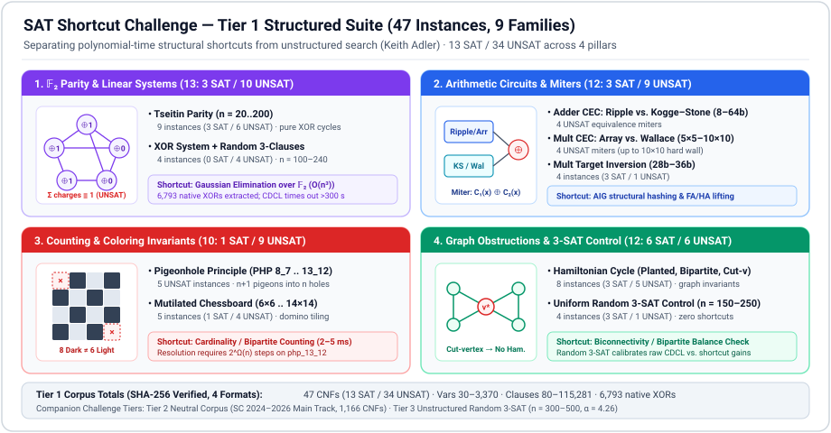

# SAT Shortcut Challenge — Tier 1 Structured Suite (`sat-shortcut-challenge-tier1`)

*Figure: Four-pillar architectural map of Keith Adler's 47 structured Tier-1 instances across 9 families ($\mathbb{F}_2$ parity, arithmetic miters, counting/coloring invariants, and graph obstructions + random 3-SAT control). Regenerated via [`src/gen_diagram.py`](src/gen_diagram.py).*

## Provenance & Credit

- **Author & Created by:** Keith Adler ([`@keithadler`](https://twitter.com/keithadler) on Twitter/X)
- **Upstream Repository:** [`keithadler/sat-shortcut-challenge`](https://github.com/keithadler/sat-shortcut-challenge)
- **License:** Apache License 2.0 — see [`LICENSE`](LICENSE) (copied verbatim from upstream).
- **Challenge Rules:** Full rules preserved verbatim in [`CHALLENGE.md`](CHALLENGE.md).
- **Companion Collections:** Tier 2 neutral corpus ([`../sat-competition-2002-2026-uris/`](../sat-competition-2002-2026-uris/README.md)) and Tier 3 unstructured random 3-SAT ([`../sat-shortcut-challenge-tier3/`](../sat-shortcut-challenge-tier3/README.md)).

## Problem Description

Designed by Keith Adler to separate detecting known polynomial-time structure from accelerating unstructured general search, **Tier 1** comprises **47 structured SAT instances across 9 families**, generated by `src/bench.py` and `src/more.py` and 100% SHA-256 verified on decompressed payloads against [`results/MANIFEST-tier1.sha256`](results/MANIFEST-tier1.sha256):

1. Tseitin parity (`tseitin_n*`, 9 instances)
2. Pigeonhole Principle (`php_*`, 5 instances)
3. Random 3-SAT (`random3sat_n150..250*`, 4 instances)
4. Adder CEC: Ripple-Carry vs. Kogge–Stone (`cec_adder_*`, 4 instances)
5. Multiplier CEC: Array vs. Wallace (`cec_mult_*`, 4 instances)
6. Multiplier target inversion (`mult_target_*`, 4 instances)
7. Mutilated chessboard (`chessboard_*`, 5 instances)
8. Hamiltonian cycle (`ham_*`: planted, unbalanced bipartite, cut-vertex, 8 instances)
9. XOR system + random 3-clauses (`xor_plus_*`, 4 instances)

## Corpus & Data Sizes

- **`cnf-orig/`** — 47 original native **DIMACS `.cnf.xz`** files (322.9 KB).
- **`aig-converted/`** — 47 exact **Binary AIGER 1.9 `.aig.xz`** conversions (414.8 KB, verified via [Berkeley ABC](https://github.com/berkeley-abc/abc) `read_aiger`).
- **`xcnf-converted/`** — 47 lossless **[CryptoMiniSat](https://github.com/msoos/cryptominisat) `.xcnf.xz`** conversions (277.2 KB, `6,793` extracted native XOR parity clauses).
- **`anf-converted/`** — 47 lossless linear-size **DIMACS-ANF `.anf.xz`** conversions (588.3 KB, generated via [`../src/to_anf.py`](../src/to_anf.py)).
- **[`expected.tsv`](expected.tsv)** — Ground-truth verdict manifest for all 47 instances (**13 SAT / 34 UNSAT**).
- **`results/`** — Upstream Tier-1 manifest and baseline summary ([`MANIFEST-tier1.sha256`](results/MANIFEST-tier1.sha256), [`RESULTS.md`](results/RESULTS.md), [`shortcut_chart.png`](results/shortcut_chart.png)).
- **`src/`** — Upstream Tier-1 generator and reference scripts (`bench.py`, `chart.py`, `gen.py`, `more.py`, `run_cadical.py`, `structsat.py`, `cnf2aig.py`, `cnf2xcnf.py`).

| Format | Directory | Files | Key Dimensions (Range) | Compressed Size |
|---|---|---:|---|---:|
| **DIMACS CNF (origin)** | `cnf-orig/` | 47 | Vars: 30–3,370; Clauses: 80–115,281 | 322.9 KB |
| **Binary AIGER 1.9** | `aig-converted/` | 47 | Inputs: 30–3,370; ANDs: 239–233,600 | 414.8 KB |
| **[CryptoMiniSat](https://github.com/msoos/cryptominisat) XCNF** | `xcnf-converted/` | 47 | Native XOR clauses total: 6,793 | 277.2 KB |
| **DIMACS-ANF** | `anf-converted/` | 47 | Vars: 30–4,560; Eqs: 20–118,241 (deg ≤ 3) | 588.3 KB |
| **Total (4 Formats, Status: 13 SAT / 34 UNSAT)** | | **188** | | **1.57 MB** |

## Benchmark Results

- **Hardware & Protocol:** Same machine (**AMD Ryzen 9 5950X**, 16C/32T Linux, **1 thread per run** pinned across 14 dedicated physical cores `0..13` with zero SMT sharing, $T_{\max} = 300\;\text{s}$, PAR-2 penalty $600\;\text{s}$). All solvers ran with default single-thread flags (`-t 1` for CryptoMiniSat 5.18.0; `--max-cores 1` for Frobenius) on identical uncompressed flat `.cnf` inputs; **100% of all 47 instances** were run (no subsampling), every Frobenius SAT model was independently verified against 100% of input clauses, and **0 verdict disagreements** occurred across all solvers.
- **Note on 14-core load vs. solo core:** Under simultaneous 14-core load, `ham_bipartite_14_15` took 38.65 s for Frobenius (vs. 74 ms on an uncontended solo core); the uniform 14-core sweep measurement is reported below for strict same-protocol consistency across all 5 solvers. At $T_{\max} = 300\;\text{s}$, [Kissat](https://github.com/arminbiere/kissat) (`79.18 s`), [CaDiCaL](https://github.com/arminbiere/cadical) (`157.98 s`), and [CryptoMiniSat](https://github.com/msoos/cryptominisat) (`214.92 s`) solve `cec_mult_10x10_arr_vs_wal` (UNSAT), while Frobenius and [dense-solver](https://github.com/libdense/dense-solver) solve `php_13_12` and `tseitin_n200_unsat` in `2–3 ms` where standard CDCL solvers time out (`>300 s`).

| Instance | Verdict | Frobenius 1C | [CaDiCaL](https://github.com/arminbiere/cadical) 3.1.0 | [CryptoMiniSat](https://github.com/msoos/cryptominisat) 5.18.0 | [dense-solver](https://github.com/libdense/dense-solver) 0.0.4 | [Kissat](https://github.com/arminbiere/kissat) 4.0.4 |
|---|:---:|---:|---:|---:|---:|---:|
| `cec_adder_16b_rc_vs_ks` | UNSAT | 10.07 ms | **7.66 ms** | 87.44 ms | 17.75 ms | 31.07 ms |
| `cec_adder_32b_rc_vs_ks` | UNSAT | **7.72 ms** | 23.85 ms | 149.00 ms | 57.21 ms | 56.21 ms |
| `cec_adder_64b_rc_vs_ks` | UNSAT | **32.38 ms** | 74.18 ms | 372.39 ms | 245.80 ms | 206.64 ms |
| `cec_adder_8b_rc_vs_ks` | UNSAT | 8.45 ms | **4.92 ms** | 78.43 ms | 10.73 ms | 14.16 ms |
| `cec_mult_10x10_arr_vs_wal` | UNSAT | >300 s | 157.98 s | 214.92 s | >300 s | **79.18 s** |
| `cec_mult_5x5_arr_vs_wal` | UNSAT | **24.25 ms** | 24.93 ms | 160.58 ms | 48.91 ms | 52.58 ms |
| `cec_mult_6x6_arr_vs_wal` | UNSAT | **113.04 ms** | 127.39 ms | 244.33 ms | 276.29 ms | 281.54 ms |
| `cec_mult_8x8_arr_vs_wal` | UNSAT | 5,266.84 ms | 5,437.39 ms | **3,255.17 ms** | 14.05 s | 3,671.92 ms |
| `chessboard_10x10_unsat` | UNSAT | 5.56 ms | 98.55 ms | 142.05 ms | **5.20 ms** | 63.69 ms |
| `chessboard_14x14_sat` | SAT | 4.97 ms | **3.46 ms** | 86.90 ms | 4.02 ms | 5.39 ms |
| `chessboard_14x14_unsat` | UNSAT | 2.73 ms | 17.19 s | 13.15 s | **2.44 ms** | 7,307.62 ms |
| `chessboard_6x6_unsat` | UNSAT | 4.64 ms | 3.00 ms | 55.64 ms | **2.82 ms** | 5.88 ms |
| `chessboard_8x8_unsat` | UNSAT | 7.78 ms | 5.19 ms | 53.92 ms | **4.93 ms** | 15.60 ms |
| `ham_bipartite_10_11` | UNSAT | **44.60 ms** | 7,455.90 ms | 998.21 ms | >300 s | 115.14 ms |
| `ham_bipartite_14_15` | UNSAT | 38.65 s | 8,897.95 ms | 6,699.39 ms | 512.41 ms | **221.32 ms** |
| `ham_bipartite_7_8` | UNSAT | **36.62 ms** | 207.54 ms | 185.53 ms | 717.58 ms | 162.80 ms |
| `ham_cutvertex_15` | UNSAT | **44.64 ms** | 129.56 ms | 999.61 ms | 309.20 ms | 64.88 ms |
| `ham_cutvertex_23` | UNSAT | 198.16 ms | 5,202.28 ms | 21.09 s | 3,384.18 ms | **53.06 ms** |
| `ham_planted_n20` | SAT | 57.94 ms | **8.05 ms** | 1,031.35 ms | 33.83 ms | 73.16 ms |
| `ham_planted_n30` | SAT | 580.32 ms | 636.14 ms | 2,849.81 ms | **86.53 ms** | 1,119.35 ms |
| `ham_planted_n40` | SAT | 442.53 ms | 368.99 ms | 5,352.78 ms | **314.51 ms** | 1,478.16 ms |
| `mult_target_28b_sat` | SAT | 26.99 ms | **10.40 ms** | 209.72 ms | 33.59 ms | 38.68 ms |
| `mult_target_28b_unsat` | UNSAT | 10.96 ms | **5.09 ms** | 95.86 ms | 18.92 ms | 8.49 ms |
| `mult_target_32b_sat` | SAT | 15.23 ms | **7.42 ms** | 187.04 ms | 45.01 ms | 59.88 ms |
| `mult_target_36b_sat` | SAT | 18.08 ms | **8.60 ms** | 207.02 ms | 31.50 ms | 46.16 ms |
| `php_10_9` | UNSAT | **7.17 ms** | 6,286.81 ms | 9,335.33 ms | 7.54 ms | 520.38 ms |
| `php_11_10` | UNSAT | 2.47 ms | 45.25 s | 117.10 s | **2.06 ms** | 1,761.67 ms |
| `php_13_12` | UNSAT | 2.84 ms | >300 s | >300 s | **2.36 ms** | >300 s |
| `php_8_7` | UNSAT | 6.58 ms | 42.37 ms | 116.90 ms | **6.51 ms** | 51.06 ms |
| `php_9_8` | UNSAT | 3.62 ms | 357.90 ms | 732.35 ms | **2.69 ms** | 119.04 ms |
| `random3sat_n150_s1` | SAT | **4.66 ms** | 7.95 ms | 117.41 ms | 30.48 ms | 50.19 ms |
| `random3sat_n200_s1` | UNSAT | **190.17 ms** | 772.21 ms | 1,292.33 ms | 649.79 ms | 851.26 ms |
| `random3sat_n200_s2` | SAT | 49.79 ms | 516.32 ms | 106.65 ms | **45.13 ms** | 334.62 ms |
| `random3sat_n250_s1` | SAT | **71.24 ms** | 860.60 ms | 1,908.84 ms | 4,638.42 ms | 1,311.69 ms |
| `tseitin_n100_sat` | SAT | **2.59 ms** | 10.65 ms | 27.23 ms | 3.92 ms | 6.15 ms |
| `tseitin_n100_unsat` | UNSAT | 2.55 ms | 271.99 s | 23.47 ms | **2.20 ms** | 23.41 s |
| `tseitin_n200_sat` | SAT | **2.87 ms** | 9.05 ms | 37.17 ms | 5.76 ms | 5.86 ms |
| `tseitin_n200_unsat` | UNSAT | 2.42 ms | >300 s | 29.58 ms | **2.11 ms** | >300 s |
| `tseitin_n20_unsat` | UNSAT | **3.35 ms** | 7.97 ms | 61.09 ms | 7.78 ms | 3.44 ms |
| `tseitin_n30_unsat` | UNSAT | 3.35 ms | 15.61 ms | 78.15 ms | **2.88 ms** | 10.78 ms |
| `tseitin_n40_sat` | SAT | **2.64 ms** | 10.21 ms | 21.85 ms | 5.23 ms | 2.94 ms |
| `tseitin_n40_unsat` | UNSAT | **2.45 ms** | 47.25 ms | 50.41 ms | 2.64 ms | 40.08 ms |
| `tseitin_n60_unsat` | UNSAT | **3.26 ms** | 517.35 ms | 66.69 ms | 3.61 ms | 307.68 ms |
| `xor_plus_clauses_n100_free14_s1` | UNSAT | **3.09 ms** | 11.36 ms | 93.51 ms | 5.57 ms | 4.43 ms |
| `xor_plus_clauses_n160_free16_s2` | UNSAT | **3.82 ms** | 14.56 ms | 66.35 ms | 10.68 ms | 6.88 ms |
| `xor_plus_clauses_n240_free18_s3` | UNSAT | **4.79 ms** | 56.42 ms | 132.74 ms | 23.97 ms | 21.41 ms |
| `xor_plus_clauses_n240_free18_s4` | UNSAT | **4.08 ms** | 102.00 ms | 116.16 ms | 6.29 ms | 46.96 ms |
| **Total (47 files, PAR-2)** | **47/47** | **46/47 — 645.99 s** *(fastest)* | 45/47 — 1,730.80 s *(2.68x)* | 46/47 — 1,004.18 s *(1.55x)* | 45/47 — 1,225.68 s *(1.90x)* | 45/47 — 1,323.20 s *(2.05x)* |

<!-- BEGIN_STRUCTURAL_ANALYSIS -->
## Phase-Transition & Structural Analysis

*Auto-generated by [`../src/analyze_benchmarks.py`](../src/analyze_benchmarks.py). Position relative to the critical phase transition is measured by $\rho_{\mathrm{crit}} = \frac{1}{n}\sum_k m_k / \alpha_c(k)$ (exact $\alpha/\alpha_c(k)$ for pure $k$-SAT; effective critical threshold $\alpha_c^{\mathrm{eff}} = \alpha/\rho_{\mathrm{crit}}$; `Under` $<0.90\times$, `Near-crit` $0.90\text{--}1.10\times$, `Over` $>1.10\times$), alongside Gent–Walsh annealed constrainedness $\kappa = -\frac{1}{n}\sum_i \log_2(1-2^{-k_i})$ (AAAI 1996), clause-length profile ($\bar{k}$, `%Bin`, `%Horn`), variable-degree CV ($\sigma_d/\bar{d}$, uniformity vs. hub skew), and extracted native XOR parity clauses.*

| Group / Family | Files | Med $n$ | Med $m$ | $\alpha=m/n$ (Med) | $\alpha_c^{\mathrm{eff}}$ (Med) | $\rho_{\mathrm{crit}}$ Med [Min–Max] (Regime) | Med $\kappa$ | Med $\bar{k}$ | Bin% | Horn% | Deg CV | Total XORs |
|---|---:|---:|---:|---:|---:|---:|---:|---:|---:|---:|---:|---:|
| `sat-shortcut-challenge-tier1` | 47 | 237 | 992 | 3.33 | 1.89 | **1.75x** [0.62x–72.0x] (Over) | 0.92 | 2.61 | 38% | 68% | 0.10 | 6,793 |

**Collection Phase-Transition Summary (47 instances, 4 formats: 47 CNF / 47 AIG / 47 XCNF / 47 ANF):** median $\rho_{\mathrm{crit}} = 1.75\times$ (range `0.62x–72.0x`), median $\kappa = 0.92$, regime split **9 Under / 8 Near-critical / 30 Over**, total extracted native XOR parity clauses = **6,793**, total ANF equations = **310,239**.
<!-- END_STRUCTURAL_ANALYSIS -->

## References

- K. Adler ([`@keithadler`](https://twitter.com/keithadler)), [`keithadler/sat-shortcut-challenge`](https://github.com/keithadler/sat-shortcut-challenge): Three-tier SAT shortcut vs. unstructured search benchmark challenge (Apache-2.0).
