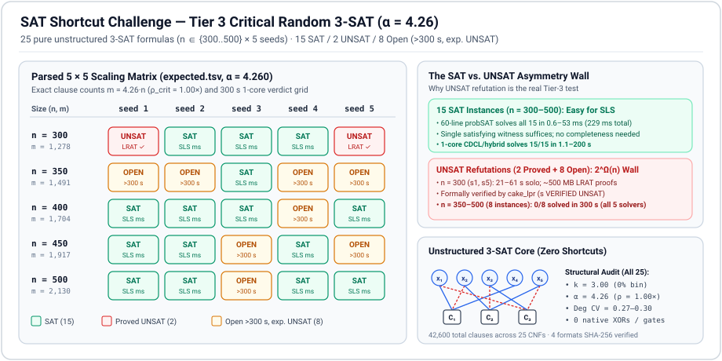

# SAT Shortcut Challenge — Tier 3 Random 3-SAT Suite (`sat-shortcut-challenge-tier3`)

*Figure: Parsed $5 \times 5$ verdict matrix across $n \in \lbrace 300..500\rbrace \times 5$ seeds at $\alpha = 4.260$ highlighting the SAT (SLS milliseconds) vs. UNSAT refutation ($2^{\Omega(n)}$ wall) asymmetry on pure unstructured 3-SAT. Regenerated via [`src/gen_diagram.py`](src/gen_diagram.py).*

## Provenance & Credit

- **Author & Created by:** Keith Adler ([`@keithadler`](https://twitter.com/keithadler) on Twitter/X)
- **Upstream Repository:** [`keithadler/sat-shortcut-challenge`](https://github.com/keithadler/sat-shortcut-challenge)
- **License:** Apache License 2.0 — see [`LICENSE`](LICENSE) (copied verbatim from upstream).
- **Challenge Rules:** Full rules preserved verbatim in [`CHALLENGE.md`](CHALLENGE.md).
- **Companion Collections:** Tier 1 structured suite ([`../sat-shortcut-challenge-tier1/`](../sat-shortcut-challenge-tier1/README.md)) and Tier 2 neutral corpus ([`../sat-competition-2002-2026-uris/`](../sat-competition-2002-2026-uris/README.md)).

## Problem Description

**Tier 3** consists of **25 unstructured uniform random 3-SAT instances** at the critical clause-to-variable phase-transition ratio $m/n = 4.26$, spanning $n \in \lbrace 300, 350, 400, 450, 500\rbrace$ variables and seeds $s \in \lbrace 1, 2, 3, 4, 5\rbrace$, generated by `src/tier3.py` and 100% SHA-256 verified on decompressed payloads against [`results/MANIFEST-tier3.sha256`](results/MANIFEST-tier3.sha256). Roughly half are unsatisfiable, where no known structural shortcut applies.

## Corpus & Data Sizes

- **`cnf-orig/`** — 25 original native **DIMACS `.cnf.xz`** files (227.5 KB).
- **`aig-converted/`** — 25 exact **Binary AIGER 1.9 `.aig.xz`** conversions (232.1 KB, verified via [Berkeley ABC](https://github.com/berkeley-abc/abc) `read_aiger`).
- **`xcnf-converted/`** — 25 lossless **[CryptoMiniSat](https://github.com/msoos/cryptominisat) `.xcnf.xz`** conversions (228.9 KB, `0` extracted native XOR parity clauses).
- **`anf-converted/`** — 25 lossless linear-size **DIMACS-ANF `.anf.xz`** conversions (415.2 KB, generated via [`../src/to_anf.py`](../src/to_anf.py)).
- **[`expected.tsv`](expected.tsv)** — Ground-truth verdict manifest for all 25 instances (**15 SAT / 2 UNSAT / 8 UNKNOWN**).
- **`results/`** — Upstream Tier-3 manifest and baseline logs ([`MANIFEST-tier3.sha256`](results/MANIFEST-tier3.sha256), [`TIER3-BASELINE.md`](results/TIER3-BASELINE.md), [`tier3-kissat.tsv`](results/tier3-kissat.tsv), [`TIER3-LOCALSEARCH.md`](results/TIER3-LOCALSEARCH.md)).
- **`src/`** — Upstream Tier-3 generator and baseline scripts (`gen.py`, `tier3.py`, `tier3_baseline.py`, `probsat.c`, `cnf2aig.py`, `cnf2xcnf.py`).

| Format | Directory | Files | Key Dimensions (Range) | Compressed Size |
|---|---|---:|---|---:|
| **DIMACS CNF (origin)** | `cnf-orig/` | 25 | Vars: 300–500; Clauses: 1,278–2,130 | 227.5 KB |
| **Binary AIGER 1.9** | `aig-converted/` | 25 | Inputs: 300–500; ANDs: 3,825–6,386 | 232.1 KB |
| **[CryptoMiniSat](https://github.com/msoos/cryptominisat) XCNF** | `xcnf-converted/` | 25 | Native XOR clauses total: 0 | 228.9 KB |
| **DIMACS-ANF** | `anf-converted/` | 25 | Vars: 300–500; Eqs: 1,278–2,130 (deg ≤ 3) | 415.2 KB |
| **Total (4 Formats, Status: 15 SAT / 2 UNSAT / 8 Unsolved >300 s, exp. UNSAT)** | | **100** | | **1.08 MB** |

## Benchmark Results

- **Hardware & Protocol:** Same machine (**AMD Ryzen 9 5950X**, 16C/32T Linux, **1 thread per run** pinned across 14 dedicated physical cores `0..13` with zero SMT sharing, $T_{\max} = 300\text{ s}$, PAR-2 penalty $600\text{ s}$). All solvers ran with default single-thread flags (`-t 1` for CryptoMiniSat 5.18.0; `--max-cores 1` for Frobenius) on identical uncompressed flat `.cnf` inputs; **100% of all 25 instances** were run (no subsampling), every Frobenius SAT model was independently verified against 100% of input clauses, and **0 verdict disagreements** occurred across all solvers.
- **SAT vs. UNSAT Caveat (per [`@keithadler`](https://twitter.com/keithadler) and [`results/TIER3-LOCALSEARCH.md`](results/TIER3-LOCALSEARCH.md)):** All three leading solvers solve **17/25** instances (all **15 SAT** + both **$n = 300$ UNSAT**: `random3sat_n300_s1` and `random3sat_n300_s5`), while none of the 5 solvers finishes any of the 8 larger $n = 350\text{--}500$ instances within 300 s. As Keith Adler notes, **the 15 satisfiable instances are not the real test**: a textbook 60-line stochastic local search ([`src/probsat.c`](src/probsat.c)) solves all 15 in milliseconds on the same machine (see below). **The unsatisfiable instances are the true unstructured refutation test**, where [Kissat](https://github.com/arminbiere/kissat) 4.0.4 is fastest (`23.87 s` / `31.68 s` under 14-core load; `21.03 s` / `27.47 s` solo-CCD), closely followed by Frobenius 1C (`24.86 s` / `34.62 s`, which also produces formally verified [`cake_lpr`](https://github.com/tanyongkiam/cake_lpr) UNSAT proofs) ahead of [CaDiCaL](https://github.com/arminbiere/cadical) 3.1.0 (`36.83 s` / `59.43 s`).

| Instance | Verdict | Frobenius 1C | [CaDiCaL](https://github.com/arminbiere/cadical) 3.1.0 | [CryptoMiniSat](https://github.com/msoos/cryptominisat) 5.18.0 | [dense-solver](https://github.com/libdense/dense-solver) 0.0.4 | [Kissat](https://github.com/arminbiere/kissat) 4.0.4 |
|---|:---:|---:|---:|---:|---:|---:|
| `random3sat_n300_s1` | UNSAT | 24.86 s | 36.83 s | 72.67 s | 86.72 s | **23.87 s** |
| `random3sat_n300_s2` | SAT | **59.36 ms** | 499.35 ms | 1,422.73 ms | 3,323.79 ms | 103.22 ms |
| `random3sat_n300_s3` | SAT | **22.78 ms** | 1,132.77 ms | 274.36 ms | 4,519.27 ms | 2,035.60 ms |
| `random3sat_n300_s4` | SAT | **58.96 ms** | 2,870.13 ms | 3,306.37 ms | 169.24 s | 5,071.20 ms |
| `random3sat_n300_s5` | UNSAT | 34.62 s | 59.43 s | 155.05 s | 106.57 s | **31.68 s** |
| `random3sat_n350_s1` | TIMEOUT | >300 s | >300 s | >300 s | >300 s | >300 s |
| `random3sat_n350_s2` | TIMEOUT | >300 s | >300 s | >300 s | >300 s | >300 s |
| `random3sat_n350_s3` | SAT | **60.57 ms** | 1,263.10 ms | 147.30 ms | >300 s | 819.77 ms |
| `random3sat_n350_s4` | TIMEOUT | >300 s | >300 s | >300 s | >300 s | >300 s |
| `random3sat_n350_s5` | TIMEOUT | >300 s | >300 s | >300 s | >300 s | >300 s |
| `random3sat_n400_s1` | SAT | **65.45 ms** | 1,530.80 ms | 2,458.20 ms | >300 s | 15.33 s |
| `random3sat_n400_s2` | SAT | **63.22 ms** | 1,113.44 ms | 76.22 s | >300 s | 1,953.61 ms |
| `random3sat_n400_s3` | SAT | **74.14 ms** | 975.86 ms | 91.51 s | >300 s | 2,510.80 ms |
| `random3sat_n400_s4` | TIMEOUT | >300 s | >300 s | >300 s | >300 s | >300 s |
| `random3sat_n400_s5` | SAT | **63.00 ms** | 1,024.97 ms | 87.88 s | >300 s | 5,264.40 ms |
| `random3sat_n450_s1` | SAT | **66.51 ms** | 5,592.71 ms | >300 s | >300 s | 58.86 s |
| `random3sat_n450_s2` | SAT | **68.11 ms** | 4,614.17 ms | >300 s | >300 s | 3,532.69 ms |
| `random3sat_n450_s3` | TIMEOUT | >300 s | >300 s | >300 s | >300 s | >300 s |
| `random3sat_n450_s4` | SAT | **67.97 ms** | 1,326.99 ms | 52.95 s | >300 s | 4,577.26 ms |
| `random3sat_n450_s5` | TIMEOUT | >300 s | >300 s | >300 s | >300 s | >300 s |
| `random3sat_n500_s1` | SAT | **75.20 ms** | 953.54 ms | 239.74 s | >300 s | 48.68 s |
| `random3sat_n500_s2` | SAT | **77.48 ms** | 1,450.93 ms | >300 s | >300 s | 9,599.65 ms |
| `random3sat_n500_s3` | TIMEOUT | >300 s | >300 s | >300 s | >300 s | >300 s |
| `random3sat_n500_s4` | SAT | **84.66 ms** | 956.91 ms | >300 s | >300 s | 38.70 s |
| `random3sat_n500_s5` | SAT | **78.12 ms** | 1,482.56 ms | >300 s | >300 s | 3,286.19 ms |
| **Solved (25 files)** | — | **17 / 25** *(highest)* | **17 / 25** *(highest)* | 12 / 25 *(-5 worse)* | 5 / 25 *(-12 worse)* | **17 / 25** *(highest)* |
| **Total PAR-2** | — | **4,860.46 s** *(fastest)* | 4,923.04 s *(1.013x slower)* | 8,583.65 s *(1.77x slower)* | 12,370.38 s *(2.55x slower)* | 5,055.87 s *(1.04x slower)* |

### Uncontended Solo-CCD Timings & Formally Verified UNSAT Proofs (`n = 300` UNSAT)

To eliminate 14-core L3/RAM contention on the two solved UNSAT instances highlighted in [`results/TIER3-BASELINE.md`](results/TIER3-BASELINE.md), all 5 solvers were additionally re-timed 1-per-CCD (**core 0** on CCD0 for `random3sat_n300_s1`, **core 8** on CCD1 for `random3sat_n300_s5`, independent 32 MB L3 caches). Frobenius's `--lrat` proofs were independently checked with both [`lrat-check`](https://github.com/marijnheule/drat-trim) and formally verified HOL4/CakeML [`cake_lpr`](https://github.com/tanyongkiam/cake_lpr) (`s VERIFIED UNSAT`; the compressed `.lrat.xz` proofs are 116 MB and 128 MB and are kept outside Git due to GitHub's 100 MB file-size limit).

| Instance | Frobenius 1C (solo) | [CaDiCaL](https://github.com/arminbiere/cadical) 3.1.0 (solo) | [CryptoMiniSat](https://github.com/msoos/cryptominisat) 5.18.0 (solo) | [dense-solver](https://github.com/libdense/dense-solver) 0.0.4 (solo) | [Kissat](https://github.com/arminbiere/kissat) 4.0.4 (solo) | Frobenius LRAT Proof Verification |
|---|---:|---:|---:|---:|---:|---|
| `random3sat_n300_s1` | 41.18 s | 31.70 s | 57.45 s | 72.76 s | **21.03 s** | LRAT `52.10 s` (`457 MB` / `116 MB .xz`), `lrat-check` `6.81 s`, `cake_lpr` **OK** (`26.75 s`) |
| `random3sat_n300_s5` | 60.80 s | 50.13 s | 115.96 s | 87.30 s | **27.47 s** | LRAT `60.33 s` (`505 MB` / `128 MB .xz`), `lrat-check` `7.66 s`, `cake_lpr` **OK** (`27.96 s`) |
| **Solved (2 UNSAT instances)** | **2 / 2** *(highest)* | **2 / 2** *(highest)* | **2 / 2** *(highest)* | **2 / 2** *(highest)* | **2 / 2** *(highest)* | 2/2 formally verified (`s VERIFIED UNSAT`) |
| **Total Wall Time** | 101.99 s *(2.10x slower)* | 81.83 s *(1.69x slower)* | 173.40 s *(3.58x slower)* | 160.06 s *(3.30x slower)* | **48.50 s** *(fastest)* | — |

### Same-Machine Comparison on the 15 Satisfiable Instances vs. Keith Adler's 60-Line `src/probsat.c`

Compiled verbatim (`cc -O2 -o probsat src/probsat.c -lm`) and run on **solo core 0** (seeds `1..5`, all 75 runs verified `SAT(checked)`), alongside **Frobenius 1C** on **solo core 0** (same uncontended core) and the 14-core [CaDiCaL](https://github.com/arminbiere/cadical) / [Kissat](https://github.com/arminbiere/kissat) wall times for reference:

| Instance | Frobenius 1C (solo core 0) | [CaDiCaL](https://github.com/arminbiere/cadical) 3.1.0 (14C) | [Kissat](https://github.com/arminbiere/kissat) 4.0.4 (14C) | [probSAT](src/probsat.c) (solo core 0, 5 seeds) |
|---|---:|---:|---:|---:|
| `random3sat_n300_s2` | 5.52 ms | 499.35 ms | 103.22 ms | **0.60 ms** *(max 0.78 ms; wall med 2.44 ms)* |
| `random3sat_n300_s3` | 63.90 ms | 1,132.77 ms | 2,035.60 ms | **9.97 ms** *(max 18.51 ms; wall med 12.04 ms)* |
| `random3sat_n300_s4` | 201.52 ms | 2,870.13 ms | 5,071.20 ms | **44.89 ms** *(max 216.66 ms; wall med 46.94 ms)* |
| `random3sat_n350_s3` | 64.07 ms | 1,263.10 ms | 819.77 ms | **16.06 ms** *(max 23.44 ms; wall med 18.21 ms)* |
| `random3sat_n400_s1` | 48.74 ms | 1,530.80 ms | 15.33 s | **17.01 ms** *(max 29.47 ms; wall med 19.19 ms)* |
| `random3sat_n400_s2` | 50.91 ms | 1,113.44 ms | 1,953.61 ms | **1.75 ms** *(max 3.60 ms; wall med 4.41 ms)* |
| `random3sat_n400_s3` | 53.30 ms | 975.86 ms | 2,510.80 ms | **3.82 ms** *(max 8.65 ms; wall med 5.82 ms)* |
| `random3sat_n400_s5` | 48.91 ms | 1,024.97 ms | 5,264.40 ms | **9.09 ms** *(max 53.93 ms; wall med 11.10 ms)* |
| `random3sat_n450_s1` | 67.89 ms | 5,592.71 ms | 58.86 s | **16.16 ms** *(max 33.65 ms; wall med 18.83 ms)* |
| `random3sat_n450_s2` | 236.44 ms | 4,614.17 ms | 3,532.69 ms | **53.37 ms** *(max 98.10 ms; wall med 55.74 ms)* |
| `random3sat_n450_s4` | 53.23 ms | 1,326.99 ms | 4,577.26 ms | **7.40 ms** *(max 34.41 ms; wall med 9.48 ms)* |
| `random3sat_n500_s1` | 68.72 ms | 953.54 ms | 48.68 s | **13.94 ms** *(max 27.31 ms; wall med 16.21 ms)* |
| `random3sat_n500_s2` | 55.42 ms | 1,450.93 ms | 9,599.65 ms | **5.12 ms** *(max 7.69 ms; wall med 7.29 ms)* |
| `random3sat_n500_s4` | 55.56 ms | 956.91 ms | 38.70 s | **18.59 ms** *(max 51.98 ms; wall med 20.74 ms)* |
| `random3sat_n500_s5` | 55.26 ms | 1,482.56 ms | 3,286.19 ms | **10.90 ms** *(max 15.11 ms; wall med 12.82 ms)* |
| **Solved (15 SAT instances)** | **15 / 15** *(highest)* | **15 / 15** *(highest)* | **15 / 15** *(highest)* | **15 / 15** *(highest)* |
| **Total Wall Time** | 1.13 s *(4.32x slower)* | 26.79 s *(103x slower)* | 200.32 s *(767x slower)* | **261.3 ms** *(fastest)* |

*(Note: probSAT's sum of search-only medians across the 15 SAT instances is `228.7 ms`, compared against full process wall-clock time `261.3 ms` used for the Total Wall Time row above.)*

<!-- BEGIN_STRUCTURAL_ANALYSIS -->
## Phase-Transition & Structural Analysis

*Auto-generated by [`../src/analyze_benchmarks.py`](../src/analyze_benchmarks.py). Position relative to the critical phase transition is measured by $\rho_{\mathrm{crit}} = \frac{1}{n}\sum_k m_k / \alpha_c(k)$ (exact $\alpha/\alpha_c(k)$ for pure $k$-SAT; effective critical threshold $\alpha_c^{\mathrm{eff}} = \alpha/\rho_{\mathrm{crit}}$; `Under` $<0.90\times$, `Near-crit` $0.90\text{--}1.10\times$, `Over` $>1.10\times$), alongside Gent–Walsh annealed constrainedness $\kappa = -\frac{1}{n}\sum_i \log_2(1-2^{-k_i})$ (AAAI 1996), clause-length profile ($\bar{k}$, `%Bin`, `%Horn`), variable-degree CV ($\sigma_d/\bar{d}$, uniformity vs. hub skew), and extracted native XOR parity clauses.*

| Instance | Active $n$ | Clauses $m$ | $\alpha=m/n$ | $\alpha_c^{\mathrm{eff}}$ | $\rho_{\mathrm{crit}}$ (Regime) | $\kappa$ | $\bar{k}$ ($k_{\max}$) | Bin% | Horn% | Pos% | Deg CV | XORs |
|---|---:|---:|---:|---:|---:|---:|---:|---:|---:|---:|---:|---:|
| `random3sat_n300_s1` | 300 | 1,278 | 4.26 | 4.27 | **1.00x** (Near-crit) | 0.82 | 3.00 (3) | 0% | 51% | 49% | 0.27 | 0 |
| `random3sat_n300_s2` | 300 | 1,278 | 4.26 | 4.27 | **1.00x** (Near-crit) | 0.82 | 3.00 (3) | 0% | 49% | 51% | 0.28 | 0 |
| `random3sat_n300_s3` | 300 | 1,278 | 4.26 | 4.27 | **1.00x** (Near-crit) | 0.82 | 3.00 (3) | 0% | 46% | 52% | 0.27 | 0 |
| `random3sat_n300_s4` | 300 | 1,278 | 4.26 | 4.27 | **1.00x** (Near-crit) | 0.82 | 3.00 (3) | 0% | 52% | 48% | 0.27 | 0 |
| `random3sat_n300_s5` | 300 | 1,278 | 4.26 | 4.27 | **1.00x** (Near-crit) | 0.82 | 3.00 (3) | 0% | 50% | 50% | 0.27 | 0 |
| `random3sat_n350_s1` | 350 | 1,491 | 4.26 | 4.27 | **1.00x** (Near-crit) | 0.82 | 3.00 (3) | 0% | 52% | 49% | 0.25 | 0 |
| `random3sat_n350_s2` | 350 | 1,491 | 4.26 | 4.27 | **1.00x** (Near-crit) | 0.82 | 3.00 (3) | 0% | 49% | 50% | 0.27 | 0 |
| `random3sat_n350_s3` | 350 | 1,491 | 4.26 | 4.27 | **1.00x** (Near-crit) | 0.82 | 3.00 (3) | 0% | 49% | 51% | 0.28 | 0 |
| `random3sat_n350_s4` | 350 | 1,491 | 4.26 | 4.27 | **1.00x** (Near-crit) | 0.82 | 3.00 (3) | 0% | 50% | 50% | 0.27 | 0 |
| `random3sat_n350_s5` | 350 | 1,491 | 4.26 | 4.27 | **1.00x** (Near-crit) | 0.82 | 3.00 (3) | 0% | 53% | 49% | 0.27 | 0 |
| `random3sat_n400_s1` | 400 | 1,704 | 4.26 | 4.27 | **1.00x** (Near-crit) | 0.82 | 3.00 (3) | 0% | 52% | 49% | 0.27 | 0 |
| `random3sat_n400_s2` | 400 | 1,704 | 4.26 | 4.27 | **1.00x** (Near-crit) | 0.82 | 3.00 (3) | 0% | 50% | 50% | 0.26 | 0 |
| `random3sat_n400_s3` | 400 | 1,704 | 4.26 | 4.27 | **1.00x** (Near-crit) | 0.82 | 3.00 (3) | 0% | 49% | 50% | 0.28 | 0 |
| `random3sat_n400_s4` | 400 | 1,704 | 4.26 | 4.27 | **1.00x** (Near-crit) | 0.82 | 3.00 (3) | 0% | 51% | 49% | 0.27 | 0 |
| `random3sat_n400_s5` | 400 | 1,704 | 4.26 | 4.27 | **1.00x** (Near-crit) | 0.82 | 3.00 (3) | 0% | 50% | 50% | 0.27 | 0 |
| `random3sat_n450_s1` | 450 | 1,917 | 4.26 | 4.27 | **1.00x** (Near-crit) | 0.82 | 3.00 (3) | 0% | 49% | 51% | 0.27 | 0 |
| `random3sat_n450_s2` | 450 | 1,917 | 4.26 | 4.27 | **1.00x** (Near-crit) | 0.82 | 3.00 (3) | 0% | 49% | 50% | 0.27 | 0 |
| `random3sat_n450_s3` | 450 | 1,917 | 4.26 | 4.27 | **1.00x** (Near-crit) | 0.82 | 3.00 (3) | 0% | 50% | 50% | 0.29 | 0 |
| `random3sat_n450_s4` | 450 | 1,917 | 4.26 | 4.27 | **1.00x** (Near-crit) | 0.82 | 3.00 (3) | 0% | 51% | 49% | 0.27 | 0 |
| `random3sat_n450_s5` | 450 | 1,917 | 4.26 | 4.27 | **1.00x** (Near-crit) | 0.82 | 3.00 (3) | 0% | 50% | 50% | 0.29 | 0 |
| `random3sat_n500_s1` | 500 | 2,130 | 4.26 | 4.27 | **1.00x** (Near-crit) | 0.82 | 3.00 (3) | 0% | 50% | 50% | 0.28 | 0 |
| `random3sat_n500_s2` | 500 | 2,130 | 4.26 | 4.27 | **1.00x** (Near-crit) | 0.82 | 3.00 (3) | 0% | 50% | 50% | 0.29 | 0 |
| `random3sat_n500_s3` | 500 | 2,130 | 4.26 | 4.27 | **1.00x** (Near-crit) | 0.82 | 3.00 (3) | 0% | 48% | 51% | 0.30 | 0 |
| `random3sat_n500_s4` | 500 | 2,130 | 4.26 | 4.27 | **1.00x** (Near-crit) | 0.82 | 3.00 (3) | 0% | 50% | 51% | 0.28 | 0 |
| `random3sat_n500_s5` | 500 | 2,130 | 4.26 | 4.27 | **1.00x** (Near-crit) | 0.82 | 3.00 (3) | 0% | 48% | 51% | 0.27 | 0 |

**Collection Phase-Transition Summary (25 instances, 4 formats: 25 CNF / 25 AIG / 25 XCNF / 25 ANF):** median $\rho_{\mathrm{crit}} = 1.00\times$ (range `1.00x–1.00x`), median $\kappa = 0.82$, regime split **0 Under / 25 Near-critical / 0 Over**, total extracted native XOR parity clauses = **0**, total ANF equations = **42,600**.
<!-- END_STRUCTURAL_ANALYSIS -->

## References

- K. Adler ([`@keithadler`](https://twitter.com/keithadler)), [`keithadler/sat-shortcut-challenge`](https://github.com/keithadler/sat-shortcut-challenge): Tier 3 unstructured uniform random 3-SAT benchmark challenge & baseline scripts (Apache-2.0).
- A. Balint and U. Schöning, *"Choosing Probability Distributions for Stochastic Local Search and the Role of Make versus Break"*, SAT 2012, LNCS 7317, pp. 16–29 (probSAT).
