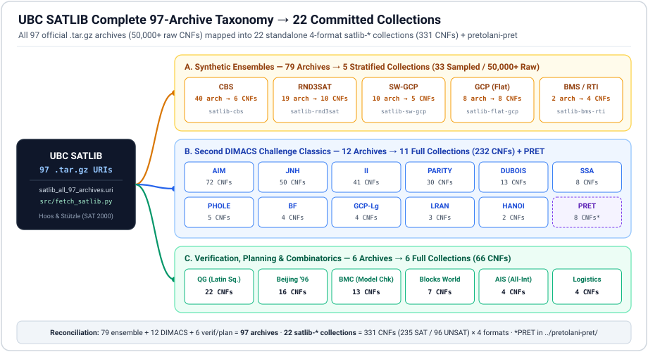

# UBC SATLIB Complete 97-Archive URI Manifest (`satlib-archive-uris`)

*Figure: Complete taxonomy tree mapping all 97 official UBC SATLIB `.tar.gz` archive URIs (79 synthetic ensemble + 12 DIMACS + 6 verification/planning) into the 22 committed 4-format `satlib-*` collections (331 CNFs) plus `pretolani-pret`. Regenerated via [`src/gen_diagram.py`](src/gen_diagram.py).*

## Provenance & Credit

- **Upstream Archive:** [SATLIB — Benchmark Problems (UBC)](https://www.cs.ubc.ca/~hoos/SATLIB/benchm.html)
- **Maintainers & Curators:** Holger H. Hoos and Thomas Stützle (University of British Columbia / TU Darmstadt)
- **Primary Paper:** H. H. Hoos and T. Stützle, *"SATLIB: An Online Resource for Research on SAT"*, SAT 2000, IOS Press, pp. 283–292 (2000).
- **License:** Classic public scientific benchmark collection redistributed by UBC SATLIB for academic SAT research; no separate upstream `LICENSE` file is bundled in the archives.
- **Recommended by:** [`@jasonslenderman`](https://twitter.com/jasonslenderman) (Twitter/X)

## Problem Description

UBC **SATLIB** (Hoos & Stützle, SAT 2000) is the classic foundational repository of SAT benchmarks spanning structured industrial/EDA verification, planning, graph coloring, combinatorial puzzles, and synthetic random $k$-SAT phase-transition ensembles across **97 official `.tar.gz` archives** ($50{,}000+$ raw formulas). Rather than duplicating multi-gigabyte synthetic ensembles in Git, this collection indexes all 97 upstream archive URIs alongside a parallel fetcher, while all 17 structured families (in full) plus stratified representatives from all 5 synthetic ensembles (**331 instances** across all 4 formats) are committed directly in the 22 standalone `../satlib-*/` collections.

## Corpus & Data Sizes

### Directory Layout & Usage

Rather than duplicating multi-gigabyte synthetic ensemble archives (50,000+ raw formulas) in Git, this collection stores the complete official manifest of all **97 UBC SATLIB `.tar.gz` archive URLs** alongside a parallel downloader script (parallel to [`../sat-competition-2002-2026-uris/`](../sat-competition-2002-2026-uris/README.md)):

- [`satlib_all_97_archives.uri`](satlib_all_97_archives.uri) — Complete list of all 97 official UBC SATLIB `.tar.gz` URLs.
- [`src/fetch_satlib.py`](src/fetch_satlib.py) — Parallel archive downloader (`python3 src/fetch_satlib.py --all-archives <out_dir>`).
- **Ground-Truth Verdicts:** Because this catalog indexes multi-instance `.tar.gz` archives rather than individual formulas, per-instance `expected.tsv` manifests live directly inside each of the 22 standalone `../satlib-*/` collections below (331 committed instances total: **235 SAT / 96 UNSAT / 0 UNKNOWN**).

### Committed Standalone SATLIB Collections (331 Instances Across 22 Collections, All 4 Formats)

Every instance from all 17 structured SATLIB/DIMACS/Beijing families (298 instances in full; Pretolani's `PRET` formulas live in [`../pretolani-pret/`](../pretolani-pret/README.md)) plus 33 stratified representatives across all 5 synthetic ensembles are committed directly in 22 standalone top-level collections (all 4 formats: `cnf-orig/`, `aig-converted/`, `xcnf-converted/`, `anf-converted/`):

| Collection | Category / Domain | Instances | `.cnf.xz` | `.aig.xz` | `.xcnf.xz` | `.anf.xz` |
|---|---|---:|---:|---:|---:|---:|
| [`satlib-ais/`](../satlib-ais/README.md) | All-Interval Series (full) | 4 | 13.4 KB | 19.3 KB | 13.1 KB | 21.6 KB |
| [`satlib-beijing/`](../satlib-beijing/README.md) | 1996 Beijing SAT Competition (full) | 16 | 637.2 KB | 1.05 MB | 623.8 KB | 1.92 MB |
| [`satlib-bmc/`](../satlib-bmc/README.md) | Bounded Model Checking — Shtrichman (full) | 13 | 4.67 MB | 5.41 MB | 4.53 MB | 12.83 MB |
| [`satlib-bms-rti/`](../satlib-bms-rti/README.md) | Backbone-Minimal Random 3-SAT (sample / 1,000*) | 4 | 6.9 KB | 8.6 KB | 7.1 KB | 12.8 KB |
| [`satlib-cbs/`](../satlib-cbs/README.md) | Controlled Backbone Random 3-SAT (sample / 40,000*) | 6 | 12.1 KB | 15.0 KB | 12.4 KB | 22.4 KB |
| [`satlib-dimacs-aim/`](../satlib-dimacs-aim/README.md) | Artificial Random 3-SAT — Iwama et al. (full) | 72 | 121.6 KB | 142.7 KB | 125.2 KB | 197.8 KB |
| [`satlib-dimacs-bf/`](../satlib-dimacs-bf/README.md) | Circuit Bridge-Fault Analysis (full) | 4 | 61.0 KB | 73.7 KB | 61.0 KB | 113.9 KB |
| [`satlib-dimacs-dubois/`](../satlib-dimacs-dubois/README.md) | Dubois Hard Parity UNSAT (full) | 13 | 11.6 KB | 13.7 KB | 7.3 KB | 5.4 KB |
| [`satlib-dimacs-gcp-large/`](../satlib-dimacs-gcp-large/README.md) | Large Graph Colouring `g125`/`g250` (full) | 4 | 586.2 KB | 294.7 KB | 476.6 KB | 994.4 KB |
| [`satlib-dimacs-hanoi/`](../satlib-dimacs-hanoi/README.md) | Towers of Hanoi `hanoi4`, `hanoi5` (full) | 2 | 33.4 KB | 39.4 KB | 33.3 KB | 64.1 KB |
| [`satlib-dimacs-ii/`](../satlib-dimacs-ii/README.md) | Inductive Inference (full) | 41 | 382.0 KB | 770.7 KB | 383.9 KB | 2.40 MB |
| [`satlib-dimacs-jnh/`](../satlib-dimacs-jnh/README.md) | Variable-Length Random SAT — Hooker (full) | 50 | 285.7 KB | 373.9 KB | 288.0 KB | 970.1 KB |
| [`satlib-dimacs-lran/`](../satlib-dimacs-lran/README.md) | Large Random 3-SAT `f600`/`f1000`/`f2000` (full) | 3 | 90.1 KB | 87.7 KB | 90.2 KB | 165.2 KB |
| [`satlib-dimacs-parity/`](../satlib-dimacs-parity/README.md) | Parity Learning `par8`/`par16`/`par32` (full) | 30 | 252.4 KB | 345.3 KB | 125.0 KB | 189.7 KB |
| [`satlib-dimacs-phole/`](../satlib-dimacs-phole/README.md) | Pigeonhole Principle `hole6..10` (full) | 5 | 4.6 KB | 5.2 KB | 4.8 KB | 6.1 KB |
| [`satlib-dimacs-ssa/`](../satlib-dimacs-ssa/README.md) | Single-Stuck-At Circuit Faults (full) | 8 | 147.5 KB | 176.3 KB | 146.9 KB | 282.7 KB |
| [`satlib-flat-gcp/`](../satlib-flat-gcp/README.md) | Flat 3-Colourable Graphs `flat30..200` (sample / 1,700*) | 8 | 19.5 KB | 21.0 KB | 20.0 KB | 29.6 KB |
| [`satlib-planning-blocksworld/`](../satlib-planning-blocksworld/README.md) | SATPLAN Blocks World (full) | 7 | 229.8 KB | 454.9 KB | 229.9 KB | 492.0 KB |
| [`satlib-planning-logistics/`](../satlib-planning-logistics/README.md) | SATPLAN Logistics `a..d` (full) | 4 | 79.7 KB | 126.2 KB | 80.0 KB | 223.0 KB |
| [`satlib-qg/`](../satlib-qg/README.md) | Quasigroup / Latin Squares — Zhang (full) | 22 | 1.64 MB | 4.23 MB | 1.64 MB | 4.91 MB |
| [`satlib-rnd3sat/`](../satlib-rnd3sat/README.md) | Uniform Random 3-SAT `uf`/`uuf50..250` (sample / 6,600*) | 10 | 33.1 KB | 37.1 KB | 33.6 KB | 59.2 KB |
| [`satlib-sw-gcp/`](../satlib-sw-gcp/README.md) | Morphed Small-World 5-Colouring `lp0..p0` (sample / 901*) | 5 | 19.1 KB | 23.7 KB | 19.5 KB | 35.9 KB |

## Benchmark Results

- **Hardware & Protocol:** Same machine (**AMD Ryzen 9 5950X**, 16C/32T Linux, 1 thread per run across 8 dedicated physical cores, default single-thread flags with `-t 1` for CryptoMiniSat 5.18.0 and `--max-cores 1` for Frobenius, $T_{\max} = 5\;\text{s}$, PAR-2 penalty $10{,}000\;\text{ms}$, identical flat `.cnf` input, 0 verdict disagreements, 100% SAT model verification).

| Collection (Instances) | Metric | Frobenius 1C | [CaDiCaL](https://github.com/arminbiere/cadical) 3.1.0 | [CryptoMiniSat](https://github.com/msoos/cryptominisat) 5.18.0 | [dense-solver](https://github.com/libdense/dense-solver) 0.0.4 | [Kissat](https://github.com/arminbiere/kissat) 4.0.4 |
|---|---|---:|---:|---:|---:|---:|
| [`satlib-ais/`](../satlib-ais/README.md) (4) | **Solved** | **4 / 4** *(highest)* | **4 / 4** *(highest)* | **4 / 4** *(highest)* | **4 / 4** *(highest)* | **4 / 4** *(highest)* |
|  | **PAR-2** | **4.0 ms** *(fastest)* | 15.9 ms *(3.98x slower)* | 458.9 ms *(115x slower)* | 20.9 ms *(5.22x slower)* | 8.8 ms *(2.20x slower)* |
| [`satlib-beijing/`](../satlib-beijing/README.md) (16) | **Solved** | **16 / 16** *(highest)* | 15 / 16 *(-1 worse)* | 15 / 16 *(-1 worse)* | 15 / 16 *(-1 worse)* | **16 / 16** *(highest)* |
|  | **PAR-2** | **232.2 ms** *(fastest)* | 10,375.0 ms *(44.7x slower)* | 18,153.0 ms *(78.2x slower)* | 13,334.9 ms *(57.4x slower)* | 3,813.0 ms *(16.4x slower)* |
| [`satlib-bmc/`](../satlib-bmc/README.md) (13) | **Solved** | **13 / 13** *(highest)* | **13 / 13** *(highest)* | **13 / 13** *(highest)* | **13 / 13** *(highest)* | **13 / 13** *(highest)* |
|  | **PAR-2** | **1,987.6 ms** *(fastest)* | 4,923.8 ms *(2.48x slower)* | 19,129.8 ms *(9.62x slower)* | 12,123.0 ms *(6.10x slower)* | 2,709.7 ms *(1.36x slower)* |
| [`satlib-bms-rti/`](../satlib-bms-rti/README.md) (4) | **Solved** | **4 / 4** *(highest)* | **4 / 4** *(highest)* | **4 / 4** *(highest)* | **4 / 4** *(highest)* | **4 / 4** *(highest)* |
|  | **PAR-2** | **5.6 ms** *(fastest)* | 20.6 ms *(3.68x slower)* | 85.4 ms *(15.3x slower)* | 11.6 ms *(2.07x slower)* | 49.0 ms *(8.75x slower)* |
| [`satlib-cbs/`](../satlib-cbs/README.md) (6) | **Solved** | **6 / 6** *(highest)* | **6 / 6** *(highest)* | **6 / 6** *(highest)* | **6 / 6** *(highest)* | **6 / 6** *(highest)* |
|  | **PAR-2** | **6.0 ms** *(fastest)* | 26.7 ms *(4.45x slower)* | 172.3 ms *(28.7x slower)* | 13.4 ms *(2.23x slower)* | 101.8 ms *(17.0x slower)* |
| [`satlib-dimacs-aim/`](../satlib-dimacs-aim/README.md) (72) | **Solved** | **72 / 72** *(highest)* | **72 / 72** *(highest)* | **72 / 72** *(highest)* | **72 / 72** *(highest)* | **72 / 72** *(highest)* |
|  | **PAR-2** | **106.5 ms** *(fastest)* | 211.9 ms *(1.99x slower)* | 1,538.6 ms *(14.4x slower)* | 131.1 ms *(1.23x slower)* | 239.9 ms *(2.25x slower)* |
| [`satlib-dimacs-bf/`](../satlib-dimacs-bf/README.md) (4) | **Solved** | **4 / 4** *(highest)* | **4 / 4** *(highest)* | **4 / 4** *(highest)* | **4 / 4** *(highest)* | **4 / 4** *(highest)* |
|  | **PAR-2** | **20.4 ms** *(fastest)* | 25.4 ms *(1.25x slower)* | 208.1 ms *(10.2x slower)* | 92.0 ms *(4.51x slower)* | 27.4 ms *(1.34x slower)* |
| [`satlib-dimacs-dubois/`](../satlib-dimacs-dubois/README.md) (13) | **Solved** | **13 / 13** *(highest)* | **13 / 13** *(highest)* | **13 / 13** *(highest)* | **13 / 13** *(highest)* | **13 / 13** *(highest)* |
|  | **PAR-2** | **7.7 ms** *(fastest)* | 33.1 ms *(4.30x slower)* | 252.3 ms *(32.8x slower)* | 21.5 ms *(2.79x slower)* | 21.8 ms *(2.83x slower)* |
| [`satlib-dimacs-gcp-large/`](../satlib-dimacs-gcp-large/README.md) (4) | **Solved** | **4 / 4** *(highest)* | 2 / 4 *(-2 worse)* | 1 / 4 *(-3 worse)* | 0 / 4 *(-4 worse)* | 0 / 4 *(-4 worse)* |
|  | **PAR-2** | **451.8 ms** *(fastest)* | 22,861.2 ms *(50.6x slower)* | 31,575.5 ms *(69.9x slower)* | 40,000.0 ms *(88.5x slower)* | 40,000.0 ms *(88.5x slower)* |
| [`satlib-dimacs-hanoi/`](../satlib-dimacs-hanoi/README.md) (2) | **Solved** | **2 / 2** *(highest)* | **2 / 2** *(highest)* | **2 / 2** *(highest)* | **2 / 2** *(highest)* | **2 / 2** *(highest)* |
|  | **PAR-2** | **141.5 ms** *(fastest)* | 173.9 ms *(1.23x slower)* | 704.8 ms *(4.98x slower)* | 211.5 ms *(1.49x slower)* | 558.9 ms *(3.95x slower)* |
| [`satlib-dimacs-ii/`](../satlib-dimacs-ii/README.md) (41) | **Solved** | **41 / 41** *(highest)* | **41 / 41** *(highest)* | **41 / 41** *(highest)* | **41 / 41** *(highest)* | **41 / 41** *(highest)* |
|  | **PAR-2** | **145.4 ms** *(fastest)* | 285.0 ms *(1.96x slower)* | 12,071.9 ms *(83.0x slower)* | 566.4 ms *(3.90x slower)* | 553.8 ms *(3.81x slower)* |
| [`satlib-dimacs-jnh/`](../satlib-dimacs-jnh/README.md) (50) | **Solved** | **50 / 50** *(highest)* | **50 / 50** *(highest)* | **50 / 50** *(highest)* | **50 / 50** *(highest)* | **50 / 50** *(highest)* |
|  | **PAR-2** | **101.8 ms** *(fastest)* | 158.6 ms *(1.56x slower)* | 1,105.1 ms *(10.9x slower)* | 112.2 ms *(1.10x slower)* | 279.1 ms *(2.74x slower)* |
| [`satlib-dimacs-lran/`](../satlib-dimacs-lran/README.md) (3) | **Solved** | **3 / 3** *(highest)* | 2 / 3 *(-1 worse)* | 0 / 3 *(-3 worse)* | 0 / 3 *(-3 worse)* | 0 / 3 *(-3 worse)* |
|  | **PAR-2** | **170.7 ms** *(fastest)* | 13,747.5 ms *(80.5x slower)* | 30,000.0 ms *(176x slower)* | 30,000.0 ms *(176x slower)* | 30,000.0 ms *(176x slower)* |
| [`satlib-dimacs-parity/`](../satlib-dimacs-parity/README.md) (30) | **Solved** | **30 / 30** *(highest)* | 20 / 30 *(-10 worse)* | **30 / 30** *(highest)* | 20 / 30 *(-10 worse)* | 20 / 30 *(-10 worse)* |
|  | **PAR-2** | **311.3 ms** *(fastest)* | 100,504.6 ms *(323x slower)* | 11,150.4 ms *(35.8x slower)* | 100,313.4 ms *(322x slower)* | 100,364.4 ms *(322x slower)* |
| [`satlib-dimacs-phole/`](../satlib-dimacs-phole/README.md) (5) | **Solved** | **5 / 5** *(highest)* | 4 / 5 *(-1 worse)* | 4 / 5 *(-1 worse)* | **5 / 5** *(highest)* | **5 / 5** *(highest)* |
|  | **PAR-2** | **3.1 ms** *(fastest)* | 13,417.3 ms *(4,328x slower)* | 15,141.0 ms *(4,884x slower)* | 6.9 ms *(2.23x slower)* | 1,467.4 ms *(473x slower)* |
| [`satlib-dimacs-ssa/`](../satlib-dimacs-ssa/README.md) (8) | **Solved** | **8 / 8** *(highest)* | **8 / 8** *(highest)* | **8 / 8** *(highest)* | **8 / 8** *(highest)* | **8 / 8** *(highest)* |
|  | **PAR-2** | **34.9 ms** *(fastest)* | 38.8 ms *(1.11x slower)* | 269.4 ms *(7.72x slower)* | 91.8 ms *(2.63x slower)* | 36.3 ms *(1.04x slower)* |
| [`satlib-flat-gcp/`](../satlib-flat-gcp/README.md) (8) | **Solved** | **8 / 8** *(highest)* | **8 / 8** *(highest)* | **8 / 8** *(highest)* | **8 / 8** *(highest)* | **8 / 8** *(highest)* |
|  | **PAR-2** | **10.7 ms** *(fastest)* | 30.7 ms *(2.87x slower)* | 233.4 ms *(21.8x slower)* | 21.3 ms *(1.99x slower)* | 48.3 ms *(4.51x slower)* |
| [`satlib-planning-blocksworld/`](../satlib-planning-blocksworld/README.md) (7) | **Solved** | **7 / 7** *(highest)* | **7 / 7** *(highest)* | **7 / 7** *(highest)* | **7 / 7** *(highest)* | **7 / 7** *(highest)* |
|  | **PAR-2** | **148.6 ms** *(fastest)* | 386.6 ms *(2.60x slower)* | 1,834.6 ms *(12.3x slower)* | 209.5 ms *(1.41x slower)* | 342.9 ms *(2.31x slower)* |
| [`satlib-planning-logistics/`](../satlib-planning-logistics/README.md) (4) | **Solved** | **4 / 4** *(highest)* | **4 / 4** *(highest)* | **4 / 4** *(highest)* | **4 / 4** *(highest)* | **4 / 4** *(highest)* |
|  | **PAR-2** | **26.0 ms** *(fastest)* | 32.5 ms *(1.25x slower)* | 954.9 ms *(36.7x slower)* | 73.4 ms *(2.82x slower)* | 119.5 ms *(4.60x slower)* |
| [`satlib-qg/`](../satlib-qg/README.md) (22) | **Solved** | **22 / 22** *(highest)* | **22 / 22** *(highest)* | **22 / 22** *(highest)* | **22 / 22** *(highest)* | **22 / 22** *(highest)* |
|  | **PAR-2** | **3,042.1 ms** *(fastest)* | 3,665.8 ms *(1.21x slower)* | 14,567.0 ms *(4.79x slower)* | 7,179.0 ms *(2.36x slower)* | 6,187.5 ms *(2.03x slower)* |
| [`satlib-rnd3sat/`](../satlib-rnd3sat/README.md) (10) | **Solved** | **10 / 10** *(highest)* | **10 / 10** *(highest)* | **10 / 10** *(highest)* | **10 / 10** *(highest)* | **10 / 10** *(highest)* |
|  | **PAR-2** | **1,076.9 ms** *(fastest)* | 3,542.8 ms *(3.29x slower)* | 4,147.5 ms *(3.85x slower)* | 3,257.8 ms *(3.03x slower)* | 2,435.5 ms *(2.26x slower)* |
| [`satlib-sw-gcp/`](../satlib-sw-gcp/README.md) (5) | **Solved** | **5 / 5** *(highest)* | **5 / 5** *(highest)* | **5 / 5** *(highest)* | **5 / 5** *(highest)* | **5 / 5** *(highest)* |
|  | **PAR-2** | **5.7 ms** *(fastest)* | 17.2 ms *(3.02x slower)* | 269.9 ms *(47.4x slower)* | 16.8 ms *(2.95x slower)* | 43.1 ms *(7.56x slower)* |
| **Total (331 instances, 22 collections)** | **Solved** | **331 / 331** *(highest)* | 316 / 331 *(-15 worse)* | 323 / 331 *(-8 worse)* | 313 / 331 *(-18 worse)* | 314 / 331 *(-17 worse)* |
|  | **PAR-2** | **8,040.5 ms** *(fastest)* | 174,494.9 ms *(21.70x slower)* | 164,024.0 ms *(20.40x slower)* | 207,808.4 ms *(25.85x slower)* | 189,408.0 ms *(23.56x slower)* |

<!-- BEGIN_STRUCTURAL_ANALYSIS -->
## Phase-Transition & Structural Analysis

*Auto-generated by [`../src/analyze_benchmarks.py`](../src/analyze_benchmarks.py). This directory stores **97 official UBC SATLIB `.tar.gz` archive URIs** across 1 manifest(s) rather than duplicating multi-gigabyte synthetic archives in Git; run `python3 src/fetch_satlib.py --all-archives <out_dir>` to download upstream tarballs, or inspect the 22 committed standalone SATLIB collections (`../satlib-*/`) for full four-format structural and phase-transition metrics.*
<!-- END_STRUCTURAL_ANALYSIS -->

## References

- H. H. Hoos and T. Stützle, *"SATLIB: An Online Resource for Research on SAT"*, SAT 2000, IOS Press, pp. 283–292 ([`cs.ubc.ca/~hoos/SATLIB/`](https://www.cs.ubc.ca/~hoos/SATLIB/benchm.html)).
- D. S. Johnson and M. A. Trick (eds.), *Cliques, Coloring, and Satisfiability: Second DIMACS Implementation Challenge*, DIMACS Series vol. 26, AMS, 1996.
