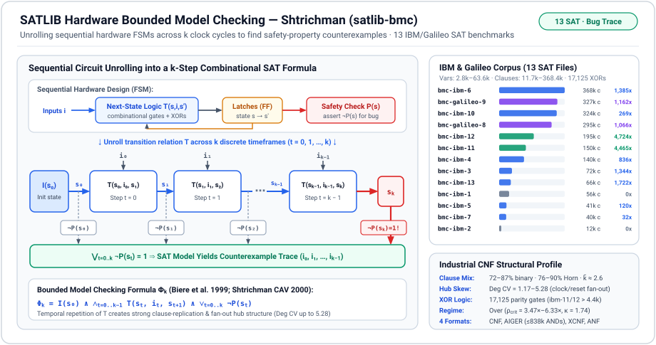

# SATLIB — Bounded Model Checking — Shtrichman (full) (`satlib-bmc`)

*Figure: Hardware Bounded Model Checking (BMC) unrolling of a sequential FSM transition relation $T(s_t, i_t, s_{t+1})$ across $k$ timeframes to find safety-violation counterexample traces ($\bigvee_t \neg P(s_t)=1$) across all 13 IBM/Galileo SAT benchmarks. Regenerated via [`src/gen_diagram.py`](src/gen_diagram.py).*

## Provenance & Credit

- **Upstream Archive:** [SATLIB — Benchmark Problems (UBC)](https://www.cs.ubc.ca/~hoos/SATLIB/benchm.html)
- **SATLIB Curators:** Holger H. Hoos and Thomas Stützle (University of British Columbia / TU Darmstadt)
- **Family Contributors:** Ofer Shtrichman (CAV 2000)
- **License:** Classic public scientific benchmark collection redistributed by UBC SATLIB for academic SAT research; no separate upstream `LICENSE` file is bundled in the archives.
- **Format Hygiene:** Legacy SATLIB trailing `%` / `0` EOF sentinels were stripped and wrapped multi-line clauses normalized to canonical 1-clause-per-line DIMACS CNF so every modern SAT solver parses all files cleanly.
- **Full SATLIB Archive Manifest:** [`../satlib-archive-uris/`](../satlib-archive-uris/README.md) (all 97 official UBC SATLIB `.tar.gz` archive URLs; Pretolani's `PRET` formulas live in [`../pretolani-pret/`](../pretolani-pret/README.md)).
- **Recommended by:** [`@jasonslenderman`](https://twitter.com/jasonslenderman) (Twitter/X)

## Problem Description

All 13 hardware Bounded Model Checking (BMC) instances from Ofer Shtrichman's IBM/Galileo verification benchmark suite.

## Corpus & Data Sizes

- **`cnf-orig/`** — 13 original native **DIMACS `.cnf.xz`** files (4.67 MB).
- **`aig-converted/`** — 13 exact **Binary AIGER 1.9 `.aig.xz`** conversions (5.41 MB, verified via [Berkeley ABC](https://github.com/berkeley-abc/abc) `read_aiger`).
- **`xcnf-converted/`** — 13 lossless **[CryptoMiniSat](https://github.com/msoos/cryptominisat) `.xcnf.xz`** conversions (4.53 MB, `17,125` extracted native XOR parity clauses).
- **`anf-converted/`** — 13 lossless linear-size **DIMACS-ANF `.anf.xz`** conversions (12.83 MB, generated via [`../src/to_anf.py`](../src/to_anf.py)).
- **[`expected.tsv`](expected.tsv)** — Ground-truth verdict manifest for all 13 instances (**13 SAT / 0 UNSAT**).
- **`src/`** — Standalone converters (`cnf2aig.py`, `cnf2xcnf.py`).

| Format | Directory | Files | Key Dimensions (Range) | Compressed Size |
|---|---|---:|---|---:|
| **DIMACS CNF (origin)** | `cnf-orig/` | 13 | Vars: 2,810–63,624; Clauses: 11,683–368,352 | 4.67 MB |
| **Binary AIGER 1.9** | `aig-converted/` | 13 | Inputs: 2,810–63,624; ANDs: 26,769–838,395 | 5.41 MB |
| **[CryptoMiniSat](https://github.com/msoos/cryptominisat) XCNF** | `xcnf-converted/` | 13 | Native XOR clauses total: 17,125 | 4.53 MB |
| **DIMACS-ANF** | `anf-converted/` | 13 | Vars: 6,449–263,727; Eqs: 15,306–576,285 (deg ≤ 3) | 12.83 MB |
| **Total (4 Formats, Status: 13 SAT / 0 UNSAT)** | | **52** | | **27.44 MB** |

## Benchmark Results

- **Hardware & Protocol:** Same machine (**AMD Ryzen 9 5950X**, 16C/32T Linux, **1 thread per run** pinned across 8 dedicated physical cores, $T_{\max} = 5\text{ s}$, PAR-2 penalty $10,000\text{ ms}$). All solvers ran with default single-thread flags (`-t 1` for CryptoMiniSat 5.18.0; `--max-cores 1` for Frobenius) on identical uncompressed flat `.cnf` inputs; **100% of all 13 instances** were run (no subsampling), every Frobenius SAT model was independently verified against 100% of input clauses, and **0 verdict disagreements** occurred across all solvers.

| Instance | Verdict | Frobenius 1C | [CaDiCaL](https://github.com/arminbiere/cadical) 3.1.0 | [CryptoMiniSat](https://github.com/msoos/cryptominisat) 5.18.0 | [dense-solver](https://github.com/libdense/dense-solver) 0.0.4 | [Kissat](https://github.com/arminbiere/kissat) 4.0.4 |
|---|:---:|---:|---:|---:|---:|---:|
| `bmc-galileo-8` | SAT | **177.77 ms** | 417.32 ms | 1,939.86 ms | 1,192.37 ms | 207.71 ms |
| `bmc-galileo-9` | SAT | **192.66 ms** | 711.71 ms | 2,073.07 ms | 1,551.13 ms | 324.09 ms |
| `bmc-ibm-1` | SAT | **48.15 ms** | 53.88 ms | 1,364.21 ms | 129.89 ms | 93.68 ms |
| `bmc-ibm-10` | SAT | **248.82 ms** | 649.90 ms | 2,192.34 ms | 2,430.23 ms | 265.20 ms |
| `bmc-ibm-11` | SAT | **115.17 ms** | 415.71 ms | 1,589.34 ms | 792.31 ms | 177.32 ms |
| `bmc-ibm-12` | SAT | **598.21 ms** | 1,230.99 ms | 2,740.33 ms | 3,165.09 ms | 958.33 ms |
| `bmc-ibm-13` | SAT | **166.50 ms** | 468.75 ms | 1,284.27 ms | 601.98 ms | 236.02 ms |
| `bmc-ibm-2` | SAT | **7.02 ms** | 7.43 ms | 46.80 ms | 13.77 ms | 15.40 ms |
| `bmc-ibm-3` | SAT | 106.12 ms | 209.83 ms | 1,152.26 ms | 226.45 ms | **88.69 ms** |
| `bmc-ibm-4` | SAT | **89.83 ms** | 134.65 ms | 1,331.23 ms | 572.45 ms | 104.02 ms |
| `bmc-ibm-5` | SAT | **19.47 ms** | 21.65 ms | 324.13 ms | 57.21 ms | 39.59 ms |
| `bmc-ibm-6` | SAT | 206.29 ms | 585.29 ms | 2,850.13 ms | 1,337.44 ms | **191.28 ms** |
| `bmc-ibm-7` | SAT | 11.60 ms | 16.64 ms | 241.85 ms | 52.73 ms | **8.39 ms** |
| **Solved (13 files)** | — | **13 / 13** *(highest)* | **13 / 13** *(highest)* | **13 / 13** *(highest)* | **13 / 13** *(highest)* | **13 / 13** *(highest)* |
| **Total PAR-2** | — | **1,987.6 ms** *(fastest)* | 4,923.8 ms *(2.48x slower)* | 19,129.8 ms *(9.62x slower)* | 12,123.0 ms *(6.10x slower)* | 2,709.7 ms *(1.36x slower)* |

<!-- BEGIN_STRUCTURAL_ANALYSIS -->
## Phase-Transition & Structural Analysis

*Auto-generated by [`../src/analyze_benchmarks.py`](../src/analyze_benchmarks.py). Position relative to the critical phase transition is measured by $\rho_{\mathrm{crit}} = \frac{1}{n}\sum_k m_k / \alpha_c(k)$ (exact $\alpha/\alpha_c(k)$ for pure $k$-SAT; effective critical threshold $\alpha_c^{\mathrm{eff}} = \alpha/\rho_{\mathrm{crit}}$; `Under` $<0.90\times$, `Near-crit` $0.90\text{--}1.10\times$, `Over` $>1.10\times$), alongside Gent–Walsh annealed constrainedness $\kappa = -\frac{1}{n}\sum_i \log_2(1-2^{-k_i})$ (AAAI 1996), clause-length profile ($\bar{k}$, `%Bin`, `%Horn`), variable-degree CV ($\sigma_d/\bar{d}$, uniformity vs. hub skew), and extracted native XOR parity clauses.*

| Instance | Active $n$ | Clauses $m$ | $\alpha=m/n$ | $\alpha_c^{\mathrm{eff}}$ | $\rho_{\mathrm{crit}}$ (Regime) | $\kappa$ | $\bar{k}$ ($k_{\max}$) | Bin% | Horn% | Pos% | Deg CV | XORs |
|---|---:|---:|---:|---:|---:|---:|---:|---:|---:|---:|---:|---:|
| `bmc-galileo-8` | 58,073 | 294,821 | 5.08 | 1.19 | **4.27x** (Over) | 1.82 | 2.60 (37) | 82% | 90% | 44% | 5.28 | 1,066 |
| `bmc-galileo-9` | 63,623 | 326,999 | 5.14 | 1.19 | **4.33x** (Over) | 1.85 | 2.61 (40) | 82% | 90% | 44% | 5.21 | 1,162 |
| `bmc-ibm-1` | 9,685 | 55,870 | 5.77 | 1.14 | **5.05x** (Over) | 2.13 | 2.68 (39) | 86% | 79% | 53% | 1.22 | 0 |
| `bmc-ibm-10` | 59,056 | 323,700 | 5.48 | 1.16 | **4.72x** (Over) | 2.00 | 2.64 (32) | 85% | 82% | 48% | 2.20 | 269 |
| `bmc-ibm-11` | 32,109 | 150,027 | 4.67 | 1.30 | **3.58x** (Over) | 1.58 | 2.63 (34) | 72% | 76% | 49% | 1.64 | 4,465 |
| `bmc-ibm-12` | 39,598 | 194,778 | 4.92 | 1.28 | **3.85x** (Over) | 1.68 | 2.65 (33) | 74% | 77% | 49% | 1.95 | 4,724 |
| `bmc-ibm-13` | 13,215 | 65,728 | 4.97 | 1.26 | **3.94x** (Over) | 1.74 | 2.65 (20) | 74% | 81% | 49% | 1.19 | 1,722 |
| `bmc-ibm-2` | 2,794 | 11,683 | 4.18 | 1.20 | **3.47x** (Over) | 1.50 | 2.52 (17) | 80% | 82% | 48% | 1.32 | 0 |
| `bmc-ibm-3` | 14,930 | 72,106 | 4.83 | 1.26 | **3.85x** (Over) | 1.68 | 2.62 (19) | 76% | 81% | 49% | 1.17 | 1,344 |
| `bmc-ibm-4` | 28,161 | 139,716 | 4.96 | 1.20 | **4.14x** (Over) | 1.77 | 2.63 (43) | 81% | 79% | 49% | 1.52 | 836 |
| `bmc-ibm-5` | 9,395 | 41,207 | 4.39 | 1.21 | **3.64x** (Over) | 1.57 | 2.55 (53) | 80% | 83% | 48% | 3.03 | 120 |
| `bmc-ibm-6` | 51,639 | 368,352 | 7.13 | 1.13 | **6.33x** (Over) | 2.67 | 2.73 (86) | 87% | 85% | 52% | 1.88 | 1,385 |
| `bmc-ibm-7` | 8,630 | 39,774 | 4.61 | 1.19 | **3.87x** (Over) | 1.66 | 2.56 (33) | 82% | 83% | 49% | 1.31 | 32 |

**Collection Phase-Transition Summary (13 instances, 4 formats: 13 CNF / 13 AIG / 13 XCNF / 13 ANF):** median $\rho_{\mathrm{crit}} = 3.94\times$ (range `3.47x–6.33x`), median $\kappa = 1.74$, regime split **0 Under / 0 Near-critical / 13 Over**, total extracted native XOR parity clauses = **17,125**, total ANF equations = **2,930,376**.
<!-- END_STRUCTURAL_ANALYSIS -->

## References

- H. H. Hoos and T. Stützle, *"SATLIB: An Online Resource for Research on SAT"*, SAT 2000, IOS Press, pp. 283–292 ([`cs.ubc.ca/~hoos/SATLIB/`](https://www.cs.ubc.ca/~hoos/SATLIB/benchm.html)).
- D. S. Johnson and M. A. Trick (eds.), *Cliques, Coloring, and Satisfiability: Second DIMACS Implementation Challenge*, DIMACS Series vol. 26, AMS, 1996.
