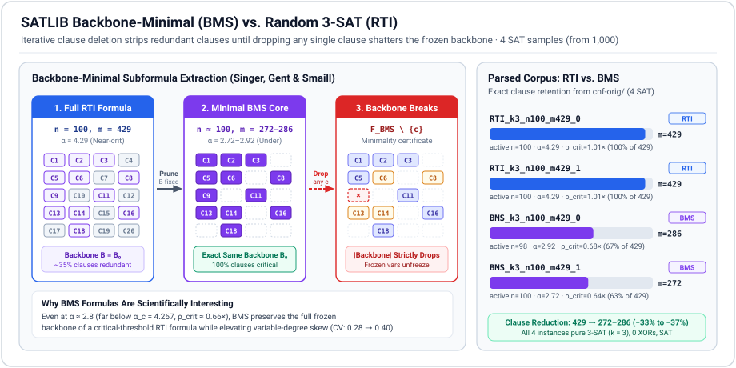

# SATLIB — Backbone-Minimal Random 3-SAT (sample / 1,000*) (`satlib-bms-rti`)

## Provenance & Credit

- **Upstream Archive:** [SATLIB — Benchmark Problems (UBC)](https://www.cs.ubc.ca/~hoos/SATLIB/benchm.html)
- **SATLIB Curators:** Holger H. Hoos and Thomas Stützle (University of British Columbia / TU Darmstadt)
- **Family Contributors:** Josh Singer, Ian P. Gent, and Alan Smaill
- **License:** Classic public scientific benchmark collection redistributed by UBC SATLIB for academic SAT research; no separate upstream `LICENSE` file is bundled in the archives.
- **Format Hygiene:** Legacy SATLIB trailing `%` / `0` EOF sentinels were stripped and wrapped multi-line clauses normalized to canonical 1-clause-per-line DIMACS CNF so every modern SAT solver parses all files cleanly.
- **Full SATLIB Archive Manifest:** [`../satlib-archive-uris/`](../satlib-archive-uris/README.md) (all 97 official UBC SATLIB `.tar.gz` archive URLs; Pretolani's `PRET` formulas live in [`../pretolani-pret/`](../pretolani-pret/README.md)).
- **Recommended by:** [`@jasonslenderman`](https://twitter.com/jasonslenderman) (Twitter/X)

## Problem Description

Stratified sample of 4 instances from the 1,000-instance SATLIB Backbone-Minimal (`BMS`) / Random-3-SAT (`RTI`) ensemble (full archive URLs in [`../satlib-archive-uris/`](../satlib-archive-uris/README.md)).

*Figure: Three-stage backbone-minimal clause-deletion pipeline showing redundant clause pruning (`RTI` $m=429 \to$ `BMS` $m=272\text{--}286$) until dropping any single clause shatters the frozen backbone core. Regenerated via [`src/gen_diagram.py`](src/gen_diagram.py).*

## Corpus & Data Sizes (Four Formats)

- **`cnf-orig/`** — 4 original native **DIMACS `.cnf.xz`** files (6.9 KB).
- **`aig-converted/`** — 4 exact **Binary AIGER 1.9 `.aig.xz`** conversions (8.6 KB, verified via [Berkeley ABC](https://github.com/berkeley-abc/abc) `read_aiger`).
- **`xcnf-converted/`** — 4 lossless **[CryptoMiniSat](https://github.com/msoos/cryptominisat) `.xcnf.xz`** conversions (7.1 KB, `0` extracted native XOR parity clauses).
- **`anf-converted/`** — 4 lossless linear-size **DIMACS-ANF `.anf.xz`** conversions (12.8 KB, generated via [`../src/to_anf.py`](../src/to_anf.py)).
- **[`expected.tsv`](expected.tsv)** — Ground-truth verdict manifest for all 4 instances (**4 SAT / 0 UNSAT**).
- **`src/`** — Standalone converters (`cnf2aig.py`, `cnf2xcnf.py`).

| Format | Directory | Files | Key Dimensions (Range) | Compressed Size |
|---|---|---:|---|---:|
| **DIMACS CNF (origin)** | `cnf-orig/` | 4 | Vars: 100; Clauses: 272–429 | 6.9 KB |
| **Binary AIGER 1.9** | `aig-converted/` | 4 | Inputs: 100; ANDs: 815–1,279 | 8.6 KB |
| **[CryptoMiniSat](https://github.com/msoos/cryptominisat) XCNF** | `xcnf-converted/` | 4 | Native XOR clauses total: 0 | 7.1 KB |
| **DIMACS-ANF** | `anf-converted/` | 4 | Vars: 100; Eqs: 272–429 (deg ≤ 3) | 12.8 KB |
| **Total (4 Formats, Status: 4 SAT / 0 UNSAT)** | | **16** | | **35.5 KB** |

## Comparative 1-Core Benchmark Results (All 4 Instances, Flat `.cnf`, $T_{\max} = 5\;\text{s}$)

- **Hardware & Protocol:** Same machine (**AMD Ryzen 9 5950X**, 16C/32T Linux, **1 thread per run** pinned across 8 dedicated physical cores, $T_{\max} = 5\;\text{s}$, PAR-2 penalty $10,000\;\text{ms}$). All solvers ran with default single-thread flags (`-t 1` for CryptoMiniSat 5.18.0; `--max-cores 1` for Frobenius) on identical uncompressed flat `.cnf` inputs; **100% of all 4 instances** were run (no subsampling), every Frobenius SAT model was independently verified against 100% of input clauses, and **0 verdict disagreements** occurred across all solvers.

| Instance | Verdict | Frobenius 1C | [CaDiCaL](https://github.com/arminbiere/cadical) 3.1.0 | [CryptoMiniSat](https://github.com/msoos/cryptominisat) 5.18.0 | [dense-solver](https://github.com/libdense/dense-solver) 0.0.4 | [Kissat](https://github.com/arminbiere/kissat) 4.0.4 |
|---|:---:|---:|---:|---:|---:|---:|
| `BMS_k3_n100_m429_0` | SAT | 4.06 ms | 7.91 ms | 13.73 ms | **2.60 ms** | 10.85 ms |
| `BMS_k3_n100_m429_1` | SAT | **2.26 ms** | 3.37 ms | 23.52 ms | 4.16 ms | 7.89 ms |
| `RTI_k3_n100_m429_0` | SAT | **2.71 ms** | 5.11 ms | 25.14 ms | 2.86 ms | 15.03 ms |
| `RTI_k3_n100_m429_1` | SAT | 2.27 ms | 4.18 ms | 23.01 ms | **1.97 ms** | 15.26 ms |
| **Total (4 files, PAR-2)** | **4/4** | **4/4 — 11.3 ms** *(fastest)* | 4/4 — 20.6 ms *(1.82x)* | 4/4 — 85.4 ms *(7.56x)* | 4/4 — 11.6 ms *(1.03x)* | 4/4 — 49.0 ms *(4.34x)* |

<!-- BEGIN_STRUCTURAL_ANALYSIS -->
## Phase-Transition & Structural Analysis

*Auto-generated by [`../src/analyze_benchmarks.py`](../src/analyze_benchmarks.py). Position relative to the critical phase transition is measured by $\rho_{\mathrm{crit}} = \frac{1}{n}\sum_k m_k / \alpha_c(k)$ (exact $\alpha/\alpha_c(k)$ for pure $k$-SAT; effective critical threshold $\alpha_c^{\mathrm{eff}} = \alpha/\rho_{\mathrm{crit}}$; `Under` $<0.90\times$, `Near-crit` $0.90\text{--}1.10\times$, `Over` $>1.10\times$), alongside Gent–Walsh annealed constrainedness $\kappa = -\frac{1}{n}\sum_i \log_2(1-2^{-k_i})$ (AAAI 1996), clause-length profile ($\bar{k}$, `%Bin`, `%Horn`), variable-degree CV ($\sigma_d/\bar{d}$, uniformity vs. hub skew), and extracted native XOR parity clauses.*

| Instance | Active $n$ | Clauses $m$ | $\alpha=m/n$ | $\alpha_c^{\mathrm{eff}}$ | $\rho_{\mathrm{crit}}$ (Regime) | $\kappa$ | $\bar{k}$ ($k_{\max}$) | Bin% | Horn% | Pos% | Deg CV | XORs |
|---|---:|---:|---:|---:|---:|---:|---:|---:|---:|---:|---:|---:|
| `BMS_k3_n100_m429_0` | 98 | 286 | 2.92 | 4.27 | **0.68x** (Under) | 0.56 | 3.00 (3) | 0% | 48% | 51% | 0.37 | 0 |
| `BMS_k3_n100_m429_1` | 100 | 272 | 2.72 | 4.27 | **0.64x** (Under) | 0.52 | 3.00 (3) | 0% | 49% | 51% | 0.42 | 0 |
| `RTI_k3_n100_m429_0` | 100 | 429 | 4.29 | 4.27 | **1.01x** (Near-crit) | 0.83 | 3.00 (3) | 0% | 44% | 53% | 0.29 | 0 |
| `RTI_k3_n100_m429_1` | 100 | 429 | 4.29 | 4.27 | **1.01x** (Near-crit) | 0.83 | 3.00 (3) | 0% | 47% | 53% | 0.28 | 0 |

**Collection Phase-Transition Summary (4 instances, 4 formats: 4 CNF / 4 AIG / 4 XCNF / 4 ANF):** median $\rho_{\mathrm{crit}} = 0.84\times$ (range `0.64x–1.01x`), median $\kappa = 0.69$, regime split **2 Under / 2 Near-critical / 0 Over**, total extracted native XOR parity clauses = **0**, total ANF equations = **1,416**.
<!-- END_STRUCTURAL_ANALYSIS -->

## References

- H. H. Hoos and T. Stützle, *"SATLIB: An Online Resource for Research on SAT"*, SAT 2000, IOS Press, pp. 283–292 ([`cs.ubc.ca/~hoos/SATLIB/`](https://www.cs.ubc.ca/~hoos/SATLIB/benchm.html)).
- D. S. Johnson and M. A. Trick (eds.), *Cliques, Coloring, and Satisfiability: Second DIMACS Implementation Challenge*, DIMACS Series vol. 26, AMS, 1996.
