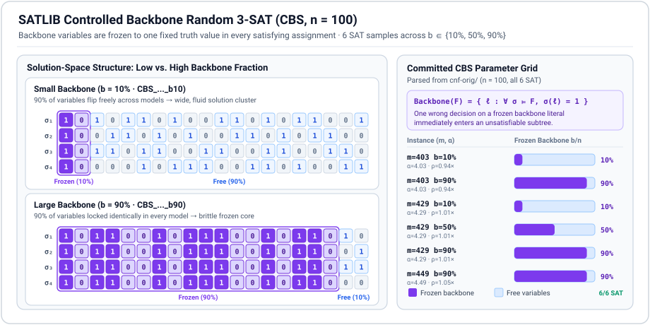

# SATLIB — Controlled Backbone Random 3-SAT (sample / 40,000*) (`satlib-cbs`)

*Figure: Solution-space assignment matrix contrasting fluid low-backbone ($b = 10\%$) against rigid frozen-core ($b = 90\%$) satisfying assignments alongside the parsed 6-instance $(m, b)$ parameter grid. Regenerated via [`src/gen_diagram.py`](src/gen_diagram.py).*

## Provenance & Credit

- **Upstream Archive:** [SATLIB — Benchmark Problems (UBC)](https://www.cs.ubc.ca/~hoos/SATLIB/benchm.html)
- **SATLIB Curators:** Holger H. Hoos and Thomas Stützle (University of British Columbia / TU Darmstadt)
- **Family Contributors:** Josh Singer, Ian P. Gent, and Alan Smaill
- **License:** Classic public scientific benchmark collection redistributed by UBC SATLIB for academic SAT research; no separate upstream `LICENSE` file is bundled in the archives.
- **Format Hygiene:** Legacy SATLIB trailing `%` / `0` EOF sentinels were stripped and wrapped multi-line clauses normalized to canonical 1-clause-per-line DIMACS CNF so every modern SAT solver parses all files cleanly.
- **Full SATLIB Archive Manifest:** [`../satlib-archive-uris/`](../satlib-archive-uris/README.md) (all 97 official UBC SATLIB `.tar.gz` archive URLs; Pretolani's `PRET` formulas live in [`../pretolani-pret/`](../pretolani-pret/README.md)).
- **Recommended by:** [`@jasonslenderman`](https://twitter.com/jasonslenderman) (Twitter/X)

## Problem Description

Stratified sample of 6 instances from the 40,000-instance SATLIB Controlled Backbone Size (`CBS`) random 3-SAT ensemble (full archive URLs in [`../satlib-archive-uris/`](../satlib-archive-uris/README.md)).

## Corpus & Data Sizes

- **`cnf-orig/`** — 6 original native **DIMACS `.cnf.xz`** files (12.1 KB).
- **`aig-converted/`** — 6 exact **Binary AIGER 1.9 `.aig.xz`** conversions (15.0 KB, verified via [Berkeley ABC](https://github.com/berkeley-abc/abc) `read_aiger`).
- **`xcnf-converted/`** — 6 lossless **[CryptoMiniSat](https://github.com/msoos/cryptominisat) `.xcnf.xz`** conversions (12.4 KB, `0` extracted native XOR parity clauses).
- **`anf-converted/`** — 6 lossless linear-size **DIMACS-ANF `.anf.xz`** conversions (22.4 KB, generated via [`../src/to_anf.py`](../src/to_anf.py)).
- **[`expected.tsv`](expected.tsv)** — Ground-truth verdict manifest for all 6 instances (**6 SAT / 0 UNSAT**).
- **`src/`** — Standalone converters (`cnf2aig.py`, `cnf2xcnf.py`).

| Format | Directory | Files | Key Dimensions (Range) | Compressed Size |
|---|---|---:|---|---:|
| **DIMACS CNF (origin)** | `cnf-orig/` | 6 | Vars: 100; Clauses: 403–449 | 12.1 KB |
| **Binary AIGER 1.9** | `aig-converted/` | 6 | Inputs: 100; ANDs: 1,198–1,339 | 15.0 KB |
| **[CryptoMiniSat](https://github.com/msoos/cryptominisat) XCNF** | `xcnf-converted/` | 6 | Native XOR clauses total: 0 | 12.4 KB |
| **DIMACS-ANF** | `anf-converted/` | 6 | Vars: 100; Eqs: 403–449 (deg ≤ 3) | 22.4 KB |
| **Total (4 Formats, Status: 6 SAT / 0 UNSAT)** | | **24** | | **61.8 KB** |

## Benchmark Results

- **Hardware & Protocol:** Same machine (**AMD Ryzen 9 5950X**, 16C/32T Linux, **1 thread per run** pinned across 8 dedicated physical cores, $T_{\max} = 5\;\text{s}$, PAR-2 penalty $10,000\;\text{ms}$). All solvers ran with default single-thread flags (`-t 1` for CryptoMiniSat 5.18.0; `--max-cores 1` for Frobenius) on identical uncompressed flat `.cnf` inputs; **100% of all 6 instances** were run (no subsampling), every Frobenius SAT model was independently verified against 100% of input clauses, and **0 verdict disagreements** occurred across all solvers.

| Instance | Verdict | Frobenius 1C | [CaDiCaL](https://github.com/arminbiere/cadical) 3.1.0 | [CryptoMiniSat](https://github.com/msoos/cryptominisat) 5.18.0 | [dense-solver](https://github.com/libdense/dense-solver) 0.0.4 | [Kissat](https://github.com/arminbiere/kissat) 4.0.4 |
|---|:---:|---:|---:|---:|---:|---:|
| `CBS_k3_n100_m403_b10_0` | SAT | **0.91 ms** | 7.93 ms | 17.12 ms | 2.52 ms | 12.84 ms |
| `CBS_k3_n100_m403_b90_0` | SAT | **1.73 ms** | 3.18 ms | 30.17 ms | 2.49 ms | 15.94 ms |
| `CBS_k3_n100_m429_b10_0` | SAT | **0.81 ms** | 2.65 ms | 19.54 ms | 2.00 ms | 14.08 ms |
| `CBS_k3_n100_m429_b50_0` | SAT | **0.81 ms** | 3.45 ms | 20.74 ms | 2.01 ms | 13.50 ms |
| `CBS_k3_n100_m429_b90_0` | SAT | **0.97 ms** | 3.74 ms | 32.74 ms | 2.61 ms | 17.47 ms |
| `CBS_k3_n100_m449_b90_0` | SAT | **0.78 ms** | 5.75 ms | 52.03 ms | 1.74 ms | 28.02 ms |
| **Total (6 files, PAR-2)** | **6/6** | **6/6 — 6.0 ms** *(fastest)* | 6/6 — 26.7 ms *(4.44x)* | 6/6 — 172.3 ms *(28.62x)* | 6/6 — 13.4 ms *(2.23x)* | 6/6 — 101.8 ms *(16.91x)* |

<!-- BEGIN_STRUCTURAL_ANALYSIS -->
## Phase-Transition & Structural Analysis

*Auto-generated by [`../src/analyze_benchmarks.py`](../src/analyze_benchmarks.py). Position relative to the critical phase transition is measured by $\rho_{\mathrm{crit}} = \frac{1}{n}\sum_k m_k / \alpha_c(k)$ (exact $\alpha/\alpha_c(k)$ for pure $k$-SAT; effective critical threshold $\alpha_c^{\mathrm{eff}} = \alpha/\rho_{\mathrm{crit}}$; `Under` $<0.90\times$, `Near-crit` $0.90\text{--}1.10\times$, `Over` $>1.10\times$), alongside Gent–Walsh annealed constrainedness $\kappa = -\frac{1}{n}\sum_i \log_2(1-2^{-k_i})$ (AAAI 1996), clause-length profile ($\bar{k}$, `%Bin`, `%Horn`), variable-degree CV ($\sigma_d/\bar{d}$, uniformity vs. hub skew), and extracted native XOR parity clauses.*

| Instance | Active $n$ | Clauses $m$ | $\alpha=m/n$ | $\alpha_c^{\mathrm{eff}}$ | $\rho_{\mathrm{crit}}$ (Regime) | $\kappa$ | $\bar{k}$ ($k_{\max}$) | Bin% | Horn% | Pos% | Deg CV | XORs |
|---|---:|---:|---:|---:|---:|---:|---:|---:|---:|---:|---:|---:|
| `CBS_k3_n100_m403_b10_0` | 100 | 403 | 4.03 | 4.27 | **0.94x** (Near-crit) | 0.78 | 3.00 (3) | 0% | 50% | 50% | 0.28 | 0 |
| `CBS_k3_n100_m403_b90_0` | 100 | 403 | 4.03 | 4.27 | **0.94x** (Near-crit) | 0.78 | 3.00 (3) | 0% | 51% | 50% | 0.29 | 0 |
| `CBS_k3_n100_m429_b10_0` | 100 | 429 | 4.29 | 4.27 | **1.01x** (Near-crit) | 0.83 | 3.00 (3) | 0% | 46% | 53% | 0.25 | 0 |
| `CBS_k3_n100_m429_b50_0` | 100 | 429 | 4.29 | 4.27 | **1.01x** (Near-crit) | 0.83 | 3.00 (3) | 0% | 47% | 51% | 0.28 | 0 |
| `CBS_k3_n100_m429_b90_0` | 100 | 429 | 4.29 | 4.27 | **1.01x** (Near-crit) | 0.83 | 3.00 (3) | 0% | 46% | 53% | 0.28 | 0 |
| `CBS_k3_n100_m449_b90_0` | 100 | 449 | 4.49 | 4.27 | **1.05x** (Near-crit) | 0.86 | 3.00 (3) | 0% | 50% | 50% | 0.28 | 0 |

**Collection Phase-Transition Summary (6 instances, 4 formats: 6 CNF / 6 AIG / 6 XCNF / 6 ANF):** median $\rho_{\mathrm{crit}} = 1.01\times$ (range `0.94x–1.05x`), median $\kappa = 0.83$, regime split **0 Under / 6 Near-critical / 0 Over**, total extracted native XOR parity clauses = **0**, total ANF equations = **2,542**.
<!-- END_STRUCTURAL_ANALYSIS -->

## References

- H. H. Hoos and T. Stützle, *"SATLIB: An Online Resource for Research on SAT"*, SAT 2000, IOS Press, pp. 283–292 ([`cs.ubc.ca/~hoos/SATLIB/`](https://www.cs.ubc.ca/~hoos/SATLIB/benchm.html)).
- D. S. Johnson and M. A. Trick (eds.), *Cliques, Coloring, and Satisfiability: Second DIMACS Implementation Challenge*, DIMACS Series vol. 26, AMS, 1996.
