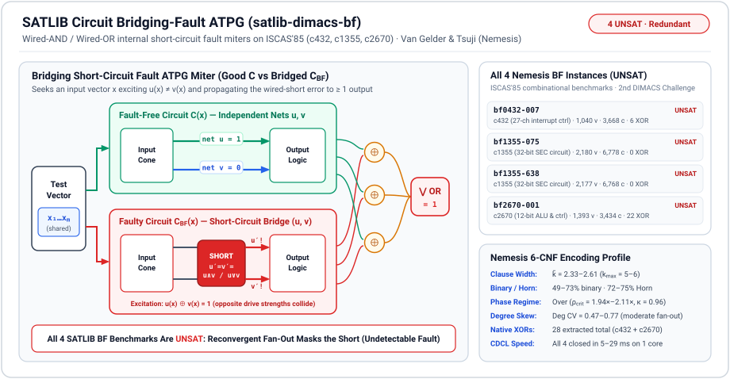

# SATLIB — Circuit Bridge-Fault Analysis (full) (`satlib-dimacs-bf`)

*Figure: Combinational circuit bridging-fault ATPG miter contrasting fault-free nets $(u, v)$ against a wired-AND/OR internal short-circuit ($u' = v'$) across all 4 redundant UNSAT Nemesis ISCAS'85 (`c432`, `c1355`, `c2670`) benchmarks. Regenerated via [`src/gen_diagram.py`](src/gen_diagram.py).*

## Provenance & Credit

- **Upstream Archive:** [SATLIB — Benchmark Problems (UBC)](https://www.cs.ubc.ca/~hoos/SATLIB/benchm.html)
- **SATLIB Curators:** Holger H. Hoos and Thomas Stützle (University of British Columbia / TU Darmstadt)
- **Family Contributors:** Allen Van Gelder and Yumi Tsuji
- **License:** Classic public scientific benchmark collection redistributed by UBC SATLIB for academic SAT research; no separate upstream `LICENSE` file is bundled in the archives.
- **Format Hygiene:** Legacy SATLIB trailing `%` / `0` EOF sentinels were stripped and wrapped multi-line clauses normalized to canonical 1-clause-per-line DIMACS CNF so every modern SAT solver parses all files cleanly.
- **Format Hygiene Note:** Leading `c p ...` comment lines in legacy files were prefixed as `c - p ...` (zero clause/variable changes) so [CryptoMiniSat](https://github.com/msoos/cryptominisat) 5.18.0's model-counting directive parser reads them without error.
- **Full SATLIB Archive Manifest:** [`../satlib-archive-uris/`](../satlib-archive-uris/README.md) (all 97 official UBC SATLIB `.tar.gz` archive URLs; Pretolani's `PRET` formulas live in [`../pretolani-pret/`](../pretolani-pret/README.md)).
- **Recommended by:** [`@jasonslenderman`](https://twitter.com/jasonslenderman) (Twitter/X)

## Problem Description

All 4 combinational circuit bridge-fault test-pattern generation instances (`bf0432`, `bf1355`, `bf2670`) from the Second DIMACS Challenge.

## Corpus & Data Sizes

- **`cnf-orig/`** — 4 original native **DIMACS `.cnf.xz`** files (61.0 KB).
- **`aig-converted/`** — 4 exact **Binary AIGER 1.9 `.aig.xz`** conversions (73.7 KB, verified via [Berkeley ABC](https://github.com/berkeley-abc/abc) `read_aiger`).
- **`xcnf-converted/`** — 4 lossless **[CryptoMiniSat](https://github.com/msoos/cryptominisat) `.xcnf.xz`** conversions (61.0 KB, `28` extracted native XOR parity clauses).
- **`anf-converted/`** — 4 lossless linear-size **DIMACS-ANF `.anf.xz`** conversions (113.9 KB, generated via [`../src/to_anf.py`](../src/to_anf.py)).
- **[`expected.tsv`](expected.tsv)** — Ground-truth verdict manifest for all 4 instances (**0 SAT / 4 UNSAT**).
- **`src/`** — Standalone converters (`cnf2aig.py`, `cnf2xcnf.py`).

| Format | Directory | Files | Key Dimensions (Range) | Compressed Size |
|---|---|---:|---|---:|
| **DIMACS CNF (origin)** | `cnf-orig/` | 4 | Vars: 1,040–2,180; Clauses: 3,434–6,778 | 61.0 KB |
| **Binary AIGER 1.9** | `aig-converted/` | 4 | Inputs: 1,040–2,180; ANDs: 7,848–16,661 | 73.7 KB |
| **[CryptoMiniSat](https://github.com/msoos/cryptominisat) XCNF** | `xcnf-converted/` | 4 | Native XOR clauses total: 28 | 61.0 KB |
| **DIMACS-ANF** | `anf-converted/` | 4 | Vars: 1,417–2,706; Eqs: 3,600–7,304 (deg ≤ 3) | 113.9 KB |
| **Total (4 Formats, Status: 0 SAT / 4 UNSAT)** | | **16** | | **309.5 KB** |

## Benchmark Results

- **Hardware & Protocol:** Same machine (**AMD Ryzen 9 5950X**, 16C/32T Linux, **1 thread per run** pinned across 8 dedicated physical cores, $T_{\max} = 5\;\text{s}$, PAR-2 penalty $10,000\;\text{ms}$). All solvers ran with default single-thread flags (`-t 1` for CryptoMiniSat 5.18.0; `--max-cores 1` for Frobenius) on identical uncompressed flat `.cnf` inputs; **100% of all 4 instances** were run (no subsampling), every Frobenius SAT model was independently verified against 100% of input clauses, and **0 verdict disagreements** occurred across all solvers.

| Instance | Verdict | Frobenius 1C | [CaDiCaL](https://github.com/arminbiere/cadical) 3.1.0 | [CryptoMiniSat](https://github.com/msoos/cryptominisat) 5.18.0 | [dense-solver](https://github.com/libdense/dense-solver) 0.0.4 | [Kissat](https://github.com/arminbiere/kissat) 4.0.4 |
|---|:---:|---:|---:|---:|---:|---:|
| `bf0432-007` | UNSAT | 17.24 ms | 7.76 ms | 77.02 ms | 12.76 ms | **6.53 ms** |
| `bf1355-075` | UNSAT | 21.00 ms | 5.87 ms | 40.35 ms | 30.81 ms | **5.52 ms** |
| `bf1355-638` | UNSAT | 28.12 ms | **6.63 ms** | 40.86 ms | 36.13 ms | 7.62 ms |
| `bf2670-001` | UNSAT | 29.11 ms | **5.11 ms** | 49.87 ms | 12.29 ms | 7.69 ms |
| **Total (4 files, PAR-2)** | **4/4** | 4/4 — 95.5 ms *(3.76x)* | **4/4 — 25.4 ms** *(fastest)* | 4/4 — 208.1 ms *(8.20x)* | 4/4 — 92.0 ms *(3.63x)* | 4/4 — 27.4 ms *(1.08x)* |

<!-- BEGIN_STRUCTURAL_ANALYSIS -->
## Phase-Transition & Structural Analysis

*Auto-generated by [`../src/analyze_benchmarks.py`](../src/analyze_benchmarks.py). Position relative to the critical phase transition is measured by $\rho_{\mathrm{crit}} = \frac{1}{n}\sum_k m_k / \alpha_c(k)$ (exact $\alpha/\alpha_c(k)$ for pure $k$-SAT; effective critical threshold $\alpha_c^{\mathrm{eff}} = \alpha/\rho_{\mathrm{crit}}$; `Under` $<0.90\times$, `Near-crit` $0.90\text{--}1.10\times$, `Over` $>1.10\times$), alongside Gent–Walsh annealed constrainedness $\kappa = -\frac{1}{n}\sum_i \log_2(1-2^{-k_i})$ (AAAI 1996), clause-length profile ($\bar{k}$, `%Bin`, `%Horn`), variable-degree CV ($\sigma_d/\bar{d}$, uniformity vs. hub skew), and extracted native XOR parity clauses.*

| Instance | Active $n$ | Clauses $m$ | $\alpha=m/n$ | $\alpha_c^{\mathrm{eff}}$ | $\rho_{\mathrm{crit}}$ (Regime) | $\kappa$ | $\bar{k}$ ($k_{\max}$) | Bin% | Horn% | Pos% | Deg CV | XORs |
|---|---:|---:|---:|---:|---:|---:|---:|---:|---:|---:|---:|---:|
| `bf0432-007` | 1,040 | 3,668 | 3.53 | 1.67 | **2.11x** (Over) | 1.03 | 2.61 (6) | 49% | 75% | 39% | 0.54 | 6 |
| `bf1355-075` | 2,180 | 6,778 | 3.11 | 1.54 | **2.01x** (Over) | 0.96 | 2.52 (6) | 55% | 72% | 44% | 0.47 | 0 |
| `bf1355-638` | 2,177 | 6,768 | 3.11 | 1.54 | **2.02x** (Over) | 0.96 | 2.52 (6) | 55% | 72% | 43% | 0.47 | 0 |
| `bf2670-001` | 1,393 | 3,434 | 2.47 | 1.27 | **1.94x** (Over) | 0.86 | 2.33 (5) | 73% | 72% | 52% | 0.77 | 22 |

**Collection Phase-Transition Summary (4 instances, 4 formats: 4 CNF / 4 AIG / 4 XCNF / 4 ANF):** median $\rho_{\mathrm{crit}} = 2.01\times$ (range `1.94x–2.11x`), median $\kappa = 0.96$, regime split **0 Under / 0 Near-critical / 4 Over**, total extracted native XOR parity clauses = **28**, total ANF equations = **22,223**.
<!-- END_STRUCTURAL_ANALYSIS -->

## References

- H. H. Hoos and T. Stützle, *"SATLIB: An Online Resource for Research on SAT"*, SAT 2000, IOS Press, pp. 283–292 ([`cs.ubc.ca/~hoos/SATLIB/`](https://www.cs.ubc.ca/~hoos/SATLIB/benchm.html)).
- D. S. Johnson and M. A. Trick (eds.), *Cliques, Coloring, and Satisfiability: Second DIMACS Implementation Challenge*, DIMACS Series vol. 26, AMS, 1996.
