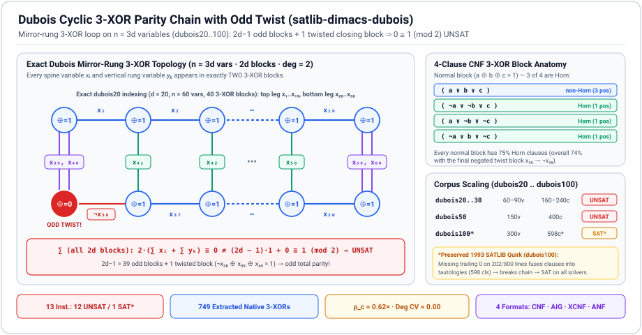

# SATLIB — Dubois Hard Parity UNSAT (full) (`satlib-dimacs-dubois`)

*Figure: Exact Dubois mirror-rung cyclic 3-XOR parity ladder on $n = 3d$ degree-2 variables closing with one negated odd-twist block, 4-clause CNF XOR anatomy (74% Horn), and the preserved `dubois100` quirk. Regenerated via [`src/gen_diagram.py`](src/gen_diagram.py).*

## Provenance & Credit

- **Upstream Archive:** [SATLIB — Benchmark Problems (UBC)](https://www.cs.ubc.ca/~hoos/SATLIB/benchm.html)
- **SATLIB Curators:** Holger H. Hoos and Thomas Stützle (University of British Columbia / TU Darmstadt)
- **Family Contributors:** Olivier Dubois
- **License:** Classic public scientific benchmark collection redistributed by UBC SATLIB for academic SAT research; no separate upstream `LICENSE` file is bundled in the archives.
- **Format Hygiene:** Legacy SATLIB trailing `%` / `0` EOF sentinels were stripped and wrapped multi-line clauses normalized to canonical 1-clause-per-line DIMACS CNF so every modern SAT solver parses all files cleanly.
- **Format Hygiene Notes:**
  1. Leading `c p ...` comment lines were prefixed as `c - p ...` (zero clause/variable changes) for [CryptoMiniSat](https://github.com/msoos/cryptominisat) 5.18.0 compatibility.
  2. *Historical upstream quirk preserved:* Upstream SATLIB's `dubois100.cnf` omits the trailing `0` terminator on 202 of its 800 lines in the original 1993 file, fusing adjacent clauses into tautologies (`598` `0`-terminated clauses); all five modern DIMACS solvers agree verbatim `dubois100.cnf` is SAT while `dubois20..50` are UNSAT.
- **Full SATLIB Archive Manifest:** [`../satlib-archive-uris/`](../satlib-archive-uris/README.md) (all 97 official UBC SATLIB `.tar.gz` archive URLs; Pretolani's `PRET` formulas live in [`../pretolani-pret/`](../pretolani-pret/README.md)).
- **Recommended by:** [`@jasonslenderman`](https://twitter.com/jasonslenderman) (Twitter/X)

## Problem Description

All 13 classic Dubois parity-based 3-SAT formulas (`dubois20`–`dubois100`) from the Second DIMACS Implementation Challenge.

## Corpus & Data Sizes

- **`cnf-orig/`** — 13 original native **DIMACS `.cnf.xz`** files (11.6 KB).
- **`aig-converted/`** — 13 exact **Binary AIGER 1.9 `.aig.xz`** conversions (13.7 KB, verified via [Berkeley ABC](https://github.com/berkeley-abc/abc) `read_aiger`).
- **`xcnf-converted/`** — 13 lossless **[CryptoMiniSat](https://github.com/msoos/cryptominisat) `.xcnf.xz`** conversions (7.3 KB, `749` extracted native XOR parity clauses).
- **`anf-converted/`** — 13 lossless linear-size **DIMACS-ANF `.anf.xz`** conversions (5.4 KB, generated via [`../src/to_anf.py`](../src/to_anf.py)).
- **[`expected.tsv`](expected.tsv)** — Ground-truth verdict manifest for all 13 instances (**1 SAT / 12 UNSAT**).
- **`src/`** — Standalone converters (`cnf2aig.py`, `cnf2xcnf.py`).

| Format | Directory | Files | Key Dimensions (Range) | Compressed Size |
|---|---|---:|---|---:|
| **DIMACS CNF (origin)** | `cnf-orig/` | 13 | Vars: 60–300; Clauses: 160–598 | 11.6 KB |
| **Binary AIGER 1.9** | `aig-converted/` | 13 | Inputs: 60–300; ANDs: 479–1,199 | 13.7 KB |
| **[CryptoMiniSat](https://github.com/msoos/cryptominisat) XCNF** | `xcnf-converted/` | 13 | Native XOR clauses total: 749 | 7.3 KB |
| **DIMACS-ANF** | `anf-converted/` | 13 | Vars: 60–300; Eqs: 40–100 (deg ≤ 1) | 5.4 KB |
| **Total (4 Formats, Status: Mixed (12 UNSAT / 1 SAT*))** | | **52** | | **38.0 KB** |

## Benchmark Results

- **Hardware & Protocol:** Same machine (**AMD Ryzen 9 5950X**, 16C/32T Linux, **1 thread per run** pinned across 8 dedicated physical cores, $T_{\max} = 5\;\text{s}$, PAR-2 penalty $10,000\;\text{ms}$). All solvers ran with default single-thread flags (`-t 1` for CryptoMiniSat 5.18.0; `--max-cores 1` for Frobenius) on identical uncompressed flat `.cnf` inputs; **100% of all 13 instances** were run (no subsampling), every Frobenius SAT model was independently verified against 100% of input clauses, and **0 verdict disagreements** occurred across all solvers.

| Instance | Verdict | Frobenius 1C | [CaDiCaL](https://github.com/arminbiere/cadical) 3.1.0 | [CryptoMiniSat](https://github.com/msoos/cryptominisat) 5.18.0 | [dense-solver](https://github.com/libdense/dense-solver) 0.0.4 | [Kissat](https://github.com/arminbiere/kissat) 4.0.4 |
|---|:---:|---:|---:|---:|---:|---:|
| `dubois100` | SAT | 2.02 ms | 2.60 ms | 5.22 ms | 1.60 ms | **1.53 ms** |
| `dubois20` | UNSAT | 2.15 ms | 2.61 ms | 25.31 ms | **1.65 ms** | 1.69 ms |
| `dubois21` | UNSAT | 1.79 ms | 2.46 ms | 18.18 ms | **1.46 ms** | 1.48 ms |
| `dubois22` | UNSAT | 1.97 ms | 2.45 ms | 19.51 ms | **1.48 ms** | 1.63 ms |
| `dubois23` | UNSAT | 2.25 ms | 2.94 ms | 18.23 ms | **1.39 ms** | 1.54 ms |
| `dubois24` | UNSAT | 2.03 ms | 2.92 ms | 23.29 ms | **1.61 ms** | 1.68 ms |
| `dubois25` | UNSAT | **1.65 ms** | 2.17 ms | 18.00 ms | 2.05 ms | 1.70 ms |
| `dubois26` | UNSAT | 1.89 ms | 2.39 ms | 18.46 ms | 1.62 ms | **1.54 ms** |
| `dubois27` | UNSAT | 1.81 ms | 2.34 ms | 18.48 ms | 1.57 ms | **1.55 ms** |
| `dubois28` | UNSAT | 1.69 ms | 2.52 ms | 17.88 ms | 1.66 ms | **1.50 ms** |
| `dubois29` | UNSAT | 2.02 ms | 2.67 ms | 24.04 ms | **1.83 ms** | 1.88 ms |
| `dubois30` | UNSAT | 1.72 ms | 2.50 ms | 18.72 ms | **1.59 ms** | 1.71 ms |
| `dubois50` | UNSAT | **1.84 ms** | 2.54 ms | 26.98 ms | 2.02 ms | 2.34 ms |
| **Total (13 files, PAR-2)** | **13/13** | 13/13 — 24.8 ms *(1.15x)* | 13/13 — 33.1 ms *(1.54x)* | 13/13 — 252.3 ms *(11.72x)* | **13/13 — 21.5 ms** *(fastest)* | 13/13 — 21.8 ms *(1.01x)* |

<!-- BEGIN_STRUCTURAL_ANALYSIS -->
## Phase-Transition & Structural Analysis

*Auto-generated by [`../src/analyze_benchmarks.py`](../src/analyze_benchmarks.py). Position relative to the critical phase transition is measured by $\rho_{\mathrm{crit}} = \frac{1}{n}\sum_k m_k / \alpha_c(k)$ (exact $\alpha/\alpha_c(k)$ for pure $k$-SAT; effective critical threshold $\alpha_c^{\mathrm{eff}} = \alpha/\rho_{\mathrm{crit}}$; `Under` $<0.90\times$, `Near-crit` $0.90\text{--}1.10\times$, `Over` $>1.10\times$), alongside Gent–Walsh annealed constrainedness $\kappa = -\frac{1}{n}\sum_i \log_2(1-2^{-k_i})$ (AAAI 1996), clause-length profile ($\bar{k}$, `%Bin`, `%Horn`), variable-degree CV ($\sigma_d/\bar{d}$, uniformity vs. hub skew), and extracted native XOR parity clauses.*

| Instance | Active $n$ | Clauses $m$ | $\alpha=m/n$ | $\alpha_c^{\mathrm{eff}}$ | $\rho_{\mathrm{crit}}$ (Regime) | $\kappa$ | $\bar{k}$ ($k_{\max}$) | Bin% | Horn% | Pos% | Deg CV | XORs |
|---|---:|---:|---:|---:|---:|---:|---:|---:|---:|---:|---:|---:|
| `dubois100` | 300 | 598 | 1.99 | 6.14 | **0.32x** (Under) | 0.27 | 4.01 (6) | 0% | 50% | 50% | 0.00 | 99 |
| `dubois20` | 60 | 160 | 2.67 | 4.27 | **0.62x** (Under) | 0.51 | 3.00 (3) | 0% | 74% | 50% | 0.00 | 40 |
| `dubois21` | 63 | 168 | 2.67 | 4.27 | **0.62x** (Under) | 0.51 | 3.00 (3) | 0% | 74% | 50% | 0.00 | 42 |
| `dubois22` | 66 | 176 | 2.67 | 4.27 | **0.62x** (Under) | 0.51 | 3.00 (3) | 0% | 74% | 50% | 0.00 | 44 |
| `dubois23` | 69 | 184 | 2.67 | 4.27 | **0.62x** (Under) | 0.51 | 3.00 (3) | 0% | 74% | 50% | 0.00 | 46 |
| `dubois24` | 72 | 192 | 2.67 | 4.27 | **0.62x** (Under) | 0.51 | 3.00 (3) | 0% | 74% | 50% | 0.00 | 48 |
| `dubois25` | 75 | 200 | 2.67 | 4.27 | **0.62x** (Under) | 0.51 | 3.00 (3) | 0% | 74% | 50% | 0.00 | 50 |
| `dubois26` | 78 | 208 | 2.67 | 4.27 | **0.62x** (Under) | 0.51 | 3.00 (3) | 0% | 74% | 50% | 0.00 | 52 |
| `dubois27` | 81 | 216 | 2.67 | 4.27 | **0.62x** (Under) | 0.51 | 3.00 (3) | 0% | 74% | 50% | 0.00 | 54 |
| `dubois28` | 84 | 224 | 2.67 | 4.27 | **0.62x** (Under) | 0.51 | 3.00 (3) | 0% | 74% | 50% | 0.00 | 56 |
| `dubois29` | 87 | 232 | 2.67 | 4.27 | **0.62x** (Under) | 0.51 | 3.00 (3) | 0% | 74% | 50% | 0.00 | 58 |
| `dubois30` | 90 | 240 | 2.67 | 4.27 | **0.62x** (Under) | 0.51 | 3.00 (3) | 0% | 74% | 50% | 0.00 | 60 |
| `dubois50` | 150 | 400 | 2.67 | 4.27 | **0.62x** (Under) | 0.51 | 3.00 (3) | 0% | 74% | 50% | 0.00 | 100 |

**Collection Phase-Transition Summary (13 instances, 4 formats: 13 CNF / 13 AIG / 13 XCNF / 13 ANF):** median $\rho_{\mathrm{crit}} = 0.62\times$ (range `0.32x–0.62x`), median $\kappa = 0.51$, regime split **13 Under / 0 Near-critical / 0 Over**, total extracted native XOR parity clauses = **749**, total ANF equations = **749**.
<!-- END_STRUCTURAL_ANALYSIS -->

## References

- H. H. Hoos and T. Stützle, *"SATLIB: An Online Resource for Research on SAT"*, SAT 2000, IOS Press, pp. 283–292 ([`cs.ubc.ca/~hoos/SATLIB/`](https://www.cs.ubc.ca/~hoos/SATLIB/benchm.html)).
- D. S. Johnson and M. A. Trick (eds.), *Cliques, Coloring, and Satisfiability: Second DIMACS Implementation Challenge*, DIMACS Series vol. 26, AMS, 1996.
