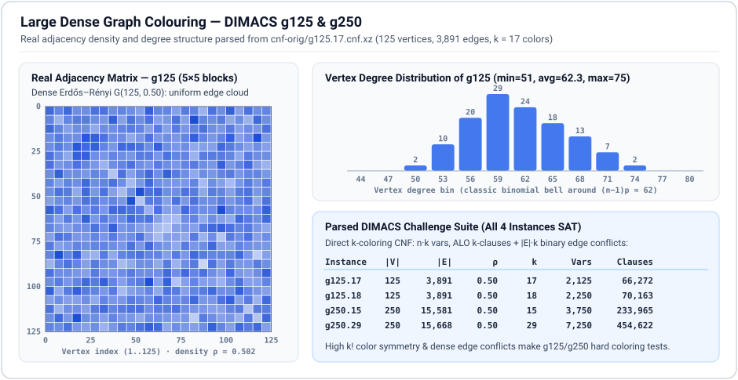

# SATLIB — Large Graph Colouring `g125`/`g250` (full) (`satlib-dimacs-gcp-large`)

*Figure: Real 125-vertex adjacency density heatmap ($5\times 5$ blocks, $\rho=0.502$) and binomial degree distribution parsed from `cnf-orig/g125.17.cnf.xz` alongside the parsed `g125`/`g250` suite dimensions. Regenerated via [`src/gen_diagram.py`](src/gen_diagram.py).*

## Provenance & Credit

- **Upstream Archive:** [SATLIB — Benchmark Problems (UBC)](https://www.cs.ubc.ca/~hoos/SATLIB/benchm.html)
- **SATLIB Curators:** Holger H. Hoos and Thomas Stützle (University of British Columbia / TU Darmstadt)
- **Family Contributors:** Second DIMACS Implementation Challenge
- **License:** Classic public scientific benchmark collection redistributed by UBC SATLIB for academic SAT research; no separate upstream `LICENSE` file is bundled in the archives.
- **Format Hygiene:** Legacy SATLIB trailing `%` / `0` EOF sentinels were stripped and wrapped multi-line clauses normalized to canonical 1-clause-per-line DIMACS CNF so every modern SAT solver parses all files cleanly.
- **Full SATLIB Archive Manifest:** [`../satlib-archive-uris/`](../satlib-archive-uris/README.md) (all 97 official UBC SATLIB `.tar.gz` archive URLs; Pretolani's `PRET` formulas live in [`../pretolani-pret/`](../pretolani-pret/README.md)).
- **Recommended by:** [`@jasonslenderman`](https://twitter.com/jasonslenderman) (Twitter/X)

## Problem Description

All 4 large graph coloring benchmarks (`g125.17`, `g125.18`, `g250.15`, `g250.29`) from the Second DIMACS Challenge.

## Corpus & Data Sizes

- **`cnf-orig/`** — 4 original native **DIMACS `.cnf.xz`** files (586.2 KB).
- **`aig-converted/`** — 4 exact **Binary AIGER 1.9 `.aig.xz`** conversions (294.7 KB, verified via [Berkeley ABC](https://github.com/berkeley-abc/abc) `read_aiger`).
- **`xcnf-converted/`** — 4 lossless **[CryptoMiniSat](https://github.com/msoos/cryptominisat) `.xcnf.xz`** conversions (476.6 KB, `0` extracted native XOR parity clauses).
- **`anf-converted/`** — 4 lossless linear-size **DIMACS-ANF `.anf.xz`** conversions (994.4 KB, generated via [`../src/to_anf.py`](../src/to_anf.py)).
- **[`expected.tsv`](expected.tsv)** — Ground-truth verdict manifest for all 4 instances (**4 SAT / 0 UNSAT**).
- **`src/`** — Standalone converters (`cnf2aig.py`, `cnf2xcnf.py`).

| Format | Directory | Files | Key Dimensions (Range) | Compressed Size |
|---|---|---:|---|---:|
| **DIMACS CNF (origin)** | `cnf-orig/` | 4 | Vars: 2,125–7,250; Clauses: 66,272–454,622 | 586.2 KB |
| **Binary AIGER 1.9** | `aig-converted/` | 4 | Inputs: 2,125–7,250; ANDs: 134,418–915,993 | 294.7 KB |
| **[CryptoMiniSat](https://github.com/msoos/cryptominisat) XCNF** | `xcnf-converted/` | 4 | Native XOR clauses total: 0 | 476.6 KB |
| **DIMACS-ANF** | `anf-converted/` | 4 | Vars: 3,875–13,750; Eqs: 68,022–461,122 (deg ≤ 3) | 994.4 KB |
| **Total (4 Formats, Status: 4 SAT / 0 UNSAT)** | | **16** | | **2.30 MB** |

## Benchmark Results

- **Hardware & Protocol:** Same machine (**AMD Ryzen 9 5950X**, 16C/32T Linux, **1 thread per run** pinned across 8 dedicated physical cores, $T_{\max} = 5\text{ s}$, PAR-2 penalty $10,000\text{ ms}$). All solvers ran with default single-thread flags (`-t 1` for CryptoMiniSat 5.18.0; `--max-cores 1` for Frobenius) on identical uncompressed flat `.cnf` inputs; **100% of all 4 instances** were run (no subsampling), every Frobenius SAT model was independently verified against 100% of input clauses, and **0 verdict disagreements** occurred across all solvers.

| Instance | Verdict | Frobenius 1C | [CaDiCaL](https://github.com/arminbiere/cadical) 3.1.0 | [CryptoMiniSat](https://github.com/msoos/cryptominisat) 5.18.0 | [dense-solver](https://github.com/libdense/dense-solver) 0.0.4 | [Kissat](https://github.com/arminbiere/kissat) 4.0.4 |
|---|:---:|---:|---:|---:|---:|---:|
| `g125.17` | SAT | **81.38 ms** | >5 s | >5 s | >5 s | >5 s |
| `g125.18` | SAT | **13.25 ms** | 1,698.89 ms | >5 s | >5 s | >5 s |
| `g250.15` | SAT | **37.46 ms** | 1,162.31 ms | 1,575.45 ms | >5 s | >5 s |
| `g250.29` | SAT | **319.68 ms** | >5 s | >5 s | >5 s | >5 s |
| **Solved (4 files)** | — | **4 / 4** *(highest)* | 2 / 4 *(-2 worse)* | 1 / 4 *(-3 worse)* | 0 / 4 *(-4 worse)* | 0 / 4 *(-4 worse)* |
| **Total PAR-2** | — | **451.8 ms** *(fastest)* | 22,861.2 ms *(50.60x slower)* | 31,575.5 ms *(69.89x slower)* | 40,000.0 ms *(88.54x slower)* | 40,000.0 ms *(88.54x slower)* |

<!-- BEGIN_STRUCTURAL_ANALYSIS -->
## Phase-Transition & Structural Analysis

*Auto-generated by [`../src/analyze_benchmarks.py`](../src/analyze_benchmarks.py). Position relative to the critical phase transition is measured by $\rho_{\mathrm{crit}} = \frac{1}{n}\sum_k m_k / \alpha_c(k)$ (exact $\alpha/\alpha_c(k)$ for pure $k$-SAT; effective critical threshold $\alpha_c^{\mathrm{eff}} = \alpha/\rho_{\mathrm{crit}}$; `Under` $<0.90\times$, `Near-crit` $0.90\text{--}1.10\times$, `Over` $>1.10\times$), alongside Gent–Walsh annealed constrainedness $\kappa = -\frac{1}{n}\sum_i \log_2(1-2^{-k_i})$ (AAAI 1996), clause-length profile ($\bar{k}$, `%Bin`, `%Horn`), variable-degree CV ($\sigma_d/\bar{d}$, uniformity vs. hub skew), and extracted native XOR parity clauses.*

| Instance | Active $n$ | Clauses $m$ | $\alpha=m/n$ | $\alpha_c^{\mathrm{eff}}$ | $\rho_{\mathrm{crit}}$ (Regime) | $\kappa$ | $\bar{k}$ ($k_{\max}$) | Bin% | Horn% | Pos% | Deg CV | XORs |
|---|---:|---:|---:|---:|---:|---:|---:|---:|---:|---:|---:|---:|
| `g125.17` | 2,125 | 66,272 | 31.19 | 1.00 | **31.1x** (Over) | 12.92 | 2.03 (17) | 100% | 100% | 2% | 0.08 | 0 |
| `g125.18` | 2,250 | 70,163 | 31.18 | 1.00 | **31.1x** (Over) | 12.92 | 2.03 (18) | 100% | 100% | 2% | 0.08 | 0 |
| `g250.15` | 3,750 | 233,965 | 62.39 | 1.00 | **62.3x** (Over) | 25.87 | 2.01 (15) | 100% | 100% | 1% | 0.06 | 0 |
| `g250.29` | 7,250 | 454,622 | 62.71 | 1.00 | **62.7x** (Over) | 26.01 | 2.01 (29) | 100% | 100% | 1% | 0.06 | 0 |

**Collection Phase-Transition Summary (4 instances, 4 formats: 4 CNF / 4 AIG / 4 XCNF / 4 ANF):** median $\rho_{\mathrm{crit}} = 46.7\times$ (range `31.1x–62.7x`), median $\kappa = 19.39$, regime split **0 Under / 0 Near-critical / 4 Over**, total extracted native XOR parity clauses = **0**, total ANF equations = **838,147**.
<!-- END_STRUCTURAL_ANALYSIS -->

## References

- H. H. Hoos and T. Stützle, *"SATLIB: An Online Resource for Research on SAT"*, SAT 2000, IOS Press, pp. 283–292 ([`cs.ubc.ca/~hoos/SATLIB/`](https://www.cs.ubc.ca/~hoos/SATLIB/benchm.html)).
- D. S. Johnson and M. A. Trick (eds.), *Cliques, Coloring, and Satisfiability: Second DIMACS Implementation Challenge*, DIMACS Series vol. 26, AMS, 1996.
