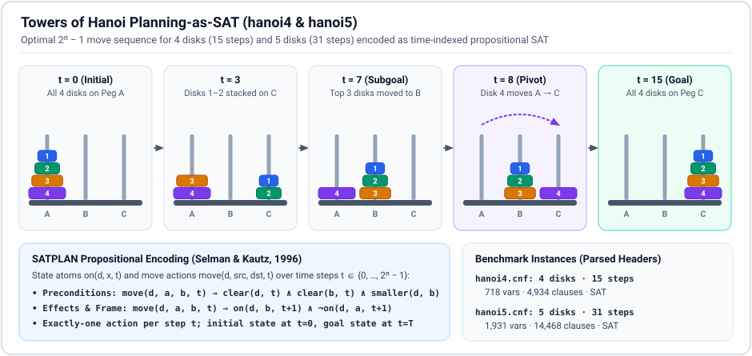

# SATLIB — Towers of Hanoi `hanoi4`, `hanoi5` (full) (`satlib-dimacs-hanoi`)

## Provenance & Credit

- **Upstream Archive:** [SATLIB — Benchmark Problems (UBC)](https://www.cs.ubc.ca/~hoos/SATLIB/benchm.html)
- **SATLIB Curators:** Holger H. Hoos and Thomas Stützle (University of British Columbia / TU Darmstadt)
- **Family Contributors:** Second DIMACS Implementation Challenge
- **License:** Classic public scientific benchmark collection redistributed by UBC SATLIB for academic SAT research; no separate upstream `LICENSE` file is bundled in the archives.
- **Format Hygiene:** Legacy SATLIB trailing `%` / `0` EOF sentinels were stripped and wrapped multi-line clauses normalized to canonical 1-clause-per-line DIMACS CNF so every modern SAT solver parses all files cleanly.
- **Full SATLIB Archive Manifest:** [`../satlib-archive-uris/`](../satlib-archive-uris/README.md) (all 97 official UBC SATLIB `.tar.gz` archive URLs; Pretolani's `PRET` formulas live in [`../pretolani-pret/`](../pretolani-pret/README.md)).
- **Recommended by:** [`@jasonslenderman`](https://twitter.com/jasonslenderman) (Twitter/X)

## Problem Description

Both classic Towers of Hanoi planning-as-SAT benchmarks (`hanoi4` and `hanoi5`, 2 SAT instances).

*Figure: Exact optimal $2^4 - 1 = 15$-move trajectory for `hanoi4` highlighting the $t=7$ subgoal and $t=8$ largest-disk pivot, paired with Selman and Kautz's time-indexed SATPLAN action/frame encoding. Regenerated via [`src/gen_diagram.py`](src/gen_diagram.py).*

## Corpus & Data Sizes (Four Formats)

- **`cnf-orig/`** — 2 original native **DIMACS `.cnf.xz`** files (33.4 KB).
- **`aig-converted/`** — 2 exact **Binary AIGER 1.9 `.aig.xz`** conversions (39.4 KB, verified via [Berkeley ABC](https://github.com/berkeley-abc/abc) `read_aiger`).
- **`xcnf-converted/`** — 2 lossless **[CryptoMiniSat](https://github.com/msoos/cryptominisat) `.xcnf.xz`** conversions (33.3 KB, `0` extracted native XOR parity clauses).
- **`anf-converted/`** — 2 lossless linear-size **DIMACS-ANF `.anf.xz`** conversions (64.1 KB, generated via [`../src/to_anf.py`](../src/to_anf.py)).
- **[`expected.tsv`](expected.tsv)** — Ground-truth verdict manifest for all 2 instances (**2 SAT / 0 UNSAT**).
- **`src/`** — Standalone converters (`cnf2aig.py`, `cnf2xcnf.py`).

| Format | Directory | Files | Key Dimensions (Range) | Compressed Size |
|---|---|---:|---|---:|
| **DIMACS CNF (origin)** | `cnf-orig/` | 2 | Vars: 718–1,931; Clauses: 4,934–14,468 | 33.4 KB |
| **Binary AIGER 1.9** | `aig-converted/` | 2 | Inputs: 718–1,931; ANDs: 11,190–32,846 | 39.4 KB |
| **[CryptoMiniSat](https://github.com/msoos/cryptominisat) XCNF** | `xcnf-converted/` | 2 | Native XOR clauses total: 0 | 33.3 KB |
| **DIMACS-ANF** | `anf-converted/` | 2 | Vars: 853–2,303; Eqs: 5,069–14,840 (deg ≤ 3) | 64.1 KB |
| **Total (4 Formats, Status: 2 SAT / 0 UNSAT)** | | **8** | | **170.3 KB** |

## Comparative 1-Core Benchmark Results (All 2 Instances, Flat `.cnf`, $T_{\max} = 5\;\text{s}$)

- **Hardware & Protocol:** Same machine (**AMD Ryzen 9 5950X**, 16C/32T Linux, **1 thread per run** pinned across 8 dedicated physical cores, $T_{\max} = 5\;\text{s}$, PAR-2 penalty $10,000\;\text{ms}$). All solvers ran with default single-thread flags (`-t 1` for CryptoMiniSat 5.18.0; `--max-cores 1` for Frobenius) on identical uncompressed flat `.cnf` inputs; **100% of all 2 instances** were run (no subsampling), every Frobenius SAT model was independently verified against 100% of input clauses, and **0 verdict disagreements** occurred across all solvers.

| Instance | Verdict | Frobenius 1C | [CaDiCaL](https://github.com/arminbiere/cadical) 3.1.0 | [CryptoMiniSat](https://github.com/msoos/cryptominisat) 5.18.0 | [dense-solver](https://github.com/libdense/dense-solver) 0.0.4 | [Kissat](https://github.com/arminbiere/kissat) 4.0.4 |
|---|:---:|---:|---:|---:|---:|---:|
| `hanoi4` | SAT | **18.12 ms** | 20.25 ms | 139.53 ms | 20.16 ms | 42.72 ms |
| `hanoi5` | SAT | 332.69 ms | **153.68 ms** | 565.30 ms | 191.36 ms | 516.22 ms |
| **Total (2 files, PAR-2)** | **2/2** | 2/2 — 350.8 ms *(2.02x)* | **2/2 — 173.9 ms** *(fastest)* | 2/2 — 704.8 ms *(4.05x)* | 2/2 — 211.5 ms *(1.22x)* | 2/2 — 558.9 ms *(3.21x)* |

<!-- BEGIN_STRUCTURAL_ANALYSIS -->
## Phase-Transition & Structural Analysis

*Auto-generated by [`../src/analyze_benchmarks.py`](../src/analyze_benchmarks.py). Position relative to the critical phase transition is measured by $\rho_{\mathrm{crit}} = \frac{1}{n}\sum_k m_k / \alpha_c(k)$ (exact $\alpha/\alpha_c(k)$ for pure $k$-SAT; effective critical threshold $\alpha_c^{\mathrm{eff}} = \alpha/\rho_{\mathrm{crit}}$; `Under` $<0.90\times$, `Near-crit` $0.90\text{--}1.10\times$, `Over` $>1.10\times$), alongside Gent–Walsh annealed constrainedness $\kappa = -\frac{1}{n}\sum_i \log_2(1-2^{-k_i})$ (AAAI 1996), clause-length profile ($\bar{k}$, `%Bin`, `%Horn`), variable-degree CV ($\sigma_d/\bar{d}$, uniformity vs. hub skew), and extracted native XOR parity clauses.*

| Instance | Active $n$ | Clauses $m$ | $\alpha=m/n$ | $\alpha_c^{\mathrm{eff}}$ | $\rho_{\mathrm{crit}}$ (Regime) | $\kappa$ | $\bar{k}$ ($k_{\max}$) | Bin% | Horn% | Pos% | Deg CV | XORs |
|---|---:|---:|---:|---:|---:|---:|---:|---:|---:|---:|---:|---:|
| `hanoi4` | 718 | 4,934 | 6.87 | 1.57 | **4.38x** (Over) | 2.23 | 2.47 (7) | 50% | 75% | 29% | 0.53 | 0 |
| `hanoi5` | 1,931 | 14,468 | 7.49 | 1.58 | **4.74x** (Over) | 2.42 | 2.48 (8) | 50% | 75% | 29% | 0.60 | 0 |

**Collection Phase-Transition Summary (2 instances, 4 formats: 2 CNF / 2 AIG / 2 XCNF / 2 ANF):** median $\rho_{\mathrm{crit}} = 4.56\times$ (range `4.38x–4.74x`), median $\kappa = 2.32$, regime split **0 Under / 0 Near-critical / 2 Over**, total extracted native XOR parity clauses = **0**, total ANF equations = **19,909**.
<!-- END_STRUCTURAL_ANALYSIS -->

## References

- H. H. Hoos and T. Stützle, *"SATLIB: An Online Resource for Research on SAT"*, SAT 2000, IOS Press, pp. 283–292 ([`cs.ubc.ca/~hoos/SATLIB/`](https://www.cs.ubc.ca/~hoos/SATLIB/benchm.html)).
- D. S. Johnson and M. A. Trick (eds.), *Cliques, Coloring, and Satisfiability: Second DIMACS Implementation Challenge*, DIMACS Series vol. 26, AMS, 1996.
