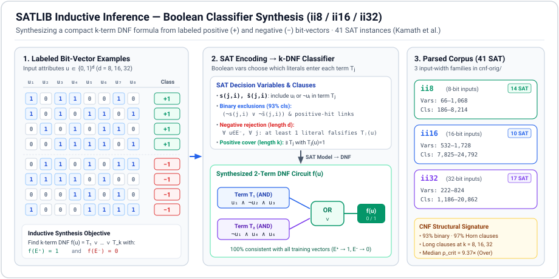

# SATLIB — Inductive Inference (full) (`satlib-dimacs-ii`)

*Figure: Inductive inference pipeline synthesizing labeled positive ($+$) and negative ($-$) bit-vectors via binary-dominated SAT encoding into a 2-level $k$-term DNF classifier across all 41 `ii8`/`ii16`/`ii32` instances. Regenerated via [`src/gen_diagram.py`](src/gen_diagram.py).*

## Provenance & Credit

- **Upstream Archive:** [SATLIB — Benchmark Problems (UBC)](https://www.cs.ubc.ca/~hoos/SATLIB/benchm.html)
- **SATLIB Curators:** Holger H. Hoos and Thomas Stützle (University of British Columbia / TU Darmstadt)
- **Family Contributors:** A. Kamath, N. Karmarkar, K. Ramakrishnan, and M. Resende
- **License:** Classic public scientific benchmark collection redistributed by UBC SATLIB for academic SAT research; no separate upstream `LICENSE` file is bundled in the archives.
- **Format Hygiene:** Legacy SATLIB trailing `%` / `0` EOF sentinels were stripped and wrapped multi-line clauses normalized to canonical 1-clause-per-line DIMACS CNF so every modern SAT solver parses all files cleanly.
- **Full SATLIB Archive Manifest:** [`../satlib-archive-uris/`](../satlib-archive-uris/README.md) (all 97 official UBC SATLIB `.tar.gz` archive URLs; Pretolani's `PRET` formulas live in [`../pretolani-pret/`](../pretolani-pret/README.md)).
- **Recommended by:** [`@jasonslenderman`](https://twitter.com/jasonslenderman) (Twitter/X)

## Problem Description

All 41 Inductive Inference (`ii8`, `ii16`, `ii32`) Boolean function synthesis benchmarks from the Second DIMACS Challenge.

## Corpus & Data Sizes

- **`cnf-orig/`** — 41 original native **DIMACS `.cnf.xz`** files (382.0 KB).
- **`aig-converted/`** — 41 exact **Binary AIGER 1.9 `.aig.xz`** conversions (770.7 KB, verified via [Berkeley ABC](https://github.com/berkeley-abc/abc) `read_aiger`).
- **`xcnf-converted/`** — 41 lossless **[CryptoMiniSat](https://github.com/msoos/cryptominisat) `.xcnf.xz`** conversions (383.9 KB, `0` extracted native XOR parity clauses).
- **`anf-converted/`** — 41 lossless linear-size **DIMACS-ANF `.anf.xz`** conversions (2.40 MB, generated via [`../src/to_anf.py`](../src/to_anf.py)).
- **[`expected.tsv`](expected.tsv)** — Ground-truth verdict manifest for all 41 instances (**41 SAT / 0 UNSAT**).
- **`src/`** — Standalone converters (`cnf2aig.py`, `cnf2xcnf.py`).

| Format | Directory | Files | Key Dimensions (Range) | Compressed Size |
|---|---|---:|---|---:|
| **DIMACS CNF (origin)** | `cnf-orig/` | 41 | Vars: 66–1,728; Clauses: 186–24,792 | 382.0 KB |
| **Binary AIGER 1.9** | `aig-converted/` | 41 | Inputs: 66–1,728; ANDs: 437–52,752 | 770.7 KB |
| **[CryptoMiniSat](https://github.com/msoos/cryptominisat) XCNF** | `xcnf-converted/` | 41 | Native XOR clauses total: 0 | 383.9 KB |
| **DIMACS-ANF** | `anf-converted/` | 41 | Vars: 126–71,316; Eqs: 246–91,419 (deg ≤ 3) | 2.40 MB |
| **Total (4 Formats, Status: 41 SAT / 0 UNSAT)** | | **164** | | **3.90 MB** |

## Benchmark Results

- **Hardware & Protocol:** Same machine (**AMD Ryzen 9 5950X**, 16C/32T Linux, **1 thread per run** pinned across 8 dedicated physical cores, $T_{\max} = 5\;\text{s}$, PAR-2 penalty $10,000\;\text{ms}$). All solvers ran with default single-thread flags (`-t 1` for CryptoMiniSat 5.18.0; `--max-cores 1` for Frobenius) on identical uncompressed flat `.cnf` inputs; **100% of all 41 instances** were run (no subsampling), every Frobenius SAT model was independently verified against 100% of input clauses, and **0 verdict disagreements** occurred across all solvers.

| Instance | Verdict | Frobenius 1C | [CaDiCaL](https://github.com/arminbiere/cadical) 3.1.0 | [CryptoMiniSat](https://github.com/msoos/cryptominisat) 5.18.0 | [dense-solver](https://github.com/libdense/dense-solver) 0.0.4 | [Kissat](https://github.com/arminbiere/kissat) 4.0.4 |
|---|:---:|---:|---:|---:|---:|---:|
| `ii16a1` | SAT | 5.07 ms | 8.84 ms | 417.44 ms | 8.66 ms | **3.36 ms** |
| `ii16a2` | SAT | 4.99 ms | 10.74 ms | 564.29 ms | 11.10 ms | **4.44 ms** |
| `ii16b1` | SAT | **9.30 ms** | 12.48 ms | 783.52 ms | 19.23 ms | 49.72 ms |
| `ii16b2` | SAT | 4.19 ms | 9.76 ms | 448.05 ms | 10.95 ms | **3.41 ms** |
| `ii16c1` | SAT | 4.36 ms | 8.20 ms | 414.70 ms | 8.41 ms | **3.49 ms** |
| `ii16c2` | SAT | **3.83 ms** | 7.16 ms | 436.12 ms | 12.64 ms | 4.04 ms |
| `ii16d1` | SAT | **6.47 ms** | 12.85 ms | 461.12 ms | 9.99 ms | 31.02 ms |
| `ii16d2` | SAT | 3.82 ms | 6.71 ms | 427.48 ms | 38.42 ms | **3.63 ms** |
| `ii16e1` | SAT | 4.71 ms | 8.14 ms | 529.96 ms | 12.55 ms | **3.98 ms** |
| `ii16e2` | SAT | **4.48 ms** | 7.19 ms | 437.73 ms | 7.88 ms | 27.48 ms |
| `ii32a1` | SAT | 9.42 ms | **8.16 ms** | 530.33 ms | 20.57 ms | 40.65 ms |
| `ii32b1` | SAT | 1.88 ms | 4.25 ms | 86.60 ms | 2.32 ms | **1.52 ms** |
| `ii32b2` | SAT | **3.52 ms** | 5.63 ms | 151.88 ms | 8.71 ms | 22.53 ms |
| `ii32b3` | SAT | **6.77 ms** | 7.08 ms | 471.68 ms | 10.37 ms | 28.49 ms |
| `ii32b4` | SAT | 9.72 ms | **6.85 ms** | 548.16 ms | 13.29 ms | 33.44 ms |
| `ii32c1` | SAT | 1.97 ms | 2.55 ms | 70.54 ms | 2.50 ms | **1.61 ms** |
| `ii32c2` | SAT | 2.23 ms | 3.20 ms | 153.48 ms | 3.39 ms | **2.12 ms** |
| `ii32c3` | SAT | **3.14 ms** | 4.91 ms | 273.59 ms | 4.83 ms | 22.49 ms |
| `ii32c4` | SAT | **11.13 ms** | 11.78 ms | 552.90 ms | 50.28 ms | 51.09 ms |
| `ii32d1` | SAT | 4.02 ms | 4.88 ms | 108.65 ms | **3.89 ms** | 26.28 ms |
| `ii32d2` | SAT | **3.87 ms** | 34.56 ms | 230.52 ms | 10.50 ms | 24.08 ms |
| `ii32d3` | SAT | 31.04 ms | **11.62 ms** | 649.30 ms | 205.81 ms | 62.59 ms |
| `ii32e1` | SAT | 1.84 ms | 3.26 ms | 83.34 ms | 2.25 ms | **1.64 ms** |
| `ii32e2` | SAT | 2.27 ms | 3.75 ms | 156.43 ms | 4.78 ms | **2.26 ms** |
| `ii32e3` | SAT | **2.72 ms** | 5.03 ms | 443.94 ms | 10.84 ms | 3.72 ms |
| `ii32e4` | SAT | **4.70 ms** | 6.88 ms | 534.34 ms | 13.54 ms | 28.36 ms |
| `ii32e5` | SAT | **7.02 ms** | 13.07 ms | 650.05 ms | 12.21 ms | 37.98 ms |
| `ii8a1` | SAT | 1.68 ms | 2.79 ms | 6.58 ms | **1.59 ms** | 1.83 ms |
| `ii8a2` | SAT | 1.73 ms | 2.56 ms | 16.62 ms | 1.92 ms | **1.41 ms** |
| `ii8a3` | SAT | 1.91 ms | 2.78 ms | 44.08 ms | 2.37 ms | **1.50 ms** |
| `ii8a4` | SAT | 2.17 ms | 3.74 ms | 66.81 ms | 2.91 ms | **1.77 ms** |
| `ii8b1` | SAT | 1.84 ms | 3.98 ms | 48.28 ms | 2.59 ms | **1.65 ms** |
| `ii8b2` | SAT | **1.70 ms** | 3.40 ms | 99.83 ms | 3.76 ms | 2.00 ms |
| `ii8b3` | SAT | **1.80 ms** | 4.56 ms | 176.71 ms | 4.61 ms | 2.33 ms |
| `ii8b4` | SAT | 3.01 ms | 6.01 ms | 254.34 ms | 5.41 ms | **2.54 ms** |
| `ii8c1` | SAT | 2.70 ms | 3.42 ms | 72.27 ms | 2.55 ms | **1.66 ms** |
| `ii8c2` | SAT | **2.02 ms** | 4.98 ms | 172.96 ms | 4.16 ms | 2.65 ms |
| `ii8d1` | SAT | 2.63 ms | 3.62 ms | 79.54 ms | 2.69 ms | **1.92 ms** |
| `ii8d2` | SAT | **1.83 ms** | 5.17 ms | 179.61 ms | 4.33 ms | 2.45 ms |
| `ii8e1` | SAT | **2.20 ms** | 4.25 ms | 76.65 ms | 3.65 ms | 2.22 ms |
| `ii8e2` | SAT | **1.91 ms** | 4.23 ms | 161.50 ms | 3.95 ms | 2.42 ms |
| **Total (41 files, PAR-2)** | **41/41** | **41/41 — 187.6 ms** *(fastest)* | 41/41 — 285.0 ms *(1.52x)* | 41/41 — 12,071.9 ms *(64.35x)* | 41/41 — 566.4 ms *(3.02x)* | 41/41 — 553.8 ms *(2.95x)* |

<!-- BEGIN_STRUCTURAL_ANALYSIS -->
## Phase-Transition & Structural Analysis

*Auto-generated by [`../src/analyze_benchmarks.py`](../src/analyze_benchmarks.py). Position relative to the critical phase transition is measured by $\rho_{\mathrm{crit}} = \frac{1}{n}\sum_k m_k / \alpha_c(k)$ (exact $\alpha/\alpha_c(k)$ for pure $k$-SAT; effective critical threshold $\alpha_c^{\mathrm{eff}} = \alpha/\rho_{\mathrm{crit}}$; `Under` $<0.90\times$, `Near-crit` $0.90\text{--}1.10\times$, `Over` $>1.10\times$), alongside Gent–Walsh annealed constrainedness $\kappa = -\frac{1}{n}\sum_i \log_2(1-2^{-k_i})$ (AAAI 1996), clause-length profile ($\bar{k}$, `%Bin`, `%Horn`), variable-degree CV ($\sigma_d/\bar{d}$, uniformity vs. hub skew), and extracted native XOR parity clauses.*

| Group / Family | Files | Med $n$ | Med $m$ | $\alpha=m/n$ (Med) | $\alpha_c^{\mathrm{eff}}$ (Med) | $\rho_{\mathrm{crit}}$ Med [Min–Max] (Regime) | Med $\kappa$ | Med $\bar{k}$ | Bin% | Horn% | Deg CV | Total XORs |
|---|---:|---:|---:|---:|---:|---:|---:|---:|---:|---:|---:|---:|
| `satlib-dimacs-ii` | 41 | 520 | 6,108 | 10.28 | 1.08 | **9.37x** [2.57x–24.1x] (Over) | 3.90 | 3.01 | 93% | 97% | 0.64 | 0 |

**Collection Phase-Transition Summary (41 instances, 4 formats: 41 CNF / 41 AIG / 41 XCNF / 41 ANF):** median $\rho_{\mathrm{crit}} = 9.37\times$ (range `2.57x–24.1x`), median $\kappa = 3.90$, regime split **0 Under / 0 Near-critical / 41 Over**, total extracted native XOR parity clauses = **0**, total ANF equations = **736,164**.
<!-- END_STRUCTURAL_ANALYSIS -->

## References

- H. H. Hoos and T. Stützle, *"SATLIB: An Online Resource for Research on SAT"*, SAT 2000, IOS Press, pp. 283–292 ([`cs.ubc.ca/~hoos/SATLIB/`](https://www.cs.ubc.ca/~hoos/SATLIB/benchm.html)).
- D. S. Johnson and M. A. Trick (eds.), *Cliques, Coloring, and Satisfiability: Second DIMACS Implementation Challenge*, DIMACS Series vol. 26, AMS, 1996.
