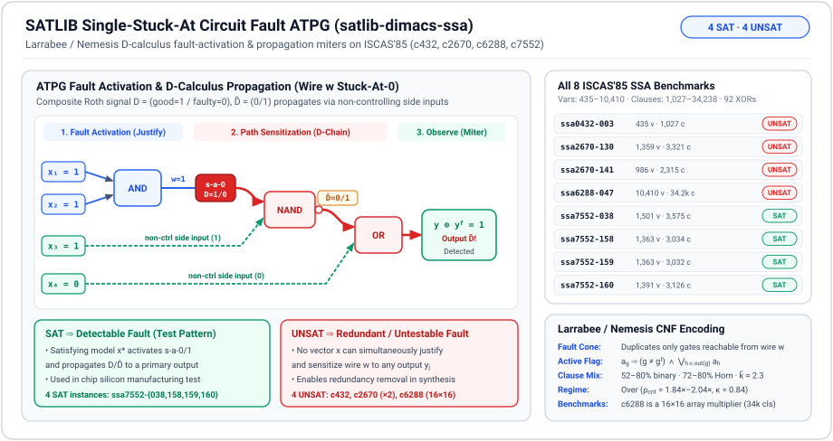

# SATLIB — Single-Stuck-At Circuit Faults (full) (`satlib-dimacs-ssa`)

*Figure: Single-stuck-at (`s-a-0`) ATPG activation and Roth D-calculus propagation ($D = 1/0$, $\bar{D} = 0/1$) via non-controlling side inputs to an output miter contrasting detectable SAT (`c7552`) vs. redundant UNSAT (`c432`, `c2670`, `c6288`) ISCAS'85 faults. Regenerated via [`src/gen_diagram.py`](src/gen_diagram.py).*

## Provenance & Credit

- **Upstream Archive:** [SATLIB — Benchmark Problems (UBC)](https://www.cs.ubc.ca/~hoos/SATLIB/benchm.html)
- **SATLIB Curators:** Holger H. Hoos and Thomas Stützle (University of British Columbia / TU Darmstadt)
- **Family Contributors:** Allen Van Gelder and Yumi Tsuji
- **License:** Classic public scientific benchmark collection redistributed by UBC SATLIB for academic SAT research; no separate upstream `LICENSE` file is bundled in the archives.
- **Format Hygiene:** Legacy SATLIB trailing `%` / `0` EOF sentinels were stripped and wrapped multi-line clauses normalized to canonical 1-clause-per-line DIMACS CNF so every modern SAT solver parses all files cleanly.
- **Format Hygiene Note:** Leading `c p ...` comment lines were prefixed as `c - p ...` (zero clause/variable changes) for [CryptoMiniSat](https://github.com/msoos/cryptominisat) 5.18.0 compatibility.
- **Full SATLIB Archive Manifest:** [`../satlib-archive-uris/`](../satlib-archive-uris/README.md) (all 97 official UBC SATLIB `.tar.gz` archive URLs; Pretolani's `PRET` formulas live in [`../pretolani-pret/`](../pretolani-pret/README.md)).
- **Recommended by:** [`@jasonslenderman`](https://twitter.com/jasonslenderman) (Twitter/X)

## Problem Description

All 8 Single-Stuck-At (`ssa`) combinational circuit fault-detection benchmarks from the Second DIMACS Challenge.

## Corpus & Data Sizes

- **`cnf-orig/`** — 8 original native **DIMACS `.cnf.xz`** files (147.5 KB).
- **`aig-converted/`** — 8 exact **Binary AIGER 1.9 `.aig.xz`** conversions (176.3 KB, verified via [Berkeley ABC](https://github.com/berkeley-abc/abc) `read_aiger`).
- **`xcnf-converted/`** — 8 lossless **[CryptoMiniSat](https://github.com/msoos/cryptominisat) `.xcnf.xz`** conversions (146.9 KB, `92` extracted native XOR parity clauses).
- **`anf-converted/`** — 8 lossless linear-size **DIMACS-ANF `.anf.xz`** conversions (282.7 KB, generated via [`../src/to_anf.py`](../src/to_anf.py)).
- **[`expected.tsv`](expected.tsv)** — Ground-truth verdict manifest for all 8 instances (**4 SAT / 4 UNSAT**).
- **`src/`** — Standalone converters (`cnf2aig.py`, `cnf2xcnf.py`).

| Format | Directory | Files | Key Dimensions (Range) | Compressed Size |
|---|---|---:|---|---:|
| **DIMACS CNF (origin)** | `cnf-orig/` | 8 | Vars: 435–10,410; Clauses: 1,027–34,238 | 147.5 KB |
| **Binary AIGER 1.9** | `aig-converted/` | 8 | Inputs: 435–10,410; ANDs: 2,333–84,551 | 176.3 KB |
| **[CryptoMiniSat](https://github.com/msoos/cryptominisat) XCNF** | `xcnf-converted/` | 8 | Native XOR clauses total: 92 | 146.9 KB |
| **DIMACS-ANF** | `anf-converted/` | 8 | Vars: 504–12,845; Eqs: 1,087–36,673 (deg ≤ 3) | 282.7 KB |
| **Total (4 Formats, Status: 4 SAT / 4 UNSAT)** | | **32** | | **753.4 KB** |

## Benchmark Results

- **Hardware & Protocol:** Same machine (**AMD Ryzen 9 5950X**, 16C/32T Linux, **1 thread per run** pinned across 8 dedicated physical cores, $T_{\max} = 5\text{ s}$, PAR-2 penalty $10,000\text{ ms}$). All solvers ran with default single-thread flags (`-t 1` for CryptoMiniSat 5.18.0; `--max-cores 1` for Frobenius) on identical uncompressed flat `.cnf` inputs; **100% of all 8 instances** were run (no subsampling), every Frobenius SAT model was independently verified against 100% of input clauses, and **0 verdict disagreements** occurred across all solvers.

| Instance | Verdict | Frobenius 1C | [CaDiCaL](https://github.com/arminbiere/cadical) 3.1.0 | [CryptoMiniSat](https://github.com/msoos/cryptominisat) 5.18.0 | [dense-solver](https://github.com/libdense/dense-solver) 0.0.4 | [Kissat](https://github.com/arminbiere/kissat) 4.0.4 |
|---|:---:|---:|---:|---:|---:|---:|
| `ssa0432-003` | UNSAT | 4.23 ms | **2.68 ms** | 21.01 ms | 3.80 ms | 3.50 ms |
| `ssa2670-130` | UNSAT | 7.35 ms | **5.58 ms** | 36.92 ms | 15.10 ms | 10.31 ms |
| `ssa2670-141` | UNSAT | **4.10 ms** | 4.25 ms | 32.63 ms | 13.66 ms | 10.43 ms |
| `ssa6288-047` | UNSAT | **2.99 ms** | 12.87 ms | 8.54 ms | 29.02 ms | 4.25 ms |
| `ssa7552-038` | SAT | 4.92 ms | 4.17 ms | 47.20 ms | 9.40 ms | **2.13 ms** |
| `ssa7552-158` | SAT | 3.58 ms | 3.03 ms | 39.27 ms | 7.13 ms | **1.79 ms** |
| `ssa7552-159` | SAT | 3.69 ms | 2.96 ms | 41.51 ms | 6.79 ms | **1.85 ms** |
| `ssa7552-160` | SAT | 4.09 ms | 3.23 ms | 42.34 ms | 6.91 ms | **2.07 ms** |
| **Solved (8 files)** | — | **8 / 8** *(highest)* | **8 / 8** *(highest)* | **8 / 8** *(highest)* | **8 / 8** *(highest)* | **8 / 8** *(highest)* |
| **Total PAR-2** | — | **34.9 ms** *(fastest)* | 38.8 ms *(1.11x slower)* | 269.4 ms *(7.71x slower)* | 91.8 ms *(2.63x slower)* | 36.3 ms *(1.04x slower)* |

<!-- BEGIN_STRUCTURAL_ANALYSIS -->
## Phase-Transition & Structural Analysis

*Auto-generated by [`../src/analyze_benchmarks.py`](../src/analyze_benchmarks.py). Position relative to the critical phase transition is measured by $\rho_{\mathrm{crit}} = \frac{1}{n}\sum_k m_k / \alpha_c(k)$ (exact $\alpha/\alpha_c(k)$ for pure $k$-SAT; effective critical threshold $\alpha_c^{\mathrm{eff}} = \alpha/\rho_{\mathrm{crit}}$; `Under` $<0.90\times$, `Near-crit` $0.90\text{--}1.10\times$, `Over` $>1.10\times$), alongside Gent–Walsh annealed constrainedness $\kappa = -\frac{1}{n}\sum_i \log_2(1-2^{-k_i})$ (AAAI 1996), clause-length profile ($\bar{k}$, `%Bin`, `%Horn`), variable-degree CV ($\sigma_d/\bar{d}$, uniformity vs. hub skew), and extracted native XOR parity clauses.*

| Instance | Active $n$ | Clauses $m$ | $\alpha=m/n$ | $\alpha_c^{\mathrm{eff}}$ | $\rho_{\mathrm{crit}}$ (Regime) | $\kappa$ | $\bar{k}$ ($k_{\max}$) | Bin% | Horn% | Pos% | Deg CV | XORs |
|---|---:|---:|---:|---:|---:|---:|---:|---:|---:|---:|---:|---:|
| `ssa0432-003` | 435 | 1,027 | 2.36 | 1.24 | **1.91x** (Over) | 0.84 | 2.30 (5) | 76% | 77% | 49% | 0.65 | 3 |
| `ssa2670-130` | 1,359 | 3,321 | 2.44 | 1.26 | **1.94x** (Over) | 0.86 | 2.33 (5) | 74% | 72% | 52% | 0.77 | 22 |
| `ssa2670-141` | 986 | 2,315 | 2.35 | 1.19 | **1.97x** (Over) | 0.86 | 2.26 (5) | 80% | 74% | 53% | 0.93 | 7 |
| `ssa6288-047` | 10,410 | 34,238 | 3.29 | 1.61 | **2.04x** (Over) | 0.99 | 2.55 (6) | 52% | 73% | 42% | 0.41 | 0 |
| `ssa7552-038` | 1,501 | 3,575 | 2.38 | 1.26 | **1.89x** (Over) | 0.84 | 2.31 (6) | 73% | 79% | 49% | 1.67 | 15 |
| `ssa7552-158` | 1,363 | 3,034 | 2.23 | 1.21 | **1.84x** (Over) | 0.81 | 2.25 (5) | 77% | 80% | 51% | 1.88 | 15 |
| `ssa7552-159` | 1,363 | 3,032 | 2.22 | 1.21 | **1.84x** (Over) | 0.81 | 2.25 (5) | 77% | 80% | 51% | 1.88 | 15 |
| `ssa7552-160` | 1,391 | 3,126 | 2.25 | 1.21 | **1.86x** (Over) | 0.82 | 2.25 (5) | 78% | 80% | 52% | 1.84 | 15 |

**Collection Phase-Transition Summary (8 instances, 4 formats: 8 CNF / 8 AIG / 8 XCNF / 8 ANF):** median $\rho_{\mathrm{crit}} = 1.90\times$ (range `1.84x–2.04x`), median $\kappa = 0.84$, regime split **0 Under / 0 Near-critical / 8 Over**, total extracted native XOR parity clauses = **92**, total ANF equations = **56,675**.
<!-- END_STRUCTURAL_ANALYSIS -->

## References

- H. H. Hoos and T. Stützle, *"SATLIB: An Online Resource for Research on SAT"*, SAT 2000, IOS Press, pp. 283–292 ([`cs.ubc.ca/~hoos/SATLIB/`](https://www.cs.ubc.ca/~hoos/SATLIB/benchm.html)).
- D. S. Johnson and M. A. Trick (eds.), *Cliques, Coloring, and Satisfiability: Second DIMACS Implementation Challenge*, DIMACS Series vol. 26, AMS, 1996.
