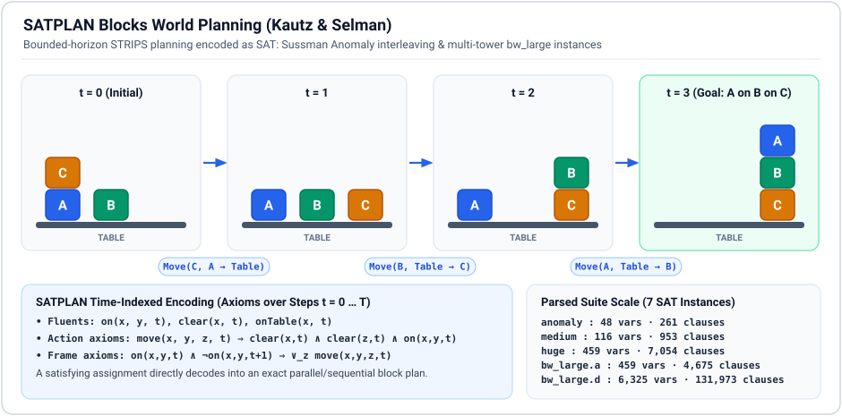

# SATLIB — SATPLAN Blocks World (full) (`satlib-planning-blocksworld`)

*Figure: Three-step SATPLAN execution solving the classic Sussman Anomaly (`anomaly.cnf.xz`) via interleaved `Move` actions, alongside the time-indexed fluent/frame axioms and `bw_large` scaling. Regenerated via [`src/gen_diagram.py`](src/gen_diagram.py).*

## Provenance & Credit

- **Upstream Archive:** [SATLIB — Benchmark Problems (UBC)](https://www.cs.ubc.ca/~hoos/SATLIB/benchm.html)
- **SATLIB Curators:** Holger H. Hoos and Thomas Stützle (University of British Columbia / TU Darmstadt)
- **Family Contributors:** Henry Kautz and Bart Selman (AAAI 1996)
- **License:** Classic public scientific benchmark collection redistributed by UBC SATLIB for academic SAT research; no separate upstream `LICENSE` file is bundled in the archives.
- **Format Hygiene:** Legacy SATLIB trailing `%` / `0` EOF sentinels were stripped and wrapped multi-line clauses normalized to canonical 1-clause-per-line DIMACS CNF so every modern SAT solver parses all files cleanly.
- **Full SATLIB Archive Manifest:** [`../satlib-archive-uris/`](../satlib-archive-uris/README.md) (all 97 official UBC SATLIB `.tar.gz` archive URLs; Pretolani's `PRET` formulas live in [`../pretolani-pret/`](../pretolani-pret/README.md)).
- **Recommended by:** [`@jasonslenderman`](https://twitter.com/jasonslenderman) (Twitter/X)

## Problem Description

All 7 classic SATPLAN Blocks World planning-as-SAT instances (`anomaly`, `medium`, `huge`, `bw_large.a`–`d`).

## Corpus & Data Sizes

- **`cnf-orig/`** — 7 original native **DIMACS `.cnf.xz`** files (229.8 KB).
- **`aig-converted/`** — 7 exact **Binary AIGER 1.9 `.aig.xz`** conversions (454.9 KB, verified via [Berkeley ABC](https://github.com/berkeley-abc/abc) `read_aiger`).
- **`xcnf-converted/`** — 7 lossless **[CryptoMiniSat](https://github.com/msoos/cryptominisat) `.xcnf.xz`** conversions (229.9 KB, `0` extracted native XOR parity clauses).
- **`anf-converted/`** — 7 lossless linear-size **DIMACS-ANF `.anf.xz`** conversions (492.0 KB, generated via [`../src/to_anf.py`](../src/to_anf.py)).
- **[`expected.tsv`](expected.tsv)** — Ground-truth verdict manifest for all 7 instances (**7 SAT / 0 UNSAT**).
- **`src/`** — Standalone converters (`cnf2aig.py`, `cnf2xcnf.py`).

| Format | Directory | Files | Key Dimensions (Range) | Compressed Size |
|---|---|---:|---|---:|
| **DIMACS CNF (origin)** | `cnf-orig/` | 7 | Vars: 48–6,325; Clauses: 261–131,973 | 229.8 KB |
| **Binary AIGER 1.9** | `aig-converted/` | 7 | Inputs: 48–6,325; ANDs: 525–294,117 | 454.9 KB |
| **[CryptoMiniSat](https://github.com/msoos/cryptominisat) XCNF** | `xcnf-converted/` | 7 | Native XOR clauses total: 0 | 229.9 KB |
| **DIMACS-ANF** | `anf-converted/` | 7 | Vars: 51–7,104; Eqs: 264–132,752 (deg ≤ 3) | 492.0 KB |
| **Total (4 Formats, Status: 7 SAT / 0 UNSAT)** | | **28** | | **1.37 MB** |

## Benchmark Results

- **Hardware & Protocol:** Same machine (**AMD Ryzen 9 5950X**, 16C/32T Linux, **1 thread per run** pinned across 8 dedicated physical cores, $T_{\max} = 5\text{ s}$, PAR-2 penalty $10,000\text{ ms}$). All solvers ran with default single-thread flags (`-t 1` for CryptoMiniSat 5.18.0; `--max-cores 1` for Frobenius) on identical uncompressed flat `.cnf` inputs; **100% of all 7 instances** were run (no subsampling), every Frobenius SAT model was independently verified against 100% of input clauses, and **0 verdict disagreements** occurred across all solvers.

| Instance | Verdict | Frobenius 1C | [CaDiCaL](https://github.com/arminbiere/cadical) 3.1.0 | [CryptoMiniSat](https://github.com/msoos/cryptominisat) 5.18.0 | [dense-solver](https://github.com/libdense/dense-solver) 0.0.4 | [Kissat](https://github.com/arminbiere/kissat) 4.0.4 |
|---|:---:|---:|---:|---:|---:|---:|
| `anomaly` | SAT | **0.88 ms** | 2.14 ms | 3.63 ms | 1.47 ms | 1.23 ms |
| `bw_large.a` | SAT | **2.64 ms** | 3.42 ms | 124.65 ms | 4.53 ms | 24.05 ms |
| `bw_large.b` | SAT | **7.26 ms** | 7.35 ms | 352.77 ms | 8.76 ms | 28.79 ms |
| `bw_large.c` | SAT | **37.30 ms** | 52.90 ms | 537.91 ms | 42.31 ms | 67.06 ms |
| `bw_large.d` | SAT | **96.54 ms** | 314.33 ms | 679.20 ms | 144.95 ms | 196.21 ms |
| `huge` | SAT | **2.73 ms** | 4.17 ms | 126.18 ms | 5.47 ms | 24.15 ms |
| `medium` | SAT | **1.29 ms** | 2.25 ms | 10.27 ms | 2.00 ms | 1.37 ms |
| **Solved (7 files)** | — | **7 / 7** *(highest)* | **7 / 7** *(highest)* | **7 / 7** *(highest)* | **7 / 7** *(highest)* | **7 / 7** *(highest)* |
| **Total PAR-2** | — | **148.6 ms** *(fastest)* | 386.6 ms *(2.60x slower)* | 1,834.6 ms *(12.34x slower)* | 209.5 ms *(1.41x slower)* | 342.9 ms *(2.31x slower)* |

<!-- BEGIN_STRUCTURAL_ANALYSIS -->
## Phase-Transition & Structural Analysis

*Auto-generated by [`../src/analyze_benchmarks.py`](../src/analyze_benchmarks.py). Position relative to the critical phase transition is measured by $\rho_{\mathrm{crit}} = \frac{1}{n}\sum_k m_k / \alpha_c(k)$ (exact $\alpha/\alpha_c(k)$ for pure $k$-SAT; effective critical threshold $\alpha_c^{\mathrm{eff}} = \alpha/\rho_{\mathrm{crit}}$; `Under` $<0.90\times$, `Near-crit` $0.90\text{--}1.10\times$, `Over` $>1.10\times$), alongside Gent–Walsh annealed constrainedness $\kappa = -\frac{1}{n}\sum_i \log_2(1-2^{-k_i})$ (AAAI 1996), clause-length profile ($\bar{k}$, `%Bin`, `%Horn`), variable-degree CV ($\sigma_d/\bar{d}$, uniformity vs. hub skew), and extracted native XOR parity clauses.*

| Instance | Active $n$ | Clauses $m$ | $\alpha=m/n$ | $\alpha_c^{\mathrm{eff}}$ | $\rho_{\mathrm{crit}}$ (Regime) | $\kappa$ | $\bar{k}$ ($k_{\max}$) | Bin% | Horn% | Pos% | Deg CV | XORs |
|---|---:|---:|---:|---:|---:|---:|---:|---:|---:|---:|---:|---:|
| `anomaly` | 48 | 261 | 5.44 | 1.21 | **4.50x** (Over) | 1.98 | 2.23 (4) | 78% | 84% | 26% | 0.28 | 0 |
| `bw_large.a` | 459 | 4,675 | 10.19 | 1.29 | **7.89x** (Over) | 3.56 | 2.31 (10) | 71% | 85% | 22% | 0.39 | 0 |
| `bw_large.b` | 1,087 | 13,772 | 12.67 | 1.29 | **9.82x** (Over) | 4.43 | 2.31 (12) | 71% | 85% | 20% | 0.38 | 0 |
| `bw_large.c` | 3,016 | 50,457 | 16.73 | 1.25 | **13.4x** (Over) | 5.99 | 2.27 (16) | 74% | 87% | 17% | 0.37 | 0 |
| `bw_large.d` | 6,325 | 131,973 | 20.87 | 1.21 | **17.3x** (Over) | 7.62 | 2.23 (20) | 78% | 89% | 14% | 0.36 | 0 |
| `huge` | 459 | 7,054 | 15.37 | 1.18 | **13.1x** (Over) | 5.71 | 2.21 (10) | 81% | 90% | 15% | 0.34 | 0 |
| `medium` | 116 | 953 | 8.22 | 1.20 | **6.83x** (Over) | 3.00 | 2.24 (6) | 78% | 88% | 21% | 0.34 | 0 |

**Collection Phase-Transition Summary (7 instances, 4 formats: 7 CNF / 7 AIG / 7 XCNF / 7 ANF):** median $\rho_{\mathrm{crit}} = 9.82\times$ (range `4.50x–17.3x`), median $\kappa = 4.43$, regime split **0 Under / 0 Near-critical / 7 Over**, total extracted native XOR parity clauses = **0**, total ANF equations = **210,742**.
<!-- END_STRUCTURAL_ANALYSIS -->

## References

- H. H. Hoos and T. Stützle, *"SATLIB: An Online Resource for Research on SAT"*, SAT 2000, IOS Press, pp. 283–292 ([`cs.ubc.ca/~hoos/SATLIB/`](https://www.cs.ubc.ca/~hoos/SATLIB/benchm.html)).
- D. S. Johnson and M. A. Trick (eds.), *Cliques, Coloring, and Satisfiability: Second DIMACS Implementation Challenge*, DIMACS Series vol. 26, AMS, 1996.
