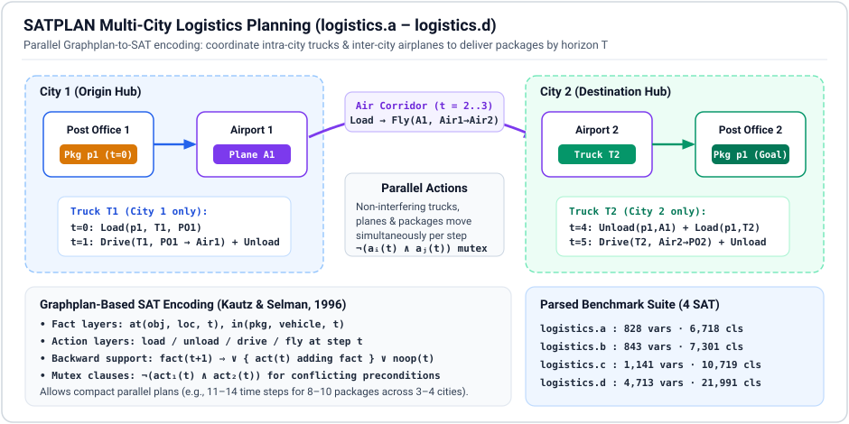

# SATLIB — SATPLAN Logistics `a..d` (full) (`satlib-planning-logistics`)

*Figure: Multi-city Logistics transport graph showing intra-city trucks, inter-city airplane flights, parallel Graphplan action layers, and parsed CNF sizes for `logistics.a`–`logistics.d`. Regenerated via [`src/gen_diagram.py`](src/gen_diagram.py).*

## Provenance & Credit

- **Upstream Archive:** [SATLIB — Benchmark Problems (UBC)](https://www.cs.ubc.ca/~hoos/SATLIB/benchm.html)
- **SATLIB Curators:** Holger H. Hoos and Thomas Stützle (University of British Columbia / TU Darmstadt)
- **Family Contributors:** Henry Kautz and Bart Selman (AAAI 1996)
- **License:** Classic public scientific benchmark collection redistributed by UBC SATLIB for academic SAT research; no separate upstream `LICENSE` file is bundled in the archives.
- **Format Hygiene:** Legacy SATLIB trailing `%` / `0` EOF sentinels were stripped and wrapped multi-line clauses normalized to canonical 1-clause-per-line DIMACS CNF so every modern SAT solver parses all files cleanly.
- **Full SATLIB Archive Manifest:** [`../satlib-archive-uris/`](../satlib-archive-uris/README.md) (all 97 official UBC SATLIB `.tar.gz` archive URLs; Pretolani's `PRET` formulas live in [`../pretolani-pret/`](../pretolani-pret/README.md)).
- **Recommended by:** [`@jasonslenderman`](https://twitter.com/jasonslenderman) (Twitter/X)

## Problem Description

All 4 classic SATPLAN Logistics planning-as-SAT instances (`logistics.a` through `logistics.d`).

## Corpus & Data Sizes

- **`cnf-orig/`** — 4 original native **DIMACS `.cnf.xz`** files (79.7 KB).
- **`aig-converted/`** — 4 exact **Binary AIGER 1.9 `.aig.xz`** conversions (126.2 KB, verified via [Berkeley ABC](https://github.com/berkeley-abc/abc) `read_aiger`).
- **`xcnf-converted/`** — 4 lossless **[CryptoMiniSat](https://github.com/msoos/cryptominisat) `.xcnf.xz`** conversions (80.0 KB, `0` extracted native XOR parity clauses).
- **`anf-converted/`** — 4 lossless linear-size **DIMACS-ANF `.anf.xz`** conversions (223.0 KB, generated via [`../src/to_anf.py`](../src/to_anf.py)).
- **[`expected.tsv`](expected.tsv)** — Ground-truth verdict manifest for all 4 instances (**4 SAT / 0 UNSAT**).
- **`src/`** — Standalone converters (`cnf2aig.py`, `cnf2xcnf.py`).

| Format | Directory | Files | Key Dimensions (Range) | Compressed Size |
|---|---|---:|---|---:|
| **DIMACS CNF (origin)** | `cnf-orig/` | 4 | Vars: 828–4,713; Clauses: 6,718–21,991 | 79.7 KB |
| **Binary AIGER 1.9** | `aig-converted/` | 4 | Inputs: 828–4,713; ANDs: 17,751–51,346 | 126.2 KB |
| **[CryptoMiniSat](https://github.com/msoos/cryptominisat) XCNF** | `xcnf-converted/` | 4 | Native XOR clauses total: 0 | 80.0 KB |
| **DIMACS-ANF** | `anf-converted/` | 4 | Vars: 1,894–9,734; Eqs: 7,784–27,012 (deg ≤ 3) | 223.0 KB |
| **Total (4 Formats, Status: 4 SAT / 0 UNSAT)** | | **16** | | **509.0 KB** |

## Benchmark Results

- **Hardware & Protocol:** Same machine (**AMD Ryzen 9 5950X**, 16C/32T Linux, **1 thread per run** pinned across 8 dedicated physical cores, $T_{\max} = 5\;\text{s}$, PAR-2 penalty $10,000\;\text{ms}$). All solvers ran with default single-thread flags (`-t 1` for CryptoMiniSat 5.18.0; `--max-cores 1` for Frobenius) on identical uncompressed flat `.cnf` inputs; **100% of all 4 instances** were run (no subsampling), every Frobenius SAT model was independently verified against 100% of input clauses, and **0 verdict disagreements** occurred across all solvers.

| Instance | Verdict | Frobenius 1C | [CaDiCaL](https://github.com/arminbiere/cadical) 3.1.0 | [CryptoMiniSat](https://github.com/msoos/cryptominisat) 5.18.0 | [dense-solver](https://github.com/libdense/dense-solver) 0.0.4 | [Kissat](https://github.com/arminbiere/kissat) 4.0.4 |
|---|:---:|---:|---:|---:|---:|---:|
| `logistics.a` | SAT | **3.84 ms** | 6.39 ms | 94.96 ms | 6.29 ms | 26.94 ms |
| `logistics.b` | SAT | **4.04 ms** | 5.70 ms | 66.15 ms | 6.95 ms | 27.56 ms |
| `logistics.c` | SAT | **9.07 ms** | 9.93 ms | 145.19 ms | 10.21 ms | 29.87 ms |
| `logistics.d` | SAT | 11.84 ms | **10.53 ms** | 648.55 ms | 49.95 ms | 35.12 ms |
| **Total (4 files, PAR-2)** | **4/4** | **4/4 — 28.8 ms** *(fastest)* | 4/4 — 32.5 ms *(1.13x)* | 4/4 — 954.9 ms *(33.17x)* | 4/4 — 73.4 ms *(2.55x)* | 4/4 — 119.5 ms *(4.15x)* |

<!-- BEGIN_STRUCTURAL_ANALYSIS -->
## Phase-Transition & Structural Analysis

*Auto-generated by [`../src/analyze_benchmarks.py`](../src/analyze_benchmarks.py). Position relative to the critical phase transition is measured by $\rho_{\mathrm{crit}} = \frac{1}{n}\sum_k m_k / \alpha_c(k)$ (exact $\alpha/\alpha_c(k)$ for pure $k$-SAT; effective critical threshold $\alpha_c^{\mathrm{eff}} = \alpha/\rho_{\mathrm{crit}}$; `Under` $<0.90\times$, `Near-crit` $0.90\text{--}1.10\times$, `Over` $>1.10\times$), alongside Gent–Walsh annealed constrainedness $\kappa = -\frac{1}{n}\sum_i \log_2(1-2^{-k_i})$ (AAAI 1996), clause-length profile ($\bar{k}$, `%Bin`, `%Horn`), variable-degree CV ($\sigma_d/\bar{d}$, uniformity vs. hub skew), and extracted native XOR parity clauses.*

| Instance | Active $n$ | Clauses $m$ | $\alpha=m/n$ | $\alpha_c^{\mathrm{eff}}$ | $\rho_{\mathrm{crit}}$ (Regime) | $\kappa$ | $\bar{k}$ ($k_{\max}$) | Bin% | Horn% | Pos% | Deg CV | XORs |
|---|---:|---:|---:|---:|---:|---:|---:|---:|---:|---:|---:|---:|
| `logistics.a` | 828 | 6,718 | 8.11 | 1.67 | **4.86x** (Over) | 2.37 | 2.67 (11) | 49% | 89% | 30% | 0.31 | 0 |
| `logistics.b` | 843 | 7,301 | 8.66 | 1.56 | **5.57x** (Over) | 2.65 | 2.61 (14) | 55% | 90% | 28% | 0.35 | 0 |
| `logistics.c` | 1,141 | 10,719 | 9.39 | 1.56 | **6.02x** (Over) | 2.87 | 2.61 (14) | 55% | 91% | 28% | 0.30 | 0 |
| `logistics.d` | 4,713 | 21,991 | 4.67 | 1.11 | **4.21x** (Over) | 1.77 | 2.33 (16) | 89% | 89% | 42% | 0.88 | 0 |

**Collection Phase-Transition Summary (4 instances, 4 formats: 4 CNF / 4 AIG / 4 XCNF / 4 ANF):** median $\rho_{\mathrm{crit}} = 5.21\times$ (range `4.21x–6.02x`), median $\kappa = 2.51$, regime split **0 Under / 0 Near-critical / 4 Over**, total extracted native XOR parity clauses = **0**, total ANF equations = **55,604**.
<!-- END_STRUCTURAL_ANALYSIS -->

## References

- H. H. Hoos and T. Stützle, *"SATLIB: An Online Resource for Research on SAT"*, SAT 2000, IOS Press, pp. 283–292 ([`cs.ubc.ca/~hoos/SATLIB/`](https://www.cs.ubc.ca/~hoos/SATLIB/benchm.html)).
- D. S. Johnson and M. A. Trick (eds.), *Cliques, Coloring, and Satisfiability: Second DIMACS Implementation Challenge*, DIMACS Series vol. 26, AMS, 1996.
