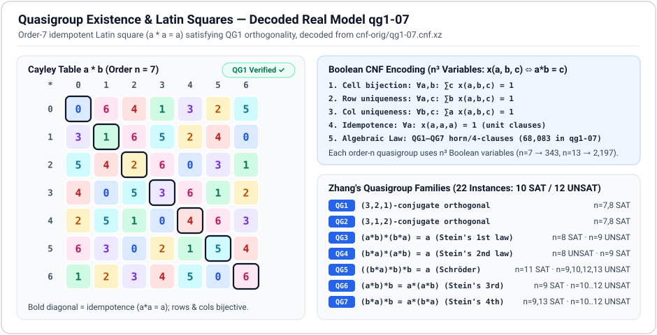

# SATLIB — Quasigroup / Latin Squares — Zhang (full) (`satlib-qg`)

*Figure: Verified order-7 idempotent Latin square ($a \ast a = a$) satisfying QG1 orthogonality, decoded directly from `cnf-orig/qg1-07.cnf.xz`, together with the $n^3$-variable CNF encoding and Zhang's `QG1`–`QG7` algebraic laws. Regenerated via [`src/gen_diagram.py`](src/gen_diagram.py).*

## Provenance & Credit

- **Upstream Archive:** [SATLIB — Benchmark Problems (UBC)](https://www.cs.ubc.ca/~hoos/SATLIB/benchm.html)
- **SATLIB Curators:** Holger H. Hoos and Thomas Stützle (University of British Columbia / TU Darmstadt)
- **Family Contributors:** Hantao Zhang
- **License:** Classic public scientific benchmark collection redistributed by UBC SATLIB for academic SAT research; no separate upstream `LICENSE` file is bundled in the archives.
- **Format Hygiene:** Legacy SATLIB trailing `%` / `0` EOF sentinels were stripped and wrapped multi-line clauses normalized to canonical 1-clause-per-line DIMACS CNF so every modern SAT solver parses all files cleanly.
- **Full SATLIB Archive Manifest:** [`../satlib-archive-uris/`](../satlib-archive-uris/README.md) (all 97 official UBC SATLIB `.tar.gz` archive URLs; Pretolani's `PRET` formulas live in [`../pretolani-pret/`](../pretolani-pret/README.md)).
- **Recommended by:** [`@jasonslenderman`](https://twitter.com/jasonslenderman) (Twitter/X)

## Problem Description

All 22 Quasigroup existence / Latin Square (`qg1`–`qg7`) SAT and UNSAT instances contributed by Hantao Zhang.

## Corpus & Data Sizes

- **`cnf-orig/`** — 22 original native **DIMACS `.cnf.xz`** files (1.64 MB).
- **`aig-converted/`** — 22 exact **Binary AIGER 1.9 `.aig.xz`** conversions (4.23 MB, verified via [Berkeley ABC](https://github.com/berkeley-abc/abc) `read_aiger`).
- **`xcnf-converted/`** — 22 lossless **[CryptoMiniSat](https://github.com/msoos/cryptominisat) `.xcnf.xz`** conversions (1.64 MB, `0` extracted native XOR parity clauses).
- **`anf-converted/`** — 22 lossless linear-size **DIMACS-ANF `.anf.xz`** conversions (4.91 MB, generated via [`../src/to_anf.py`](../src/to_anf.py)).
- **[`expected.tsv`](expected.tsv)** — Ground-truth verdict manifest for all 22 instances (**10 SAT / 12 UNSAT**).
- **`src/`** — Standalone converters (`cnf2aig.py`, `cnf2xcnf.py`).

| Format | Directory | Files | Key Dimensions (Range) | Compressed Size |
|---|---|---:|---|---:|
| **DIMACS CNF (origin)** | `cnf-orig/` | 22 | Vars: 343–2,197; Clauses: 9,685–148,957 | 1.64 MB |
| **Binary AIGER 1.9** | `aig-converted/` | 22 | Inputs: 343–2,197; ANDs: 23,908–337,034 | 4.23 MB |
| **[CryptoMiniSat](https://github.com/msoos/cryptominisat) XCNF** | `xcnf-converted/` | 22 | Native XOR clauses total: 0 | 1.64 MB |
| **DIMACS-ANF** | `anf-converted/` | 22 | Vars: 1,472–143,712; Eqs: 10,645–292,157 (deg ≤ 3) | 4.91 MB |
| **Total (4 Formats, Status: 10 SAT / 12 UNSAT)** | | **88** | | **12.42 MB** |

## Benchmark Results

- **Hardware & Protocol:** Same machine (**AMD Ryzen 9 5950X**, 16C/32T Linux, **1 thread per run** pinned across 8 dedicated physical cores, $T_{\max} = 5\text{ s}$, PAR-2 penalty $10,000\text{ ms}$). All solvers ran with default single-thread flags (`-t 1` for CryptoMiniSat 5.18.0; `--max-cores 1` for Frobenius) on identical uncompressed flat `.cnf` inputs; **100% of all 22 instances** were run (no subsampling), every Frobenius SAT model was independently verified against 100% of input clauses, and **0 verdict disagreements** occurred across all solvers.

| Instance | Verdict | Frobenius 1C | [CaDiCaL](https://github.com/arminbiere/cadical) 3.1.0 | [CryptoMiniSat](https://github.com/msoos/cryptominisat) 5.18.0 | [dense-solver](https://github.com/libdense/dense-solver) 0.0.4 | [Kissat](https://github.com/arminbiere/kissat) 4.0.4 |
|---|:---:|---:|---:|---:|---:|---:|
| `qg1-07` | SAT | 13.79 ms | **12.95 ms** | 204.83 ms | 23.69 ms | 83.39 ms |
| `qg1-08` | SAT | 126.85 ms | **107.57 ms** | 480.07 ms | 124.75 ms | 731.76 ms |
| `qg2-07` | SAT | 9.85 ms | 12.27 ms | 269.39 ms | 22.19 ms | **6.20 ms** |
| `qg2-08` | SAT | 260.45 ms | **107.08 ms** | 1,563.06 ms | 980.43 ms | 348.94 ms |
| `qg3-08` | SAT | **5.01 ms** | 5.05 ms | 150.56 ms | 7.33 ms | 28.09 ms |
| `qg3-09` | UNSAT | **473.96 ms** | 628.64 ms | 779.37 ms | 3,137.39 ms | 835.51 ms |
| `qg4-08` | UNSAT | **8.46 ms** | 13.20 ms | 144.44 ms | 11.17 ms | 33.10 ms |
| `qg4-09` | SAT | 19.30 ms | 34.97 ms | 217.03 ms | **16.00 ms** | 35.40 ms |
| `qg5-09` | UNSAT | 8.70 ms | **6.78 ms** | 433.91 ms | 17.76 ms | 16.12 ms |
| `qg5-10` | UNSAT | 12.79 ms | **10.82 ms** | 626.57 ms | 20.11 ms | 42.56 ms |
| `qg5-11` | SAT | 18.79 ms | **16.58 ms** | 687.54 ms | 28.86 ms | 58.56 ms |
| `qg5-12` | UNSAT | **36.84 ms** | 44.08 ms | 763.59 ms | 52.42 ms | 105.06 ms |
| `qg5-13` | UNSAT | **1,178.01 ms** | 1,734.15 ms | 2,125.51 ms | 1,946.58 ms | 2,060.38 ms |
| `qg6-09` | SAT | 4.62 ms | 6.50 ms | 525.08 ms | 10.02 ms | **3.03 ms** |
| `qg6-10` | UNSAT | 10.87 ms | **10.74 ms** | 624.56 ms | 17.52 ms | 37.10 ms |
| `qg6-11` | UNSAT | **30.37 ms** | 45.28 ms | 680.25 ms | 38.65 ms | 79.13 ms |
| `qg6-12` | UNSAT | **460.33 ms** | 586.13 ms | 989.44 ms | 469.95 ms | 1,223.98 ms |
| `qg7-09` | SAT | 5.72 ms | 6.91 ms | 48.40 ms | 11.00 ms | **3.07 ms** |
| `qg7-10` | UNSAT | 11.93 ms | **8.56 ms** | 632.10 ms | 14.80 ms | 34.90 ms |
| `qg7-11` | UNSAT | **24.32 ms** | 29.51 ms | 649.02 ms | 29.49 ms | 53.11 ms |
| `qg7-12` | UNSAT | 284.74 ms | 213.63 ms | 838.03 ms | **127.10 ms** | 263.38 ms |
| `qg7-13` | SAT | 36.38 ms | **24.35 ms** | 1,134.27 ms | 71.80 ms | 104.73 ms |
| **Solved (22 files)** | — | **22 / 22** *(highest)* | **22 / 22** *(highest)* | **22 / 22** *(highest)* | **22 / 22** *(highest)* | **22 / 22** *(highest)* |
| **Total PAR-2** | — | **3,042.1 ms** *(fastest)* | 3,665.8 ms *(1.21x slower)* | 14,567.0 ms *(4.79x slower)* | 7,179.0 ms *(2.36x slower)* | 6,187.5 ms *(2.03x slower)* |

<!-- BEGIN_STRUCTURAL_ANALYSIS -->
## Phase-Transition & Structural Analysis

*Auto-generated by [`../src/analyze_benchmarks.py`](../src/analyze_benchmarks.py). Position relative to the critical phase transition is measured by $\rho_{\mathrm{crit}} = \frac{1}{n}\sum_k m_k / \alpha_c(k)$ (exact $\alpha/\alpha_c(k)$ for pure $k$-SAT; effective critical threshold $\alpha_c^{\mathrm{eff}} = \alpha/\rho_{\mathrm{crit}}$; `Under` $<0.90\times$, `Near-crit` $0.90\text{--}1.10\times$, `Over` $>1.10\times$), alongside Gent–Walsh annealed constrainedness $\kappa = -\frac{1}{n}\sum_i \log_2(1-2^{-k_i})$ (AAAI 1996), clause-length profile ($\bar{k}$, `%Bin`, `%Horn`), variable-degree CV ($\sigma_d/\bar{d}$, uniformity vs. hub skew), and extracted native XOR parity clauses.*

| Instance | Active $n$ | Clauses $m$ | $\alpha=m/n$ | $\alpha_c^{\mathrm{eff}}$ | $\rho_{\mathrm{crit}}$ (Regime) | $\kappa$ | $\bar{k}$ ($k_{\max}$) | Bin% | Horn% | Pos% | Deg CV | XORs |
|---|---:|---:|---:|---:|---:|---:|---:|---:|---:|---:|---:|---:|
| `qg1-07` | 343 | 68,083 | 198.5 | 6.66 | **29.8x** (Over) | 22.36 | 3.87 (7) | 5% | 100% | 0% | 0.02 | 0 |
| `qg1-08` | 512 | 148,957 | 290.9 | 7.17 | **40.6x** (Over) | 31.55 | 3.90 (8) | 4% | 100% | 0% | 0.02 | 0 |
| `qg2-07` | 343 | 68,083 | 198.5 | 6.99 | **28.4x** (Over) | 21.62 | 3.90 (7) | 5% | 100% | 0% | 0.01 | 0 |
| `qg2-08` | 512 | 148,957 | 290.9 | 7.45 | **39.0x** (Over) | 30.71 | 3.92 (8) | 4% | 100% | 0% | 0.01 | 0 |
| `qg3-08` | 512 | 10,469 | 20.45 | 1.44 | **14.2x** (Over) | 6.79 | 2.47 (8) | 59% | 98% | 21% | 0.04 | 0 |
| `qg3-09` | 729 | 16,732 | 22.95 | 1.44 | **16.0x** (Over) | 7.60 | 2.47 (9) | 60% | 99% | 21% | 0.04 | 0 |
| `qg4-08` | 512 | 9,685 | 18.92 | 1.51 | **12.5x** (Over) | 5.98 | 2.53 (8) | 56% | 98% | 23% | 0.01 | 0 |
| `qg4-09` | 729 | 15,580 | 21.37 | 1.50 | **14.2x** (Over) | 6.79 | 2.52 (9) | 57% | 98% | 22% | 0.01 | 0 |
| `qg5-09` | 729 | 28,540 | 39.15 | 2.13 | **18.4x** (Over) | 10.21 | 2.74 (9) | 31% | 99% | 28% | 0.02 | 0 |
| `qg5-10` | 1,000 | 43,636 | 43.64 | 2.12 | **20.6x** (Over) | 11.41 | 2.73 (10) | 31% | 99% | 27% | 0.01 | 0 |
| `qg5-11` | 1,331 | 64,054 | 48.12 | 2.11 | **22.8x** (Over) | 12.61 | 2.73 (11) | 31% | 99% | 27% | 0.01 | 0 |
| `qg5-12` | 1,728 | 90,919 | 52.62 | 2.11 | **25.0x** (Over) | 13.81 | 2.73 (12) | 32% | 100% | 27% | 0.01 | 0 |
| `qg5-13` | 2,197 | 125,464 | 57.11 | 2.10 | **27.2x** (Over) | 15.00 | 2.72 (13) | 32% | 100% | 27% | 0.01 | 0 |
| `qg6-09` | 729 | 21,844 | 29.96 | 1.84 | **16.3x** (Over) | 8.46 | 2.66 (9) | 41% | 99% | 26% | 0.05 | 0 |
| `qg6-10` | 1,000 | 33,466 | 33.47 | 1.83 | **18.3x** (Over) | 9.47 | 2.65 (10) | 41% | 99% | 26% | 0.05 | 0 |
| `qg6-11` | 1,331 | 49,204 | 36.97 | 1.83 | **20.2x** (Over) | 10.48 | 2.65 (11) | 41% | 99% | 25% | 0.04 | 0 |
| `qg6-12` | 1,728 | 69,931 | 40.47 | 1.82 | **22.2x** (Over) | 11.48 | 2.64 (12) | 41% | 99% | 25% | 0.04 | 0 |
| `qg7-09` | 729 | 22,060 | 30.26 | 1.85 | **16.3x** (Over) | 8.50 | 2.66 (9) | 40% | 99% | 26% | 0.02 | 0 |
| `qg7-10` | 1,000 | 33,736 | 33.74 | 1.85 | **18.3x** (Over) | 9.50 | 2.66 (10) | 40% | 99% | 26% | 0.02 | 0 |
| `qg7-11` | 1,331 | 49,534 | 37.22 | 1.84 | **20.2x** (Over) | 10.51 | 2.65 (11) | 41% | 99% | 25% | 0.02 | 0 |
| `qg7-12` | 1,728 | 70,327 | 40.70 | 1.83 | **22.2x** (Over) | 11.51 | 2.65 (12) | 41% | 99% | 25% | 0.01 | 0 |
| `qg7-13` | 2,197 | 97,072 | 44.18 | 1.83 | **24.2x** (Over) | 12.52 | 2.64 (13) | 41% | 99% | 25% | 0.01 | 0 |

**Collection Phase-Transition Summary (22 instances, 4 formats: 22 CNF / 22 AIG / 22 XCNF / 22 ANF):** median $\rho_{\mathrm{crit}} = 20.4\times$ (range `12.5x–40.6x`), median $\kappa = 10.96$, regime split **0 Under / 0 Near-critical / 22 Over**, total extracted native XOR parity clauses = **0**, total ANF equations = **1,742,827**.
<!-- END_STRUCTURAL_ANALYSIS -->

## References

- H. H. Hoos and T. Stützle, *"SATLIB: An Online Resource for Research on SAT"*, SAT 2000, IOS Press, pp. 283–292 ([`cs.ubc.ca/~hoos/SATLIB/`](https://www.cs.ubc.ca/~hoos/SATLIB/benchm.html)).
- D. S. Johnson and M. A. Trick (eds.), *Cliques, Coloring, and Satisfiability: Second DIMACS Implementation Challenge*, DIMACS Series vol. 26, AMS, 1996.
