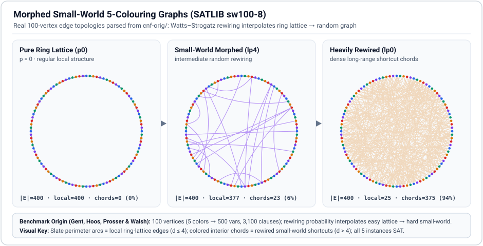

# SATLIB — Morphed Small-World 5-Colouring `lp0..p0` (sample / 901*) (`satlib-sw-gcp`)

*Figure: Real 100-vertex edge topologies parsed from `sw100-8-p0`, `lp4`, and `lp0`, showing Watts–Strogatz rewiring morphing a regular 4-neighbor ring lattice into a small-world 5-coloring graph with long-range chords. Regenerated via [`src/gen_diagram.py`](src/gen_diagram.py).*

## Provenance & Credit

- **Upstream Archive:** [SATLIB — Benchmark Problems (UBC)](https://www.cs.ubc.ca/~hoos/SATLIB/benchm.html)
- **SATLIB Curators:** Holger H. Hoos and Thomas Stützle (University of British Columbia / TU Darmstadt)
- **Family Contributors:** Ian P. Gent, Holger H. Hoos, Patrick Prosser, and Toby Walsh
- **License:** Classic public scientific benchmark collection redistributed by UBC SATLIB for academic SAT research; no separate upstream `LICENSE` file is bundled in the archives.
- **Format Hygiene:** Legacy SATLIB trailing `%` / `0` EOF sentinels were stripped and wrapped multi-line clauses normalized to canonical 1-clause-per-line DIMACS CNF so every modern SAT solver parses all files cleanly.
- **Full SATLIB Archive Manifest:** [`../satlib-archive-uris/`](../satlib-archive-uris/README.md) (all 97 official UBC SATLIB `.tar.gz` archive URLs; Pretolani's `PRET` formulas live in [`../pretolani-pret/`](../pretolani-pret/README.md)).
- **Recommended by:** [`@jasonslenderman`](https://twitter.com/jasonslenderman) (Twitter/X)

## Problem Description

Stratified sample of 5 instances (`sw100-8-*`) from the 901-instance SATLIB morphed small-world 5-colouring graph ensemble (full archive URLs in [`../satlib-archive-uris/`](../satlib-archive-uris/README.md)).

## Corpus & Data Sizes

- **`cnf-orig/`** — 5 original native **DIMACS `.cnf.xz`** files (19.1 KB).
- **`aig-converted/`** — 5 exact **Binary AIGER 1.9 `.aig.xz`** conversions (23.7 KB, verified via [Berkeley ABC](https://github.com/berkeley-abc/abc) `read_aiger`).
- **`xcnf-converted/`** — 5 lossless **[CryptoMiniSat](https://github.com/msoos/cryptominisat) `.xcnf.xz`** conversions (19.5 KB, `0` extracted native XOR parity clauses).
- **`anf-converted/`** — 5 lossless linear-size **DIMACS-ANF `.anf.xz`** conversions (35.9 KB, generated via [`../src/to_anf.py`](../src/to_anf.py)).
- **[`expected.tsv`](expected.tsv)** — Ground-truth verdict manifest for all 5 instances (**5 SAT / 0 UNSAT**).
- **`src/`** — Standalone converters (`cnf2aig.py`, `cnf2xcnf.py`).

| Format | Directory | Files | Key Dimensions (Range) | Compressed Size |
|---|---|---:|---|---:|
| **DIMACS CNF (origin)** | `cnf-orig/` | 5 | Vars: 500; Clauses: 3,100 | 19.1 KB |
| **Binary AIGER 1.9** | `aig-converted/` | 5 | Inputs: 500; ANDs: 6,499 | 23.7 KB |
| **[CryptoMiniSat](https://github.com/msoos/cryptominisat) XCNF** | `xcnf-converted/` | 5 | Native XOR clauses total: 0 | 19.5 KB |
| **DIMACS-ANF** | `anf-converted/` | 5 | Vars: 700; Eqs: 3,300 (deg ≤ 3) | 35.9 KB |
| **Total (4 Formats, Status: 5 SAT / 0 UNSAT)** | | **20** | | **98.2 KB** |

## Benchmark Results

- **Hardware & Protocol:** Same machine (**AMD Ryzen 9 5950X**, 16C/32T Linux, **1 thread per run** pinned across 8 dedicated physical cores, $T_{\max} = 5\;\text{s}$, PAR-2 penalty $10,000\;\text{ms}$). All solvers ran with default single-thread flags (`-t 1` for CryptoMiniSat 5.18.0; `--max-cores 1` for Frobenius) on identical uncompressed flat `.cnf` inputs; **100% of all 5 instances** were run (no subsampling), every Frobenius SAT model was independently verified against 100% of input clauses, and **0 verdict disagreements** occurred across all solvers.

| Instance | Verdict | Frobenius 1C | [CaDiCaL](https://github.com/arminbiere/cadical) 3.1.0 | [CryptoMiniSat](https://github.com/msoos/cryptominisat) 5.18.0 | [dense-solver](https://github.com/libdense/dense-solver) 0.0.4 | [Kissat](https://github.com/arminbiere/kissat) 4.0.4 |
|---|:---:|---:|---:|---:|---:|---:|
| `sw100-8-lp0-c5_sw100-1` | SAT | **1.07 ms** | 2.81 ms | 64.67 ms | 2.94 ms | 21.88 ms |
| `sw100-8-lp2-c5_sw100-1` | SAT | **0.97 ms** | 3.37 ms | 56.14 ms | 2.84 ms | 1.67 ms |
| `sw100-8-lp4-c5_sw100-1` | SAT | **0.99 ms** | 2.91 ms | 46.89 ms | 2.95 ms | 1.72 ms |
| `sw100-8-lp6-c5_sw100-1` | SAT | **1.68 ms** | 5.32 ms | 53.13 ms | 6.02 ms | 16.37 ms |
| `sw100-8-p0-c5_sw100-1` | SAT | **0.95 ms** | 2.76 ms | 49.12 ms | 2.09 ms | 1.48 ms |
| **Solved (5 files)** | — | **5 / 5** *(highest)* | **5 / 5** *(highest)* | **5 / 5** *(highest)* | **5 / 5** *(highest)* | **5 / 5** *(highest)* |
| **Total PAR-2** | — | **5.7 ms** *(fastest)* | 17.2 ms *(3.04x slower)* | 269.9 ms *(47.66x slower)* | 16.8 ms *(2.97x slower)* | 43.1 ms *(7.61x slower)* |

<!-- BEGIN_STRUCTURAL_ANALYSIS -->
## Phase-Transition & Structural Analysis

*Auto-generated by [`../src/analyze_benchmarks.py`](../src/analyze_benchmarks.py). Position relative to the critical phase transition is measured by $\rho_{\mathrm{crit}} = \frac{1}{n}\sum_k m_k / \alpha_c(k)$ (exact $\alpha/\alpha_c(k)$ for pure $k$-SAT; effective critical threshold $\alpha_c^{\mathrm{eff}} = \alpha/\rho_{\mathrm{crit}}$; `Under` $<0.90\times$, `Near-crit` $0.90\text{--}1.10\times$, `Over` $>1.10\times$), alongside Gent–Walsh annealed constrainedness $\kappa = -\frac{1}{n}\sum_i \log_2(1-2^{-k_i})$ (AAAI 1996), clause-length profile ($\bar{k}$, `%Bin`, `%Horn`), variable-degree CV ($\sigma_d/\bar{d}$, uniformity vs. hub skew), and extracted native XOR parity clauses.*

| Instance | Active $n$ | Clauses $m$ | $\alpha=m/n$ | $\alpha_c^{\mathrm{eff}}$ | $\rho_{\mathrm{crit}}$ (Regime) | $\kappa$ | $\bar{k}$ ($k_{\max}$) | Bin% | Horn% | Pos% | Deg CV | XORs |
|---|---:|---:|---:|---:|---:|---:|---:|---:|---:|---:|---:|---:|
| `sw100-8-lp0-c5_sw100-1` | 500 | 3,100 | 6.20 | 1.03 | **6.01x** (Over) | 2.50 | 2.10 (5) | 97% | 97% | 8% | 0.22 | 0 |
| `sw100-8-lp2-c5_sw100-1` | 500 | 3,100 | 6.20 | 1.03 | **6.01x** (Over) | 2.50 | 2.10 (5) | 97% | 97% | 8% | 0.14 | 0 |
| `sw100-8-lp4-c5_sw100-1` | 500 | 3,100 | 6.20 | 1.03 | **6.01x** (Over) | 2.50 | 2.10 (5) | 97% | 97% | 8% | 0.07 | 0 |
| `sw100-8-lp6-c5_sw100-1` | 500 | 3,100 | 6.20 | 1.03 | **6.01x** (Over) | 2.50 | 2.10 (5) | 97% | 97% | 8% | 0.03 | 0 |
| `sw100-8-p0-c5_sw100-1` | 500 | 3,100 | 6.20 | 1.03 | **6.01x** (Over) | 2.50 | 2.10 (5) | 97% | 97% | 8% | 0.00 | 0 |

**Collection Phase-Transition Summary (5 instances, 4 formats: 5 CNF / 5 AIG / 5 XCNF / 5 ANF):** median $\rho_{\mathrm{crit}} = 6.01\times$ (range `6.01x–6.01x`), median $\kappa = 2.50$, regime split **0 Under / 0 Near-critical / 5 Over**, total extracted native XOR parity clauses = **0**, total ANF equations = **16,500**.
<!-- END_STRUCTURAL_ANALYSIS -->

## References

- H. H. Hoos and T. Stützle, *"SATLIB: An Online Resource for Research on SAT"*, SAT 2000, IOS Press, pp. 283–292 ([`cs.ubc.ca/~hoos/SATLIB/`](https://www.cs.ubc.ca/~hoos/SATLIB/benchm.html)).
- D. S. Johnson and M. A. Trick (eds.), *Cliques, Coloring, and Satisfiability: Second DIMACS Implementation Challenge*, DIMACS Series vol. 26, AMS, 1996.
