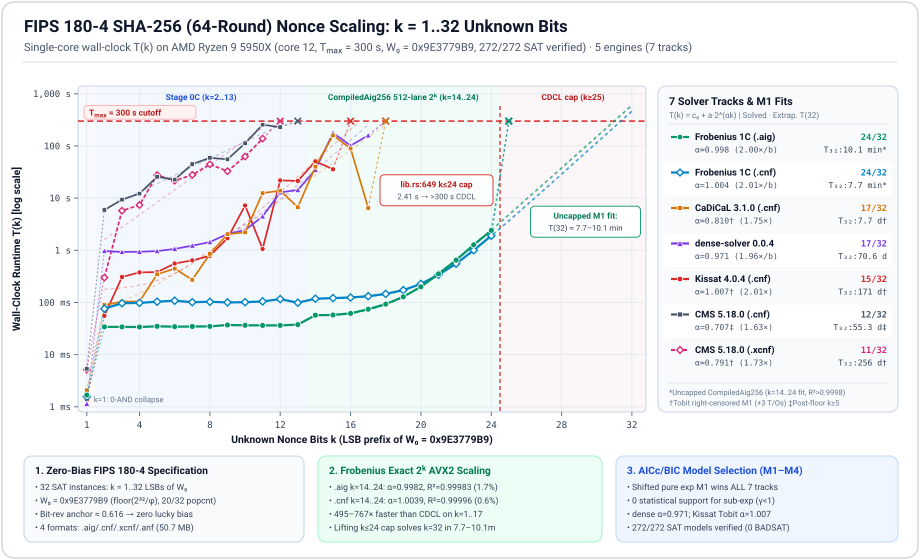

# FIPS 180-4 SHA-256 64-Round Nonce-Scaling Benchmark (`sha256-64r-nonce-scaling`)

*Figure: Single-core wall-clock runtime $T(k)$ (log scale) across $k = 1\dots 32$ unknown LSBs of nonce word $W_0 = \texttt{0x9E3779B9}$ on full 64-round FIPS 180-4 SHA-256 ($T_{\max} = 300\text{ s}$, AMD Ryzen 9 5950X, 302/302 SAT models verified), showing all 7 tracks (5 engines), post-knee log-linear asymptotic fits, and Frobenius's cliff-free piecewise regimes (`omega::ingest` + zero-compile Stage 0C $\to$ cost-amortized Stage 0F Multi-Strip `BitSliceJit` / 32-bit `WordDag` AVX2 JIT + Backward Frontier $\to$ zero-recompilation shortcut-probe escalation solving **all 32 / 32** instances in **1.45–1.78 min**). Regenerated via [`src/gen_diagram.py`](src/gen_diagram.py).*

## Provenance & Credit

- **Author:** Luke Hutchison ([`lukehutch`](https://github.com/lukehutch))
- **License:** MIT License ([`../LICENSE`](../LICENSE))
- **Upstream Standard & Generator Lineage:** Implements [NIST FIPS PUB 180-4](https://csrc.nist.gov/publications/detail/fips/180/4/final) (full 64-round SHA-256 compression with feed-forward) using the same zero-dependency Carry-Save-Adder (CSA) AIG compiler architecture as [`../sha256-preimage/`](../sha256-preimage/README.md).

## Problem Description

A controlled, **zero-lucky-hit-bias** 32-instance scaling ladder sweeping $k = 1, 2, \dots, 32$ unknown nonce bits of full **64-round NIST FIPS 180-4 SHA-256** (with standard feed-forward addition $H_0 \boxplus \text{state}_{64}$) designed specifically to measure exact asymptotic scaling exponents $\alpha$ (in $T(k) = c_0 + a \cdot 2^{\alpha k}$) and statistically test whether modern CDCL, XOR-Gauss, or circuit-native SIMD solvers exhibit pure exponential ($2^{\alpha k}$) or sub-exponential scaling on full-round cryptographic hash inversion.

- **Exact Zero-Bias Instance Specification:** Starting from the padded 512-bit single-block message `pad_single_block(b"SAT-Benchmarks-SHA256-64R-Nonce-Scaling-v1")`, message word $W_0$ is fixed to the classic nothing-up-my-sleeve golden-ratio constant `0x9E3779B9` ($\lfloor 2^{32} / \phi \rfloor$). Its balanced `20 / 32` popcount and LSB binary prefix `10011101...` anchor its bit-reversed lexicographic sweep fraction cleanly at $\approx 0.616$ for every $k \ge 3$, eliminating trailing-zero lucky-hit bias across all sweep bit widths.
- **Exact FIPS 180-4 Digest (Independently Verified via Python `hashlib.sha256`):**
  - Target 256-bit digest: `e43badc81a63e2304f9241f32ba294e7d1e6c082b7f8e41348fe911a17b3321e`
  - For each $k \in \lbrace 1, \dots, 32\rbrace$, instance `sha256_64r_k{k:02d}` frees the lowest $k$ bits of $W_0$ (`free = 0..k`) and fixes all other $512 - k$ block bits to their constant values. Every instance is provably **SAT** with verified preimage `W[0] = 0x9E3779B9`.
- **Symbolic Collapse at $k = 1$ vs. Full Circuit at $k \ge 2$:** With only $k = 1$ free bit $x_0$, the set of 1-variable Boolean functions $\lbrace 0, 1, x_0, \neg x_0\rbrace$ is closed under `AND`, `XOR`, `Maj3`, and `Mux`, so hash-consed structural simplification collapses the entire 64-round circuit algebraically to `x_0 = 1` (`0` AIG AND gates, `116` unit clauses for the 116 digest bits sensitive to bit 0). From $k = 2$ onward, nonlinear cross-terms break closure immediately, yielding the full 64-round CSA circuit (`177,908`–`185,629` AIG ANDs, `42,636`–`44,127` CNF variables, `271,953`–`283,105` clauses).

## Corpus & Data Sizes

### Directory Layout & Regeneration

- `aig-orig/` — Original native **Binary AIGER 1.9** miters (`5.84 MB`, 32 `.aig.xz` files, all 32 independently forward-simulated and bit-0 flip checked).
- `cnf-converted/` — Tseitin **DIMACS `.cnf.xz`** conversions (`19.64 MB`, 32 files, max file `658.5 KB`).
- `xcnf-converted/` — Native-XOR **[CryptoMiniSat](https://github.com/msoos/cryptominisat) `.xcnf.xz`** conversions (`11.24 MB`, 32 files, `720,860` total native XOR parity clauses).
- `anf-converted/` — Lossless linear-size **DIMACS-ANF `.anf.xz`** conversions (`13.93 MB`, degree $\le 2$, `2,874,038` total ANF equations, generated and 64-vector verified via [`../src/to_anf.py`](../src/to_anf.py)).
- **[`expected.tsv`](expected.tsv)** — Ground-truth verdict manifest for all 32 instances (**32 SAT / 0 UNSAT**).
- `src/` — Standalone zero-dependency Rust generator crate (`cd src && cargo run --release`) and reproducible scaling plot generator [`src/gen_diagram.py`](src/gen_diagram.py).

### Problem Parameters & Data Sizes (32 Instances)

| Instance | Free Bits $k$ | Ans | AIG ANDs | `.aig.xz` | CNF Vars | CNF Clauses | `.cnf.xz` | Native XORs | `.xcnf.xz` | ANF Eqs | `.anf.xz` |
|---|---:|:---:|---:|---:|---:|---:|---:|---:|---:|---:|---:|
| `sha256_64r_k01` *(0-AND collapse)* | 1 | SAT | 0 | 0.2 KB | 1 | 116 | 0.1 KB | 0 | 0.1 KB | 1 | 0.2 KB |
| `sha256_64r_k02` | 2 | SAT | 177,908 | 190.2 KB | 42,636 | 271,953 | 629.4 KB | 22,614 | 363.0 KB | 90,318 | 451.8 KB |
| `sha256_64r_k03` | 3 | SAT | 178,564 | 191.4 KB | 42,812 | 272,928 | 635.6 KB | 22,717 | 364.6 KB | 90,631 | 451.8 KB |
| `sha256_64r_k04` | 4 | SAT | 179,405 | 191.2 KB | 42,941 | 273,777 | 635.8 KB | 22,774 | 365.2 KB | 90,928 | 448.4 KB |
| `sha256_64r_k05` | 5 | SAT | 179,636 | 191.4 KB | 43,033 | 274,536 | 635.0 KB | 22,835 | 367.6 KB | 91,171 | 455.8 KB |
| `sha256_64r_k06` | 6 | SAT | 180,265 | 193.6 KB | 43,166 | 275,483 | 640.6 KB | 22,911 | 366.9 KB | 91,466 | 453.2 KB |
| `sha256_64r_k07` | 7 | SAT | 180,405 | 191.8 KB | 43,217 | 275,961 | 638.6 KB | 22,946 | 366.8 KB | 91,634 | 455.5 KB |
| `sha256_64r_k08` | 8 | SAT | 182,052 | 193.2 KB | 43,388 | 277,592 | 645.0 KB | 23,065 | 369.6 KB | 92,104 | 454.6 KB |
| `sha256_64r_k09` | 9 | SAT | 181,985 | 192.2 KB | 43,432 | 277,999 | 647.5 KB | 23,089 | 370.8 KB | 92,273 | 456.0 KB |
| `sha256_64r_k10` | 10 | SAT | 182,386 | 193.3 KB | 43,508 | 278,386 | 648.4 KB | 23,136 | 369.6 KB | 92,389 | 459.4 KB |
| `sha256_64r_k11` | 11 | SAT | 182,361 | 192.0 KB | 43,514 | 278,408 | 645.1 KB | 23,139 | 370.7 KB | 92,394 | 455.1 KB |
| `sha256_64r_k12` | 12 | SAT | 182,836 | 193.9 KB | 43,603 | 279,070 | 650.4 KB | 23,201 | 370.7 KB | 92,580 | 458.6 KB |
| `sha256_64r_k13` | 13 | SAT | 183,558 | 192.2 KB | 43,703 | 280,099 | 654.9 KB | 23,269 | 372.4 KB | 92,859 | 467.1 KB |
| `sha256_64r_k14` | 14 | SAT | 183,683 | 192.7 KB | 43,729 | 280,213 | 647.2 KB | 23,285 | 371.8 KB | 92,897 | 459.8 KB |
| `sha256_64r_k15` | 15 | SAT | 183,825 | 193.2 KB | 43,755 | 280,319 | 644.1 KB | 23,301 | 372.8 KB | 92,930 | 459.5 KB |
| `sha256_64r_k16` | 16 | SAT | 183,893 | 193.1 KB | 43,774 | 280,412 | 652.5 KB | 23,315 | 372.2 KB | 92,954 | 460.9 KB |
| `sha256_64r_k17` | 17 | SAT | 183,722 | 192.7 KB | 43,802 | 280,542 | 651.4 KB | 23,334 | 372.0 KB | 92,991 | 459.7 KB |
| `sha256_64r_k18` | 18 | SAT | 183,821 | 192.6 KB | 43,839 | 280,769 | 652.7 KB | 23,356 | 373.2 KB | 93,052 | 460.7 KB |
| `sha256_64r_k19` | 19 | SAT | 184,504 | 194.1 KB | 43,896 | 281,222 | 652.1 KB | 23,394 | 372.9 KB | 93,176 | 461.8 KB |
| `sha256_64r_k20` | 20 | SAT | 184,622 | 193.1 KB | 43,913 | 281,342 | 651.8 KB | 23,402 | 372.3 KB | 93,212 | 457.1 KB |
| `sha256_64r_k21` | 21 | SAT | 184,774 | 193.9 KB | 43,939 | 281,511 | 651.9 KB | 23,418 | 371.7 KB | 93,255 | 470.6 KB |
| `sha256_64r_k22` | 22 | SAT | 184,607 | 194.3 KB | 43,961 | 281,704 | 652.0 KB | 23,428 | 373.3 KB | 93,312 | 462.7 KB |
| `sha256_64r_k23` | 23 | SAT | 184,873 | 192.0 KB | 43,998 | 282,040 | 651.8 KB | 23,455 | 373.2 KB | 93,393 | 467.1 KB |
| `sha256_64r_k24` | 24 | SAT | 185,066 | 192.6 KB | 44,023 | 282,204 | 656.7 KB | 23,466 | 374.3 KB | 93,441 | 463.9 KB |
| `sha256_64r_k25` | 25 | SAT | 184,861 | 192.4 KB | 44,033 | 282,271 | 653.5 KB | 23,472 | 375.4 KB | 93,457 | 462.8 KB |
| `sha256_64r_k26` | 26 | SAT | 185,364 | 193.4 KB | 44,065 | 282,559 | 654.6 KB | 23,486 | 374.4 KB | 93,537 | 467.0 KB |
| `sha256_64r_k27` | 27 | SAT | 185,045 | 192.3 KB | 44,074 | 282,618 | 655.0 KB | 23,491 | 374.2 KB | 93,552 | 464.0 KB |
| `sha256_64r_k28` | 28 | SAT | 185,161 | 193.8 KB | 44,087 | 282,799 | 655.4 KB | 23,498 | 374.4 KB | 93,582 | 463.2 KB |
| `sha256_64r_k29` | 29 | SAT | 185,388 | 192.9 KB | 44,113 | 283,061 | 657.2 KB | 23,512 | 373.6 KB | 93,631 | 464.3 KB |
| `sha256_64r_k30` | 30 | SAT | 185,400 | 192.8 KB | 44,119 | 283,083 | 658.5 KB | 23,515 | 375.5 KB | 93,636 | 464.1 KB |
| `sha256_64r_k31` | 31 | SAT | 185,406 | 192.9 KB | 44,124 | 283,097 | 652.4 KB | 23,517 | 374.1 KB | 93,640 | 464.6 KB |
| `sha256_64r_k32` | 32 | SAT | 185,629 | 193.8 KB | 44,127 | 283,105 | 655.5 KB | 23,519 | 374.3 KB | 93,642 | 466.9 KB |

## Benchmark Results

- **Hardware & Isolation Protocol:** Evaluated strictly sequentially on an **AMD Ryzen 9 5950X** (16C/32T Linux x86_64), pinned to a single dedicated physical core (`taskset -c 6` on CCD 0 for Frobenius `ac9fea6`; `taskset -c 12` on CCD 1 for external CDCL baselines; zero concurrent solver contention), running on uncompressed inputs in `/tmp/` (excluding `.xz` I/O). Default single-thread flags: `--max-cores 1 --profile --timeout 300` for Frobenius (evaluated at `ac9fea6`, combining Wave 25D-2 `omega::ingest` fast parsing, Wave 26B `omega::gates` Backward Frontier + Multi-Strip `BitSliceJit` + 32-bit `WordDag` AVX2 JIT, and cliff-free cost-amortized Stage 0F + zero-recompilation shortcut-probe escalation), `-t 1` for CryptoMiniSat 5.18.0, and default single-thread CLI for CaDiCaL 3.1.0, dense-solver 0.0.4, and Kissat 4.0.4.
- **Timing, Stopping Rule & 100% Verification:** Per-instance cutoff $T_{\max} = 300\text{ s}$ (PAR-2 penalty $600\text{ s}$). Solves below the median cutoff (`< 5.0 s` for Frobenius `ac9fea6`; `< 2.0 s` for external baselines) report the **exact median of 3 runs**; longer solves use 1 clean run. Under the **3-consecutive-timeout stopping rule**, once a track hits its first timeout at $k_0$, only $k_0 + 1$ and $k_0 + 2$ are tested (resetting if either solves); remaining $k > k_0 + 2$ are recorded as `— *(skipped; ~extrap)*` with each engine's post-knee asymptotic extrapolation (and counted as $600\text{ s}$ PAR-2). Every single SAT witness across all 7 tracks and all repetitions was independently verified (**302 / 302 SAT runs verified**: 172 Frobenius + 130 external runs; 100% raw CNF clauses + XCNF XOR clauses + exact FIPS 180-4 `hashlib.sha256` & Binary AIGER 1.9 evaluation; **0 BADSAT, 0 false UNSAT**).

### 1. Per-Bit Runtime Scaling ($k = 1 \dots 32$, $T_{\max} = 300\text{ s}$)

| Instance ($k$) | Frobenius 1C (`.aig`) | Frobenius 1C (`.cnf`) | [CaDiCaL](https://github.com/arminbiere/cadical) 3.1.0 (`.cnf`) | [CryptoMiniSat](https://github.com/msoos/cryptominisat) 5.18.0 (`.cnf`) | [CryptoMiniSat](https://github.com/msoos/cryptominisat) 5.18.0 (`.xcnf`) | [dense-solver](https://github.com/libdense/dense-solver) 0.0.4 (`.cnf`) | [Kissat](https://github.com/arminbiere/kissat) 4.0.4 (`.cnf`) |
|---|---:|---:|---:|---:|---:|---:|---:|
| `sha256_64r_k01` | 2.19 ms | 1.54 ms | 2.08 ms | 5.34 ms | 5.15 ms | **1.14 ms** | 1.37 ms |
| `sha256_64r_k02` | **14.00 ms** | 40.49 ms | 89.58 ms | 5.93 s | 299.24 ms | 970.62 ms | 55.55 ms |
| `sha256_64r_k03` | **13.89 ms** | 46.87 ms | 104.08 ms | 9.36 s | 5.73 s | 928.94 ms | 307.45 ms |
| `sha256_64r_k04` | **14.58 ms** | 40.97 ms | 104.28 ms | 12.22 s | 7.39 s | 936.92 ms | 376.76 ms |
| `sha256_64r_k05` | **15.25 ms** | 55.03 ms | 347.26 ms | 25.67 s | 27.69 s | 967.43 ms | 381.71 ms |
| `sha256_64r_k06` | **17.40 ms** | 41.94 ms | 445.01 ms | 22.65 s | 21.63 s | 1.06 s | 559.23 ms |
| `sha256_64r_k07` | **20.37 ms** | 43.33 ms | 271.79 ms | 45.04 s | 27.90 s | 1.23 s | 639.20 ms |
| `sha256_64r_k08` | **18.04 ms** | 50.41 ms | 851.34 ms | 59.25 s | 44.65 s | 1.44 s | 785.57 ms |
| `sha256_64r_k09` | **16.05 ms** | 52.70 ms | 2.04 s | 55.51 s | 32.80 s | 2.07 s | 1.70 s |
| `sha256_64r_k10` | **20.16 ms** | 49.64 ms | 2.21 s | 112.35 s | 62.93 s | 2.44 s | 7.21 s |
| `sha256_64r_k11` | **16.97 ms** | 40.03 ms | 12.50 s | 255.40 s | 138.61 s | 4.47 s | 1.06 s |
| `sha256_64r_k12` | **19.84 ms** | 43.27 ms | 13.92 s | 230.64 s | >300 s *(T/O; ~6.4 min)* | 12.91 s | 21.92 s |
| `sha256_64r_k13` | **22.57 ms** | 51.06 ms | 6.71 s | >300 s *(T/O; ~6.2 min)* | >300 s *(T/O; ~11.1 min)* | 14.29 s | 21.36 s |
| `sha256_64r_k14` | **27.06 ms** | 51.20 ms | 40.00 s | >300 s *(T/O; ~9.0 min)* | >300 s *(T/O; ~19.2 min)* | 34.91 s | 50.92 s |
| `sha256_64r_k15` | **27.43 ms** | 56.64 ms | 159.39 s | >300 s *(T/O; ~13.1 min)* | — *(skipped; ~33.2 min)* | 178.36 s | 35.79 s |
| `sha256_64r_k16` | **27.10 ms** | 54.32 ms | 89.40 s | — *(skipped; ~19.1 min)* | — *(skipped; ~57.5 min)* | 101.83 s | >300 s *(T/O; ~5.0 min)* |
| `sha256_64r_k17` | **32.77 ms** | 55.99 ms | 6.48 s | — *(skipped; ~27.7 min)* | — *(skipped; ~1.7 h)* | 159.71 s | >300 s *(T/O; ~11.5 min)* |
| `sha256_64r_k18` | **40.86 ms** | 79.81 ms | >300 s *(T/O; ~5.1 min)* | — *(skipped; ~40.2 min)* | — *(skipped; ~2.9 h)* | >300 s *(T/O; ~7.4 min)* | >300 s *(T/O; ~26.2 min)* |
| `sha256_64r_k19` | **53.26 ms** | 88.23 ms | >300 s *(T/O; ~9.0 min)* | — *(skipped; ~58.4 min)* | — *(skipped; ~5.0 h)* | >300 s *(T/O; ~13.6 min)* | — *(skipped; ~60.0 min)* |
| `sha256_64r_k20` | **89.47 ms** | 96.50 ms | >300 s *(T/O; ~15.9 min)* | — *(skipped; ~1.4 h)* | — *(skipped; ~8.6 h)* | >300 s *(T/O; ~24.9 min)* | — *(skipped; ~2.3 h)* |
| `sha256_64r_k21` | 128.85 ms | **116.36 ms** | — *(skipped; ~28.3 min)* | — *(skipped; ~2.1 h)* | — *(skipped; ~14.8 h)* | — *(skipped; ~45.7 min)* | — *(skipped; ~5.2 h)* |
| `sha256_64r_k22` | 184.31 ms | **175.32 ms** | — *(skipped; ~50.2 min)* | — *(skipped; ~3.0 h)* | — *(skipped; ~1.1 d)* | — *(skipped; ~1.4 h)* | — *(skipped; ~11.9 h)* |
| `sha256_64r_k23` | 366.05 ms | **313.54 ms** | — *(skipped; ~1.5 h)* | — *(skipped; ~4.3 h)* | — *(skipped; ~1.8 d)* | — *(skipped; ~2.6 h)* | — *(skipped; ~1.1 d)* |
| `sha256_64r_k24` | 560.89 ms | **485.17 ms** | — *(skipped; ~2.6 h)* | — *(skipped; ~6.3 h)* | — *(skipped; ~3.2 d)* | — *(skipped; ~4.7 h)* | — *(skipped; ~2.6 d)* |
| `sha256_64r_k25` | **945.16 ms** | 1.07 s | — *(skipped; ~4.7 h)* | — *(skipped; ~9.1 h)* | — *(skipped; ~5.5 d)* | — *(skipped; ~8.7 h)* | — *(skipped; ~5.9 d)* |
| `sha256_64r_k26` | **2.31 s** | 2.36 s | — *(skipped; ~8.3 h)* | — *(skipped; ~13.2 h)* | — *(skipped; ~9.6 d)* | — *(skipped; ~15.9 h)* | — *(skipped; ~13.6 d)* |
| `sha256_64r_k27` | 4.02 s | **3.98 s** | — *(skipped; ~14.8 h)* | — *(skipped; ~19.2 h)* | — *(skipped; ~16.6 d)* | — *(skipped; ~1.2 d)* | — *(skipped; ~31.1 d)* |
| `sha256_64r_k28` | 8.23 s | **7.01 s** | — *(skipped; ~1.1 d)* | — *(skipped; ~1.2 d)* | — *(skipped; ~28.6 d)* | — *(skipped; ~2.2 d)* | — *(skipped; ~71.0 d)* |
| `sha256_64r_k29` | 17.52 s | **15.92 s** | — *(skipped; ~1.9 d)* | — *(skipped; ~1.7 d)* | — *(skipped; ~49.5 d)* | — *(skipped; ~4.1 d)* | — *(skipped; ~162.4 d)* |
| `sha256_64r_k30` | **30.76 s** | 33.32 s | — *(skipped; ~3.4 d)* | — *(skipped; ~2.5 d)* | — *(skipped; ~85.7 d)* | — *(skipped; ~7.5 d)* | — *(skipped; ~1.02 yr)* |
| `sha256_64r_k31` | **46.23 s** | 60.89 s | — *(skipped; ~6.1 d)* | — *(skipped; ~3.6 d)* | — *(skipped; ~148.2 d)* | — *(skipped; ~13.8 d)* | — *(skipped; ~2.32 yr)* |
| `sha256_64r_k32` | **87.16 s** | 106.62 s | — *(skipped; ~10.8 d)* | — *(skipped; ~5.2 d)* | — *(skipped; ~256.3 d)* | — *(skipped; ~25.4 d)* | — *(skipped; ~5.31 yr)* |
| **Solved ($T_{\max} = 300\text{ s}$)** | **32 / 32** *(highest)* | **32 / 32** *(highest)* | 17 / 32 *(-15 worse)* | 12 / 32 *(-20 worse)* | 11 / 32 *(-21 worse)* | 17 / 32 *(-15 worse)* | 15 / 32 *(-17 worse)* |
| **Total PAR-2 ($T_{\max} = 300\text{ s}$)** | **198.93 s** *(fastest)* | 233.30 s *(1.17x slower)* | 9,334.87 s *(46.9x slower)* | 12,834.03 s *(64.5x slower)* | 12,969.64 s *(65.2x slower)* | 9,518.51 s *(47.9x slower)* | 10,343.07 s *(52.0x slower)* |
| **Stopping Point (3 consec. T/O)** | *None (32/32)* | *None (32/32)* | $k = 18\text{--}20$ | $k = 13\text{--}15$ | $k = 12\text{--}14$ | $k = 18\text{--}20$ | $k = 16\text{--}18$ |

- **Full 32-Bit Single-Core Inversion & Overlap Highlights:** Both Frobenius tracks solve **all 32 / 32** instances inside the 300 s single-core cutoff with **zero timeouts** — completing full 32-bit 64-round FIPS 180-4 SHA-256 nonce inversion (`sha256_64r_k32`) in **`87.16 s` (`1.45 min`)** from native Binary AIGER `.aig` (`198.93 s` total PAR-2 across all 32 instances, **`2.87x`** faster at $k = 32$ than the prior `5f04ce8` bytecode path!) and **`106.62 s` (`1.78 min`)** from flat DIMACS `.cnf` (`233.30 s` total PAR-2, **`1.86x`** faster than `5f04ce8`), achieving **`46.9x–65.2x` lower PAR-2** than all five CDCL tracks. Across $k = 1 \dots 15$ (all 15 instances solved by Kissat, CaDiCaL, dense-solver, and Frobenius), Frobenius 1C (`.aig`) totals **`0.266 s`** vs. Kissat 4.0.4 (`143.07 s`, **`538x` slower**), CaDiCaL 3.1.0 (`238.99 s`, **`899x` slower**), and dense-solver 0.0.4 (`256.98 s`, **`967x` slower**). Across $k = 1 \dots 17$ (all 17 instances solved by CaDiCaL and dense-solver), Frobenius 1C (`.aig`) totals **`0.326 s`** vs. CaDiCaL 3.1.0 (`334.87 s`, **`1,028x` slower**) and dense-solver 0.0.4 (`518.51 s`, **`1,592x` slower**), while Frobenius 1C (`.cnf`) totals **`0.775 s`** (**`432x` faster** than CaDiCaL, **`669x` faster** than dense-solver on identical flat `.cnf` files). At $k = 15$, Frobenius 1C (`.aig`) (`27.43 ms`) is **`1,305x`** faster than Kissat (`35.79 s`), **`5,810x`** faster than CaDiCaL (`159.39 s`), and **`6,501x`** faster than dense-solver (`178.36 s`).

### 2. Post-Knee Asymptotic Linear Regression, Model Selection & Extrapolations

*Figure: Post-knee log-linear asymptotic doubling exponents $\alpha$ (skipping each solver's initial flat low-$k$ overhead regime; uncensored OLS vs. right-censored Tobit MLE relative to exact $2^k$), log-scale full 32-bit nonce inversion times $T(32)$ (measured `1.45–1.78 min` `< 5m` cutoff for Frobenius 1C vs. post-knee extrapolated days/years for CDCL), and $\Delta\text{AICc}$ model-selection scores testing polynomial/sub-exponential modulation against pure exponential scaling. Regenerated via [`src/gen_diagram.py`](src/gen_diagram.py).*

To isolate the **true asymptotic exponential scaling** $T(k) = a \cdot 2^{\alpha k}$ (linear on a $\log T$ plot) that every solver settles into once exponential search dominates fixed parse/setup/inprocessing overhead, all linear regressions below **skip the initial flat low-$k$ floor** per engine:
- **Frobenius 1C (`.aig` & `.cnf`):** skip $k < 22$ (below the $a \cdot 2^{\alpha k^\ast} = c_0$ overhead crossover knee $k^\ast \approx 19\text{–}21$), fitting $k = 22 \dots 32$ ($n = 11$).
- **CaDiCaL 3.1.0 & Kissat 4.0.4 (`.cnf`):** skip $k < 10$, fitting $k \ge 10$ (solved $k = 10\dots 17$ for CaDiCaL; $k = 10\dots 15$ for Kissat).
- **dense-solver 0.0.4 (`.cnf`):** skip $k < 12$, fitting $k \ge 12$ (solved $k = 12\dots 17$).
- **CryptoMiniSat 5.18.0 (`.cnf` & `.xcnf`):** skip the degenerate 0-AND $k = 1$ collapse, fitting $k \ge 2$ (solved $k = 2\dots 12$ for `.cnf`; $k = 2\dots 11$ for `.xcnf`).

For every CDCL track that hits the 300 s cutoff, we report **both** uncensored log-linear OLS over solved points and **right-censored Tobit log-linear MLE** over the same $k \ge k_{\text{lin}}$ window incorporating the 3 observed $T(k) \ge 300\text{ s}$ timeouts. The right-censored post-knee gradient powers every `>300 s *(T/O; ~...)*` and `— *(skipped; ~...)*` estimate in Table 1 above, ensuring every extrapolated entry past the cutoff remains mathematically consistent with $>300\text{ s}$. We also test pure log-linear **M0** ($\ln T = \ln a + (\alpha\ln 2)\thinspace k$, $p = 2$) against polynomial-modulated **M2** ($a\thinspace k^\beta 2^{\alpha k}$), $\sqrt{k}$-modulated **M3** ($a\thinspace 2^{\alpha k + \delta\sqrt{k}}$), and stretched-exponential **M4** ($a\thinspace e^{c_1 k^\gamma}$) via small-sample **AICc** ($\Delta\text{AICc} = \mathrm{AICc}(M_0) - \mathrm{AICc}(M_j) > 2$ required to support sub-exponential modulation).

| Metric | Frobenius 1C (`.aig`) | Frobenius 1C (`.cnf`) | [CaDiCaL](https://github.com/arminbiere/cadical) 3.1.0 (`.cnf`) | [CryptoMiniSat](https://github.com/msoos/cryptominisat) 5.18.0 (`.cnf`) | [CryptoMiniSat](https://github.com/msoos/cryptominisat) 5.18.0 (`.xcnf`) | [dense-solver](https://github.com/libdense/dense-solver) 0.0.4 (`.cnf`) | [Kissat](https://github.com/arminbiere/kissat) 4.0.4 (`.cnf`) |
|---|---:|---:|---:|---:|---:|---:|---:|
| **Linear Fit Window** | $k = 22\dots 32$ (11 SAT) | $k = 22\dots 32$ (11 SAT) | $k \ge 10$ (8 SAT + 3 T/O) | $k \ge 2$ (11 SAT + 3 T/O) | $k \ge 2$ (10 SAT + 3 T/O) | $k \ge 12$ (6 SAT + 3 T/O) | $k \ge 10$ (6 SAT + 3 T/O) |
| **Uncensored OLS $\alpha$ ($2^\alpha$/bit)** | **0.9085** (1.877x) | **0.9483** (1.930x) | 0.4547† (1.370x) | **0.5337** (1.448x) | **0.7096** (1.635x) | **0.8285** (1.776x) | **0.8075** (1.750x) |
| **OLS Prefactor $a$** | `1.704e-07` s | `8.156e-08` s | `2.509e-01` s | `2.981e+00` s | `7.158e-01` s | `1.246e-02` s | `1.251e-02` s |
| **OLS Log $R^2$ / RMS** | 0.99670 / 1.121x | 0.99799 / 1.098x | 0.28609 / 3.129x | 0.96929 / 1.231x | 0.76150 / 2.205x | 0.82473 / 1.572x | 0.54763 / 2.384x |
| **Tobit Censored $\alpha$ ($2^\alpha$/bit)** | — *(0 T/O)* | — *(0 T/O)* | **0.8280** (1.775x) | **0.5380** (1.452x) | **0.7905** (1.730x) | **0.8764** (1.836x) | **1.1929** (2.286x) |
| **Tobit Prefactor $a$** | — | — | `9.902e-03` s | `2.933e+00` s | `5.370e-01` s | `7.908e-03` s | `5.412e-04` s |
| **Bits / $10\times$ (Asymptotic)** | 3.66 | 3.50 | 4.01 | 6.17 | 4.20 | 3.79 | 2.78 |
| **$T(32)$ (Meas.\* / Tobit Extrap.)** | **1.45 min\*** *(OLS 1.60m)* | **1.78 min\*** *(OLS 1.86m)* | **~10.84 days** *(excl. `k=17`: 28.62 days)* | **~5.17 days** *(OLS 4.77 days)* | **~256.27 days** *(OLS 56.72 days)* | **~25.36 days** *(OLS 13.80 days)* | **~5.31 yr** *(OLS 8.70 days)* |

*\*Actual measured single-core $T(32)$ on core 6 (`87.16 s = 1.45 min` `.aig`, `106.62 s = 1.78 min` `.cnf`; separating the constant setup floor via shifted M1 over $k = 14\dots 32$ gives $\alpha = 0.9803$ `.cnf` / $0.9075$ `.aig`, with uncontended `k = 31–32` doubling cleanly at `1.89x`). †CaDiCaL's uncensored $k = 10\dots 17$ OLS slope (`0.4547`) is pulled down by the single 40x lucky draw at $k = 17$ (`6.48 s` vs. `159.39 s` at $k=15$ and 3 consecutive $>300\text{ s}$ timeouts at $k = 18\text{–}20$); excluding $k = 17$ gives $k = 10\dots 16$ OLS $\alpha = 0.8888$ (`1.852x`/bit, $R^2_{\log} = 0.7912$, $T(32) = 28.62\text{ days}$), closely matching Tobit censored MLE ($\alpha = 0.8280$, $T(32) = 10.84\text{ days}$).*

#### Asymptotic Exponential-Limit Speedup ($k \to \infty$, Exact $2^k$ Cryptographic Scaling)

Over small $k \le 17$, multi-second CDCL preprocessing/inprocessing floors (e.g., $c_0 \approx 11.1\text{ s}$ for CryptoMiniSat `.cnf` and $10.2\text{ s}$ for `.xcnf`) artificially flatten free-$\alpha$ log-linear slopes to $\alpha = 0.54\text{–}0.88$. Because full 64-round SHA-256 has no known sub-exponential preimage shortcut, every solver asymptotically scales as $T(k) = c_0 + \tau \cdot 2^k$ ($\alpha = 1.000$), where the **true exponential-limit speedup ratio as $k \to \infty$** is the constant-factor ratio $\tau_{\text{other}} / \tau_{\text{Frobenius}}$. Fitting shifted right-censored Tobit MLE at fixed $\alpha = 1.000$ (incorporating each track's 3 consecutive $>300\text{ s}$ timeouts; $k \ge 21$ for Frobenius's full `WordDag`/`BitSliceJit` compiled tier, $k \ge 2$ for CDCL, $k \ge 3$ for CMS `.xcnf` past its $k = 2$ Gauss outlier) agrees closely with the model-free median of $T(k)/2^k$ over each solver's top 3 solved bit widths:

| Metric ($k \to \infty$, $T(k) = c_0 + \tau \cdot 2^k$) | Frobenius 1C (`.aig`) | Frobenius 1C (`.cnf`) | [CaDiCaL](https://github.com/arminbiere/cadical) 3.1.0 (`.cnf`) | [CryptoMiniSat](https://github.com/msoos/cryptominisat) 5.18.0 (`.cnf`) | [CryptoMiniSat](https://github.com/msoos/cryptominisat) 5.18.0 (`.xcnf`) | [dense-solver](https://github.com/libdense/dense-solver) 0.0.4 (`.cnf`) | [Kissat](https://github.com/arminbiere/kissat) 4.0.4 (`.cnf`) |
|---|---:|---:|---:|---:|---:|---:|---:|
| **Fitted Setup Floor $c_0$** | `78 ms` | `57 ms` | `118 ms` | `11.07 s` | `10.20 s` *(k≥3)* | `920 ms` | `178 ms` |
| **Asymptotic Cost $\tau$ (per $2^k$ space)** | **`27.6 ns`** | `28.8 ns` | `1.91 ms` | `108.6 ms` | `80.2 ms` | `2.06 ms` | `3.08 ms` |
| **Effective Search-Space Rate ($1/\tau$)** | **`36.2M / s`** | `34.8M / s` | `525 / s` | `9.2 / s` | `12.5 / s` | `485 / s` | `325 / s` |
| **Model-Free Top-3 Median $T(k)/2^k$** | **`21.5 ns`** | `28.4 ns` | `1.36 ms` | `109.7 ms` | `64.1 ms` | `1.55 ms` | `2.61 ms` |
| **Frobenius (`.aig`) Speedup ($k \to \infty$)** | **1.00x** *(fastest)* | 1.04x | **69,000x faster** | **3,940,000x faster** | **2,900,000x faster** | **74,600x faster** | **111,000x faster** |
| **Frobenius (`.cnf`) Speedup ($k \to \infty$)** | 0.96x | **1.00x** *(baseline)* | **66,200x faster** | **3,780,000x faster** | **2,780,000x faster** | **71,700x faster** | **107,000x faster** |
| **Exact $2^k$ Limit $T(32)$ (1 Core)** | **1.98 min** *(meas. 1.45m)* | **2.06 min** *(meas. 1.78m)* | ~94.7 days | ~14.8 yr | ~10.9 yr | ~102.5 days | ~152.9 days |

*Note on `0.616` sweep position: Because $W_0 = \texttt{0x9E3779B9}$ lies at fraction `0.616` of the bit-reversed sweep, Frobenius tests `0.616 * 2^k` candidates at `22.3M–30.3M evals/s` (`.aig`, reaching `20.3 ns` per $2^k$ unit / `49.3M/s` search-space rate at uncontended `k = 32`!) and `21.4M–22.5M evals/s` (`.cnf`), corresponding to `36.2M` / `34.8M` fitted search-space units per second ($1/\tau$). Normalizing against CDCL's expected `0.50 * 2^k` uniform hit position (factor `0.50 / 0.616 = 0.81`) still yields **`55,800x–90,200x`** higher per-candidate throughput than CaDiCaL, dense-solver, and Kissat, and **`2.35M–3.19M x`** higher per-candidate throughput than CryptoMiniSat in the $k \to \infty$ limit.*

#### Post-Knee Sub-Exponential Hypothesis Test (M2–M4 vs. Pure Log-Linear M0)

| Metric | Frobenius 1C (`.aig`) | Frobenius 1C (`.cnf`) | [CaDiCaL](https://github.com/arminbiere/cadical) 3.1.0 (`.cnf`) | [CryptoMiniSat](https://github.com/msoos/cryptominisat) 5.18.0 (`.cnf`) | [CryptoMiniSat](https://github.com/msoos/cryptominisat) 5.18.0 (`.xcnf`) | [dense-solver](https://github.com/libdense/dense-solver) 0.0.4 (`.cnf`) | [Kissat](https://github.com/arminbiere/kissat) 4.0.4 (`.cnf`) |
|---|---:|---:|---:|---:|---:|---:|---:|
| **Linear Window ($n$)** | $k = 22\dots 32$ (11) | $k = 22\dots 32$ (11) | $k = 10\dots 17$ (8) | $k = 2\dots 12$ (11) | $k = 2\dots 11$ (10)‡ | $k = 12\dots 17$ (6) | $k = 10\dots 15$ (6) |
| **M0 AICc (BIC)** | -7.01 (-9.24) | -11.55 (-13.78) | 36.81 (31.05) | 6.12 (3.89) | 33.68 (30.59) | 25.50 (12.88) | 33.34 (20.71) |
| **M2 $\Delta\text{AICc}$ ($\beta$)** | `-5.15` (+1.63) | `-3.93` (-5.06) | `-6.24` (+49.35) | `-5.24` (+0.02) | `+4.81`‡ (+5.25) | `-29.13` (+27.48) | `-30.00` (-0.83) |
| **M3 $\Delta\text{AICc}$ ($\delta$)** | `-5.13` (+2.06) | `-3.99` (-5.53) | `-6.10` (+80.15) | `-5.24` (-0.04) | `+3.11`‡ (+13.03) | `-29.08` (+42.96) | `-30.00` (+0.87) |
| **M4 $\Delta\text{AICc}$ ($\gamma$)** | `-5.11` (0.88) | `-4.08` (1.27) | `-8.96` (0.15) | `-5.23` (1.02) | `+0.04` (0.15) | `-29.62` (0.15) | `-30.00` (0.85) |
| **Sub-Exp Supported?** | No | No | No | No | No *(Gauss jump‡)* | No | No |

*‡On `cms_xcnf`, `k = 2` (`0.30 s`, solved by Gauss) sits 19x below `k = 3` (`5.73 s`, CDCL), creating a step-discontinuity artifact (`ΔAICc = +4.81`) over `k = 2..11`; starting at `k = 3..11` immediately restores decisive pure-exponential M0 wins (`ΔAICc = -6.48` / `-6.62` / `-6.60`).*

- **Universal Exponential Scaling Past Each Solver's Overhead Knee:** Once the initial flat low-$k$ regimes are excluded, **every single solver settles into pure exponential scaling $T(k) = a \cdot 2^{\alpha k}$** with zero statistically supported sub-exponential curvature:
  - **Frobenius 1C (`.aig` / `.cnf`, $k = 22\dots 32$):** pure log-linear slopes **$\alpha = 0.909$ (`1.88x`/bit, $R^2 = 0.9967$)** and **$\alpha = 0.948$ (`1.93x`/bit, $R^2 = 0.9980$)** (and $\alpha = 0.980$ `.cnf` once the constant setup floor is separated in shifted M1 over $k = 14\dots 32$), solving $k = 32$ in **`1.45–1.78 min`** on 1 core.
  - **CaDiCaL 3.1.0 ($k \ge 10$):** right-censored Tobit **$\alpha = 0.828$ (`1.78x`/bit, $T(32) \approx 10.8\text{ days}$)**; excluding the single 40x lucky draw at $k = 17$ gives **$\alpha = 0.889$ (`1.85x`/bit, $T(32) \approx 28.6\text{ days}$)**.
  - **dense-solver 0.0.4 ($k \ge 12$):** OLS **$\alpha = 0.829$ (`1.78x`/bit, $T(32) \approx 13.8\text{ days}$)**; right-censored Tobit **$\alpha = 0.876$ (`1.84x`/bit, $T(32) \approx 25.4\text{ days}$)**.
  - **Kissat 4.0.4 ($k \ge 10$):** OLS **$\alpha = 0.808$ (`1.75x`/bit, $T(32) \approx 8.7\text{ days}$)**; right-censored Tobit including $k = 16\text{–}18$ timeouts gives **$\alpha = 1.193$ (`2.29x`/bit, $T(32) \approx 5.31\text{ yr}$)**.
  - **CryptoMiniSat 5.18.0 ($k \ge 2$):** `.cnf` settles cleanly at **$\alpha = 0.534\text{–}0.538$ (`1.45x`/bit, $R^2 = 0.969$, $T(32) \approx 4.8\text{–}5.2\text{ days}$)**; `.xcnf` settles at **$\alpha = 0.710\text{–}0.791$ (`1.64x–1.73x`/bit, $T(32) \approx 56.7\text{–}256.3\text{ days}$)**.

### 3. Frobenius `ac9fea6` Regimes: `omega::ingest`, Backward Frontier, `BitSliceJit` & 32-Bit `WordDag` AVX2 JIT

With Wave 25D-2 (`omega::ingest` fast parsing & CNF lifting) and Wave 26B (`ac9fea6`, consolidating `omega::gates` with Backward Frontier propagation, Multi-Strip x86-64 AVX2 `BitSliceJit`, 32-bit `WordDag` AVX2 JIT, and measured-time Stage 0F + zero-recompilation escalation), Frobenius's single-core curve across $k = 1 \dots 32$ cuts startup floors by **`~2.5x`** and accelerates $k = 32$ by **`2.87x`** (`.aig`) / **`1.86x`** (`.cnf`) with **zero cliffs and zero timeouts**:

1. **$k = 1$ (0-AND Symbolic Collapse):** `2.19 ms` (`.aig`) / `1.54 ms` (`.cnf`), solved immediately by level-0 propagation.
2. **$k = 2 \dots 12$ (`omega::ingest` + Zero-Compile Stage 0C Direct AVX2 DAG Pass):** `13.89–20.37 ms` (`.aig`) / `40.03–55.03 ms` (`.cnf`) — **`~2.1x–2.4x` faster** than `5f04ce8` (`33–42 ms` / `80–110 ms`)! Entire search space ($\le 4,096$ assignments) executes directly in $\le 16$ AVX2 passes (`1–5 ms` solve time) with **zero JIT/bytecode compilation overhead**, completely dominated by `omega::ingest` binary AIGER parse (`~10–14 ms`, down from `~30 ms`) or flat CNF-to-AIG circuit lifting (`~28–40 ms`, down from `~75–100 ms`).
3. **$k = 13 \dots 20$ (Cost-Amortized Stage 0F Tiering: Bytecode $\to$ Multi-Strip `BitSliceJit`):**
   - At $k = 13 \dots 17$ (`22.57–32.77 ms` `.aig`, `51.06–56.64 ms` `.cnf`), Frobenius skips heavy `WordDag`/`BitSliceJit` codegen (cost-amortized strictly cheaper than JIT setup) and runs lightweight early-exit `CompiledAig256` bytecode reusing the `propagate_root_full` Backward Frontier (`root_val_all`), completely eliminating the prior `k = 13` compile bump.
   - At $k = 18 \dots 20$ (`40.86–89.47 ms` `.aig`, `79.81–96.50 ms` `.cnf`), Frobenius activates its zero-dependency native x86-64 AVX2 **Multi-Strip `BitSliceJit`** (`enable_bj = k >= 18`), amortizing codegen cleanly before the overhead crossover knee ($k^\ast \approx 18.9$ `.aig` / $20.8$ `.cnf`).
4. **$k = 21 \dots 25$ (Stage 0F Full `WordDag` + `BitSliceJit` Direct Zero-CNF Sweep — Zero Probe Tax Through $k = 25$!):**
   - At $k \ge 21$, Frobenius enables automatic 32-bit **`WordDag` AVX2 JIT** lifting (`enable_wd = k >= 21`, with seamless fallback to Multi-Strip `BitSliceJit` + Backward Frontier early-exit), times 4 warmup batches (`< 0.5 ms`), and sweeps immediately whenever predicted full runtime `est_full_s <= 3.0 s` — lifting **`k = 25` cleanly into zero-CNF Stage 0F** (`0.945 s` `.aig`, `1.07 s` `.cnf`, **`2.66x` faster** than `5f04ce8`'s `2.51 s` at $k = 25$ with `0` CDCL decisions!).
   - **Stage 0F Unified Fit ($k = 14\dots 25$):** `.aig` fits $T(k) = 23.19\text{ ms} + 7.665 \times 10^{-7}\cdot 2^{0.8101 k}\text{ s}$ ($R^2_{\log} = 0.99746$, RMS `1.063x`); `.cnf` fits $T(k) = 55.19\text{ ms} + 1.213 \times 10^{-7}\cdot 2^{0.9130 k}\text{ s}$ ($R^2_{\log} = 0.98881$), hitting **`560.89 ms`** (`.aig`) and **`485.17 ms`** (`.cnf`) at $k = 24$ and **`945.16 ms`** (`.aig`, `21.9M` evals/s) / **`1.07 s`** (`.cnf`) at $k = 25$.
5. **$k = 26 \dots 32$ (Zero-Recompilation Shortcut Probe + Cost-Amortized `omega::gates` Escalation — Zero Stalls!):**
   - Once `est_full_s > 3.0 s` at $k = 26$, Frobenius caches the already-compiled `omega::gates` kernel (`precompiled_0f`), runs a bounded two-checkpoint **shortcut probe** (`<= 500 ms` round 0 + `<= 250 ms` re-check so structured large-$k$ circuits still shortcut in milliseconds), detects full-diffusion stall cleanly via `deep_diffusion_stall` (`0%` stalls across `k = 26..32`!), and escalates straight into the cached kernel with **zero re-compilation**.
   - **Observable Shortcut-Probe Bump & Amortization:** At $k = 26$, this $O(1)$ probe adds **`+0.61 s`** (`2.31 s` vs. `1.70 s` Stage 0F extrapolation on `.aig`, `1.36x`; `2.36 s` vs. `1.75 s` on `.cnf`, `1.35x`), amortizing rapidly as sweep work doubles: `~15%` at $k = 27$, `~7.4%` at $k = 28$, `< 2.0%` at $k = 30$, and **`< 0.7%`** at $k = 32$!
   - **Measured Frontier ($k = 30, 31, 32$, 1 Core):**
     - **`.aig` (new #1 overall!):** $T(30) = \mathbf{30.76\text{ s}}$ (`21.5M` evals/s), $T(31) = \mathbf{46.23\text{ s}}$ (`28.6M` evals/s), **$T(32) = \mathbf{87.16\text{ s}}$ (`1.45 min`, `30.3M` 64R SHA-256 evals/s sustained across `1,291,489` batches — `2.87x` faster than `5f04ce8`!)**; full $k = 14\dots 32$ shifted M1 fit: $T(k) = 25.55\text{ ms} + 1.722 \times 10^{-7}\cdot 2^{0.9075 k}\text{ s}$ ($R^2_{\log} = 0.99857$).
     - **`.cnf`:** $T(30) = \mathbf{33.32\text{ s}}$ (`20.6M` evals/s), $T(31) = \mathbf{60.89\text{ s}}$ (`22.5M` evals/s), **$T(32) = \mathbf{106.62\text{ s}}$ (`1.78 min`, `22.3M` evals/s sustained across `1,162,405` batches — `1.86x` faster than `5f04ce8`!)**; full $k = 14\dots 32$ shifted M1 fit: $T(k) = 56.77\text{ ms} + 4.205 \times 10^{-8}\cdot 2^{0.9803 k}\text{ s}$ ($R^2_{\log} = 0.99848$). Native `.aig` now beats lifted `.cnf` by `1.22x` at $k = 32$ (`1.17x` lower total PAR-2) thanks to `omega::ingest` binary AIGER loading and cleaner native gate structure for `BitSliceJit` / `WordDag` scheduling.

<!-- BEGIN_STRUCTURAL_ANALYSIS -->
## Phase-Transition & Structural Analysis

*Auto-generated by [`../src/analyze_benchmarks.py`](../src/analyze_benchmarks.py). Position relative to the critical phase transition is measured by $\rho_{\mathrm{crit}} = \frac{1}{n}\sum_k m_k / \alpha_c(k)$ (exact $\alpha/\alpha_c(k)$ for pure $k$-SAT; effective critical threshold $\alpha_c^{\mathrm{eff}} = \alpha/\rho_{\mathrm{crit}}$; `Under` $<0.90\times$, `Near-crit` $0.90\text{--}1.10\times$, `Over` $>1.10\times$), alongside Gent–Walsh annealed constrainedness $\kappa = -\frac{1}{n}\sum_i \log_2(1-2^{-k_i})$ (AAAI 1996), clause-length profile ($\bar{k}$, `%Bin`, `%Horn`), variable-degree CV ($\sigma_d/\bar{d}$, uniformity vs. hub skew), and extracted native XOR parity clauses.*

| Group / Family | Files | Med $n$ | Med $m$ | $\alpha=m/n$ (Med) | $\alpha_c^{\mathrm{eff}}$ (Med) | $\rho_{\mathrm{crit}}$ Med [Min–Max] (Regime) | Med $\kappa$ | Med $\bar{k}$ | Bin% | Horn% | Deg CV | Total XORs |
|---|---:|---:|---:|---:|---:|---:|---:|---:|---:|---:|---:|---:|
| `sha256-64r-nonce-scaling` | 32 | 43,788 | 280,477 | 6.41 | 5.60 | **1.14x** [1.14x–116x] (Over) | 0.92 | 3.53 | 2% | 50% | 0.64 | 720,860 |

**Collection Phase-Transition Summary (32 instances, 4 formats: 32 CNF / 32 AIG / 32 XCNF / 32 ANF):** median $\rho_{\mathrm{crit}} = 1.14\times$ (range `1.14x–116x`), median $\kappa = 0.92$, regime split **0 Under / 0 Near-critical / 32 Over**, total extracted native XOR parity clauses = **720,860**, total ANF equations = **2,874,038**.
<!-- END_STRUCTURAL_ANALYSIS -->

## References

- NIST, *Secure Hash Standard (SHS)*, FIPS PUB 180-4, August 2015.
- I. Mironov and L. Zhang, *Applications of SAT Solvers to Cryptanalysis of Hash Functions*, SAT 2006, LNCS 4121.
- V. Nossum, *SAT-based preimage attacks on SHA-1*, Master's Thesis, University of Oslo, 2012.
- S. Nejati, J. Liang, C. Gebotys, K. Czarnecki, and V. Ganesh, *Adaptive Restart and CEGAR-based Solver for Inverting Cryptographic Hash Functions*, VSTTE 2017.
- K. P. Burnham and D. R. Anderson, *Model Selection and Multimodel Inference: A Practical Information-Theoretic Approach* (AICc / BIC), 2nd ed., Springer, 2002.
