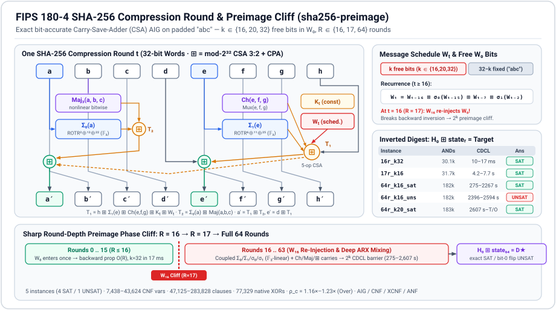

# FIPS 180-4 SHA-256 Preimage Circuits (`sha256-preimage`)

*Figure: Bit-accurate FIPS 180-4 SHA-256 Carry-Save-Adder (CSA) compression round datapath, message schedule $W_t$, and the sharp $R = 16 \to 17$ preimage cliff triggered by $W_{16}$ re-injecting the $k$ free bits of $W_0$. Regenerated via [`src/gen_diagram.py`](src/gen_diagram.py).*

## Provenance & Credit

- **Author:** Luke Hutchison ([`lukehutch`](https://github.com/lukehutch))
- **License:** MIT License ([`../LICENSE`](../LICENSE))

## Problem Description

Exact bit-accurate Carry-Save-Adder (CSA) combinational circuits implementing the NIST **FIPS 180-4 SHA-256** compression function on the padded single-block message `"abc"`, constraining all message bits except $k \in \lbrace 16, 20, 32\rbrace$ free bits of message word $W_0$ to match the target $R$-round digest (or a 1-bit-flipped impossible digest for `sha256_64r_k16_unsat`).

- **Origin:** **Original** circuit generator (MIT [`../LICENSE`](../LICENSE)), implementing [NIST FIPS PUB 180-4](https://csrc.nist.gov/publications/detail/fips/180/4/final) following the round-reduced and partial-preimage SHA-256 SAT cryptanalysis literature (Mironov & Zhang, SAT 2006; Nossum, 2012; Nejati et al., SAT 2017).
- **Sharp Phase Transition ($R = 16 \to 17$):** For $R \le 16$, $W_0$ enters only round 0 so backward propagation resolves all 32 bits in $O(R)$ time. At $R = 17$, the message schedule $W_{16} = W_0 + \sigma_0(W_1) + W_9 + \sigma_1(W_{14})$ re-injects $W_0$ into deep ARX mixing, creating a classic $2^k$ preimage cliff where standard CDCL solvers spend $275\text{--}2{,}607\text{ s}$ (or time out past $5{,}000\text{ s}$) at $R = 64, k \in \lbrace 16, 20\rbrace$.

## Corpus & Data Sizes

### Directory Layout & Regeneration

- `aig-orig/` — Original native **Binary AIGER 1.9** circuits (`648.7 KB`, verified with [Berkeley ABC](https://github.com/berkeley-abc/abc)).
- `cnf-converted/` — Tseitin **DIMACS `.cnf.xz`** conversions (`2.13 MB`).
- `xcnf-converted/` — Native-XOR **[CryptoMiniSat](https://github.com/msoos/cryptominisat) `.xcnf.xz`** conversions (`1.24 MB`).
- `anf-converted/` — Lossless linear-size **DIMACS-ANF `.anf.xz`** conversions (`2.00 MB`, degree $\le 2$, generated via [`../src/to_anf.py`](../src/to_anf.py)).
- **[`expected.tsv`](expected.tsv)** — Ground-truth verdict manifest for all 5 instances (**4 SAT / 1 UNSAT**).
- `src/` — Standalone zero-dependency Rust generator crate (`cd src && cargo run --release`).

### Problem Parameters & Data Sizes

| Instance | Rounds $R$ | Add IV | Free Bits $k$ | Message / Target | Ans | AIG ANDs | `.aig.xz` | CNF Vars | CNF Clauses | `.cnf.xz` | `.xcnf.xz` | `.anf.xz` |
|---|---:|:---:|---:|---|:---:|---:|---:|---:|---:|---:|---:|---:|
| `sha256_16r_k32` | 16 | No | 32 | `"abc"` exact | SAT | 30,142 | 33.3 KB | 7,438 | 47,125 | 107.2 KB | 64.0 KB | 101.3 KB |
| `sha256_17r_k16` | 17 | No | 16 | `"abc"` exact | SAT | 31,712 | 35.4 KB | 7,829 | 49,504 | 114.7 KB | 68.0 KB | 107.2 KB |
| `sha256_64r_k16_sat` | 64 | Yes | 16 | `"abc"` exact | SAT | 182,204 | 193.7 KB | 43,481 | 282,441 | 653.2 KB | 377.4 KB | 612.2 KB |
| `sha256_64r_k16_unsat` | 64 | Yes | 16 | `"abc"` digest bit 0 flipped | UNSAT | 182,204 | 193.7 KB | 43,481 | 282,441 | 653.2 KB | 377.4 KB | 612.2 KB |
| `sha256_64r_k20_sat` | 64 | Yes | 20 | `"abc"` exact | SAT | 183,109 | 192.5 KB | 43,624 | 283,828 | 652.6 KB | 378.1 KB | 616.7 KB |

## Benchmark Results

Evaluated sequentially on an AMD Ryzen 9 5950X (16C/32T Linux, 1 core/thread per run, default flags with `-t 1` for CryptoMiniSat 5.18.0 and `--max-cores 1` for Frobenius; exact median of 3 runs; $T_{\max} = 5{,}000\text{ s}$):

| Instance | Frobenius 1C | [CaDiCaL](https://github.com/arminbiere/cadical) 3.1.0 | [CryptoMiniSat](https://github.com/msoos/cryptominisat) 5.18.0 (CNF) | [CryptoMiniSat](https://github.com/msoos/cryptominisat) 5.18.0 (XCNF) | [dense-solver](https://github.com/libdense/dense-solver) 0.0.4 | [Kissat](https://github.com/arminbiere/kissat) 4.0.4 |
|---|---:|---:|---:|---:|---:|---:|
| `sha256_16r_k32` | **8.94 ms** | 17.32 ms | 18.61 ms | 13.70 ms | 25.73 ms | 9.61 ms |
| `sha256_17r_k16` | **19.35 ms** | 4,160.70 ms | 4,838.70 ms | 2,177.97 ms | 12,080.00 ms | 7,719.28 ms |
| `sha256_64r_k16_sat` | **89.35 ms** | 275,382.20 ms | >5,000 s (T/O) | 461,449.91 ms | 553,812.90 ms | 2,267,295.44 ms |
| `sha256_64r_k16_unsat` | **98.86 ms** | 2,594,248.08 ms | >5,000 s (T/O) | >5,000 s (T/O) | 764,244.90 ms | 2,396,511.93 ms |
| `sha256_64r_k20_sat` | **92.57 ms** | 2,606,732.29 ms | >5,000 s (T/O) | >5,000 s (T/O) | >5,000 s (T/O) | >5,000 s (T/O) |
| **Solved (5 instances)** | **5 / 5** *(highest)* | **5 / 5** *(highest)* | 2 / 5 *(-3 worse)* | 3 / 5 *(-2 worse)* | 4 / 5 *(-1 worse)* | 4 / 5 *(-1 worse)* |
| **Total PAR-2 ($T_{\max}=5{,}000\text{ s}$)** | **309.07 ms** *(fastest)* | 5,480,540.59 ms *(17,732x slower)* | 30,004,857.31 ms *(97,081x slower)* | 20,463,641.58 ms *(66,210x slower)* | 11,330,163.53 ms *(36,659x slower)* | 14,671,536.26 ms *(47,470x slower)* |

<!-- BEGIN_STRUCTURAL_ANALYSIS -->
## Phase-Transition & Structural Analysis

*Auto-generated by [`../src/analyze_benchmarks.py`](../src/analyze_benchmarks.py). Position relative to the critical phase transition is measured by $\rho_{\mathrm{crit}} = \frac{1}{n}\sum_k m_k / \alpha_c(k)$ (exact $\alpha/\alpha_c(k)$ for pure $k$-SAT; effective critical threshold $\alpha_c^{\mathrm{eff}} = \alpha/\rho_{\mathrm{crit}}$; `Under` $<0.90\times$, `Near-crit` $0.90\text{--}1.10\times$, `Over` $>1.10\times$), alongside Gent–Walsh annealed constrainedness $\kappa = -\frac{1}{n}\sum_i \log_2(1-2^{-k_i})$ (AAAI 1996), clause-length profile ($\bar{k}$, `%Bin`, `%Horn`), variable-degree CV ($\sigma_d/\bar{d}$, uniformity vs. hub skew), and extracted native XOR parity clauses.*

| Instance | Active $n$ | Clauses $m$ | $\alpha=m/n$ | $\alpha_c^{\mathrm{eff}}$ | $\rho_{\mathrm{crit}}$ (Regime) | $\kappa$ | $\bar{k}$ ($k_{\max}$) | Bin% | Horn% | Pos% | Deg CV | XORs |
|---|---:|---:|---:|---:|---:|---:|---:|---:|---:|---:|---:|---:|
| `sha256_16r_k32` | 7,438 | 47,125 | 6.34 | 5.17 | **1.23x** (Over) | 0.97 | 3.48 (4) | 3% | 50% | 50% | 0.57 | 3,780 |
| `sha256_17r_k16` | 7,829 | 49,504 | 6.32 | 5.15 | **1.23x** (Over) | 0.97 | 3.47 (4) | 3% | 50% | 50% | 0.57 | 3,990 |
| `sha256_64r_k16_sat` | 43,481 | 282,441 | 6.50 | 5.58 | **1.16x** (Over) | 0.94 | 3.52 (4) | 2% | 50% | 50% | 0.65 | 23,154 |
| `sha256_64r_k16_unsat` | 43,481 | 282,441 | 6.50 | 5.58 | **1.16x** (Over) | 0.94 | 3.52 (4) | 2% | 50% | 50% | 0.65 | 23,154 |
| `sha256_64r_k20_sat` | 43,624 | 283,828 | 6.51 | 5.60 | **1.16x** (Over) | 0.93 | 3.52 (4) | 2% | 50% | 50% | 0.65 | 23,251 |

**Collection Phase-Transition Summary (5 instances, 4 formats: 5 CNF / 5 AIG / 5 XCNF / 5 ANF):** median $\rho_{\mathrm{crit}} = 1.16\times$ (range `1.16x–1.23x`), median $\kappa = 0.94$, regime split **0 Under / 0 Near-critical / 5 Over**, total extracted native XOR parity clauses = **77,329**, total ANF equations = **309,573**.
<!-- END_STRUCTURAL_ANALYSIS -->

## References

- NIST, *Secure Hash Standard (SHS)*, FIPS PUB 180-4, August 2015.
- I. Mironov and L. Zhang, *Applications of SAT Solvers to Cryptanalysis of Hash Functions*, SAT 2006, LNCS 4121.
- S. Nejati, J. Liang, C. Gebotys, K. Czarnecki, and V. Ganesh, *Adaptive Restart and CEGAR-based Solver for Inverting Cryptographic Hash Functions*, VSTTE 2017.
