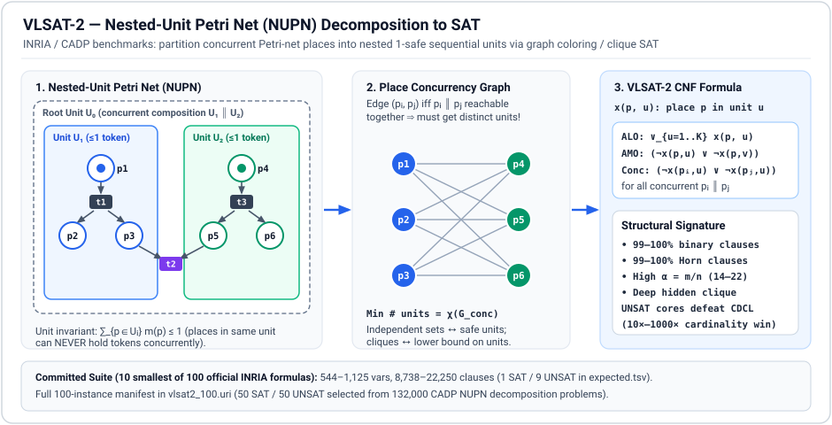

# VLSAT-2 Benchmark Suite (INRIA / CADP)

## Provenance & Credit

- **Recommended by:** [`@tavisrudd`](https://twitter.com/tavisrudd) (Twitter/X)
- **Authors & Maintainers:** Hubert Garavel, Pierre Bouvier, and the CADP team at INRIA Grenoble – Rhône-Alpes
- **Upstream Homepage:** [VLSAT-2 Benchmark Suite — CADP Resources (INRIA)](https://cadp.inria.fr/resources/vlsat/2.html)
- **License:** Public scientific benchmark collection published by INRIA / CADP for academic research and SAT competitions; no separate `LICENSE` file is bundled with the `.cnf.bz2` downloads.

## Problem Description

VLSAT-2 ("Very Large SAT", version 2) is a curated collection of **100 SAT formulas** (50 SAT, 50 UNSAT) selected from over $132{,}000$ formulas generated by automatically decomposing real-world concurrent-system Petri nets into Nested-Unit Petri Nets (NUPNs). Each instance encodes a graph-coloring / maximum-clique / unit-partitioning subproblem from Petri-net decomposition.

During curation (2020), the CADP authors filtered out every formula solved in under 60 s by at least one of [CaDiCaL](https://github.com/arminbiere/cadical) 1.3.0, [Kissat](https://github.com/arminbiere/kissat) 1.0.3, [MathSAT](https://mathsat.fbk.eu/) 5.6.5, [MiniSat](https://github.com/niklasso/minisat) 2.2.0, or [Z3](https://github.com/Z3Prover/z3) 4.8.9, and retained formulas spanning increasing hardness up to 2 hours on a Xeon E5-2630 v4. Twenty-five percent of VLSAT-2 was later adopted by official SAT Competitions.

*Figure: End-to-end INRIA/CADP VLSAT-2 pipeline mapping a Nested-Unit Petri Net (1-safe hierarchical units) to its place concurrency graph and dense binary/Horn unit-coloring CNF formula. Regenerated via [`src/gen_diagram.py`](src/gen_diagram.py).*

## Corpus & Data Sizes (Four Formats)

Following the benchmark protocol noted by [`@tavisrudd`](https://twitter.com/tavisrudd) (first 10 smallest instances committed directly + full 100-instance manifest):
- **`cnf-orig/`:** First 10 VLSAT-2 `.cnf.xz` files (`139.2 KB` xz-compressed).
- **`aig-converted/`:** 10 exact Binary AIGER 1.9 `.aig.xz` conversions (`87.1 KB`, all 10/10 verified via [Berkeley ABC](https://github.com/berkeley-abc/abc) `read_aiger`).
- **`xcnf-converted/`:** 10 lossless [CryptoMiniSat](https://github.com/msoos/cryptominisat) `.xcnf.xz` conversions (`139.5 KB`).
- **`anf-converted/`:** 10 lossless linear-size DIMACS-ANF `.anf.xz` conversions (`266.5 KB`, degree $\le 3$, generated via [`../src/to_anf.py`](../src/to_anf.py)).
- **[`expected.tsv`](expected.tsv):** Ground-truth verdicts for all 10 committed `cnf-orig/` instances (**1 SAT / 9 UNSAT**).
- **[`vlsat2_100.uri`](vlsat2_100.uri):** Complete list of all 100 official INRIA HTTPS URLs (`vlsat2_*.cnf.bz2`).
- **`src/`:** Standalone converters (`cnf2aig.py`, `cnf2xcnf.py`).

| Instance | Vars | Clauses | Upstream Status | `.cnf.xz` | AIG ANDs | `.anf.xz` |
|---|---:|---:|:---:|---:|---:|---:|
| `vlsat2_544_8738` | 544 | 8,738 | UNSAT | 10.1 KB | 17,831 | 18.5 KB |
| `vlsat2_600_11440` | 600 | 11,440 | UNSAT | 12.4 KB | 23,294 | 21.3 KB |
| `vlsat2_684_9417` | 684 | 9,417 | UNSAT | 10.2 KB | 19,337 | 20.0 KB |
| `vlsat2_684_13953` | 684 | 13,953 | UNSAT | 14.9 KB | 28,409 | 27.1 KB |
| `vlsat2_708_10259` | 708 | 10,259 | UNSAT | 11.2 KB | 21,041 | 21.3 KB |
| `vlsat2_736_11022` | 736 | 11,022 | UNSAT | 11.5 KB | 22,567 | 23.3 KB |
| `vlsat2_798_17543` | 798 | 17,543 | UNSAT | 17.9 KB | 35,678 | 36.1 KB |
| `vlsat2_1000_22250` | 1,000 | 22,250 | SAT | 15.4 KB | 45,209 | 31.0 KB |
| `vlsat2_1022_14955` | 1,022 | 14,955 | UNSAT | 16.1 KB | 30,694 | 34.7 KB |
| `vlsat2_1125_15795` | 1,125 | 15,795 | UNSAT | 19.5 KB | 32,459 | 33.3 KB |

## Comparative 1-Core Benchmark Results (All 10 Instances, Flat `.cnf`, $T_{\max} = 5\;\text{s}$)

- **Hardware & Protocol:** Same machine (**AMD Ryzen 9 5950X**, 16C/32T Linux, **1 thread per run** pinned across 8 dedicated physical cores, $T_{\max} = 5\;\text{s}$, PAR-2 penalty $10,000\;\text{ms}$). All solvers ran with default single-thread flags (`-t 1` for CryptoMiniSat 5.18.0; `--max-cores 1` for Frobenius) on identical uncompressed flat `.cnf` inputs; **100% of all 10 instances** were run (no subsampling), every Frobenius SAT model was independently verified against 100% of input clauses, and **0 verdict disagreements** occurred across all solvers.

| Instance | Verdict | Frobenius 1C | [CaDiCaL](https://github.com/arminbiere/cadical) 3.1.0 | [CryptoMiniSat](https://github.com/msoos/cryptominisat) 5.18.0 | [dense-solver](https://github.com/libdense/dense-solver) 0.0.4 | [Kissat](https://github.com/arminbiere/kissat) 4.0.4 |
|---|:---:|---:|---:|---:|---:|---:|
| `vlsat2_1000_22250` | TIMEOUT | >5 s | >5 s | >5 s | >5 s | >5 s |
| `vlsat2_1022_14955` | UNSAT | >5 s | >5 s | >5 s | >5 s | **2,513.63 ms** |
| `vlsat2_1125_15795` | TIMEOUT | >5 s | >5 s | >5 s | >5 s | >5 s |
| `vlsat2_544_8738` | UNSAT | 3.19 ms | >5 s | >5 s | **2.84 ms** | >5 s |
| `vlsat2_600_11440` | UNSAT | 3.78 ms | >5 s | >5 s | **3.03 ms** | >5 s |
| `vlsat2_684_13953` | UNSAT | **4.02 ms** | >5 s | >5 s | 5.06 ms | 869.17 ms |
| `vlsat2_684_9417` | UNSAT | **3.41 ms** | >5 s | >5 s | 4.07 ms | 807.75 ms |
| `vlsat2_708_10259` | UNSAT | **3.82 ms** | >5 s | >5 s | 4.07 ms | 652.52 ms |
| `vlsat2_736_11022` | UNSAT | 3.55 ms | >5 s | >5 s | **3.49 ms** | >5 s |
| `vlsat2_798_17543` | UNSAT | **5.90 ms** | >5 s | >5 s | 8.85 ms | >5 s |
| **Total (10 files, PAR-2)** | **8/10** | **7/10 — 30,027.7 ms** *(fastest)* | 0/10 — 100,000.0 ms *(3.33x)* | 0/10 — 100,000.0 ms *(3.33x)* | 7/10 — 30,031.4 ms *(1.00x)* | 4/10 — 64,843.1 ms *(2.16x)* |

<!-- BEGIN_STRUCTURAL_ANALYSIS -->
## Phase-Transition & Structural Analysis

*Auto-generated by [`../src/analyze_benchmarks.py`](../src/analyze_benchmarks.py). Position relative to the critical phase transition is measured by $\rho_{\mathrm{crit}} = \frac{1}{n}\sum_k m_k / \alpha_c(k)$ (exact $\alpha/\alpha_c(k)$ for pure $k$-SAT; effective critical threshold $\alpha_c^{\mathrm{eff}} = \alpha/\rho_{\mathrm{crit}}$; `Under` $<0.90\times$, `Near-crit` $0.90\text{--}1.10\times$, `Over` $>1.10\times$), alongside Gent–Walsh annealed constrainedness $\kappa = -\frac{1}{n}\sum_i \log_2(1-2^{-k_i})$ (AAAI 1996), clause-length profile ($\bar{k}$, `%Bin`, `%Horn`), variable-degree CV ($\sigma_d/\bar{d}$, uniformity vs. hub skew), and extracted native XOR parity clauses.*

| Instance | Active $n$ | Clauses $m$ | $\alpha=m/n$ | $\alpha_c^{\mathrm{eff}}$ | $\rho_{\mathrm{crit}}$ (Regime) | $\kappa$ | $\bar{k}$ ($k_{\max}$) | Bin% | Horn% | Pos% | Deg CV | XORs |
|---|---:|---:|---:|---:|---:|---:|---:|---:|---:|---:|---:|---:|
| `vlsat2_1000_22250` | 1,000 | 22,250 | 22.25 | 1.00 | **22.2x** (Over) | 9.22 | 2.03 (20) | 100% | 100% | 2% | 0.09 | 0 |
| `vlsat2_1022_14955` | 1,022 | 14,955 | 14.63 | 1.00 | **14.6x** (Over) | 6.05 | 2.05 (14) | 100% | 100% | 3% | 0.57 | 0 |
| `vlsat2_1125_15795` | 1,125 | 15,795 | 14.04 | 1.00 | **14.0x** (Over) | 5.80 | 2.06 (15) | 100% | 100% | 3% | 0.65 | 0 |
| `vlsat2_544_8738` | 544 | 8,738 | 16.06 | 1.00 | **16.0x** (Over) | 6.64 | 2.04 (16) | 100% | 100% | 2% | 0.01 | 0 |
| `vlsat2_600_11440` | 600 | 11,440 | 19.07 | 1.00 | **19.0x** (Over) | 7.89 | 2.04 (15) | 100% | 100% | 2% | 0.01 | 0 |
| `vlsat2_684_13953` | 684 | 13,953 | 20.40 | 1.00 | **20.3x** (Over) | 8.43 | 2.04 (12) | 100% | 100% | 2% | 0.26 | 0 |
| `vlsat2_684_9417` | 684 | 9,417 | 13.77 | 1.01 | **13.7x** (Over) | 5.68 | 2.05 (12) | 99% | 99% | 3% | 0.45 | 0 |
| `vlsat2_708_10259` | 708 | 10,259 | 14.49 | 1.01 | **14.4x** (Over) | 5.98 | 2.05 (12) | 99% | 99% | 3% | 0.45 | 0 |
| `vlsat2_736_11022` | 736 | 11,022 | 14.98 | 1.00 | **14.9x** (Over) | 6.19 | 2.05 (16) | 100% | 100% | 3% | 0.40 | 0 |
| `vlsat2_798_17543` | 798 | 17,543 | 21.98 | 1.00 | **21.9x** (Over) | 9.10 | 2.03 (14) | 100% | 100% | 2% | 0.18 | 0 |

**Collection Phase-Transition Summary (10 instances, 4 formats: 10 CNF / 10 AIG / 10 XCNF / 10 ANF):** median $\rho_{\mathrm{crit}} = 15.5\times$ (range `13.7x–22.2x`), median $\kappa = 6.42$, regime split **0 Under / 0 Near-critical / 10 Over**, total extracted native XOR parity clauses = **0**, total ANF equations = **140,639**.
<!-- END_STRUCTURAL_ANALYSIS -->

## References

- P. Bouvier, H. Garavel, and H. Ponce de León, *"Automatic Decomposition of Petri Nets into Automata Networks — A Synthetic Account"*, PETRI NETS 2020, LNCS 12152, pp. 3–23.
- H. Garavel, *"Nested-Unit Petri Nets"*, Journal of Logical and Algebraic Methods in Programming, vol. 104, pp. 60–85, 2019.
