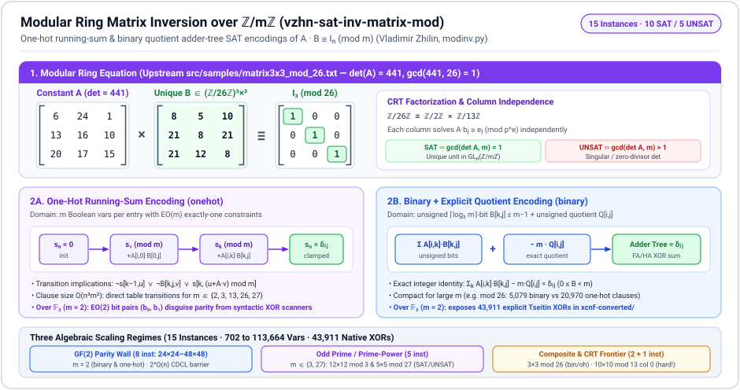

# Modular Ring Matrix Inversion over $\mathbb{Z}/m\mathbb{Z}$ (`vzhn-sat-inv-matrix-mod`)

*Figure: Illustrative schematic generated by [`src/gen_diagram.py`](src/gen_diagram.py) from the upstream matrix `src/samples/matrix3x3_mod_26.txt` (modular ring inversion $A \cdot B \equiv I_3 \pmod{26}$ with both one-hot running-sum and binary quotient adder-tree encodings).*

## Provenance & Credit

- **Upstream Author & Source:** **Vladimir Zhilin** ([`@vzhilin_me`](https://twitter.com/vzhilin_me)) — [`https://github.com/vzhn/sat-inv-matrix-py`](https://github.com/vzhn/sat-inv-matrix-py) (commit `6bfcdafea648913655d4d838d8a9adc847925c11`), the Python successor to [`vzhn/sat-inv-matrix`](https://github.com/vzhn/sat-inv-matrix) (Kotlin) and [`vzhn/z3-inv-matrix`](https://github.com/vzhn/z3-inv-matrix) (Z3).
- **Sibling Collection:** Exact integer matrix inversion over $\mathbb{Z}$ from the same upstream repository lives in [`../vzhn-sat-inv-matrix-int/`](../vzhn-sat-inv-matrix-int/README.md) (11 instances).
- **Expected Verdicts:** **15 instances** (**10 SAT / 5 UNSAT**), recorded in [`expected.tsv`](expected.tsv) and verified mathematically via exact Bareiss determinants ($\gcd(\det A, m) = 1$) and modular Gauss–Jordan inversion, as well as empirically via 100% clause-level and matrix-product model verification and formally verified `cake_lpr` UNSAT proofs (5/5 UNSAT instances).

## Problem Description

### Mathematical Problem & Encodings

Given a fixed constant integer matrix $A \in \mathbb{Z}^{n \times n}$ and modulus $m \ge 2$, find $B \in \{0, \dots, m-1\}^{n \times n}$ satisfying $A \cdot B \equiv I_n \pmod m$, encoded via [`src/modinv.py`](src/modinv.py). The inverse exists (and is unique) if and only if $\gcd(\det A, m) = 1$; otherwise the formula is UNSAT. Two exact encodings are included:

1. **One-hot running-sum (`onehot`):** Every value modulo $m$ is represented as an $m$-variable one-hot vector with `exactly_one` constraints. Each dot product $(A B)_{i,j}$ is accumulated via running sums $s_0 = 0$, $s_k = (s_{k-1} + A_{i,k} B_{k,j}) \bmod m$ using $O(n^3 m^2)$ direct-implication clauses. By the Chinese Remainder Theorem (CRT) and column independence ($A b_j \equiv e_j \pmod{p^e}$), composite moduli such as $m = 26 = 2 \cdot 13$ split into independent prime-power columns (e.g. `mod_10x10_m13_c0_oh_sat`). Over $\mathbb{F}_2$ ($m = 2$), each binary bit is split into an `exactly_one` pair $(b_0, b_1)$, disguising the underlying $\mathbb{F}_2$ parity constraints from purely syntactic XOR-block extraction.
2. **Binary quotient adder-tree (`binary`):** Each $B_{k,j}$ is an unsigned $\lceil \log_2 m \rceil$-bit integer bounded by $B_{k,j} \le m - 1$, coupled with an explicit unsigned quotient $Q_{i,j}$ via the exact integer equation $\sum_k A_{i,k} B_{k,j} - m Q_{i,j} = \delta_{ij}$ using full/half adder-tree compression. At $m = 2$, this exposes thousands of explicit Tseitin XOR gates that collapse cleanly into native parity clauses in `xcnf-converted/`.

### Algebraic Scaling Regimes

- **Linear systems over $\mathbb{F}_2$ (`mod_24x24_m2`–`mod_48x48_m2`):** Exponential $2^{\Omega(n)}$ resolution lower bounds cause pure CDCL solvers (CaDiCaL 3.1.0, dense-solver 0.0.4, Kissat 4.0.4) to time out past 60 s at $n \ge 32$, whereas Frobenius solves all $n \in \{24, 32, 40, 48\}$ in `27.0–404.4 ms` (closing the largest $48\times 48$ one-hot instance `113,664` vars in **`169.7 ms`**, **22.0× faster** than CryptoMiniSat 5.18.0 at `3.73 s`).
- **Moderate odd-prime / composite one-hot systems (`mod_3x3_m26`, `mod_5x5_m27`, `mod_12x12_m3`):** Dense one-hot running-sum clauses where Frobenius leads across every instance in `3.4–14.6 ms` (including `mod_5x5_m27_oh_sat` in **`14.6 ms`** vs. `4.84–22.56 s` for the external baselines).
- **Hard odd-prime linear-algebra frontier (`mod_10x10_m13_c0_oh_sat`):** A single column of upstream `src/samples/matrix10x10_mod_26.txt` modulo 13 (`1,170` vars, `20,630` clauses) — provably SAT; Frobenius solves and verifies it in **`3.3 ms`**, while all four external baseline solvers time out past 60 s (consistent with the upstream report of >300 s timeout for CaDiCaL).

## Corpus & Data Sizes

### Directory Layout & Regeneration

- `cnf-orig/` — Original **DIMACS CNF** encodings (15 `.cnf.xz` files, `3.04 MB` total, max `969.4 KB`).
- `aig-converted/` — Lossless logically equivalent **Binary AIGER 1.9** miter conversions (15 `.aig.xz` files, `3.69 MB` total, max `1.25 MB`).
- `xcnf-converted/` — Lossless **[CryptoMiniSat](https://github.com/msoos/cryptominisat) XCNF** conversions collapsing all exact 2- and 3-input binary adder-sum XOR blocks into native `x ... 0` parity lines (15 `.xcnf.xz` files, `2.51 MB` total, max `702.3 KB`; `43,911` total native XORs).
- `anf-converted/` — Lossless linear-size **DIMACS-ANF** conversions (15 `.anf.xz` files, `4.91 MB` total, max `1.38 MB`, degree $\le 3$, generated via [`../src/to_anf.py`](../src/to_anf.py) with `--verify`).
- [`expected.tsv`](expected.tsv) — Exact ground-truth verdicts (`10 SAT / 5 UNSAT`, strict 2-column TSV).
- `diagram.svg` — Illustrative vector diagram generated by [`src/gen_diagram.py`](src/gen_diagram.py).
- `src/` — Upstream [`modinv.py`](src/modinv.py) and helper [`invmatrix.py`](src/invmatrix.py), verbatim upstream modular matrices (`src/samples/{matrix3x3_mod_26,matrix5x5_mod_27,matrix10x10_mod_26}.txt`), converters (`cnf2aig.py`, `cnf2xcnf.py`), reproducible suite generator (`python3 src/generate_suite.py`), and diagram generator (`python3 src/gen_diagram.py`).

### Problem Parameters & Data Sizes (Four Formats)

All 3 upstream modular sample matrices (`src/samples/{matrix3x3_mod_26,matrix5x5_mod_27,matrix10x10_mod_26}.txt`) are included verbatim alongside controlled singular and $\mathbb{F}_2$ / $\mathbb{Z}/3\mathbb{Z}$ scaling extensions.

| Format | Directory | Files | Key Dimensions (Range) | Compressed Size |
|---|---|---:|---|---:|
| **DIMACS CNF (origin)** | `cnf-orig/` | 15 | Vars: 702–113,664; Clauses: 5,079–415,772 | 3.04 MB |
| **Binary AIGER 1.9** | `aig-converted/` | 15 | Inputs: 702–113,664; ANDs: 14,052–1,111,170 | 3.69 MB |
| **[CryptoMiniSat](https://github.com/msoos/cryptominisat) XCNF** | `xcnf-converted/` | 15 | Native XOR clauses total: 43,911 | 2.51 MB |
| **DIMACS-ANF** | `anf-converted/` | 15 | Vars: 845–113,664; Eqs: 2,636–331,776 (deg $\le 3$) | 4.91 MB |
| **Total (4 Formats, Status: 10 SAT / 5 UNSAT)** | | **60** | | **14.15 MB** |

| Instance | Size | Ring & Encoding | Expected | Vars | Clauses | Native XORs | `.cnf.xz` | `.aig.xz` | `.xcnf.xz` | `.anf.xz` |
|---|:---:|---|:---:|---:|---:|---:|---:|---:|---:|---:|
| `mod_3x3_m26_bin_sat` | $3\times 3$ | $\mathbb{Z}/26\mathbb{Z}$ (binary) | SAT | 840 | 5,079 | 372 | 12.3 KB | 19.4 KB | 8.1 KB | 13.4 KB |
| `mod_3x3_m26_oh_sat` | $3\times 3$ | $\mathbb{Z}/26\mathbb{Z}$ (one-hot) | SAT | 702 | 20,970 | 0 | 13.7 KB | 37.2 KB | 13.7 KB | 33.7 KB |
| `mod_5x5_m27_oh_sat` | $5\times 5$ | $\mathbb{Z}/27\mathbb{Z}$ (one-hot) | SAT | 3,375 | 116,900 | 0 | 83.3 KB | 201.6 KB | 90.8 KB | 221.3 KB |
| `mod_5x5_m27_sing_oh_unsat` | $5\times 5$ | $\mathbb{Z}/27\mathbb{Z}$ (one-hot) | UNSAT | 3,375 | 116,900 | 0 | 84.8 KB | 219.3 KB | 90.5 KB | 221.7 KB |
| `mod_10x10_m13_c0_oh_sat` | $10\times 10$ | $\mathbb{Z}/13\mathbb{Z}$ (one-hot, col 0) | SAT | 1,170 | 20,630 | 0 | 23.6 KB | 47.7 KB | 23.7 KB | 55.4 KB |
| `mod_12x12_m3_oh_sat` | $12\times 12$ | $\mathbb{Z}/3\mathbb{Z}$ (one-hot) | SAT | 3,456 | 13,680 | 0 | 29.1 KB | 40.3 KB | 29.1 KB | 55.5 KB |
| `mod_12x12_m3_sing_oh_unsat` | $12\times 12$ | $\mathbb{Z}/3\mathbb{Z}$ (one-hot) | UNSAT | 3,600 | 14,304 | 0 | 30.7 KB | 41.2 KB | 30.9 KB | 58.0 KB |
| `mod_24x24_m2_bin_sat` | $24\times 24$ | $\mathbb{Z}/2\mathbb{Z}$ (binary) | SAT | 15,333 | 87,188 | 6,527 | 210.0 KB | 291.9 KB | 129.6 KB | 223.4 KB |
| `mod_24x24_m2_bin_unsat` | $24\times 24$ | $\mathbb{Z}/2\mathbb{Z}$ (binary) | UNSAT | 15,189 | 85,869 | 6,455 | 205.8 KB | 281.4 KB | 127.7 KB | 220.1 KB |
| `mod_24x24_m2_oh_sat` | $24\times 24$ | $\mathbb{Z}/2\mathbb{Z}$ (one-hot) | SAT | 13,200 | 37,296 | 0 | 80.9 KB | 73.7 KB | 81.0 KB | 151.9 KB |
| `mod_24x24_m2_oh_unsat` | $24\times 24$ | $\mathbb{Z}/2\mathbb{Z}$ (one-hot) | UNSAT | 12,960 | 36,576 | 0 | 77.9 KB | 76.1 KB | 79.4 KB | 149.2 KB |
| `mod_32x32_m2_oh_sat` | $32\times 32$ | $\mathbb{Z}/2\mathbb{Z}$ (one-hot) | SAT | 35,456 | 102,272 | 0 | 219.8 KB | 212.6 KB | 219.7 KB | 437.5 KB |
| `mod_40x40_m2_oh_sat` | $40\times 40$ | $\mathbb{Z}/2\mathbb{Z}$ (one-hot) | SAT | 60,880 | 176,240 | 0 | 356.2 KB | 322.7 KB | 359.5 KB | 746.1 KB |
| `mod_40x40_m2_bin_unsat` | $40\times 40$ | $\mathbb{Z}/2\mathbb{Z}$ (binary) | UNSAT | 68,751 | 415,772 | 30,557 | 969.4 KB | 1.25 MB | 582.3 KB | 1.01 MB |
| `mod_48x48_m2_oh_sat` | $48\times 48$ | $\mathbb{Z}/2\mathbb{Z}$ (one-hot) | SAT | 113,664 | 331,776 | 0 | 715.0 KB | 630.1 KB | 702.3 KB | 1.38 MB |

## Benchmark Results

### Single-Core Flat-CNF Comparison ($T_{\max} = 60\;\text{s}$)

- **Hardware & Pinning:** AMD Ryzen 9 5950X (16 cores / 32 threads, Linux x86_64), **1 thread pinned strictly to physical core 4** (`taskset -c 4`), executed strictly sequentially (one solver process at a time).
- **Timeout & Metric:** $T_{\max} = 60\;\text{s}$ wall-clock time from process start to termination (including parsing); PAR-2 assigns $2 \times T_{\max} = 120\;\text{s}$ per timeout.
- **Input Fairness & Default Flags:** Because CryptoMiniSat 5.18.0 and dense-solver 0.0.4 do not read `.xz` archives directly, every solver read the exact same uncompressed flat `.cnf` file using default single-thread search settings: Frobenius (default flags), CaDiCaL 3.1.0 (default flags + `--modelalllits=true` so eliminated variables are emitted in the DIMACS witness for external checking; verified identical conflict count and runtime to bare default), CryptoMiniSat 5.18.0 (default single-thread `-t 1`), dense-solver 0.0.4 (default flags), and Kissat 4.0.4 (default flags).
- **100% Independent Verification:** Zero verdict disagreements across all 5 solvers and [`expected.tsv`](expected.tsv). Every SAT witness produced by every solver (37/37 SAT runs in this table) passed both 100% raw-clause checking against `cnf-orig/*.cnf.xz` (0 unsatisfied clauses) and exact decoded matrix verification ($A \cdot B \equiv I_n \pmod m$). Every UNSAT instance (5/5) was independently certified with formally verified `cake_lpr` (see below).

| Instance | Expected | Frobenius 1C | [CaDiCaL](https://github.com/arminbiere/cadical) 3.1.0 | [CryptoMiniSat](https://github.com/msoos/cryptominisat) 5.18.0 | [dense-solver](https://github.com/libdense/dense-solver) 0.0.4 | [Kissat](https://github.com/arminbiere/kissat) 4.0.4 |
|---|:---:|---:|---:|---:|---:|---:|
| `mod_3x3_m26_bin_sat` | SAT | **10.4 ms** | 36.7 ms | 168.3 ms | 13.5 ms | 51.2 ms |
| `mod_3x3_m26_oh_sat` | SAT | **4.7 ms** | 22.8 ms | 689.7 ms | 14.6 ms | 32.0 ms |
| `mod_5x5_m27_oh_sat` | SAT | **14.6 ms** | 11.66 s | 7.50 s | 22.56 s | 4.84 s |
| `mod_5x5_m27_sing_oh_unsat` | UNSAT | **14.3 ms** | 61.5 ms | 1.20 s | 46.5 ms | 369.7 ms |
| `mod_10x10_m13_c0_oh_sat` | SAT | **3.3 ms** | >60 s *(T/O)* | >60 s *(T/O)* | >60 s *(T/O)* | >60 s *(T/O)* |
| `mod_12x12_m3_oh_sat` | SAT | **3.5 ms** | 259.3 ms | 431.1 ms | 72.6 ms | 260.1 ms |
| `mod_12x12_m3_sing_oh_unsat` | UNSAT | **3.4 ms** | 133.6 ms | 386.4 ms | 24.0 ms | 135.3 ms |
| `mod_24x24_m2_bin_sat` | SAT | **31.6 ms** | 2.58 s | 663.3 ms | 2.34 s | 2.81 s |
| `mod_24x24_m2_bin_unsat` | UNSAT | **27.0 ms** | 441.8 ms | 640.5 ms | 74.1 ms | 767.9 ms |
| `mod_24x24_m2_oh_sat` | SAT | **127.9 ms** | 2.48 s | 647.9 ms | 1.87 s | 1.72 s |
| `mod_24x24_m2_oh_unsat` | UNSAT | **127.5 ms** | 241.2 ms | 557.1 ms | 274.2 ms | 486.1 ms |
| `mod_32x32_m2_oh_sat` | SAT | **45.2 ms** | >60 s *(T/O)* | 1.23 s | >60 s *(T/O)* | >60 s *(T/O)* |
| `mod_40x40_m2_oh_sat` | SAT | **87.7 ms** | >60 s *(T/O)* | 2.17 s | >60 s *(T/O)* | >60 s *(T/O)* |
| `mod_40x40_m2_bin_unsat` | UNSAT | **404.4 ms** | 1.41 s | 2.64 s | 2.50 s | >60 s *(T/O)* |
| `mod_48x48_m2_oh_sat` | SAT | **169.7 ms** | >60 s *(T/O)* | 3.73 s | >60 s *(T/O)* | >60 s *(T/O)* |
| **Solved ($T_{\max}=60\;\text{s}$)** | — | **15 / 15** *(highest)* | 11 / 15 *(-4 worse)* | 14 / 15 *(-1 worse)* | 11 / 15 *(-4 worse)* | 10 / 15 *(-5 worse)* |
| **Total PAR-2 ($T_{\max}=60\;\text{s}$)** | — | **1.08 s** *(fastest)* | 499.33 s *(462x slower)* | 142.65 s *(132x slower)* | 509.79 s *(472x slower)* | 611.47 s *(566x slower)* |
| **Shared-14 Solved Sum (14 instances)** | — | **1.07 s** *(fastest)* | — | 22.65 s *(21.13x slower)* | — | — |

### Format Effects (Frobenius Across All 4 Formats & CryptoMiniSat XCNF, Core 4, $T_{\max} = 60\;\text{s}$)

Evaluated on identical uncompressed flat `.cnf`, `.aig`, `.xcnf`, and `.anf` inputs pinned to core 4 (`taskset -c 4`, same-build baseline four-format sweep). All 4 formats agree 100% on every verdict (13/15 solved for Frobenius in every format; 14/15 for CryptoMiniSat 5.18.0 `.xcnf`), and every SAT witness passed 100% raw-clause and exact modular matrix-product verification.

| Instance | Expected | Frobenius 1C (`.cnf`) | Frobenius 1C (`.aig`) | Frobenius 1C (`.xcnf`) | Frobenius 1C (`.anf`) | [CryptoMiniSat](https://github.com/msoos/cryptominisat) 5.18.0 (`.xcnf`) |
|---|:---:|---:|---:|---:|---:|---:|
| `mod_3x3_m26_bin_sat` | SAT | 18.7 ms | 19.8 ms | **17.7 ms** | 24.4 ms | 84.8 ms |
| `mod_3x3_m26_oh_sat` | SAT | **46.2 ms** | 50.2 ms | 46.8 ms | 52.1 ms | 718.5 ms |
| `mod_5x5_m27_oh_sat` | SAT | **2.34 s** | 5.02 s | 4.67 s | 4.65 s | 7.68 s |
| `mod_5x5_m27_sing_oh_unsat` | UNSAT | **252.3 ms** | 259.2 ms | 263.0 ms | 284.0 ms | 1.25 s |
| `mod_10x10_m13_c0_oh_sat` | SAT | >60 s *(T/O)* | >60 s *(T/O)* | >60 s *(T/O)* | >60 s *(T/O)* | >60 s *(T/O)* |
| `mod_12x12_m3_oh_sat` | SAT | 192.7 ms | **185.3 ms** | 192.6 ms | 191.9 ms | 545.5 ms |
| `mod_12x12_m3_sing_oh_unsat` | UNSAT | **61.4 ms** | 66.7 ms | 88.2 ms | 65.6 ms | 424.5 ms |
| `mod_24x24_m2_bin_sat` | SAT | 45.2 ms | 65.3 ms | **36.3 ms** | 149.1 ms | 272.7 ms |
| `mod_24x24_m2_bin_unsat` | UNSAT | 38.1 ms | 49.5 ms | **25.1 ms** | 135.9 ms | 265.5 ms |
| `mod_24x24_m2_oh_sat` | SAT | 49.1 ms | 58.3 ms | **49.0 ms** | 60.0 ms | 569.4 ms |
| `mod_24x24_m2_oh_unsat` | UNSAT | **45.7 ms** | 70.3 ms | 46.5 ms | 54.3 ms | 572.7 ms |
| `mod_32x32_m2_oh_sat` | SAT | **161.9 ms** | 191.8 ms | 171.0 ms | 196.0 ms | 1.26 s |
| `mod_40x40_m2_oh_sat` | SAT | 408.0 ms | 408.7 ms | **375.0 ms** | 437.0 ms | 1.90 s |
| `mod_40x40_m2_bin_unsat` | UNSAT | 1.04 s | 1.66 s | **105.9 ms** | 1.57 s | 786.8 ms |
| `mod_48x48_m2_oh_sat` | SAT | >60 s *(T/O)* | >60 s *(T/O)* | >60 s *(T/O)* | >60 s *(T/O)* | **3.77 s** |
| **Solved ($T_{\max}=60\;\text{s}$)** | — | 13 / 15 *(-1 worse)* | 13 / 15 *(-1 worse)* | 13 / 15 *(-1 worse)* | 13 / 15 *(-1 worse)* | **14 / 15** *(highest)* |
| **Total PAR-2 ($T_{\max}=60\;\text{s}$)** | — | 244.70 s *(1.75x slower)* | 248.11 s *(1.77x slower)* | 246.09 s *(1.76x slower)* | 247.87 s *(1.77x slower)* | **140.10 s** *(fastest)* |

**Key Format Observation:**

- **Native `.xcnf` dramatically accelerates binary $\mathbb{F}_2$ instances:** On `mod_40x40_m2_bin_unsat` (`30,557` native XORs), `.xcnf` runs **9.82× faster** for Frobenius (`105.9 ms` vs `1.04 s`) and **3.36× faster** for CryptoMiniSat 5.18.0 (`786.8 ms` vs `2.64 s`). On `mod_24x24_m2_bin_{sat,unsat}`, `.xcnf` is likewise the fastest format (`36.3 ms` and `25.1 ms`).

### Independent UNSAT Proof Certification (5 / 5 Formally Verified)

Every UNSAT instance in this collection (**5 / 5**) was certified via direct LRAT proof emission from Frobenius (`--lrat`) and independently checked by both [`lrat-check`](https://github.com/marijnheule/drat-trim) and formally verified [`cake_lpr`](https://github.com/tanyongkiam/cake_lpr) on core 4 (`taskset -c 4`):

| Instance | Proof Format | Emit Time | Raw LRAT Size | `lrat-check` | `cake_lpr` |
|---|---|---:|---:|---|---|
| `mod_5x5_m27_sing_oh_unsat` | direct LRAT | 99.1 ms | 17.5 KB | Verified (40.5 ms) | `s VERIFIED UNSAT` (84.6 ms) |
| `mod_12x12_m3_sing_oh_unsat` | direct LRAT | 99.6 ms | 408.9 KB | Verified (26.0 ms) | `s VERIFIED UNSAT` (26.6 ms) |
| `mod_24x24_m2_bin_unsat` | direct LRAT | 51.4 ms | 193.0 KB | Verified (40.1 ms) | `s VERIFIED UNSAT` (91.6 ms) |
| `mod_24x24_m2_oh_unsat` | direct LRAT | 235.3 ms | 4.27 MB | Verified (71.5 ms) | `s VERIFIED UNSAT` (140.2 ms) |
| `mod_40x40_m2_bin_unsat` | direct LRAT | 845.1 ms | 10.27 MB | Verified (222.4 ms) | `s VERIFIED UNSAT` (685.0 ms) |

<!-- BEGIN_STRUCTURAL_ANALYSIS -->
## Phase-Transition & Structural Analysis

*Auto-generated by [`../src/analyze_benchmarks.py`](../src/analyze_benchmarks.py). Position relative to the critical phase transition is measured by $\rho_{\mathrm{crit}} = \frac{1}{n}\sum_k m_k / \alpha_c(k)$ (exact $\alpha/\alpha_c(k)$ for pure $k$-SAT; effective critical threshold $\alpha_c^{\mathrm{eff}} = \alpha/\rho_{\mathrm{crit}}$; `Under` $<0.90\times$, `Near-crit` $0.90\text{--}1.10\times$, `Over` $>1.10\times$), alongside Gent–Walsh annealed constrainedness $\kappa = -\frac{1}{n}\sum_i \log_2(1-2^{-k_i})$ (AAAI 1996), clause-length profile ($\bar{k}$, `%Bin`, `%Horn`), variable-degree CV ($\sigma_d/\bar{d}$, uniformity vs. hub skew), and extracted native XOR parity clauses.*

| Instance | Active $n$ | Clauses $m$ | $\alpha=m/n$ | $\alpha_c^{\mathrm{eff}}$ | $\rho_{\mathrm{crit}}$ (Regime) | $\kappa$ | $\bar{k}$ ($k_{\max}$) | Bin% | Horn% | Pos% | Deg CV | XORs |
|---|---:|---:|---:|---:|---:|---:|---:|---:|---:|---:|---:|---:|
| `mod_10x10_m13_c0_oh_sat` | 1,170 | 20,630 | 17.63 | 1.80 | **9.81x** (Over) | 5.04 | 2.62 (13) | 42% | 100% | 24% | 0.60 | 0 |
| `mod_12x12_m3_oh_sat` | 3,456 | 13,680 | 3.96 | 2.00 | **1.98x** (Over) | 1.07 | 2.65 (3) | 35% | 92% | 32% | 0.55 | 0 |
| `mod_12x12_m3_sing_oh_unsat` | 3,600 | 14,304 | 3.97 | 2.01 | **1.97x** (Over) | 1.07 | 2.66 (3) | 34% | 92% | 32% | 0.56 | 0 |
| `mod_24x24_m2_bin_sat` | 15,333 | 87,188 | 5.69 | 4.66 | **1.22x** (Over) | 1.00 | 3.41 (4) | 3% | 49% | 50% | 1.27 | 6,527 |
| `mod_24x24_m2_bin_unsat` | 15,189 | 85,869 | 5.65 | 4.61 | **1.23x** (Over) | 1.00 | 3.40 (4) | 3% | 49% | 50% | 1.27 | 6,455 |
| `mod_24x24_m2_oh_sat` | 13,200 | 37,296 | 2.83 | 1.81 | **1.56x** (Over) | 0.81 | 2.58 (3) | 42% | 82% | 38% | 0.71 | 0 |
| `mod_24x24_m2_oh_unsat` | 12,960 | 36,576 | 2.82 | 1.81 | **1.56x** (Over) | 0.81 | 2.58 (3) | 42% | 82% | 38% | 0.71 | 0 |
| `mod_32x32_m2_oh_sat` | 35,456 | 102,272 | 2.88 | 1.89 | **1.53x** (Over) | 0.80 | 2.61 (3) | 39% | 83% | 38% | 0.91 | 0 |
| `mod_3x3_m26_bin_sat` | 840 | 5,079 | 6.05 | 5.19 | **1.16x** (Over) | 0.97 | 3.47 (4) | 2% | 47% | 50% | 0.69 | 372 |
| `mod_3x3_m26_oh_sat` | 702 | 20,970 | 29.87 | 1.29 | **23.2x** (Over) | 10.45 | 2.32 (26) | 71% | 100% | 14% | 0.33 | 0 |
| `mod_40x40_m2_bin_unsat` | 68,751 | 415,772 | 6.05 | 5.07 | **1.19x** (Over) | 0.99 | 3.46 (4) | 2% | 49% | 50% | 1.56 | 30,557 |
| `mod_40x40_m2_oh_sat` | 60,880 | 176,240 | 2.89 | 1.90 | **1.52x** (Over) | 0.80 | 2.62 (3) | 38% | 83% | 38% | 0.98 | 0 |
| `mod_48x48_m2_oh_sat` | 113,664 | 331,776 | 2.92 | 1.93 | **1.51x** (Over) | 0.80 | 2.63 (3) | 37% | 83% | 38% | 1.14 | 0 |
| `mod_5x5_m27_oh_sat` | 3,375 | 116,900 | 34.64 | 1.56 | **22.2x** (Over) | 10.76 | 2.49 (27) | 53% | 100% | 20% | 0.40 | 0 |
| `mod_5x5_m27_sing_oh_unsat` | 3,375 | 116,900 | 34.64 | 1.56 | **22.2x** (Over) | 10.76 | 2.49 (27) | 53% | 100% | 20% | 0.40 | 0 |

**Collection Phase-Transition Summary (15 instances, 4 formats: 15 CNF / 15 AIG / 15 XCNF / 15 ANF):** median $\rho_{\mathrm{crit}} = 1.56\times$ (range `1.16x–23.2x`), median $\kappa = 1.00$, regime split **0 Under / 0 Near-critical / 15 Over**, total extracted native XOR parity clauses = **43,911**, total ANF equations = **1,304,169**.
<!-- END_STRUCTURAL_ANALYSIS -->

## References

- V. Zhilin ([`@vzhilin_me`](https://twitter.com/vzhilin_me)), [*sat-inv-matrix-py: Integer and modular matrix inversion via SAT (Python)*](https://github.com/vzhn/sat-inv-matrix-py), 2026 (building on [`vzhn/sat-inv-matrix`](https://github.com/vzhn/sat-inv-matrix) and [`vzhn/z3-inv-matrix`](https://github.com/vzhn/z3-inv-matrix)).
- A. Biere, T. Faller, K. Fazekas, M. Fleury, N. Froleyks, and F. Pollitt, *[CaDiCaL](https://github.com/arminbiere/cadical) 2.0 / [Kissat](https://github.com/arminbiere/kissat) 4.0*, CAV 2024.
- M. Soos, K. Nohl, and C. Castelluccia, *Extending SAT Solvers to Cryptographic Problems ([CryptoMiniSat](https://github.com/msoos/cryptominisat))*, SAT 2009.
- Y. K. Tan, M. J. H. Heule, and M. O. Myreen, *cake_lpr: Verified Propagation Redundancy Checking in CakeML*, TACAS 2021.
- A. Biere, *The AIGER And-Inverter Graph (AIG) Format Version 20071012*, FMV Technical Report 07/1, JKU Linz, 2007.
