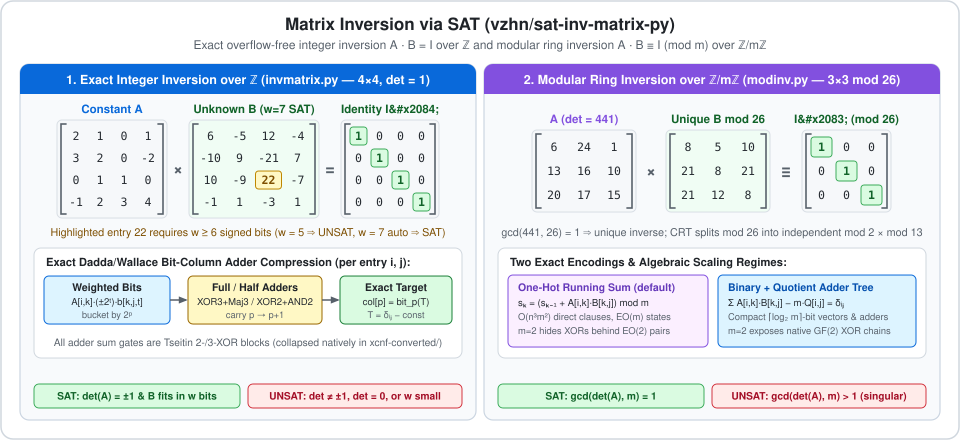

# Integer & Modular Matrix Inversion via SAT (`vzhn-sat-inv-matrix`)

## Overview & Origin

- **Upstream Author & Source:** **Vladimir Zhilin** ([`@vzhilin_me`](https://twitter.com/vzhilin_me)) — [`https://github.com/vzhn/sat-inv-matrix-py`](https://github.com/vzhn/sat-inv-matrix-py) (commit `6bfcdafea648913655d4d838d8a9adc847925c11`), the Python successor to [`vzhn/sat-inv-matrix`](https://github.com/vzhn/sat-inv-matrix) (Kotlin) and [`vzhn/z3-inv-matrix`](https://github.com/vzhn/z3-inv-matrix) (Z3).
- **Expected Verdicts:** **26 instances** (**16 SAT / 10 UNSAT**), recorded in [`expected.tsv`](expected.tsv) and verified mathematically via exact Bareiss determinants and rational/modular Gauss–Jordan inversion, as well as empirically via 100% clause-level and matrix-product model verification (121/121 SAT models) and formally verified `cake_lpr` UNSAT proofs (10/10 UNSAT instances).

*Illustrative dual-panel schematic generated by [`src/gen_diagram.py`](src/gen_diagram.py) from the upstream matrices `src/matrix/4x4.txt` (exact integer inversion $A \cdot B = I_4$ over $\mathbb{Z}$) and `src/samples/matrix3x3_mod_26.txt` (modular ring inversion $A \cdot B \equiv I_3 \pmod{26}$).*

### Mathematical Problem & Encodings

The upstream repository encodes two exact, overflow-free matrix inversion problems over a fixed constant integer matrix $A \in \mathbb{Z}^{n \times n}$:

1. **Exact Integer Matrix Inversion over $\mathbb{Z}$ (`src/invmatrix.py`):**
   Given $A \in \mathbb{Z}^{n \times n}$ and a signed two's complement bit-width $w$, find $B \in [-2^{w-1}, 2^{w-1})^{n \times n}$ satisfying $A \cdot B = I_n$ exactly over $\mathbb{Z}$ (no wrap-around modulo $2^w$).
   - Each entry $B_{k,j}$ is encoded by $w$ Boolean variables $b_{k,j,0}, \dots, b_{k,j,w-1}$ representing $-2^{w-1} b_{k,j,w-1} + \sum_{t=0}^{w-2} 2^t b_{k,j,t}$.
   - Each matrix-product entry $\sum_{k=0}^{n-1} A_{i,k} B_{k,j} = \delta_{ij}$ is decomposed into power-of-two weighted bit columns (converting negative weights via $c \cdot x = \lvert c \rvert (\neg x) - \lvert c \rvert$), compressed from LSB upward using Tseitin-encoded Dadda/Wallace full adders (`xor3` + `maj`, 14 clauses) and half adders (`xor2` + `and2`, 7 clauses), and clamped bit-for-bit to the shifted target $T = \delta_{ij} - \text{const}$.
   - **Exact Semantics:** SAT holds if and only if $A$ is unimodular ($\det A = \pm 1$) and every entry of the unique inverse $B = A^{-1}$ fits in $[-2^{w-1}, 2^{w-1})$. Setting $w$ via the Hadamard cofactor bound (`-w auto`) guarantees every entry fits if an integer inverse exists, yielding three distinct UNSAT mechanisms represented in this collection:
     1. *Non-unimodular* ($\det A \neq \pm 1$, e.g. `int_3x3_det2_w3_unsat` with $\det A = 2$),
     2. *Width-tight overflow* ($\det A = \pm 1$ but $\max \lvert (A^{-1})_{ij} \rvert$ exceeds $w$-bit signed range, e.g. `int_4x4_w5_unsat`, `int_10x10_w4_unsat`, `int_16x16_w5_unsat`), and
     3. *Singular / rank-deficient* ($\det A = 0$, e.g. `int_16x16_sing_w16_unsat`).

2. **Modular Matrix Inversion over $\mathbb{Z}/m\mathbb{Z}$ (`src/modinv.py`):**
   Given $A \in \mathbb{Z}^{n \times n}$ and modulus $m \ge 2$, find $B \in \{0, \dots, m-1\}^{n \times n}$ satisfying $A \cdot B \equiv I_n \pmod m$. The inverse exists (and is unique) if and only if $\gcd(\det A, m) = 1$; otherwise the formula is UNSAT. Two exact encodings are provided:
   - **One-hot running-sum (`onehot`):** Every value modulo $m$ is a one-hot vector of $m$ variables with `exactly_one` constraints. Each dot product $(A B)_{i,j}$ is accumulated via running sums $s_0 = 0$, $s_k = (s_{k-1} + A_{i,k} B_{k,j}) \bmod m$ using $O(n^3 m^2)$ direct-implication clauses. By the Chinese Remainder Theorem (CRT) and column independence ($A b_j \equiv e_j \pmod{p^e}$), composite moduli such as $m = 26 = 2 \cdot 13$ split into independent prime-power columns (e.g. `mod_10x10_m13_c0_oh_sat`). Over $\mathbb{F}_2$ ($m = 2$), each binary bit is split into an `exactly_one` pair $(b_0, b_1)$, hiding the underlying $\mathbb{F}_2$ parity constraints from purely syntactic XOR-block extraction.
   - **Binary quotient adder-tree (`binary`):** Each $B_{k,j}$ is an unsigned $\lceil \log_2 m \rceil$-bit integer bounded by $B_{k,j} \le m - 1$, coupled with an explicit unsigned quotient $Q_{i,j}$ via the exact integer equation $\sum_k A_{i,k} B_{k,j} - m Q_{i,j} = \delta_{ij}$ using the same full/half adder-tree compression as `invmatrix.py`. At $m = 2$, this exposes thousands of explicit Tseitin XOR gates that collapse cleanly into native parity clauses in `xcnf-converted/`.

### Why This Collection Separates Solvers Cleanly

This suite spans four sharply different algorithmic regimes within a single unified algebraic family:

- **Large exact-integer adder trees (`int_8x8`–`int_16x16`):** Hundreds of thousands of variables and up to 1.28M clauses combining arithmetic carry chains and Tseitin XORs; pure CDCL engines (Kissat 4.0.4, CaDiCaL 3.1.0) and Frobenius perform strongly, while native `.xcnf` and `.anf` formats shift Frobenius runtimes by up to 2.8× on `int_16x16_*`.
- **Linear systems over $\mathbb{F}_2$ (`mod_24x24_m2`–`mod_48x48_m2`):** Exponential $2^{\Omega(n)}$ resolution lower bounds cause pure CDCL solvers (CaDiCaL 3.1.0, dense-solver 0.0.4, Kissat 4.0.4) to time out past 60 s at $n \ge 32$, whereas Frobenius solves $n \in \{24, 32, 40\}$ in `38–408 ms` (5.3×–16.9× faster than CryptoMiniSat 5.18.0) and CryptoMiniSat 5.18.0 closes the largest $48\times 48$ one-hot instance (`113,664` vars) in `3.73 s`.
- **Moderate odd-prime / composite one-hot systems (`mod_3x3_m26`, `mod_5x5_m27`, `mod_12x12_m3`):** Dense one-hot running-sum clauses where dense-solver 0.0.4 leads on small/moderate instances (`mod_3x3_m26_*`, `mod_12x12_m3_*`, `mod_5x5_m27_sing`) and Frobenius leads on the harder `mod_5x5_m27_oh_sat` (`2.34 s` vs `4.84–22.56 s`).
- **Hard odd-prime linear-algebra frontier (`mod_10x10_m13_c0_oh_sat`):** A single column of upstream `samples/matrix10x10_mod_26.txt` modulo 13 (`1,170` vars, `20,630` clauses) — provably SAT, yet unsolved within 60 s by all five solvers (consistent with the upstream report of >300 s timeout for CaDiCaL).

## Directory Layout & Regeneration

- `cnf-orig/` — Original **DIMACS CNF** encodings (26 `.cnf.xz` files, `13.95 MB` total, max `2.81 MB`).
- `aig-converted/` — Lossless logically equivalent **Binary AIGER 1.9** miter conversions (26 `.aig.xz` files, `18.47 MB` total, max `3.76 MB`).
- `xcnf-converted/` — Lossless **CryptoMiniSat XCNF** conversions collapsing all exact 2- and 3-input adder-sum XOR blocks into native `x ... 0` parity lines (26 `.xcnf.xz` files, `9.03 MB` total, max `1.61 MB`; `393,079` total native XORs).
- `anf-converted/` — Lossless linear-size **DIMACS-ANF** conversions (26 `.anf.xz` files, `17.42 MB` total, max `3.08 MB`, degree $\le 3$, generated via [`../src/to_anf.py`](../src/to_anf.py) with `--verify`).
- `expected.tsv` — Exact ground-truth verdicts (`16 SAT / 10 UNSAT`, strict 2-column TSV).
- `diagram.svg` — Dual-panel illustrative vector diagram generated by [`src/gen_diagram.py`](src/gen_diagram.py).
- `src/` — Upstream [`invmatrix.py`](src/invmatrix.py), [`modinv.py`](src/modinv.py), verbatim upstream matrices (`src/matrix/`, `src/samples/`), converters (`cnf2aig.py`, `cnf2xcnf.py`), reproducible suite generator (`python3 src/generate_suite.py`), and diagram generator (`python3 src/gen_diagram.py`).

## Problem Parameters & Data Sizes

All 7 upstream matrices (`matrix/{4x4,8x8,10x10,16x16}.txt`, `samples/{matrix3x3_mod_26,matrix5x5_mod_27,matrix10x10_mod_26}.txt`) and the upstream README `3x3 det=2` matrix are included verbatim, alongside controlled width-tight, singular, and scaling extensions.

| Instance | Size | Ring / Width / Encoding | Expected | Vars | Clauses | Native XORs | `.cnf.xz` | `.aig.xz` | `.xcnf.xz` | `.anf.xz` |
|---|:---:|---|:---:|---:|---:|---:|---:|---:|---:|---:|
| `int_3x3_det2_w3_unsat` | $3\times 3$ | Exact $\mathbb{Z}$ ($w=3$) | UNSAT | 64 | 242 | 18 | 0.9 KB | 0.8 KB | 0.7 KB | 0.9 KB |
| `int_4x4_w5_unsat` | $4\times 4$ | Exact $\mathbb{Z}$ ($w=5$) | UNSAT | 480 | 2,640 | 200 | 6.7 KB | 11.1 KB | 4.5 KB | 7.2 KB |
| `int_4x4_w7_sat` | $4\times 4$ | Exact $\mathbb{Z}$ ($w=7$) | SAT | 672 | 3,792 | 280 | 9.5 KB | 14.6 KB | 6.4 KB | 10.3 KB |
| `int_8x8_w16_sat` | $8\times 8$ | Exact $\mathbb{Z}$ ($w=16$) | SAT | 34,560 | 233,136 | 16,768 | 518.8 KB | 755.3 KB | 318.0 KB | 574.4 KB |
| `int_8x8_w36_sat` | $8\times 8$ | Exact $\mathbb{Z}$ ($w=36$) | SAT | 77,760 | 527,856 | 37,728 | 1.15 MB | 1.58 MB | 696.3 KB | 1.28 MB |
| `int_10x10_w4_unsat` | $10\times 10$ | Exact $\mathbb{Z}$ ($w=4$) | UNSAT | 15,540 | 103,570 | 7,570 | 240.5 KB | 346.7 KB | 149.0 KB | 267.3 KB |
| `int_10x10_w16_sat` | $10\times 10$ | Exact $\mathbb{Z}$ ($w=16$) | SAT | 63,680 | 432,020 | 31,040 | 962.7 KB | 1.27 MB | 578.8 KB | 1.04 MB |
| `int_10x10_w47_sat` | $10\times 10$ | Exact $\mathbb{Z}$ ($w=47$) | SAT | 187,060 | 1,277,080 | 91,180 | 2.81 MB | 3.76 MB | 1.61 MB | 3.08 MB |
| `int_16x16_w5_unsat` | $16\times 16$ | Exact $\mathbb{Z}$ ($w=5$) | UNSAT | 45,376 | 302,560 | 22,048 | 715.4 KB | 990.1 KB | 443.7 KB | 832.2 KB |
| `int_16x16_sing_w16_unsat` | $16\times 16$ | Exact $\mathbb{Z}$ ($w=16$) | UNSAT | 146,432 | 991,712 | 71,168 | 2.28 MB | 3.05 MB | 1.39 MB | 2.73 MB |
| `int_16x16_w16_sat` | $16\times 16$ | Exact $\mathbb{Z}$ ($w=16$) | SAT | 146,432 | 991,712 | 71,168 | 2.29 MB | 3.05 MB | 1.38 MB | 2.73 MB |
| `mod_3x3_m26_bin_sat` | $3\times 3$ | $\mathbb{Z}/26\mathbb{Z}$ (binary) | SAT | 840 | 5,079 | 372 | 12.3 KB | 19.4 KB | 8.1 KB | 13.4 KB |
| `mod_3x3_m26_oh_sat` | $3\times 3$ | $\mathbb{Z}/26\mathbb{Z}$ (one-hot) | SAT | 702 | 20,970 | 0 | 13.7 KB | 37.2 KB | 13.7 KB | 33.7 KB |
| `mod_5x5_m27_oh_sat` | $5\times 5$ | $\mathbb{Z}/27\mathbb{Z}$ (one-hot) | SAT | 3,375 | 116,900 | 0 | 83.3 KB | 201.6 KB | 90.8 KB | 221.3 KB |
| `mod_5x5_m27_sing_oh_unsat` | $5\times 5$ | $\mathbb{Z}/27\mathbb{Z}$ (one-hot) | UNSAT | 3,375 | 116,900 | 0 | 84.8 KB | 219.3 KB | 90.5 KB | 221.7 KB |
| `mod_10x10_m13_c0_oh_sat` | $10\times 10$ | $\mathbb{Z}/13\mathbb{Z}$ (one-hot, col 0) | SAT | 1,170 | 20,630 | 0 | 23.6 KB | 47.7 KB | 23.7 KB | 55.4 KB |
| `mod_12x12_m3_oh_sat` | $12\times 12$ | $\mathbb{Z}/3\mathbb{Z}$ (one-hot) | SAT | 3,456 | 13,680 | 0 | 29.1 KB | 40.3 KB | 29.1 KB | 55.5 KB |
| `mod_12x12_m3_sing_oh_unsat` | $12\times 12$ | $\mathbb{Z}/3\mathbb{Z}$ (one-hot) | UNSAT | 3,600 | 14,304 | 0 | 30.7 KB | 41.2 KB | 30.9 KB | 58.0 KB |
| `mod_24x24_m2_bin_sat` | $24\times 24$ | $\mathbb{Z}/2\mathbb{Z}$ (binary) | SAT | 15,333 | 87,188 | 6,527 | 210.0 KB | 291.9 KB | 129.6 KB | 223.4 KB |
| `mod_24x24_m2_bin_unsat` | $24\times 24$ | $\mathbb{Z}/2\mathbb{Z}$ (binary) | UNSAT | 15,189 | 85,869 | 6,455 | 205.8 KB | 281.4 KB | 127.7 KB | 220.1 KB |
| `mod_24x24_m2_oh_sat` | $24\times 24$ | $\mathbb{Z}/2\mathbb{Z}$ (one-hot) | SAT | 13,200 | 37,296 | 0 | 80.9 KB | 73.7 KB | 81.0 KB | 151.9 KB |
| `mod_24x24_m2_oh_unsat` | $24\times 24$ | $\mathbb{Z}/2\mathbb{Z}$ (one-hot) | UNSAT | 12,960 | 36,576 | 0 | 77.9 KB | 76.1 KB | 79.4 KB | 149.2 KB |
| `mod_32x32_m2_oh_sat` | $32\times 32$ | $\mathbb{Z}/2\mathbb{Z}$ (one-hot) | SAT | 35,456 | 102,272 | 0 | 219.8 KB | 212.6 KB | 219.7 KB | 437.5 KB |
| `mod_40x40_m2_oh_sat` | $40\times 40$ | $\mathbb{Z}/2\mathbb{Z}$ (one-hot) | SAT | 60,880 | 176,240 | 0 | 356.2 KB | 322.7 KB | 359.5 KB | 746.1 KB |
| `mod_40x40_m2_bin_unsat` | $40\times 40$ | $\mathbb{Z}/2\mathbb{Z}$ (binary) | UNSAT | 68,751 | 415,772 | 30,557 | 969.4 KB | 1.25 MB | 582.3 KB | 1.01 MB |
| `mod_48x48_m2_oh_sat` | $48\times 48$ | $\mathbb{Z}/2\mathbb{Z}$ (one-hot) | SAT | 113,664 | 331,776 | 0 | 715.0 KB | 630.1 KB | 702.3 KB | 1.38 MB |

## Benchmark Results (1-Core, Flat DIMACS `.cnf`, $T_{\max} = 60\;\text{s}$)

- **Hardware & Pinning:** AMD Ryzen 9 5950X (16 cores / 32 threads, Linux x86_64), **1 thread pinned strictly to physical core 4** (`taskset -c 4`), executed strictly sequentially (one solver process at a time).
- **Timeout & Metric:** $T_{\max} = 60\;\text{s}$ wall-clock time from process start to termination (including parsing); PAR-2 assigns $2 \times T_{\max} = 120\;\text{s}$ per timeout.
- **Input Fairness & Default Flags:** Because CryptoMiniSat 5.18.0 and dense-solver 0.0.4 do not read `.xz` archives directly, every solver read the exact same uncompressed flat `.cnf` file using default single-thread search settings: Frobenius (default flags), CaDiCaL 3.1.0 (default flags + `--modelalllits=true` so eliminated variables are emitted in the DIMACS witness for external checking; verified identical conflict count and runtime to bare default), CryptoMiniSat 5.18.0 (default single-thread `-t 1`), dense-solver 0.0.4 (default flags), and Kissat 4.0.4 (default flags).
- **100% Independent Verification:** Zero verdict disagreements across all 5 solvers and `expected.tsv`. Every SAT witness produced by every solver (65/65 SAT runs in this table) passed both 100% raw-clause checking against `cnf-orig/*.cnf.xz` (0 unsatisfied clauses) and exact decoded matrix verification ($A \cdot B = I$ or $A \cdot B \equiv I \pmod m$). Every UNSAT instance (10/10) was independently certified with formally verified `cake_lpr` (see UNSAT Proof Certification below).

| Instance | Expected | Frobenius 1C | [CaDiCaL](https://github.com/arminbiere/cadical) 3.1.0 | [CryptoMiniSat](https://github.com/msoos/cryptominisat) 5.18.0 | [dense-solver](https://github.com/libdense/dense-solver) 0.0.4 | [Kissat](https://github.com/arminbiere/kissat) 4.0.4 |
|---|:---:|---:|---:|---:|---:|---:|
| `int_3x3_det2_w3_unsat` | UNSAT | 2.5 ms | 3.6 ms | 8.7 ms | 2.1 ms | **2.0 ms** |
| `int_4x4_w5_unsat` | UNSAT | 2.7 ms | 4.4 ms | 9.2 ms | 2.9 ms | **2.5 ms** |
| `int_4x4_w7_sat` | SAT | 3.4 ms | 5.4 ms | 11.3 ms | 3.5 ms | **2.9 ms** |
| `int_8x8_w16_sat` | SAT | 1.10 s | 229.4 ms | 2.63 s | 816.4 ms | **158.1 ms** |
| `int_8x8_w36_sat` | SAT | 3.62 s | 1.02 s | 6.82 s | 4.33 s | **375.4 ms** |
| `int_10x10_w4_unsat` | UNSAT | 64.5 ms | **34.7 ms** | 1.37 s | 124.0 ms | 49.9 ms |
| `int_10x10_w16_sat` | SAT | 761.4 ms | 874.0 ms | 4.41 s | 3.10 s | **291.9 ms** |
| `int_10x10_w47_sat` | SAT | 6.50 s | 3.17 s | 49.81 s | 42.37 s | **1.11 s** |
| `int_16x16_w5_unsat` | UNSAT | 684.1 ms | **265.3 ms** | 4.00 s | 1.39 s | 1.90 s |
| `int_16x16_sing_w16_unsat` | UNSAT | 2.28 s | **1.24 s** | 17.89 s | 17.57 s | 2.90 s |
| `int_16x16_w16_sat` | SAT | 14.29 s | 24.98 s | 19.69 s | 22.39 s | **13.27 s** |
| `mod_3x3_m26_bin_sat` | SAT | 18.7 ms | 36.7 ms | 168.3 ms | **13.5 ms** | 51.2 ms |
| `mod_3x3_m26_oh_sat` | SAT | 46.2 ms | 22.8 ms | 689.7 ms | **14.6 ms** | 32.0 ms |
| `mod_5x5_m27_oh_sat` | SAT | **2.34 s** | 11.66 s | 7.50 s | 22.56 s | 4.84 s |
| `mod_5x5_m27_sing_oh_unsat` | UNSAT | 252.3 ms | 61.5 ms | 1.20 s | **46.5 ms** | 369.7 ms |
| `mod_10x10_m13_c0_oh_sat` | SAT | >60 s *(T/O)* | >60 s *(T/O)* | >60 s *(T/O)* | >60 s *(T/O)* | >60 s *(T/O)* |
| `mod_12x12_m3_oh_sat` | SAT | 192.7 ms | 259.3 ms | 431.1 ms | **72.6 ms** | 260.1 ms |
| `mod_12x12_m3_sing_oh_unsat` | UNSAT | 61.4 ms | 133.6 ms | 386.4 ms | **24.0 ms** | 135.3 ms |
| `mod_24x24_m2_bin_sat` | SAT | **45.2 ms** | 2.58 s | 663.3 ms | 2.34 s | 2.81 s |
| `mod_24x24_m2_bin_unsat` | UNSAT | **38.1 ms** | 441.8 ms | 640.5 ms | 74.1 ms | 767.9 ms |
| `mod_24x24_m2_oh_sat` | SAT | **49.1 ms** | 2.48 s | 647.9 ms | 1.87 s | 1.72 s |
| `mod_24x24_m2_oh_unsat` | UNSAT | **45.7 ms** | 241.2 ms | 557.1 ms | 274.2 ms | 486.1 ms |
| `mod_32x32_m2_oh_sat` | SAT | **161.9 ms** | >60 s *(T/O)* | 1.23 s | >60 s *(T/O)* | >60 s *(T/O)* |
| `mod_40x40_m2_oh_sat` | SAT | **408.0 ms** | >60 s *(T/O)* | 2.17 s | >60 s *(T/O)* | >60 s *(T/O)* |
| `mod_40x40_m2_bin_unsat` | UNSAT | **1.04 s** | 1.41 s | 2.64 s | 2.50 s | >60 s *(T/O)* |
| `mod_48x48_m2_oh_sat` | SAT | >60 s *(T/O)* | >60 s *(T/O)* | **3.73 s** | >60 s *(T/O)* | >60 s *(T/O)* |
| **Solved / PAR-2 Total ($T_{\max}=60\;\text{s}$)** | **16 / 10** | 24/26 — 274.01 s *(mean 10.54 s)* | 22/26 — 531.16 s *(mean 20.43 s)* | **25/26 — 249.33 s** *(mean 9.59 s)* | 22/26 — 601.89 s *(mean 23.15 s)* | 21/26 — 631.54 s *(mean 24.29 s)* |
| **Shared-24 Solved Sum** | **24 inst.** | **34.01 s** *(fastest)* | — | 125.60 s *(3.69x slower)* | — | — |

## Format Effects (Frobenius Across All 4 Formats & CryptoMiniSat XCNF, Core 4, $T_{\max} = 60\;\text{s}$)

Evaluated on identical uncompressed flat `.cnf`, `.aig`, `.xcnf`, and `.anf` inputs pinned to core 4 (`taskset -c 4`). All 4 formats agree 100% on every verdict (24/26 solved each), and every SAT model across all 4 formats (56/56 Frobenius format runs + 14/14 CryptoMiniSat XCNF runs) passed 100% raw-clause and exact matrix-product verification.

| Instance | Expected | Frobenius 1C (`.cnf`) | Frobenius 1C (`.aig`) | Frobenius 1C (`.xcnf`) | Frobenius 1C (`.anf`) | [CryptoMiniSat](https://github.com/msoos/cryptominisat) 5.18.0 (`.xcnf`) |
|---|:---:|---:|---:|---:|---:|---:|
| `int_3x3_det2_w3_unsat` | UNSAT | 2.5 ms | **2.2 ms** | 2.4 ms | 2.4 ms | 8.3 ms |
| `int_4x4_w5_unsat` | UNSAT | **2.7 ms** | 3.0 ms | 2.7 ms | 2.9 ms | 8.9 ms |
| `int_4x4_w7_sat` | SAT | **3.4 ms** | 4.1 ms | 3.6 ms | 3.8 ms | 10.7 ms |
| `int_8x8_w16_sat` | SAT | 1.10 s | 1.19 s | 1.10 s | **882.9 ms** | 866.4 ms |
| `int_8x8_w36_sat` | SAT | 3.62 s | 2.62 s | 6.87 s | **1.80 s** | 3.54 s |
| `int_10x10_w4_unsat` | UNSAT | 64.5 ms | 90.5 ms | **55.9 ms** | 130.1 ms | 306.3 ms |
| `int_10x10_w16_sat` | SAT | **761.4 ms** | 892.6 ms | 5.57 s | 5.53 s | 3.00 s |
| `int_10x10_w47_sat` | SAT | **6.50 s** | 7.71 s | 39.55 s | 14.40 s | >60 s *(T/O)* |
| `int_16x16_w5_unsat` | UNSAT | 684.1 ms | 1.14 s | 578.3 ms | **386.3 ms** | 1.76 s |
| `int_16x16_sing_w16_unsat` | UNSAT | 2.28 s | 2.68 s | **824.2 ms** | 2.77 s | 23.78 s |
| `int_16x16_w16_sat` | SAT | 14.29 s | 22.19 s | **6.08 s** | 13.65 s | 24.94 s |
| `mod_3x3_m26_bin_sat` | SAT | 18.7 ms | 19.8 ms | **17.7 ms** | 24.4 ms | 84.8 ms |
| `mod_3x3_m26_oh_sat` | SAT | **46.2 ms** | 50.2 ms | 46.8 ms | 52.1 ms | 718.5 ms |
| `mod_5x5_m27_oh_sat` | SAT | **2.34 s** | 5.02 s | 4.67 s | 4.65 s | 7.68 s |
| `mod_5x5_m27_sing_oh_unsat` | UNSAT | **252.3 ms** | 259.2 ms | 263.0 ms | 284.0 ms | 1.25 s |
| `mod_10x10_m13_c0_oh_sat` | SAT | >60 s *(T/O)* | >60 s *(T/O)* | >60 s *(T/O)* | >60 s *(T/O)* | >60 s *(T/O)* |
| `mod_12x12_m3_oh_sat` | SAT | 192.7 ms | **185.3 ms** | 192.6 ms | 191.9 ms | 545.5 ms |
| `mod_12x12_m3_sing_oh_unsat` | UNSAT | **61.4 ms** | 66.7 ms | 88.2 ms | 65.6 ms | 424.5 ms |
| `mod_24x24_m2_bin_sat` | SAT | 45.2 ms | 65.3 ms | **36.3 ms** | 149.1 ms | 272.7 ms |
| `mod_24x24_m2_bin_unsat` | UNSAT | 38.1 ms | 49.5 ms | **25.1 ms** | 135.9 ms | 265.5 ms |
| `mod_24x24_m2_oh_sat` | SAT | 49.1 ms | 58.3 ms | **49.0 ms** | 60.0 ms | 569.4 ms |
| `mod_24x24_m2_oh_unsat` | UNSAT | **45.7 ms** | 70.3 ms | 46.5 ms | 54.3 ms | 572.7 ms |
| `mod_32x32_m2_oh_sat` | SAT | **161.9 ms** | 191.8 ms | 171.0 ms | 196.0 ms | 1.26 s |
| `mod_40x40_m2_oh_sat` | SAT | 408.0 ms | 408.7 ms | **375.0 ms** | 437.0 ms | 1.90 s |
| `mod_40x40_m2_bin_unsat` | UNSAT | 1.04 s | 1.66 s | **105.9 ms** | 1.57 s | 786.8 ms |
| `mod_48x48_m2_oh_sat` | SAT | >60 s *(T/O)* | >60 s *(T/O)* | >60 s *(T/O)* | >60 s *(T/O)* | 3.77 s |
| **Solved / PAR-2 Total ($T_{\max}=60\;\text{s}$)** | **16 / 10** | **24/26 — 274.01 s** | 24/26 — 286.63 s | 24/26 — 306.73 s | 24/26 — 287.44 s | 24/26 — 318.32 s |

**Key Format Observations:**

- **Native `.xcnf` accelerates XOR-dense instances dramatically:** On `mod_40x40_m2_bin_unsat` (`30,557` native XORs), `.xcnf` runs **9.82× faster** for Frobenius (`105.9 ms` vs `1.04 s`) and **3.36× faster** for CryptoMiniSat 5.18.0 (`786.8 ms` vs `2.64 s`). On the flagship `int_16x16_w16_sat` (`71,168` native XORs), Frobenius `.xcnf` solves in **6.08 s** (**2.35× faster** than `.cnf` and **2.18× faster** than the fastest `.cnf` baseline Kissat 4.0.4 at `13.27 s`), and `int_16x16_sing_w16_unsat` drops **2.77×** (`824.2 ms` vs `2.28 s`).
- **`.anf` shines on medium/wide integer adder trees:** Frobenius `.anf` beats `.cnf` by **2.01×** on `int_8x8_w36_sat` (`1.80 s` vs `3.62 s`) and **1.77×** on `int_16x16_w5_unsat` (`386.3 ms` vs `684.1 ms`).
- **Flat `.cnf` remains strongest overall by PAR-2 (`274.01 s`):** On the widest auto-width instance `int_10x10_w47_sat` (`1.28M` clauses, `91,180` XORs), `.cnf` (`6.50 s`) and `.aig` (`7.71 s`) outperform `.anf` (`14.40 s`) and `.xcnf` (`39.55 s`; CryptoMiniSat 5.18.0 `.xcnf` also times out >60 s versus `49.81 s` on `.cnf`).

## Independent UNSAT Proof Certification (10 / 10 Formally Verified)

Every single UNSAT instance in this suite (**10 / 10**) was certified via direct LRAT proof emission from Frobenius (`--lrat`) and independently checked by both [`lrat-check`](https://github.com/marijnheule/drat-trim) and formally verified [`cake_lpr`](https://github.com/tanyongkiam/cake_lpr) on core 4 (`taskset -c 4`):

| Instance | Proof Format | Emit Time | Raw LRAT Size | `lrat-check` | `cake_lpr` |
|---|---|---:|---:|---|---|
| `int_3x3_det2_w3_unsat` | direct LRAT | 2.6 ms | 0.2 KB | Verified (18.8 ms) | `s VERIFIED UNSAT` (2.6 ms) |
| `int_4x4_w5_unsat` | direct LRAT | 4.5 ms | 10.6 KB | Verified (19.5 ms) | `s VERIFIED UNSAT` (5.7 ms) |
| `int_10x10_w4_unsat` | direct LRAT | 115.5 ms | 181.7 KB | Verified (44.8 ms) | `s VERIFIED UNSAT` (104.9 ms) |
| `int_16x16_w5_unsat` | direct LRAT | 249.1 ms | 1.03 MB | Verified (199.8 ms) | `s VERIFIED UNSAT` (406.6 ms) |
| `int_16x16_sing_w16_unsat` | direct LRAT | 503.4 ms | 52.7 KB | Verified (303.3 ms) | `s VERIFIED UNSAT` (1,458.9 ms) |
| `mod_5x5_m27_sing_oh_unsat` | direct LRAT | 99.1 ms | 17.5 KB | Verified (40.5 ms) | `s VERIFIED UNSAT` (84.6 ms) |
| `mod_12x12_m3_sing_oh_unsat` | direct LRAT | 99.6 ms | 408.9 KB | Verified (26.0 ms) | `s VERIFIED UNSAT` (26.6 ms) |
| `mod_24x24_m2_bin_unsat` | direct LRAT | 51.4 ms | 193.0 KB | Verified (40.1 ms) | `s VERIFIED UNSAT` (91.6 ms) |
| `mod_24x24_m2_oh_unsat` | direct LRAT | 235.3 ms | 4.27 MB | Verified (71.5 ms) | `s VERIFIED UNSAT` (140.2 ms) |
| `mod_40x40_m2_bin_unsat` | direct LRAT | 845.1 ms | 10.27 MB | Verified (222.4 ms) | `s VERIFIED UNSAT` (685.0 ms) |

<!-- BEGIN_STRUCTURAL_ANALYSIS -->
## Phase-Transition & Structural Analysis

*Auto-generated by [`../src/analyze_benchmarks.py`](../src/analyze_benchmarks.py). Position relative to the critical phase transition is measured by $\rho_{\mathrm{crit}} = \frac{1}{n}\sum_k m_k / \alpha_c(k)$ (exact $\alpha/\alpha_c(k)$ for pure $k$-SAT; effective critical threshold $\alpha_c^{\mathrm{eff}} = \alpha/\rho_{\mathrm{crit}}$; `Under` $<0.90\times$, `Near-crit` $0.90\text{--}1.10\times$, `Over` $>1.10\times$), alongside Gent–Walsh annealed constrainedness $\kappa = -\frac{1}{n}\sum_i \log_2(1-2^{-k_i})$ (AAAI 1996), clause-length profile ($\bar{k}$, `%Bin`, `%Horn`), variable-degree CV ($\sigma_d/\bar{d}$, uniformity vs. hub skew), and extracted native XOR parity clauses.*

| Group / Family | Files | Med $n$ | Med $m$ | $\alpha=m/n$ (Med) | $\alpha_c^{\mathrm{eff}}$ (Med) | $\rho_{\mathrm{crit}}$ Med [Min–Max] (Regime) | Med $\kappa$ | Med $\bar{k}$ | Bin% | Horn% | Deg CV | Total XORs |
|---|---:|---:|---:|---:|---:|---:|---:|---:|---:|---:|---:|---:|
| `vzhn-sat-inv-matrix` | 26 | 15,261 | 102,921 | 6.05 | 4.50 | **1.22x** [1.11x–23.2x] (Over) | 0.98 | 3.38 | 3% | 50% | 0.95 | 393,079 |

**Collection Phase-Transition Summary (26 instances, 4 formats: 26 CNF / 26 AIG / 26 XCNF / 26 ANF):** median $\rho_{\mathrm{crit}} = 1.22\times$ (range `1.11x–23.2x`), median $\kappa = 0.98$, regime split **0 Under / 0 Near-critical / 26 Over**, total extracted native XOR parity clauses = **393,079**, total ANF equations = **3,754,401**.
<!-- END_STRUCTURAL_ANALYSIS -->

## References

- V. Zhilin ([`@vzhilin_me`](https://twitter.com/vzhilin_me)), [*sat-inv-matrix-py: Integer and modular matrix inversion via SAT (Python)*](https://github.com/vzhn/sat-inv-matrix-py), 2026 (building on [`vzhn/sat-inv-matrix`](https://github.com/vzhn/sat-inv-matrix) and [`vzhn/z3-inv-matrix`](https://github.com/vzhn/z3-inv-matrix)).
- A. Biere, T. Faller, K. Fazekas, M. Fleury, N. Froleyks, and F. Pollitt, *[CaDiCaL](https://github.com/arminbiere/cadical) 2.0 / [Kissat](https://github.com/arminbiere/kissat) 4.0*, CAV 2024.
- M. Soos, K. Nohl, and C. Castelluccia, *Extending SAT Solvers to Cryptographic Problems ([CryptoMiniSat](https://github.com/msoos/cryptominisat))*, SAT 2009.
- Y. K. Tan, M. J. H. Heule, and M. O. Myreen, *cake_lpr: Verified Propagation Redundancy Checking in CakeML*, TACAS 2021.
- A. Biere, *The AIGER And-Inverter Graph (AIG) Format Version 20071012*, FMV Technical Report 07/1, JKU Linz, 2007.
