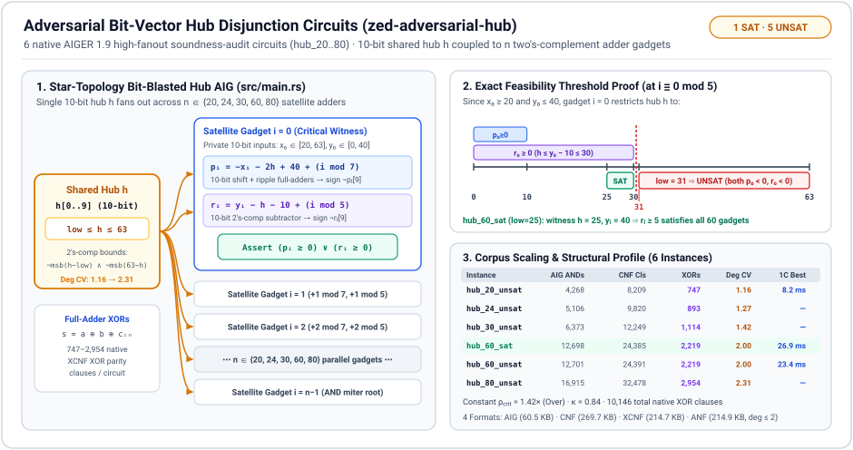

# Adversarial Bit-Vector Hub Arithmetic Disjunction Circuits (`zed-adversarial-hub`)

## Provenance & Credit

- **Author:** Luke Hutchison ([`lukehutch`](https://github.com/lukehutch))
- **License:** MIT License ([`../LICENSE`](../LICENSE))

## Overview & Origin

A 6-instance adversarial bit-level AIG soundness-audit suite (**1 SAT / 5 UNSAT**) originally constructed as native Binary AIGER 1.9 circuits (and exported to flat DIMACS CNF, native-XOR XCNF, and degree-$\le 2$ DIMACS-ANF):

- **Problem Structure:** A single 10-bit shared signed hub integer $h \in [\text{low}, 63]$ fans out to $n \in \{20, 24, 30, 60, 80\}$ pairs of private 10-bit integers $(x_i, y_i)$ with $x_i \in [20, 63]$ and $y_i \in [0, 40]$, enforcing via bit-blasted two's-complement adder/shift chains the disjunction:
  $$(-x_i - 2h + 40 + (i \bmod 7) \ge 0) \;\lor\; (y_i - h - 10 + (i \bmod 5) \ge 0)$$
- **Sharp SAT/UNSAT Threshold:** At any index $i \equiv 0 \pmod{5}$ (e.g., $i = 0$), the first branch requires $2h \le 40 - x_0 \le 20 \implies h \le 10$, while the second requires $h \le y_0 - 10 \le 30$. Setting `low = 31` makes all 5 `*_unsat` circuits unsatisfiable, whereas `low = 25` (`hub_60_sat`) is satisfiable (e.g., $h = 25, y_i = 40$).
- **Design Purpose:** Stress-tests solver soundness and preprocessing under extreme shared-hub fanout (variable-degree CV rising from `1.16` to `2.31`) coupled with dense full-adder XOR chains (`747` to `2,954` native XOR parity clauses per instance).
- **Origin:** **Original** (MIT [`../LICENSE`](../LICENSE)) — generated by the standalone zero-dependency Rust crate in `src/` (`cd src && cargo run --release`).
- **Sibling Collection:** [`zed-adversarial-php/`](../zed-adversarial-php/README.md) (12 scaled AIGER Pigeonhole Principle circuits from the same adversarial stress-audit crate).

*Figure: Star-topology bit-blasted AIG coupling a shared 10-bit hub $h \in [\text{low}, 63]$ to $n \in \{20..80\}$ two's-complement arithmetic disjunction gadgets, paired with the exact $h \le 30$ feasibility threshold proof (`low = 25` SAT vs. `low = 31` UNSAT) and 6-instance scaling profile. Regenerated via [`src/gen_diagram.py`](src/gen_diagram.py).*

## Corpus & Data Sizes (Four Formats)

- **`aig-orig/`** — 6 original native **Binary AIGER 1.9 `.aig.xz`** circuits (60.5 KB, verified with [Berkeley ABC](https://github.com/berkeley-abc/abc) `read_aiger`).
- **`cnf-converted/`** — 6 Tseitin **DIMACS `.cnf.xz`** conversions (269.7 KB).
- **`xcnf-converted/`** — 6 native-XOR **[CryptoMiniSat](https://github.com/msoos/cryptominisat) `.xcnf.xz`** conversions (214.7 KB, `10,146` extracted native XOR parity clauses).
- **`anf-converted/`** — 6 lossless linear-size **DIMACS-ANF `.anf.xz`** conversions (214.9 KB, degree $\le 2$, generated via [`../src/to_anf.py`](../src/to_anf.py)).
- **[`expected.tsv`](expected.tsv)** — Ground-truth verdict manifest for all 6 instances (**1 SAT / 5 UNSAT**).
- **`src/`** — Standalone zero-dependency Rust generator crate (`Cargo.toml`, `aig.rs`, `main.rs`) and diagram script (`gen_diagram.py`).

| Format | Directory | Files | Key Dimensions (Range) | Compressed Size |
|---|---|---:|---|---:|
| **Binary AIGER 1.9 (origin)** | `aig-orig/` | 6 | Inputs: 410–1,610; ANDs: 4,268–16,915 | 60.5 KB |
| **DIMACS CNF (Tseitin)** | `cnf-converted/` | 6 | Vars: 2,510–9,904; Clauses: 8,209–32,478 | 269.7 KB |
| **[CryptoMiniSat](https://github.com/msoos/cryptominisat) XCNF** | `xcnf-converted/` | 6 | Native XOR clauses total: 10,146 | 214.7 KB |
| **DIMACS-ANF** | `anf-converted/` | 6 | Vars: 3,268–12,942; Eqs: 2,960–11,734 (deg ≤ 2) | 214.9 KB |
| **Total (4 Formats, Status: 1 SAT / 5 UNSAT)** | | **24** | | **759.7 KB** |

## Problem Parameters & Per-Instance Sizes

| Instance | Params | Verdict | AIG ANDs | `.aig.xz` | CNF Vars | CNF Clauses | `.cnf.xz` | `.anf.xz` |
|---|---|:---:|---:|---:|---:|---:|---:|---:|
| `hub_20_unsat` | $n=20, \text{low}=31$ | UNSAT | 4,268 | 4.7 KB | 2,510 | 8,209 | 20.3 KB | 15.9 KB |
| `hub_24_unsat` | $n=24, \text{low}=31$ | UNSAT | 5,106 | 5.5 KB | 3,001 | 9,820 | 24.1 KB | 19.1 KB |
| `hub_30_unsat` | $n=30, \text{low}=31$ | UNSAT | 6,373 | 6.7 KB | 3,741 | 12,249 | 30.0 KB | 23.6 KB |
| `hub_60_sat` | $n=60, \text{low}=25$ | SAT | 12,698 | 13.2 KB | 7,438 | 24,385 | 58.5 KB | 46.8 KB |
| `hub_60_unsat` | $n=60, \text{low}=31$ | UNSAT | 12,701 | 13.2 KB | 7,440 | 24,391 | 58.8 KB | 46.9 KB |
| `hub_80_unsat` | $n=80, \text{low}=31$ | UNSAT | 16,915 | 17.3 KB | 9,904 | 32,478 | 78.1 KB | 62.5 KB |

## Benchmark Results (1-Core, Flat DIMACS `.cnf` Input)

Evaluated sequentially on an **AMD Ryzen 9 5950X** (16C/32T Linux, **1 core/thread per run**, default flags with `-t 1` for CryptoMiniSat 5.18.0 and `--max-cores 1` for Frobenius; exact median of 3 runs; $T_{\max} = 600\;\text{s}$ across the 3 promoted hub stress instances; **0 verdict disagreements**, cross-checked against [`expected.tsv`](expected.tsv)):

| Instance | Verdict | Frobenius 1C | [CaDiCaL](https://github.com/arminbiere/cadical) 3.1.0 | [CryptoMiniSat](https://github.com/msoos/cryptominisat) 5.18.0 (CNF) | [CryptoMiniSat](https://github.com/msoos/cryptominisat) 5.18.0 (XCNF) | [dense-solver](https://github.com/libdense/dense-solver) 0.0.4 | [Kissat](https://github.com/arminbiere/kissat) 4.0.4 |
|---|:---:|---:|---:|---:|---:|---:|---:|
| `hub_20_unsat` | UNSAT | 9.14 ms | 11.17 ms | 276.33 ms | 168.34 ms | **8.16 ms** | 41.27 ms |
| `hub_60_sat` | SAT | **26.87 ms** | 46.78 ms | 653.06 ms | 434.73 ms | 29.82 ms | 78.82 ms |
| `hub_60_unsat` | UNSAT | **23.41 ms** | 24.35 ms | 697.72 ms | 409.68 ms | 23.93 ms | 85.89 ms |
| **Total (3 promoted, PAR-2)** | **3/3** | **3/3 — 59.4 ms** *(fastest)* | 3/3 — 82.3 ms *(1.39x)* | 3/3 — 1,627.1 ms *(27.38x)* | 3/3 — 1,012.8 ms *(17.04x)* | 3/3 — 61.9 ms *(1.04x)* | 3/3 — 206.0 ms *(3.47x)* |

<!-- BEGIN_STRUCTURAL_ANALYSIS -->
## Phase-Transition & Structural Analysis

*Auto-generated by [`../src/analyze_benchmarks.py`](../src/analyze_benchmarks.py). Position relative to the critical phase transition is measured by $\rho_{\mathrm{crit}} = \frac{1}{n}\sum_k m_k / \alpha_c(k)$ (exact $\alpha/\alpha_c(k)$ for pure $k$-SAT; effective critical threshold $\alpha_c^{\mathrm{eff}} = \alpha/\rho_{\mathrm{crit}}$; `Under` $<0.90\times$, `Near-crit` $0.90\text{--}1.10\times$, `Over` $>1.10\times$), alongside Gent–Walsh annealed constrainedness $\kappa = -\frac{1}{n}\sum_i \log_2(1-2^{-k_i})$ (AAAI 1996), clause-length profile ($\bar{k}$, `%Bin`, `%Horn`), variable-degree CV ($\sigma_d/\bar{d}$, uniformity vs. hub skew), and extracted native XOR parity clauses.*

| Instance | Active $n$ | Clauses $m$ | $\alpha=m/n$ | $\alpha_c^{\mathrm{eff}}$ | $\rho_{\mathrm{crit}}$ (Regime) | $\kappa$ | $\bar{k}$ ($k_{\max}$) | Bin% | Horn% | Pos% | Deg CV | XORs |
|---|---:|---:|---:|---:|---:|---:|---:|---:|---:|---:|---:|---:|
| `hub_20_unsat` | 2,510 | 8,209 | 3.27 | 2.30 | **1.42x** (Over) | 0.84 | 2.76 (4) | 26% | 50% | 48% | 1.16 | 747 |
| `hub_24_unsat` | 3,001 | 9,820 | 3.27 | 2.30 | **1.42x** (Over) | 0.84 | 2.76 (4) | 26% | 50% | 48% | 1.27 | 893 |
| `hub_30_unsat` | 3,741 | 12,249 | 3.27 | 2.30 | **1.42x** (Over) | 0.84 | 2.76 (4) | 26% | 50% | 48% | 1.42 | 1,114 |
| `hub_60_sat` | 7,438 | 24,385 | 3.28 | 2.31 | **1.42x** (Over) | 0.84 | 2.76 (4) | 25% | 50% | 48% | 2.00 | 2,219 |
| `hub_60_unsat` | 7,440 | 24,391 | 3.28 | 2.30 | **1.42x** (Over) | 0.84 | 2.76 (4) | 26% | 50% | 48% | 2.00 | 2,219 |
| `hub_80_unsat` | 9,904 | 32,478 | 3.28 | 2.31 | **1.42x** (Over) | 0.84 | 2.76 (4) | 25% | 50% | 48% | 2.31 | 2,954 |

**Collection Phase-Transition Summary (6 instances, 4 formats: 6 CNF / 6 AIG / 6 XCNF / 6 ANF):** median $\rho_{\mathrm{crit}} = 1.42\times$ (range `1.42x–1.42x`), median $\kappa = 0.84$, regime split **0 Under / 0 Near-critical / 6 Over**, total extracted native XOR parity clauses = **10,146**, total ANF equations = **40,276**.
<!-- END_STRUCTURAL_ANALYSIS -->

## References

- A. Biere, K. Heljanko, and S. Wieringa, *"AIGER 1.9 and Beyond"*, FMV Technical Report 11/2, Johannes Kepler University Linz, 2011.
- G. S. Tseitin, *"On the Complexity of Derivation in Propositional Calculus"*, Studies in Constructive Mathematics and Mathematical Logic, Part II, pp. 115–125, 1968.
