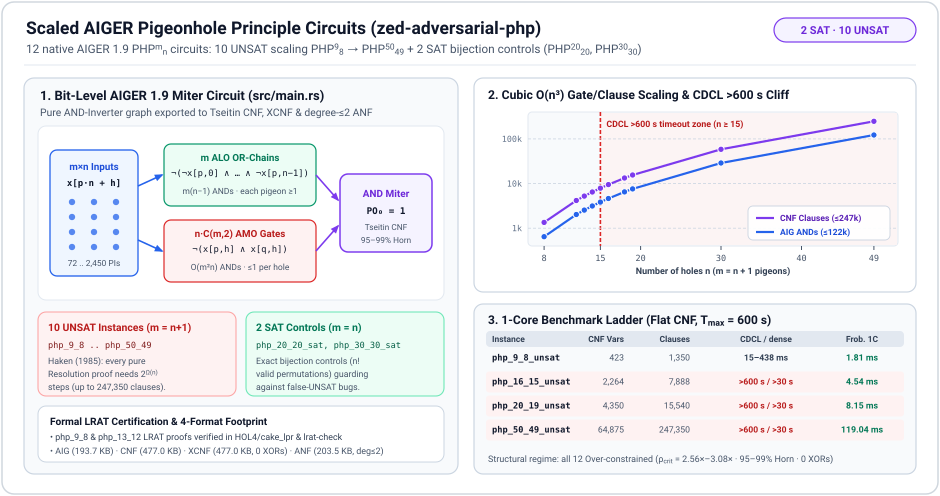

# Adversarial Scaled AIGER Pigeonhole Principle Circuits (`zed-adversarial-php`)

*Figure: Bit-level AIGER 1.9 miter architecture (`m` ALO OR-chains + $n\binom{m}{2}$ pairwise AMO exclusion gates) alongside cubic $O(n^3)$ AIG AND / Tseitin CNF clause scaling from $\mathrm{PHP}^9_8$ to $\mathrm{PHP}^{50}_{49}$ showing the uniform $T_{\max} = 5{,}000\;\text{s}$ baseline timeout wall at $\mathrm{PHP}^{20}_{19}$ (with Kissat and CryptoMiniSat already timing out past $5{,}000\;\text{s}$ at $\mathrm{PHP}^{16}_{15}$). Regenerated via [`src/gen_diagram.py`](src/gen_diagram.py).*

## Provenance & Credit

- **Author:** Luke Hutchison ([`lukehutch`](https://github.com/lukehutch))
- **License:** MIT License ([`../LICENSE`](../LICENSE))

## Problem Description

A 12-instance bit-level AIG Pigeonhole Principle scaling suite (**2 SAT / 10 UNSAT**) originally constructed as native Binary AIGER 1.9 circuits (and exported to flat DIMACS CNF, XCNF, and degree-$\le 2$ DIMACS-ANF):

- **Problem Structure:** Tseitin-encoded $\mathrm{PHP}^{m}_{n}$ circuits placing $m$ pigeons into $n$ holes via $m$ At-Least-One OR-chains and $n\binom{m}{2}$ pairwise At-Most-One NAND gates joined into a single global AND miter output $\mathrm{PO}_0$.
- **UNSAT Scaling Ladder (10 instances):** $\mathrm{PHP}^{9}_{8}$ (`647` AIG ANDs, `1,350` CNF clauses) through $\mathrm{PHP}^{50}_{49}$ (`122,499` AIG ANDs, `64,875` CNF vars, `247,350` clauses).
- **SAT Bijection Controls (2 instances):** `php_20_20_sat` ($\mathrm{PHP}^{20}_{20}$) and `php_30_30_sat` ($\mathrm{PHP}^{30}_{30}$), ensuring soundness against false-UNSAT shortcuts.
- **Why They Are Hard:** Haken (1985) proved every pure Resolution / CDCL refutation of $\mathrm{PHP}^{n+1}_{n}$ requires $2^{\Omega(n)}$ steps. [Kissat](https://github.com/arminbiere/kissat) 4.0.4 and [CryptoMiniSat](https://github.com/msoos/cryptominisat) 5.18.0 time out past $5{,}000\;\text{s}$ by $\mathrm{PHP}^{16}_{15}$, while [CaDiCaL](https://github.com/arminbiere/cadical) 3.1.0 (`109.45 s`) and [dense-solver](https://github.com/libdense/dense-solver) 0.0.4 (`499.66 s`) solve $\mathrm{PHP}^{16}_{15}$ before all five external baselines time out past $5{,}000\;\text{s}$ at $\mathrm{PHP}^{20}_{19}$ and $\mathrm{PHP}^{50}_{49}$.
- **Origin:** **Original** (MIT [`../LICENSE`](../LICENSE)) — generated by the standalone zero-dependency Rust crate in `src/` (`cd src && cargo run --release`).
- **Sibling & Related Collections:** [`zed-adversarial-hub/`](../zed-adversarial-hub/README.md) (6 high-fanout bit-vector hub disjunction circuits from the same adversarial crate), [`dense-solver-synthetic-php/`](../dense-solver-synthetic-php/README.md) (17 multi-encoding PHP CNFs), and [`satlib-dimacs-phole/`](../satlib-dimacs-phole/README.md) (classic DIMACS `hole6..10`).

## Corpus & Data Sizes

- **`aig-orig/`** — 12 original native **Binary AIGER 1.9 `.aig.xz`** circuits (193.7 KB, verified with [Berkeley ABC](https://github.com/berkeley-abc/abc) `read_aiger`).
- **`cnf-converted/`** — 12 Tseitin **DIMACS `.cnf.xz`** conversions (477.0 KB).
- **`xcnf-converted/`** — 12 lossless **[CryptoMiniSat](https://github.com/msoos/cryptominisat) `.xcnf.xz`** conversions (477.0 KB, `0` extracted native XOR parity clauses).
- **`anf-converted/`** — 12 lossless linear-size **DIMACS-ANF `.anf.xz`** conversions (203.5 KB, degree $\le 2$, generated via [`../src/to_anf.py`](../src/to_anf.py)).
- **[`expected.tsv`](expected.tsv)** — Ground-truth verdict manifest for all 12 instances (**2 SAT / 10 UNSAT**).
- **`src/`** — Standalone zero-dependency Rust generator crate (`Cargo.toml`, `aig.rs`, `main.rs`) and diagram script (`gen_diagram.py`).

| Format | Directory | Files | Key Dimensions (Range) | Compressed Size |
|---|---|---:|---|---:|
| **Binary AIGER 1.9 (origin)** | `aig-orig/` | 12 | Inputs: 72–2,450; ANDs: 647–122,499 | 193.7 KB |
| **DIMACS CNF (Tseitin)** | `cnf-converted/` | 12 | Vars: 423–64,875; Clauses: 1,350–247,350 | 477.0 KB |
| **[CryptoMiniSat](https://github.com/msoos/cryptominisat) XCNF** | `xcnf-converted/` | 12 | Native XOR clauses total: 0 | 477.0 KB |
| **DIMACS-ANF** | `anf-converted/` | 12 | Vars: 126–4,800; Eqs: 351–62,425 (deg ≤ 2) | 203.5 KB |
| **Total (4 Formats, Status: 2 SAT / 10 UNSAT)** | | **48** | | **1.32 MB** |

### Problem Parameters & Per-Instance Sizes

| Instance | Params | Verdict | AIG ANDs | `.aig.xz` | CNF Vars | CNF Clauses | `.cnf.xz` | `.anf.xz` |
|---|---|:---:|---:|---:|---:|---:|---:|---:|
| `php_9_8_unsat` | 9 pigeons, 8 holes | UNSAT | 647 | 1.1 KB | 423 | 1,350 | 2.3 KB | 1.2 KB |
| `php_13_12_unsat` | 13 pigeons, 12 holes | UNSAT | 2,027 | 2.8 KB | 1,235 | 4,186 | 6.5 KB | 3.0 KB |
| `php_14_13_unsat` | 14 pigeons, 13 holes | UNSAT | 2,547 | 3.2 KB | 1,533 | 5,250 | 7.9 KB | 3.6 KB |
| `php_15_14_unsat` | 15 pigeons, 14 holes | UNSAT | 3,149 | 3.8 KB | 1,875 | 6,480 | 9.7 KB | 4.3 KB |
| `php_16_15_unsat` | 16 pigeons, 15 holes | UNSAT | 3,839 | 4.6 KB | 2,264 | 7,888 | 10.8 KB | 4.7 KB |
| `php_17_16_unsat` | 17 pigeons, 16 holes | UNSAT | 4,623 | 5.1 KB | 2,703 | 9,486 | 12.8 KB | 5.8 KB |
| `php_19_18_unsat` | 19 pigeons, 18 holes | UNSAT | 6,497 | 6.9 KB | 3,743 | 13,300 | 17.2 KB | 7.7 KB |
| `php_20_19_unsat` | 20 pigeons, 19 holes | UNSAT | 7,599 | 8.3 KB | 4,350 | 15,540 | 19.0 KB | 8.8 KB |
| `php_31_30_unsat` | 31 pigeons, 30 holes | UNSAT | 28,829 | 26.6 KB | 15,779 | 58,528 | 63.3 KB | 23.7 KB |
| `php_50_49_unsat` | 50 pigeons, 49 holes | UNSAT | 122,499 | 99.3 KB | 64,875 | 247,350 | 249.0 KB | 110.7 KB |
| `php_20_20_sat` | 20 pigeons, 20 holes | SAT | 7,999 | 8.6 KB | 4,580 | 16,360 | 18.6 KB | 7.0 KB |
| `php_30_30_sat` | 30 pigeons, 30 holes | SAT | 26,999 | 23.4 KB | 14,820 | 54,840 | 59.7 KB | 22.9 KB |

## Benchmark Results

Evaluated sequentially on an **AMD Ryzen 9 5950X** (16C/32T Linux, **1 core/thread per run**, default flags with `-t 1` for CryptoMiniSat 5.18.0 and `--max-cores 1` for Frobenius; exact median of 3 runs for solves under $120\;\text{s}$; uniform SAT Competition Main Track timeout $T_{\max} = 5{,}000\;\text{s}$ across all 4 promoted rungs and all 6 solver configurations; **0 verdict disagreements**, cross-checked against [`expected.tsv`](expected.tsv)):

| Instance | Verdict | Frobenius 1C | [CaDiCaL](https://github.com/arminbiere/cadical) 3.1.0 | [CryptoMiniSat](https://github.com/msoos/cryptominisat) 5.18.0 (CNF) | [CryptoMiniSat](https://github.com/msoos/cryptominisat) 5.18.0 (XCNF) | [dense-solver](https://github.com/libdense/dense-solver) 0.0.4 | [Kissat](https://github.com/arminbiere/kissat) 4.0.4 |
|---|:---:|---:|---:|---:|---:|---:|---:|
| `php_9_8_unsat` | UNSAT | **2.09 ms** | 32.96 ms | 438.14 ms | 474.27 ms | 15.06 ms | 26.86 ms |
| `php_16_15_unsat` | UNSAT | **4.20 ms** | 109,447.65 ms | >5,000 s (T/O) | >5,000 s (T/O) | 499,657.63 ms | >5,000 s (T/O) |
| `php_20_19_unsat` | UNSAT | **7.75 ms** | >5,000 s (T/O) | >5,000 s (T/O) | >5,000 s (T/O) | >5,000 s (T/O) | >5,000 s (T/O) |
| `php_50_49_unsat` | UNSAT | **107.39 ms** | >5,000 s (T/O) | >5,000 s (T/O) | >5,000 s (T/O) | >5,000 s (T/O) | >5,000 s (T/O) |
| **Solved (4 promoted)** | — | **4 / 4** *(highest)* | 2 / 4 *(-2 worse)* | 1 / 4 *(-3 worse)* | 1 / 4 *(-3 worse)* | 2 / 4 *(-2 worse)* | 1 / 4 *(-3 worse)* |
| **Total PAR-2 ($T_{\max}=5{,}000\;\text{s}$)** | — | **121.43 ms** *(fastest)* | 20,109,480.61 ms *(165,606x slower)* | 30,000,438.14 ms *(247,059x slower)* | 30,000,474.27 ms *(247,060x slower)* | 20,499,672.69 ms *(168,819x slower)* | 30,000,026.86 ms *(247,056x slower)* |

*(Both `php_9_8_unsat` and `php_13_12_unsat` LRAT proofs emitted by Frobenius additionally pass formal verification in HOL4/CakeML [`cake_lpr`](https://github.com/tanyongkiam/cake_lpr) and [`lrat-check`](https://github.com/marijnheule/drat-trim).)*

### Supplementary Full-Corpus Coverage ($T_{\max} = 60\;\text{s}$)

Remaining 8 non-Gauntlet corpus instances evaluated on identical uncompressed flat `.cnf` (and `.xcnf` for CryptoMiniSat 5.18.0 XCNF) inputs, pinned to a single physical core (`1` thread per run, `--max-cores 1` for Frobenius, `-t 1` for CryptoMiniSat 5.18.0; exact median of 3 runs for sub-$15\;\text{s}$ solves; $T_{\max} = 60\;\text{s}$; **0 verdict disagreements**; all SAT models verified against 100% of raw CNF clauses):

| Instance | Verdict | Frobenius 1C | [CaDiCaL](https://github.com/arminbiere/cadical) 3.1.0 | [CryptoMiniSat](https://github.com/msoos/cryptominisat) 5.18.0 (CNF) | [CryptoMiniSat](https://github.com/msoos/cryptominisat) 5.18.0 (XCNF) | [dense-solver](https://github.com/libdense/dense-solver) 0.0.4 | [Kissat](https://github.com/arminbiere/kissat) 4.0.4 |
|---|:---:|---:|---:|---:|---:|---:|---:|
| `php_13_12_unsat` | UNSAT | **2.69 ms** | 1,342.94 ms | >60 s (T/O) | >60 s (T/O) | 4,591.39 ms | 11,594.33 ms |
| `php_14_13_unsat` | UNSAT | **3.06 ms** | 8,694.00 ms | >60 s (T/O) | >60 s (T/O) | 16,424.95 ms | >60 s (T/O) |
| `php_15_14_unsat` | UNSAT | **3.71 ms** | 34,035.10 ms | >60 s (T/O) | >60 s (T/O) | 57,980.28 ms | >60 s (T/O) |
| `php_17_16_unsat` | UNSAT | **4.98 ms** | >60 s (T/O) | >60 s (T/O) | >60 s (T/O) | >60 s (T/O) | >60 s (T/O) |
| `php_19_18_unsat` | UNSAT | **6.77 ms** | >60 s (T/O) | >60 s (T/O) | >60 s (T/O) | >60 s (T/O) | >60 s (T/O) |
| `php_31_30_unsat` | UNSAT | **26.00 ms** | >60 s (T/O) | >60 s (T/O) | >60 s (T/O) | >60 s (T/O) | >60 s (T/O) |
| `php_20_20_sat` | SAT | **3.98 ms** | 6.79 ms | 106.15 ms | 106.40 ms | 13.17 ms | 4.21 ms |
| `php_30_30_sat` | SAT | 11.70 ms | 14.72 ms | 430.51 ms | 434.89 ms | 110.94 ms | **8.70 ms** |
| **Solved (8 supplementary)** | — | **8 / 8** *(highest)* | 5 / 8 *(-3 worse)* | 2 / 8 *(-6 worse)* | 2 / 8 *(-6 worse)* | 5 / 8 *(-3 worse)* | 3 / 8 *(-5 worse)* |
| **Total PAR-2 ($T_{\max}=60\;\text{s}$)** | — | **62.89 ms** *(fastest)* | 404,093.55 ms *(6,425x slower)* | 720,536.66 ms *(11,457x slower)* | 720,541.29 ms *(11,457x slower)* | 439,120.73 ms *(6,982x slower)* | 611,607.24 ms *(9,725x slower)* |

<!-- BEGIN_STRUCTURAL_ANALYSIS -->
## Phase-Transition & Structural Analysis

*Auto-generated by [`../src/analyze_benchmarks.py`](../src/analyze_benchmarks.py). Position relative to the critical phase transition is measured by $\rho_{\mathrm{crit}} = \frac{1}{n}\sum_k m_k / \alpha_c(k)$ (exact $\alpha/\alpha_c(k)$ for pure $k$-SAT; effective critical threshold $\alpha_c^{\mathrm{eff}} = \alpha/\rho_{\mathrm{crit}}$; `Under` $<0.90\times$, `Near-crit` $0.90\text{--}1.10\times$, `Over` $>1.10\times$), alongside Gent–Walsh annealed constrainedness $\kappa = -\frac{1}{n}\sum_i \log_2(1-2^{-k_i})$ (AAAI 1996), clause-length profile ($\bar{k}$, `%Bin`, `%Horn`), variable-degree CV ($\sigma_d/\bar{d}$, uniformity vs. hub skew), and extracted native XOR parity clauses.*

| Instance | Active $n$ | Clauses $m$ | $\alpha=m/n$ | $\alpha_c^{\mathrm{eff}}$ | $\rho_{\mathrm{crit}}$ (Regime) | $\kappa$ | $\bar{k}$ ($k_{\max}$) | Bin% | Horn% | Pos% | Deg CV | XORs |
|---|---:|---:|---:|---:|---:|---:|---:|---:|---:|---:|---:|---:|
| `php_13_12_unsat` | 1,235 | 4,186 | 3.39 | 1.25 | **2.72x** (Over) | 1.66 | 2.03 (3) | 52% | 97% | 38% | 1.06 | 0 |
| `php_14_13_unsat` | 1,533 | 5,250 | 3.42 | 1.25 | **2.75x** (Over) | 1.68 | 2.03 (3) | 51% | 97% | 38% | 1.11 | 0 |
| `php_15_14_unsat` | 1,875 | 6,480 | 3.46 | 1.24 | **2.78x** (Over) | 1.70 | 2.03 (3) | 51% | 97% | 38% | 1.17 | 0 |
| `php_16_15_unsat` | 2,264 | 7,888 | 3.48 | 1.24 | **2.80x** (Over) | 1.72 | 2.03 (3) | 51% | 97% | 38% | 1.22 | 0 |
| `php_17_16_unsat` | 2,703 | 9,486 | 3.51 | 1.24 | **2.82x** (Over) | 1.73 | 2.03 (3) | 51% | 97% | 38% | 1.27 | 0 |
| `php_19_18_unsat` | 3,743 | 13,300 | 3.55 | 1.24 | **2.86x** (Over) | 1.76 | 2.02 (3) | 51% | 98% | 38% | 1.36 | 0 |
| `php_20_19_unsat` | 4,350 | 15,540 | 3.57 | 1.24 | **2.87x** (Over) | 1.77 | 2.02 (3) | 51% | 98% | 38% | 1.40 | 0 |
| `php_20_20_sat` | 4,580 | 16,360 | 3.57 | 1.24 | **2.87x** (Over) | 1.77 | 2.02 (3) | 51% | 98% | 38% | 1.40 | 0 |
| `php_30_30_sat` | 14,820 | 54,840 | 3.70 | 1.24 | **2.98x** (Over) | 1.84 | 2.02 (3) | 51% | 98% | 38% | 1.79 | 0 |
| `php_31_30_unsat` | 15,779 | 58,528 | 3.71 | 1.24 | **2.99x** (Over) | 1.85 | 2.01 (3) | 51% | 98% | 38% | 1.83 | 0 |
| `php_50_49_unsat` | 64,875 | 247,350 | 3.81 | 1.24 | **3.08x** (Over) | 1.91 | 2.01 (3) | 50% | 99% | 38% | 2.39 | 0 |
| `php_9_8_unsat` | 423 | 1,350 | 3.19 | 1.25 | **2.56x** (Over) | 1.55 | 2.04 (3) | 52% | 95% | 38% | 0.80 | 0 |

**Collection Phase-Transition Summary (12 instances, 4 formats: 12 CNF / 12 AIG / 12 XCNF / 12 ANF):** median $\rho_{\mathrm{crit}} = 2.84\times$ (range `2.56x–3.08x`), median $\kappa = 1.74$, regime split **0 Under / 0 Near-critical / 12 Over**, total extracted native XOR parity clauses = **0**, total ANF equations = **111,646**.
<!-- END_STRUCTURAL_ANALYSIS -->

## References

- A. Haken, *"The Intractability of Resolution"*, Theoretical Computer Science 39:297–308, 1985.
- S. A. Cook, *"A Short Proof of the Pigeon Hole Principle Using Extended Resolution"*, ACM SIGACT News 8(4):28–32, 1976.
- C. Sinz, *"Towards an Optimal CNF Encoding of Boolean Cardinality Constraints"*, CP 2005, LNCS 3709, pp. 827–831.
